# Ruby Cocoon

A beast-training RPG with a clean, modern stylized look, for **Godot 4.7**. You hatch your first beast from an egg, battle to make it stronger as it grows into its second and third forms, hatch every new beast from the eggs wild beasts leave behind, merge grown beasts into new ones built from both, and stop the Umbral Legion and their ghost beasts.

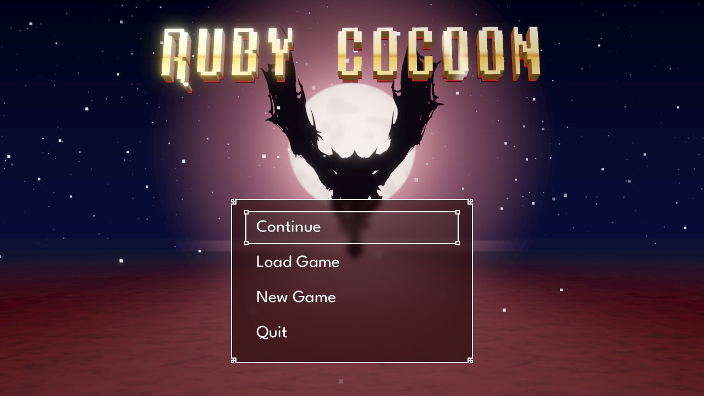<br><sub>Press A / Enter or tap during the dragon entrance to open the start menu immediately.</sub>

## Running it

To just play, download the newest Windows or Android build from the [Releases page](../../releases/latest) (see
[Windows and Android builds](#windows-and-android-builds)).

To run it from the source:

1. Install [Godot 4.7](https://godotengine.org/download) (the standard build; the game has no C#).
2. Clone this repository, or download it as a zip and unpack it.
3. In Godot's Project Manager, choose **Import**, pick the `project.godot` in the repository's folder, then press
   **F5** to play. The first time, Godot imports all the assets before the game opens, which takes a while.

Or from a terminal, in the repository's folder:

```
godot --path .
```

Here and in the rest of this README, `godot` stands for your Godot 4.7 executable, for example
`Godot_v4.7-stable_win64.exe` on Windows or `Godot_v4.7-stable_linux.x86_64` on Linux, with its folder in front if
it isn't on your PATH.

## System requirements

These are **provisional requirements for playing Ruby Cocoon**, not for developing it in the editor. OS and
graphics support follow [Godot 4.7's exported-project requirements](https://docs.godotengine.org/en/4.7/about/system_requirements.html#exported-godot-project)
and the current export settings. Hardware and free-space figures are estimates pending testing on lower-end PCs,
Macs and Android devices; they are not a guarantee of 60 fps. Existing [performance measurements](docs/performance.md)
come from a desktop Windows PC.

### Windows

| Component | Minimum (estimated) | Recommended (estimated) |
|---|---|---|
| OS | Windows 10, 64-bit | Windows 11, 64-bit |
| Processor | Intel Core i3-6100 / AMD Ryzen 3 1200 or equivalent; x86-64 with SSE4.2 | Intel Core i5-8400 / AMD Ryzen 5 2600 or better |
| Memory | 4 GB RAM | 8 GB RAM |
| Graphics | Intel HD Graphics 620 or equivalent, with full Vulkan 1.0 support and current drivers | NVIDIA GeForce GTX 1050 / AMD Radeon RX 560 or better, with 2 GB VRAM |
| Free storage | 1 GB | 2 GB on an SSD, including room for updates |
| Starting settings | 720p, Graphics **Min**; try 540p if needed | 1080p, Graphics **Mid** |

The downloadable Windows build is **x86-64 only**. Desktop play uses the Forward+ renderer by default.

### macOS

| Component | Minimum (estimated) | Recommended (estimated) |
|---|---|---|
| OS | macOS 13 Ventura | macOS 13 or newer |
| Processor | Apple M1, or a quad-core Intel Core i5 with compatible graphics | Apple M2 or newer |
| Memory | 8 GB RAM / unified memory | 16 GB unified memory |
| Graphics | Apple M1 integrated GPU, or an Intel Mac GPU with Metal 3 support | Apple M2 integrated GPU or better |
| Free storage | 1 GB | 2 GB on an SSD, including room for updates |
| Starting settings | 720p, Graphics **Min** | 1080p, Graphics **Mid** |

There is currently **no packaged macOS release or macOS export preset**. These estimates apply to running from
source with Godot 4.7 (see [Running it](#running-it)); macOS compatibility and performance still need verification.

### Android

| Component | Minimum (estimated) | Recommended (estimated) |
|---|---|---|
| OS | Android 9.0 | Android 11 or newer |
| Processor | Snapdragon 660 or equivalent, with a 64-bit ARM CPU and OS | Snapdragon 865 or better, or an equivalent chipset |
| Memory | 4 GB RAM | 6 GB RAM or more |
| Graphics | Adreno 512 or equivalent, with full Vulkan 1.0 support | Adreno 650 or better, with working Vulkan drivers |
| Free storage | 1 GB | 2 GB, including room for installation and updates |
| Starting settings | 540p, Graphics **Min** | 720p, Graphics **Mid**; try 1080p on faster devices |

The APK is **ARM64 (`arm64-v8a`) only**; 32-bit Android and x86 Android devices are not included. It uses the
Mobile renderer and landscape touch controls. Android version alone does not establish Vulkan compatibility.

Change **Resolution** and **Graphics** in **Start → Settings**. The game's defaults are 540p / Max, so lower-end
devices should start with the settings above. Storage estimates cover the installed game and working space,
not the source checkout, Godot editor or asset-import cache. Browser play has separate requirements under
[Web version](#web-version-iphone-and-any-browser).

## Controls

| Action | Keyboard | Gamepad | Touch (phones and tablets) |
|---|---|---|---|
| Move (whole steps between tile centres) | Arrow keys, four ways (with two held, you keep going the way you were walking, else the newest one counts) | D-pad: four ways; left stick: eight ways, including diagonals | D-pad, bottom left (one arrow at a time) |
| Action: talk, confirm, use a beast or weapon on an obstacle | A (or Enter) | A | A, bottom right |
| Back; hold to run | S (or Esc) | B | B, bottom right |
| Start: the travel book menu | Space | Start | START, bottom centre |
| Pause | Shift | Back / Select | PAUSE, bottom centre |
| Flute notes (Esc / Pause stops a song) | ← → A S, then ↑ ↓ | ← → A B, then ↑ ↓ | ← → A B, then ↑ ↓ |
| Walk somewhere / run there / use something | Click / double-click / click it | | Tap / double-tap / tap it |

The Start book keeps the selected input's guide on Settings' right page: keyboard key mappings, screen-button
meanings, or a matching controller illustration and fixed mappings. Only Controller input shows controller artwork.
The book has no bottom key strip. Phones and tablets show their on-screen buttons when Screen input is selected.
Desktop browsers use a keyboard or controller guide instead of the touch pad, even on touchscreen computers. The guide
uses bundled Noto Sans Symbols for arrow-key glyphs in desktop and Web builds. It also appears on the web title menu,
character creator and Load Game screen. Web builds have no Quit application
button; **Quit to title** in Settings still returns to the title menu.

USB and Bluetooth gamepads use Godot's automatic controller mappings, without a mapping screen. Connect or pair the
controller with your device, then play. The last controller used supplies the left stick. The full-width Start book
keeps two equal pages. Settings shows the matching **Controllercons duotone** illustration and fixed button guide
on the right page, without a bottom controller window. The controller is centred between labels above and below it,
with leader lines ending on the mapped buttons (both d-pad and left stick for Move). Flute controls are omitted
from this Settings guide for every input type. The title screen shows no controller illustration.
Layouts include Xbox, PlayStation, Switch/Joy-Cons,
Wii Classic/U Pro and Stadia layouts, with Xbox as the fallback for unidentified pads. Confirm is the bottom face button
(Xbox A, PlayStation Cross, Nintendo B); Back/run is the right face button (B, Circle, Nintendo A).
The stick has a radial deadzone; diagonal steps retain normal ground speed and cannot cut corners, cross stair rails,
or approach ramps and doors diagonally. Keyboard, physical d-pad, touch d-pad and tap paths keep cardinal steps.

**Start → Settings → Input** selects **Screen**, **Keyboard** or **Controller**, showing only available inputs.
Screen requires touch or mouse-emulated taps (desktop web uses guides); Keyboard requires a hardware keyboard on mobile;
Controller requires a connected pad. Your choice persists and sets the displayed controls/guide; connected inputs
remain usable. Controls are fixed; there is no remapping screen. With no explicit choice, connecting a controller hides Android/mobile touch buttons.
An explicit Screen choice restores the pad. Disconnecting falls back to an available input and restores
the phone pad when appropriate. Settings retain the selected row and scroll position while cycling or tapping values.

Tap (or click) anywhere in the world to walk there; double-tap to run. Tap a person, a door, a sign, an item, a weapon obstacle or a
wild beast to walk up to it and use it; if you're already next to it, you use it straight away.

## The journey

New Game opens with an 80-second cinematic: Magnus Gearhart's kidnapping scheme revealed in **Gearhart Tower**, then the
first morning of spring on the **Coastal Path** and at home in **Cocoon Cove**, as beasts leave hibernation and
trainer season begins. Everything is told by people talking: there is no narration and no title card. Lines advance
automatically, in the game's white speech bubbles over whoever is speaking (a voice from off screen, like Mom calling
up the stairs, gets the stationary bottom-centre bubble). **A / Enter** (or a tap on the dialogue) reveals the typing,
then advances a beat, and so does a tap of **B**. **Holding B** (or Esc, or Start) for a second skips the whole film.
The top-centre HUD names those controls over the scene's place for the first four seconds of each scene
(`Enter: Next  ·  Hold Esc: Skip`, or `A: Next  ·  Hold B: Skip` on a pad or phone), then slides away; hold B and it
comes back to say keep holding, a thin bar filling under it. On a phone only the pad's A and B show during the film,
looking as they always do: nothing can move, so the d-pad, Start and Pause step aside (`controls_overlay.gd`
`set_film_mode`). Keyboard, controller and touch all work. Continue and Load Game go straight to your saved game.
The reveal is played straight (`scripts/story/opening.gd`): Gearhart gives his staff a cheerful briefing about new
robots and "freight" for a friend in Gravenmoor, sends them home, then walks alone to a steel door in his office wall.
As he steps through, the music stops dead and a dread hit sounds (`tools/make_sfx.py`): behind it is a freight
warehouse under soft white hanging lamps, rusted iron cages down its aisle full of trainers (Lio, Bea and Orin among
them, as the hero later finds them), and at its far end their beasts in smaller cages on pallets. Gearhart's office
by night is built from the game's own pieces: wood floor and a red rug, brick and dark panelling under timber beams,
hanging lamps, three brass gears turning on the west wall, his new robots on lit plinths before the moonlit windows
onto the neon city, the company sign over his desk, a drafting table, crates and the freight lift. The warehouse is a
concrete shed with a steel truss roof, a band of factory windows high in each long wall and a roller door (modelled
on a low-poly warehouse supplied as a reference), filled with the game's own crates, barrels, racks, boxes and
pallets beside shipping containers; its cages are the **Rustbound Iron Cage** model (`tools/import_iron_cage.gd`,
`assets/props/iron_cage.res`). The spring scenes use the real places as sets (`main.gd` `build_set`): an open lawn and
broad trail shoulder inside the Coastal Path's western bend at dawn, where the wild beasts live (there are none in
towns), a Grubbit trundling out of the tall grass while Scout Bram and Camper Tilly talk with room around them.
The spring cameras face inland toward the woods, keeping the route entrance and map boundaries out of view;
then the hero's own bedroom, the sun
slanting through its windows, Mom calling up the stairs. The cage reveal fades straight to the bright spring morning,
and the hero closes with an unwitting joke about anyone spoiling it as the camera settles into the view the game
opens on.
The mounted Gearheart Industries sign uses an original vector gear-and-split-heart logo inspired by the supplied reference.

The hero knows nothing about the scheme. You start in your own bedroom, upstairs at home in **Cocoon Cove**, with no
beasts, no flute and no songs. Mom calls you down, and gives the egg and flute objective in the living room, even if
the film was skipped (flags `woke_up`, `intro_done`). The first missing-trainer news is in **Dustwell Oasis**:
nobody explains it on arrival; missing posters on the porch posts and notice boards, and Kip, Junie and Tamsin, friends
of Lio, Bea and Orin searching the town, tell it (`story.gd` SEARCHERS, POSTERS). In the jail, dopey **Deputy Rusk**
asks you to catch Slim, the prisoner who walked out of his open cell; Slim, hiding behind the wagon on the dune shelf,
was framed with a trainer's flute in his saddlebag, and Barkeep Dusty's **Card Ledger** (a key item) proves he spent
that night at the saloon's card table. Shown the ledger, the deputy clears Slim and asks you to help find the missing
trainers and the real culprit, pointing you to Captain Dalton of the gate watch in Sunwall (flags `convict_asked`, `convict_found`,
`slim_cleared`, `deputy_partner`).
**Cocoon Cove** lies low in a cove ringed by tall cliffs, on the north, the west and the east above the road out. Your
home stands in a western garden on a gentle terrace one step above the town, with two small scenery homes at the back of
it; a garden path runs along the terrace and short three-tile ramps lead down. The one by home comes out beside
**Cocoon Cove Library**, a two-storey house at the compact square's western entrance. Speak to
**Librarian Quill** for a free **World Map**, then open it from **Start → Map**.
Existing saves keep their map access and all seven buildings keep their saved interior identities. The town is a
modern pirate cove: textured brown timber, varied pastel stucco, orange clay roofs, planted gardens, and seaside cliffs. Crates and barrel staves use the same brown wood finish, with metal barrel hoops. The temple Beast
Center faces the square and the apothecary stands on land to the east. The only dock entrance is down the right-hand
stairs. A short pier holds a wooden neighbor's shack (a lived-in fisher's cabin inside, room `cove_dock_shack`) and ends
at the **Old Gear Shack**; the plaster neighbor's home stands in a garden on land. Every house has a path to its door.
Crates and barrels sit on spare edge tiles, leaving the walking lanes and doors clear; the strips behind the buildings,
where the camera can't see anyone, are thickets of shrubs rather than lawn.
The gear shack (`s` on the map, room `shack`) has no second shore entrance, ships or boats. Nobody lives there, but
a trainer left their starter gear behind: a **Worn Cap**, **Old Sneakers** and a **Rope Collar** for a beast. They
are never sold (`item_db.gd` `found`), and you put them on from the Bag. The cap and sneakers are only found there;
the Rope Collar can also be found in Bellerive's harbour equipment shack.
In Cogsworth, defeat Gearhart, then use the **Freight Lock Control** on his tower's top floor to release Lio, Bea and
Orin. The rescued trainers reunite in town, and their testimony points to Vexmora in Gravenmoor. Freeing them is
required before confronting Vexmora.

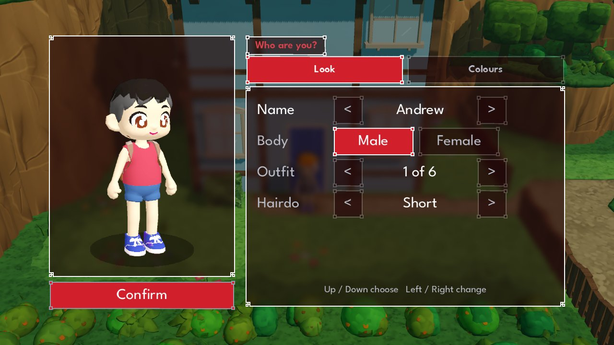<br><sub>The character creator's Look tab: name, body, outfit and hairdo; the Colours tab has the pack, skin, clothes, hair and eyes.</sub>

1. Mom tells you that your father's flute is waiting with **Uncle Rafe** in Bellerive, the next town east.
2. Elder Rowan lets you choose one of four elemental eggs.

   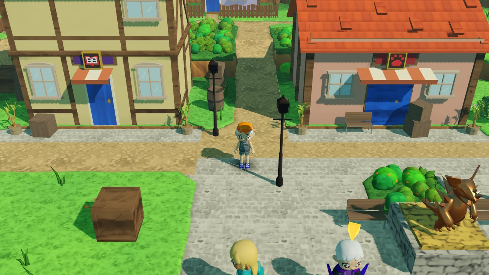<br><sub>Cocoon Cove, the seaside hamlet where you start.</sub>

3. The Beast Center hatches it into a **level 1** beast.
4. Scout Bram stands in the road to the Coastal Path until you have a beast of your own; talk to him once it has hatched and he steps aside.
5. The **Coastal Path** is the tutorial: a winding trail through the woods with five teachers on it (`world_db.gd`
   LESSON_TRAINERS, battle.gd LESSONS). Each looks straight across the trail where you can't slip past, so you always
   walk into their line of sight and they come over and stop you; you never need to talk to them first. Youngster Kit
   watches the trail where it reaches the creek. Each gives a guided battle, and so do the arena's coaches and
   the flute lesson (`battle.gd` LESSONS): every floating choice and every menu has just the one thing to pick, the one being
   taught (◄ ► stay put, and the teacher says what to do), the target and the beast to heal are chosen for you, and
   you can't lose: your beasts are healed first and always keep at least 1 HP, and nobody can run, forfeit or hit
   you. Your beast grows a level or so. Camper Tilly: the battle screen and
   fighting. Fisher Dale: turns, speed and Defend. Youngster Kit, on the trail by the creek: your own turn (slingshot, Watch, Run and Forfeit).
   Picnicker Mae: items (she gives you three Minor Potions). Ranger Holt: the ring, its middle beast, shields and
   striking an open trainer. Until you have a flute there are no wild beasts on the path, only its teachers.

   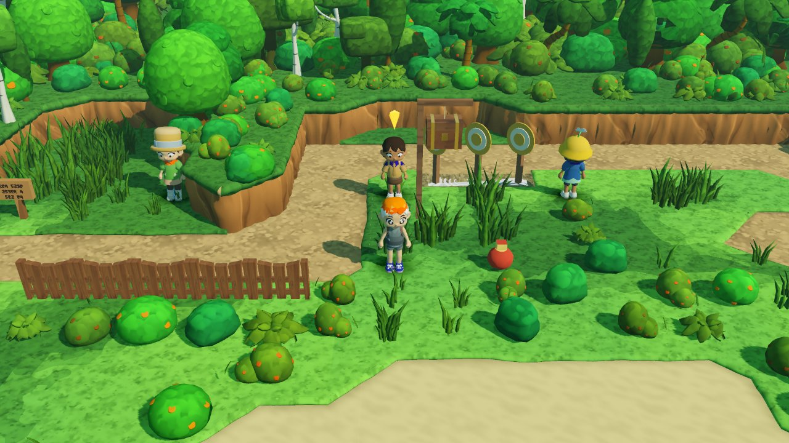<br><sub>The Coastal Path, the tutorial: a winding trail with teachers waiting on it.</sub>

6. Mend the washed-out footbridge on the Coastal Path to reach Bellerive (the sign only says there's a footbridge ahead
   and a builder's cabin by the creek). Old Hal the builder, in the cabin just west of it, is too tired to rebuild it
   himself: once you've talked to him you can take the logs stacked by his door and lay them across the creek. Go back
   in and he gives you a beast egg (a Tadlet) to hatch at Bellerive's Beast Center. Mended, it's a plank footbridge
   with railings.
   A small, continuous beach below the western trail has a low grassy approach and Shellhaven's smooth sand and
   shallow-water profile, without enclosing cliff walls, sunbathers, parasols or other resort dressing.
   It ends west of the creek; the river remains impassable until Hal's footbridge is repaired.
7. Talk to **Neighbor Nell**, Rafe's old friend beside Bellerive's west entrance, for directions to his house: the one with the **golden flute sign** above the door. Uncle Rafe gives you the flute and teaches **Weaken**, briefly: a couple of lines on how the sheet works, then he plays the song once and it's your turn to play it back. He also tells you that no song can make a wild beast yours: new beasts only come from eggs. His lesson (and the guided battle after it) gives you 30 seconds per song.
8. The first lone wild beast you meet after that is a guided battle too: Rafe's advice walks you through playing Weaken on it, then beating it. It always leaves an egg, shown in the egg film.
9. Arenas only take trainers with a flute. Each is one big room, like a Beast Center (the camera follows you round it):
   the host at the lobby desk runs the arena ladder and nothing else; the master waits in the hall on the other side of
   a wall that stops short of the front, and you challenge them there, in person.
10. Bellerive's arena teaches you to battle properly before you may face its master (`world_db.gd` ARENA_LESSONS,
    battle.gd LESSONS "team" and "elements"). Both coaches stand just inside the door; only Rory approaches you.
    **Coach Rory** stops you first and shows you fighting with a whole side of your ring (the arena's practice beasts
    fill your empty slots for the lesson). Then speak to **Coach Ondine** when you're ready for elemental
    weaknesses: her beast is weak to the element of the side facing it (with your earth
    side facing, you borrow the arena's air practice team, since nothing is weak to earth). Only then can you challenge
    **Tide Captain Marina**, and Captain Gull's ferry to the Isle of Tides only takes trainers with her Wave Crest.
11. The journey runs in one line: the Dune Road north of Bellerive stays shut by sandstorms until you've beaten the guardian of the Temple of Tides on the Isle of Tides.
12. When you leave the Temple of Tides with **Abyssion**, **Coach Ondine** appears outside and gives a protected
    practice battle: choose **Summon**, play the Song of Tides and see the water dragon strike the opposing team.
    A failed song can be tried again without spending a shield. The coach leaves after the lesson and stays gone.
13. In **Dustwell Oasis**, **Dancer Jasper** sits in the centre of the single, two-tile-wide north road, blocking
    both tiles until you return his shoes. **Instructor Lucille** has them at the **Dustwell Dance Studio**, under
    the DANCE sign at the west end of Main Street (the existing `dustwell#1` building identity). Below **trainer
    level 4**, she calls you too weak to dance and explains how to raise your trainer level. At level 4 or above,
    pass her safe rhythm practice and guided weapon battle to unlock rhythm attacks and receive Jasper's shoes.
    Return them to open the Mesa Trail toward Sunwall. Talking to Lucille first works too.

New battle mechanics are explained when used, rather than all at the start. With more than three beasts in your
party, the next ordinary battle requires you to turn the ring once before confirming beast moves. Later options
give brief first-use lessons for Move, recharging moves, ally and group targets, status, stat changes, recoil/drain,
protective moves and the new weapons. The existing move descriptions supply each move's precise effect. Lesson
completion is saved through normal phone calls. See [tutorial coverage](docs/tutorials.md).

Townsfolk and residents add a casual hint about what to do next to whatever else they say (`chatter_db.gd` HINTS, by
`Story.next_goal()`), so what they talk about moves on as soon as you've done it.
Let the place and its people tell the story: avoid descriptive arrival popups. Gravenmoor's fog and glowing street
lamps set its mood; locals react to the weather and the Legion, Old Mort explains that beaten ghosts leave Shadow Eggs, and Nurse Clover
explains Shadow Eggs and ghost merging. Arriving still unlocks ghost eggs and merging, without interrupting movement.

| Region | Towns | What happens |
|---|---|---|
| Coast | Cocoon Cove, Bellerive | Bellerive, a French Quarter harbour town, has the first arena (its coaches' lessons, then Tide Captain Marina, whose Wave Crest the ferry asks for), **Sparkwire Electronics** (shield points and beast slots), a Sky Tower and the ferry. |
| Isle of Tides | Shellhaven (resort), Kelpwick (village) | Shellhaven's tourists keep carrying pieces of the **Temple of Tides** home as souvenirs, so Kelpwick's villagers stand across the way to the reef. The resort thinks the village quaint but backwards; the village thinks the resort is exploiting the island. They step aside only for a trainer who proves they're no tourist: beat Reef Warden Nerissa in Kelpwick's great hut. |
| Desert | Dustwell Oasis (old western main street), Sunwall (old walled adobe town) | The Jackals raid every caravan at Sunwall's gates. Talk to Captain Dalton of the gate watch, then beat Bart the Jackal in the hideout to open the Dune Sea road. The **Temple of Winds** lies in the Dune Sea. |
| Mountains | Copperpick, Cogsworth (steampunk city) | CEO Magnus Gearhart is holding Cogsworth hostage and has sealed the road to the volcano. Fight up Gearhart Tower: each floor's robot sentries must fall before the stairs unlock. |
| Volcano | Emberfall | The **Temple of Flame** sits on the Caldera Road. |
| Jungle | Vinehollow | The village sells the finest gear in the land. The shaman needs the Sun, Moon and Earth relics; the ritual raises the hidden **Temple of Roots**. |
| River and moor | Riverbend, Gravenmoor | Gravenmoor is the Legion's town. Ghost beasts can be hatched and merged from here on. The gravedigger teaches the Requiem of Dusk. Commander Nyx guards the cathedral, and General Vexmora waits in the crypt beneath it. |

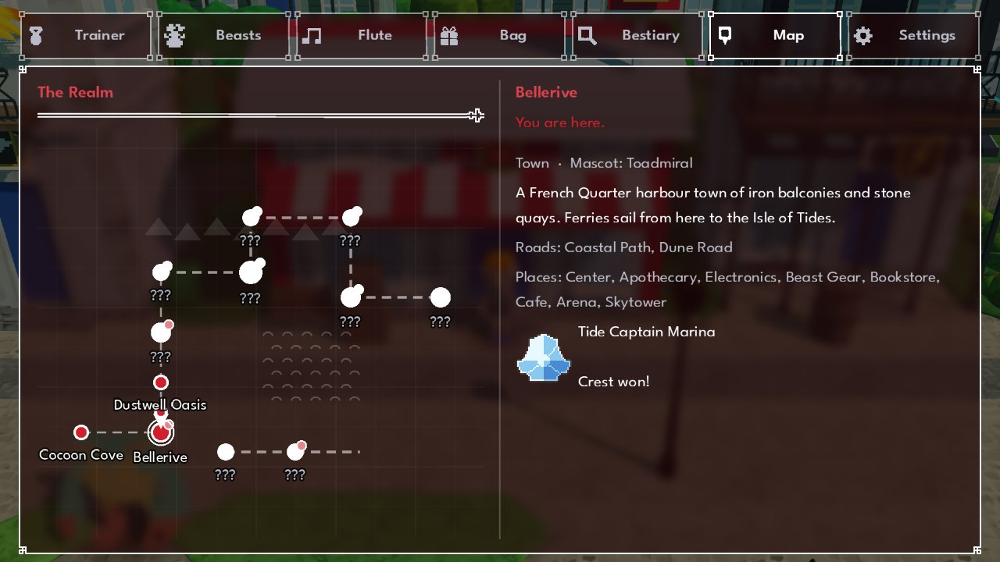<br><sub>The world map on aged paper in the Start book: town markers, question marks for unexplored towns, and a flag where you are. Town names appear on the facing page.</sub>

Every road between towns narrows to one bottleneck with a puzzle, getting harder as you go:

| Road | Puzzle |
|---|---|
| Coastal Path | A washed-out footbridge. Old Hal the builder, in the cabin beside it, lends you the logs stacked by his door; lay them across the creek, then he gives you an egg. |
| Isle Trail | Thorny brambles. A fire beast burns them; an air beast slices them down. |
| Dune Road | A sheer cliff with a rope ladder coiled at the top. A beast with wings flies up and drops it. |
| Mesa Trail | A rockslide: push the boulders around until a path opens. |
| Dune Sea | The Jackals' barricade. Beat the bandit gang in their hideout. |
| Mine Road | The mine checkpoint. Foreman Gorran signs a Miner's Pass when you beat him at the Copperpick Arena. |
| Caldera Road | Gearhart's steam gate, then a stream of lava that a water beast cools. |
| Summit Pass | A frozen pond of ice blocks that slide until they hit something. |
| Jungle Trail | The Jungle Warden blocks the crossing until you beat him. |
| Moor Road | A fog bank that an air beast blows away, then a Legion sentinel to defeat. |

Leave a push puzzle and come back to reset it; once solved, the blocks stay where you left them. Smaller elemental
obstacles (driftwood, sand drifts, boulders, dust storms, ravines) still turn up off the main road.

## Systems

- **Weapon field obstacles**: face a target or barrier and press A, or tap it to walk to its firing spot.
  An owned weapon is used automatically with one short animation; there is no aiming game or confirmation menu.
  Slingshot bullseyes and bells release ladders, gates or treasure. A boomerang strikes an entire line of switches
  in one throw and returns; the bat breaks cracked rocks and split stumps. Without the weapon, the description
  names the required weapon. A ranger beside each unsolved fixture explains its mechanism, the controls, whether
  you own the right weapon and where to get a missing one. They greet you at the firing spot, can also be spoken to
  directly, and leave once you solve it; solved guides are not loaded again. These fixtures are optional road
  detours, never required story gates.
  Weapon fixtures begin after the Coastal Path; the first road focuses on its battle teachers and footbridge.
  Solves and collected chests have separate permanent flags, retained by ordinary phone saves.

- **Fishing** (`scripts/world/fishing.gd`, `scripts/ui/fishing_game.gd`). Fisher Gil fishes off the deck of his rusty
  tin shack on Bellerive's docks. Talk to him and he offers his spare pole, leaning in the shack (take it before asking
  and you're told stealing is bad). Come back out with it and he stops you for a first cast: something always bites,
  the line is gentler, and he has you try again until you land it. After that, face any water and press A to cast.
  Where the water ripples (each map's `fish_spots`, plus a few picked along its shores) something nearly always bites,
  and quickly; anywhere else only now and then. When the float dips, tap A to strike, then reel: each tap pulls the
  line tighter and it slackens on its own; tap it up into the bright zone and keep it there with steady taps until the
  catch meter fills. Too fast and the line snaps, too slow and the beast slips off. Land it and it leaps out for a
  wild battle on a plank dock with the beast out on the water (`battle.gd` _fishing_scenery). Bait (put on your hook
  from the bag, worn until something bites) brings stronger, rarer water beasts, sooner: Wriggly Worms on the islands
  (Shellhaven, Kelpwick), a Spinner Lure from Copperpick, Cogsworth and Emberfall, a Glow Lure from Riverbend and
  Gravenmoor. Captain Gull's ferry is moored by the long pier, and Gil's rowboat by his shack (map `boats`).

  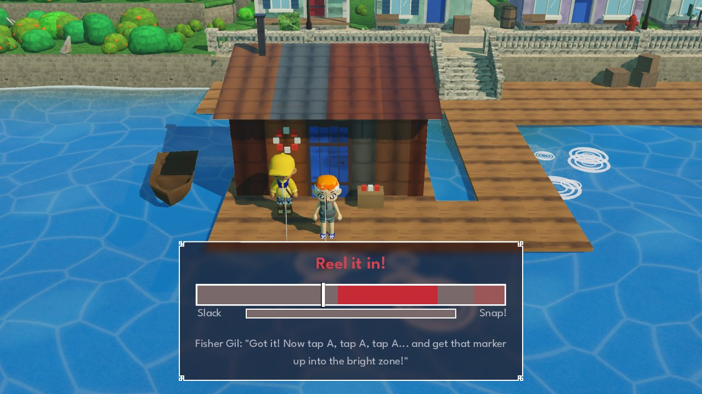<br><sub>Reeling one in with Gil, off his shack's deck in Bellerive.</sub>

- **13 beast lines** of three forms each (`race_db.gd` LINES): Fire has the spiky dino (Embit, Cinderex, Pyrosaur),
  the cactus (Pricklet, Spinesear, Saguaroar) and the pink imp (Impkin, Scampyre, Infernook); Earth the beetle
  (Grubbit, Shellhorn, Rhinoclad), the armoured boar (Tuskit, Bristlehog, Crystusk) and the tree (Saplet, Barkbrute,
  Elderoot); Water the crab (Clawlet, Snapshell, Crustacor) and the frog (Tadlet, Croakus, Toadmiral); Air the owl
  (Hootlet, Gustowl, Tempestrix), the bat (Flittle, Duskwing, Nocturna) and the berries (Berrypuff, Bramblume,
  Galeberry). Two lines are of two elements: the scorpion (Nipskit, Scorchpin, Calderak) is Fire and Earth, and the
  worm that is an eel in the sea (Wrigglet, Mudwhip, Abyssel) Earth and Water. The weaknesses are: Fire to Air, Earth
  to Water, Water to Air, and Air to Fire.

  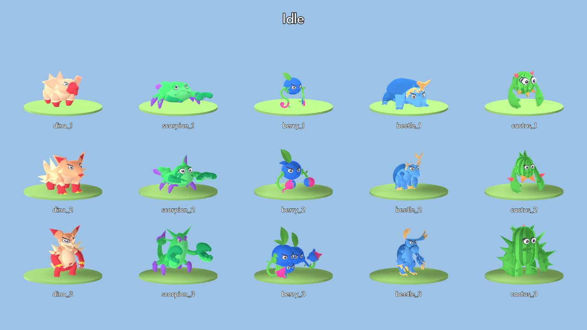<br><sub>Five of the lines, each in its three forms.</sub>

- **Growing up**: a beast hatches as its line's first form and grows into the second at **Lv 20** and the third at
  **Lv 40** (`RaceDB.EVOLVE`, `Beast.evolve`): bigger, stronger, with the new form's name (unless it has a name of its
  own). It keeps its moves, and a line learns the same moves at every form. Wild and trainers' beasts are whatever form
  their level gives. Battle XP is applied after the fighting ends. Each beast gets a short level-up celebration
  and a longer before-and-after evolution reveal, one beast at a time. The level film shows the beast on the left of
  the screen and one window on the right: its name and element, its level going up, then
  HP, MP, Attack, Defense, Spirit and Speed one line at a time with the actual previous value, new value and gain, and
  any move it learned at that level with the move's icon (`--scene=growth --preview=level --to=N` previews it). Every level-up and evolution fully restores HP and MP.
- **Move slots** (`Beast.slot_size`, `Beast.learn`): a beast holds two plain (neutral) moves, so it can always fight off
  its element, and a number of elemental moves: **2** as a hatchling, **one more each time it grows into its next form**
  (3 at Lv 20, 4 at Lv 40), and on a **merge** the better parent's count **plus two** (a fully grown pair gives 6). A beast
  of two elements splits its elemental slots evenly between them (the odd one to its main element); a move of another
  element (a ghost's, or a merge's lineage) uses its main element's slots. When it learns a move (levelling up, a tutor,
  a mascot) and that kind of slot is full, you choose there and then which move to forget for good, or to let the new
  one go (`Menus.decide_learn`); there is no list of remembered moves to swap from later. A merge keeps its parents'
  moves that fit its slots, mostly from the dominant parent. Older saves keep each beast's newest moves that fit.
- **Element roles**: Fire are offensive tanks, Water are healers, Earth are defenders, and Air handle status and evasion.
- **Eggs**:
  - Eggs are the only way to get more beasts (apart from adopting one at a kennel): no song charms a wild beast.
  - A defeated wild beast has a **20%** chance to leave an egg at the end of the battle (`GameState.egg_chance`). Some trainer gear adds a little: the Worn Cap +1%, Explorer Hat +3%, Lure Charm +2%, and the Silver, Golden and Jade Flutes +2%, +4% and +6%.
  - Each egg found plays a short film after the battle, like a level-up's (`beast_cinematic.gd` "egg"): the egg drops into the light on the quiet growth stage and turns, with its name, who left it, in the shared top-centre HUD.
  - Trainers' beasts, robots and guardians never drop eggs.
  - Beast Centers hatch eggs into level 1 beasts, the first form of the egg's line.
  - Eggs name the beast inside (for example **Embit Egg**), with the element beside the starter choices.
    Every species has its own shell colors, markings and silhouette; Shadow and Radiant variants keep the species' design.
  - Every hatch plays a cinematic in the same dark, misty roundel chamber as the merge film, with a stepped plinth
    in the middle. The platform holds the egg, and the TCM Core lowers above it, hanging from a column of metal and
    bundled wires that runs up out of frame. Its three steel tongs close against the shell and stay plain metal
    throughout: they never glow or change colour. A warm light inside the core shines down onto the egg. The glowing
    egg disappears in a whiteout with a hatch sound, then the light fades to reveal the beast. Ground mist, drifting
    dust and depth fog set the mood. Evolutions and level rewards play in the hatching vault, a dark stone chamber
    shaped like the inside of a great cocoon, with curved ribs, a stepped plinth and a horseshoe of lanterns.
  - Hatchlings show their six stats in a window on the right. Hatch, egg-drop and level-up films wait for a fresh A/B confirmation after the reveal; their notices use the shared top-centre HUD, with no bottom caption. On a hatching or level-up, A (or B) during the stats' reveal skips it; then a small gem **A: Continue** button hangs under the stats window's right end, over its bottom edge (`edge_button.gd`), and the next A, or a tap on it, carries on. The egg drop has no button.
  - **Sell eggs** at the Beast Center: ordinary eggs fetch **100 gold**, Shadow Eggs **200**, and radiant legendary eggs **500**. Select an egg and confirm the offer to sell it.
  - Arena hosts and masters offer to buy eggs only when you carry one matching the master's element, paying **twice the Beast Center price**. Marina, Nerissa and Skye buy Water eggs; Rosa buys Air; Gorran, Volta and Aeris buy Earth; Brann buys Fire. Shadow Eggs count as Ghost, and radiant eggs use their guardian's element. You can sell before completing the arena's lessons or challenging its master.
  - Ghost beasts drop Shadow Eggs only after you reach Gravenmoor.
- **Temple guardians** are summons: each elemental temple holds a legendary guardian (Abyssion, Zephyrax, Pyroclast
  and Terranox), and Gravenmoor's crypt holds the ghost Nocthrax. A stone puzzle in each teaches that temple's song.
  A guardian can't be knocked out (it rises again): weaken it and play its song to capture it. In battle the same song
  summons it, once per battle for one shield point, to hit every foe for about half their HP, more with an element
  advantage; bosses always survive it (`summon_fx.gd`).
- **Temples are several rooms** (`WorldDB.TEMPLES` `rooms`, the first room being the way in). The first is the
  **Temple of Tides**. Its road, the Coral Reef, is a jungle trail along cliffs above the sea. It crosses rivers
  falling from the high ground on railed bridges, until the old ford runs too deep to wade: a sluice lever on the
  ledge above turns the river into its old channel. Past the great falls, the trail runs down to the shore and over
  an ornate stone bridge to the temple's isle, where Keeper Pell explains its waterworks. The temple stands on its
  stepped platform under a dome, overgrown with moss and vines (`ruin_stone.gdshader`), its way in a gatehouse at
  the front. Inside is one long descent. You come in from the west onto a raised walkway along the back of a great
  hall, the water just below it. The first door, in the back wall, is open; further east the walkway steps down into the
  water. That door, on the room's east side, opens onto a single path along its back wall. Three waterfalls run
  down that wall into basins and across the path into the pool at the front of the room, with four red levers against
  the wall between them. All three are running when you arrive; each pull stops one, starts one or does both, by a fixed
  rule (`scripts/data/tide_puzzles.gd`), and the falls only stop when all four stand in the right pattern: a chime
  sounds, the pool drains and a treasure comes to light on its floor, with two flights of steps down to it. Back in the hall the water has dropped a level, so you can go down the first stairs to the second
  door: a maze of walkways over a pool, where three waterfalls drop from the ceiling through metal lattices and block
  them. Each of its four levers moves a fall from one lattice to another, opening one way and closing another, and the
  right pattern stops them all, with the same chime, drained pool and treasure. That empties the hall, and the last
  stairs lead down to a stone door in an aqua-blue frame in the east wall. Behind it the singing stones teach the
  temple's song, and learning it on your flute sinks a second stone door into the floor: beyond is an octagonal chamber
  of water, with a path to the island in its middle where the guardian waits. The two puzzle rooms are where strong
  water beasts prowl in plain sight. Temple rooms are built as ancient stone (`room_builder.gd`
  `ancient`): ashlar walls, plinths and cornices with a glowing inlay, pilasters against the walls (spaced out from the
  middle of each wall in mirrored pairs, flame sconces on every other one), and open stone portals instead of doors.
  `--scene=tides-walk` plays the temple on foot, from the front door to the guardian's island, in a solving order
  (`--shots=dir` saves each stage, as you'd see it and from high above).

  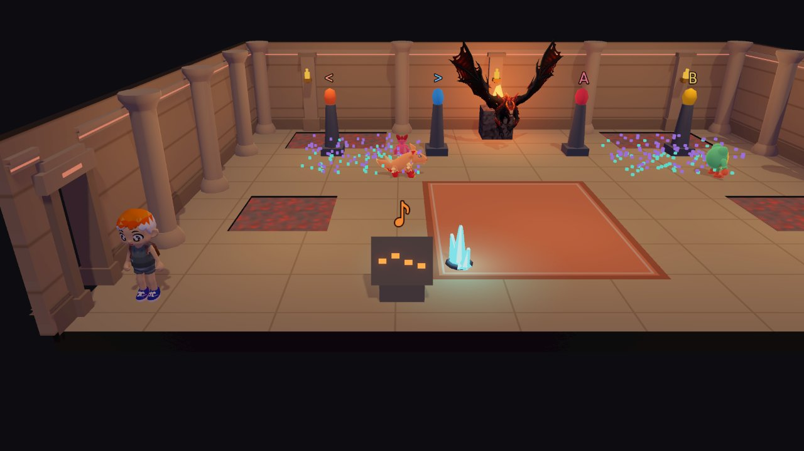<br><sub>Inside the Temple of Flame, on the Caldera Road.</sub>

  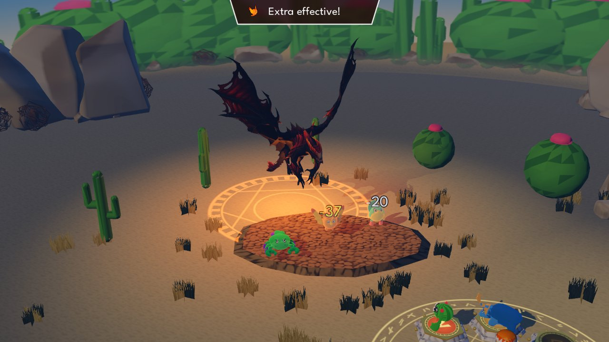<br><sub>Pyroclast answers your song: a summon striking the opposing team.</sub>

- **Merging** happens at Beast Centers, between two beasts grown into their final form and at their level limit: **Lv
  40** at rank 1, and each merge raises the limit by 20 (`Beast.level_cap`). A normal merge is 50/50. The new beast is
  put together from both parents' models (`beast_parts.gd`): one gives its frame, the other some of its parts (its
  head, arms, wings, tail or legs, each set where the frame's own were), and it is painted in one parent's colours. A
  legendary parent dominates at **80/20** and keeps its race. Ghost merging unlocks in Gravenmoor.
- **Ghost beasts** aren't beasts of their own: they're the same beasts in black and purple, glowing faintly and
  wrapped in smoke.
  - Every merge plays a cinematic (`scenes/MergeCinematic.tscn`) in a dark, misty chamber behind the Beast Center: plaster
    walls set with glowing aqua bottle-bottom glass, columns where the walls meet, cables draped across the ceiling, a stone floor and three stepped platforms. The parents stand on two
    in the background, each in a pool of light from a hanging white-and-steel TCM Core, and the centre one is empty. The parents rise into their own
    light and fade, and only then does a column of light come down from the core over the centre platform. When it lands, a white wash reveals the merged beast, with the light now on it. The camera holds
    still until then, and circles the new beast very slowly to show its form.
  - Beasts of neighbouring elements on the ring (Fire–Air, Air–Water, Water–Earth, Earth–Fire) merge into a **dual beast** of both elements. Opposite elements (Fire–Water, Air–Earth) can't merge.
- **Everyone moves one of the four ways** on the tile grid, a whole tile at a time: you, strolling townsfolk and wild
  beasts. A step, once started, always ends in the middle of the next tile (whatever you let go of or press on the
  way), so you always stop lined up with people, doors and items. With two arrows held you keep walking the way you
  were going, else the newest arrow counts (`world.gd` _key_dir).
- **Cliffs and ramps**: every town and road has high ground (`scripts/world/elevation.gd`). Woods and rock stand on
  ridges along the back and sides of each map, so you're closed in there, with the roads out running through cuts in
  them; many maps have terraces too: Cocoon Cove's garden terrace under its rim of tall cliffs, Bellerive's stone quay over the harbour, the Dune
  Road's escarpment (the rope ladder a flyer hangs climbs it), the Mesa Trail's canyon walls, Gravenmoor's graveyard
  knoll. Nobody climbs or drops down a cliff, and nobody talks, picks things up or sees across one (trainers and wild
  beasts included); ramps are walked up and down along their slope. Cliffs seldom turn a square corner: most corners
  are cut by a diagonal cliff across one tile, and nobody (you, beasts or townsfolk) can stand on a tile with a
  diagonal cliff in it, high half or low. Where a cliff drops into the sea or a river the water at its foot is deep,
  never wading shallows, with now and then a rock of the cliff's own stone standing in it. Where a river runs over a
  cliff it falls as a waterfall (Riverbend). Behind high ground you're never lost from sight: whatever ground stands between the camera
  and you dissolves around your shape in a fine dither (`terrain.gdshader` `hole`), while buildings stay unloaded until their ground footprint
  reaches the screen.
  They fade in as their base comes into view and unload when it leaves. Arrival fades use isolated material opacity
  on Forward+ and Mobile, then restore their original opaque materials. On Compatibility (the web) buildings appear
  without the fade: each see-through copy compiled a shader of its own on first sight, freezing play for up to half a
  second as a building came into view.
- **Town mascots and their signature moves**: every town has a mascot beast roaming its square and a statue of it
  beside, cast in bronze (the coast and the isles), silver (desert to mountains) or gold (the far towns). The mascot
  teaches a beast of its own line, once it reaches **Lv 40**, the town's signature move: an elemental attack mightier
  than any move of its element learnt by levelling (`world_db.gd` TOWNS "signature", `move_db.gd` SIGNATURE, e.g. the
  Pyrosaur's Bandit Blaze in Cocoon Cove; the frogs' Toadmiral is the mascot of both Bellerive and Riverbend, and
  teaches each town's own move). Nobody else teaches it, and a merge keeps it only for a beast of that line. The statue's plaque explains it, and townsfolk bring it up now and then (`chatter_db.gd` MASCOT_MOVE).
- **Wild beasts** roam the routes in plain sight; there are no random encounters (the tall grass is still there).
  - Each beast sees in a cone in front of it, half as far if you're in tall grass, and hears you running nearby.
  - Beasts come running when they spot you. Only a lone beast hopelessly outmatched by your best one (8+ levels below it) bolts.
  - Marks: a yellow **!** when one spots you, a blue **!** when it's scared and fleeing, and **?** when it loses you. Nothing shows while it charges, or once it goes back to roaming.
  - Walk into one from behind before it spots you: a **sneak attack** (green spiral, it loses its first turn). Meet one face to face: a normal battle (blue spiral). Let one catch you from behind: an **ambush** (red spiral, you lose your first turn).
  - After any wild battle, you receive **three seconds of protection** during field control. Wild beasts cannot see or hear you, drop any chase, and cannot start another encounter, even on contact. After a **victory**, your character smoothly pulses between 35% and 80% opacity until protection ends, then returns to full opacity. Escaping or losing (including the return to the Beast Center) keeps the character fully opaque. Trainer battles grant neither protection nor an opacity pulse. Menus, interactions and map transitions pause the countdown and opacity pulse.
  - Groups grow slowly through the game (`Story.pack_cap`): beasts roam alone on the early roads (always on the Coastal Path), in pairs from wild Lv 7, and in threes only from Lv 16. Within that, a beast no stronger than your best one usually (70%) roams with more of its own kind, and the pack stands its ground; on roads with wild Lv 16+, stronger four-legged beasts, flyers and serpents sometimes run in packs too.
  - Each road's trainers are stronger than any wild beast on it. The early levels climb slowly: Coastal Path Lv 2-4, Isle Trail 4-7, Coral Reef 7-10, the Temple of Tides' puzzle rooms 10-12 (its guardian Lv 12, with one helper), Dune Road 10-13. Arena masters on that stretch: Marina Lv 9-10, then Nerissa Lv 10-11, who opens the reef.
- **Levelling** is slower than before: about twice as many wins per level.
- **MP**: elemental attacks cost MP (about a tenth of their power, at least 2); regular (neutral) attacks and every other move are free, and a regular attack is always there when MP runs out. Every level-up and evolution fully restores HP and MP. MP also comes back from healing (the Beast Center machine, Mom, your bed) and items: Spirit Drop (15), Spirit Tonic (40), Spirit Elixir (all) from apothecaries, and Mint Tea at cafés.
- **The battle ring** (as in Jade Cocoon 2, `scripts/core/ring.gd`): every trainer stands in the middle of a ring of 8 slots.
  - The ring has a side per element, in this order round it: **Fire, Air, Water, Earth**. A side's middle slot holds a beast of that element; the **corner** between two sides holds a beast of either element, or a dual beast of both.
  - You carry as many beasts as you have **beast slots** wired up: 3 to start, up to 8. New beasts take a free slot they may stand in, joining the side most of your team stands on.
  - **Default element** (**Start → Beasts**, first row): the element's name appears beside the label in the left list. Left/Right changes it; A or a tap cycles forward. The 3D ring turns to the next side with a beast in any of its three slots. Fully empty sides are skipped; fainted beasts still occupy their slots. The preference is kept with your normal phone save and survives turns made during battle. Until you choose a side, existing saves keep using the last battle's facing. There are no arrows above the ring.
  - **You carry only the beasts on your ring**: the beasts you have with you are exactly the ones standing on your battle ring. Which beasts you carry changes only at a Beast Center (Nurse Clover, or the storage reliquary) or a kennel barn (Kennel Keeper Pip): **Drop off a beast** puts one you carry in your storage, and **Pick up beast** opens beast storage, where stored beasts go onto your ring. At a kennel, Pip asks whether a beast you drop off goes to **your storage** or **up for adoption**; a Beast Center only stores it. Storage is one for the whole land: a beast stored at one kennel can be taken out at a Beast Center in another town.
  - **Arranging your beasts** (`beasts_page.gd`, **Start → Beasts**, anywhere outside battle): the left list holds **Default element**, then your carried beasts, each with its level on the right and its **HP and MP** under its name (`HP 34/50   MP 20`: what it has and its limit, or one number when it's full), then your eggs. Focusing a beast lights it on the ring on the right (fully opaque and outlined, the others faded). A or a tap opens its actions in a bar under the ring: **Info** (its details and stats), **Move**, any field action it can do right now (**Fly**, for an air beast of Lv 40+ outdoors) and **Equip** (what it wears, and changing it). ◄ / ► move along the bar and B returns to the list. **Move** picks it up: Left/Right cycle its element-compatible ring spots (three for a single-element beast), including occupied ones, which it trades places with; A confirms and B returns to its actions. The formation is unchanged until confirmation, and there is no yellow arrow. The right pane shows **occupied / unlocked slots used** and the actual 3D battle ring and beasts from the battle camera's perspective, without the trainer or center dais. The beasts stand still in their resting pose there (`BeastRig.hold`), and the preview's views render only after a change and while something moves (`battle_ring_preview_stage.gd redraw`), to keep the book light on phones.
  - **Beast storage** (`Menus.storage_screen`: the same page, without the book's tabs): the list has **With you** and **In storage** sections. Pick a beast with A or a tap, then Left/Right choose a ring spot for it, trading places with whoever stands there; for a carried beast the last stop is **Storage** (also the **Store** button), so storing works with the d-pad. A confirms and B cancels; B again closes. **Info** shows the focused beast. A stored beast only takes an empty spot while your ring has room, and one beast always stays with you (`GameState.ring_move_reason` has the rules). A beast that goes into storage is healed.
  - **New beasts**: a hatchling or an adopted beast takes a free ring spot it can stand on, and you're asked to **Keep** it with you (A) or **Store** it (B); with no free spot it's placed in storage and you're told so (`Places.keep_or_store`). Your very first beast is always kept.
- **Battles** (`battle.gd`, `command_panel.gd`, `floating_hud.gd`): one side of each ring faces the foe, and only its three beasts fight, using **that side's element** or plain (neutral) moves. A dual beast in a corner uses whichever of its elements faces the foe.
  - The camera looks over your shoulder: you stand at the bottom right, the foe at the top left. Every slot is an ornate hexagonal pad with a glowing sigil of its element(s); the side facing the foe glows brighter.
  - **Cinematic HUD**: there are no fixed foe/ally grids or shield panels. The trainer or beast choosing an action gets a flat outline round their silhouette (one clean line, never across their features): you in the selected gem; a beast in the colour of the element its ring's facing side fights with, a wild beast in its own element. The camera gently frames them. One compact white bar stands to their left (to the right when the left has no room), framed in that same outline colour, and slides out from behind them; its far end runs behind the model, so the bar's frame meets the outline behind them. Its left edge leans in towards the bottom at the top-centre bar's angle. It shows the level in small black text, a thin divider, then small ◄ the action ►; a beast's HP and MP run full width along the bottom inside the same shape (square, not slanted), each in a white border, with a small margin on the right (the MP the move would spend slowly flashes). Above and below it a ▲ / ▼ in the outline colour shows that up / down lead to another beast or a turn of the ring; where they lead nowhere, a short, thick rounded line takes its place. Only one chooser bar shows at a time: yours first, then each beast's in turn. ◄ ► change the action and **A confirms**; the whole bar is a full-height tap target. What the action does, and warnings, use the shared top-centre bar.
  - Each round you choose your own action first, then each beast's move from the top. Every aimed move has a separate target confirmation, even with one foe; a move that hits everyone shows all its targets. B goes back. One press or tap confirms once. **▲ ▼ move between your beasts; ▲ past the top (or from your trainer after choosing their action) turns the 3D ring anticlockwise, ▼ past the bottom clockwise**, to the next side with a standing beast. You can also tap an available 3D ally to choose their move.
  - A ring rotation chosen during battle becomes the preferred front for the next battle and is saved with the game. Automatic guard fallbacks and lesson formations do not replace that choice.
  - **The ring turns by itself** at the start of battle to a side with a standing middle beast (the preferred starting side if covered, otherwise the nearest; without a preference, the last facing), and when everyone on the facing side falls. Guided lessons keep their teaching formation and restricted choices. Fainted beasts on either trainer's ring remain lying on their pads; empty pads stay dim. Turning is shown by the actual ring and beasts moving.
  - **Action icons**: a round icon stands before the action's name on the chooser's bar (`scripts/battle/action_icons.gd`). An elemental attack's disc is its element's colour with the element's glyph (flame, drop, peaks, wind, ghost); a plain attack (and your weapons) is grey with claw marks; every action that isn't an attack is navy, with a glyph for what it does (Defend's shield, a heal's cross, chevrons up for a boost and down for a hex, Move's arrows, Items' bottle, the Flute's note, Watch's eye, Summon's star, Run's arrow). `--scene=action-icons --shot=...` shows the whole set.
  - **Weak and resistant targets**: while an attack is aimed, each target's bar shows a mark after its name: a red burst with "!" when it is weak to that attack (double damage), a slate shield when it resists it (an attack of its own element does three quarters). The top-centre bar says "Weak!" or "Resists" after the target's HP. Elemental bombs show the marks too; plain attacks, weapons and ghosts have none.
  - **Targeting**: the chooser stays outlined and their bar names the target after the action, with a yellow arrow between them ("Bite ► Tadlet"; "► All" for a move that hits everyone). Each target is outlined too and gets its own white bar (name, level and HP) in its outline colour, tucked behind it the same way. A translucent yellow 3D arrow rises from behind the actor (so they stand in front of it) and arcs to the target. The top-centre bar says the action, the target with its HP, and what the move does. The 3D arrow is a slim, flat rectangular shaft with a long four-sided pyramid head, with translucent depth-tested faces; white chevrons on the stem point and scroll towards the target, while the head stays plain yellow in every gem. All-target moves draw one arrow to each target. ◄ ► aim; **tap a 3D beast once to aim, then again to confirm**; A also confirms. B returns to choosing the action. Move uses ▲ ▼ or a tap on a legal 3D pad (the pad gets a hull outline). Item and song targeting use the same arrows, outlines and target bars without a chooser bar. Guided battles retain their automatic target restrictions. (The outlined models are rendered a second time, alone, for their shapes only: `battle.gd` `front_texture`; `floating_hud.gd` draws the outlines from it and shows the 3D view through it over the bars' ends.)
  - **While you choose your own action** (and aim it), every standing beast without a bar of its own shows its HP over its MP in a small square plate above its head ("HP 63" over "MP 31" on the left, each beside its gauge; the HP label turns yellow at a quarter of the beast's HP or less and red at a tenth or less), and each trainer (you, and a rival trainer) shows their shield points in the same kind of plate: a "SHIELD" label, then an orb per point. The plates use the top-centre bar's dark fill with no frame, fading out towards both sides, and a thin white line along the bottom that fades the same way. None of these show while a beast is choosing. **During actions** no bars or readouts appear at all: HP changes show only as damage numbers. Shield orbs appear beside a trainer only while targeted or for about a second after a hit, and bars keep clear of them. Battle messages and damage numbers retain their existing presentation.
  - **Touch**: the chooser's bar is drawn compact but taps as a full-height row (at least 80 logical units on touch, 56 on desktop); its left end (level and ◄) and right end (►) change the action and the middle confirms. Bars stay in the safe area and outside the d-pad and A/B clusters' enlarged exclusion zones: a bar that fits on neither side of its model rests nearby with a pointer to it. Keyboard, gamepad and direct taps share the command controller; taps cannot pass into world movement.
  - **Surroundings**: outdoor, fishing and arena battles sit inside one continuous textured surround, with a curved foot blended into the stage's own floor. Each of the 14 biome palettes has its own repeating mural, baked from the game's existing regional assets. Batched clusters of regional trees, shrubs and rocks frame all four perimeter corners and hide joins; desert clusters use boulders, fishing keeps trees on land and uses rock outcrops over water, and arenas use pillars and banners. Indoor battles retain their enclosed walls and ceiling, with tall corner columns, lower temple or tower props and colored practical lights concealing wall junctions. The mural uses mipmapped anisotropic filtering and scenery casts no shadows. There is no runtime artwork generation.
  - **Battle lighting** (`stage_lighting.gd`, `stage_floor.gdshaderinc`): a softer warm key and cool rim separate the fighters from deeper blue/violet shade. The two rings sit in a broad pool of light fading gently toward darker, cooler corners; the floor and surround share the same falloff. Filmic highlights stay controlled, colors stay saturated, and only real highlights glow. Indoor corner accents replace the old row of seven lamps. The rim and practical lights cast no shadows, and the rim dims with the stage during summons. This lighting is specific to battles and works on Mobile and Compatibility.
  - **Clear sightlines** (`scenery_visibility.gd`): scenery in front of the fighters or across a camera-to-fighter sightline hides, including foreground columns, trees and rocks. Instances hide individually within their batches and return when the camera clears them. Cached bounds and a short update interval keep slow drifts cheap; cuts and quick camera moves update immediately. The floor, walls, ceiling and painted surround remain intact. Corner dressing stays around the perimeter so the visible wall joins remain covered.
  - **Camera director** (`scripts/battle/battle_camera.gd`): a short opening sweep settles over your shoulder; choosing drifts around the commanded trainer or beast. Actions move to the attacker, follow to the actual target, hold its reaction and return. Captures, knockouts and summons have their own shots; victory slowly orbits your side. Shot changes are at least half a second apart and never add waits to a round. Every position, including summon shake, stays inside the room or surround; large indoor summons widen the lens instead of crossing the ceiling. The surround mesh is cached, regional props use cached meshes and batches, and scenery (including pads, dock and floor) casts no shadows. Floating menus and the top bar keep their existing safe areas.

  - **Move**: instead of its move, a beast on the side facing the foe can step over to another slot of the ring (choose the slot with ▲ ▼, as you would a target; the arrow marks the slot). Any slot it can stand on that's empty, or holds a fainted beast (they trade places); the side it moves to then turns to face the foe. It may not leave the side facing the foe without a beast standing in its middle (so the beast guarding you stays put, but a corner beast can step into a fallen middle beast's place). One beast moves each round, last in your side's turn, so the others' moves land first. Foe trainers Move too: when the beast in the middle of the side facing you falls, one of that side's beasts steps into a slot that covers its trainer again, unless turning the ring to a side whose middle beast stands would keep more of their beasts fighting (`battle.gd` _ai_shift).
  - Then the two sides take their turns, the **faster side first**: the speed of its beasts facing the foe, helped by its trainer's level. Within a side's turn, the trainer acts first, then its beasts by priority and speed. You never see what the foe has chosen: it happens on its turn (a trainer may turn its ring then too).
  - **A target that falls first** (`ring.gd` `retarget`, `battle.gd` `_retarget`; the same rule for your beasts, your slingshot and items, and the foe's AI): when an action's turn comes and its target is down or has left the side facing the attacker, it goes to another beast standing on that side instead, the nearest slot first (a tie goes to the one facing the attacker's own row). With nobody standing there, an attack or the slingshot is turned on their trainer, who is open because that side's middle is down or empty; anything else, and any attack on a wild pack, is dropped without a message. A move that hits everyone just leaves the fallen out. A heal, boost or care item meant for an ally that has fallen goes to the standing ally with the least of its HP left; a revive is never passed on. MP is spent (and an item used up) only when the action has someone to land on. Lessons never turn a blow on a trainer by themselves.
  - Your actions: a **weapon** (the slingshot, later the boomerang and the bat: see **Weapons and the beat attack** below), **items** (potions, cures, revives, elemental bombs, sleep, poison, flash, nets, snares, weaken powder, haste, iron and war-drum tonics), a **flute song**, **Watch**, and **Run** (wild) or **Forfeit** (trainers). Each beast: a move, **Defend** (half damage until its side's next turn), or **Move** (to another slot).
  - A plain attack lunges at its target. Any other move is cast: the camera cuts to the caster as its element's glow (white for a plain move) gathers and it lets go, then cuts to where it lands as the glow streaks in, a burst there (rising motes for a heal or a boost) with the target's hit pose and number on the same frame. A beast that Defends holds a braced stance until its side's next turn; a defended or resisted hit is blocked, and other hits knock a beast back as hard as they were (`battle_camera.gd` "cast" / "impact", `battle.gd` `_cast`).
  - Winning plays *Android Sock Hop*. A beaten wild foe vanishes in a puff of smoke; fainted beasts on either trainer's ring lie on their pads, slumped with their eyes shut. A beaten trainer (you too) drops to one knee, head bowed, catching their breath: never knocked flat, as nobody gets hurt (`voxel_person.gd` set_pose "kneel"); a beaten robot powers down. Damage numbers use Quattrocento Sans Bold.

  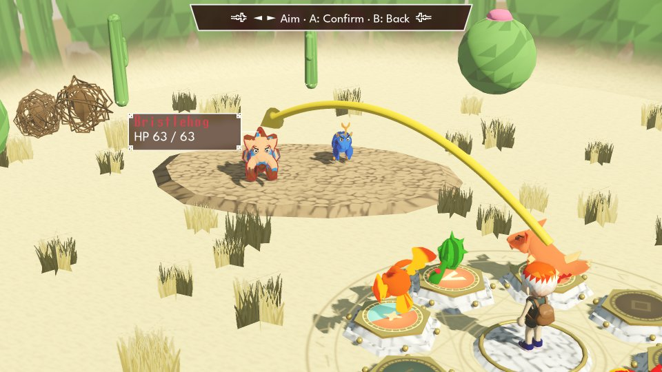<br><sub>A wild battle in a desert clearing: Bite aims at a 3D target, with a yellow arrow, silhouette outlines and compact battle bars.</sub>

- **Weapons and the beat attack** (`item_db.gd` WEAPONS, `scripts/core/beat_chain.gd`, `scripts/battle/beat_cue.gd`, `battle.gd` _do_weapon):
  - Your trainer's bar lists the weapons you own; you pick one each turn. The **Slingshot** (every trainer has one) hits one foe, or a trainer left open. The **Boomerang** sweeps every foe on the side facing you, a little softer on each, and comes back to your hand: Chief Coralie gives it in Kelpwick once the reef path is open. The **Bat** is the hardest hit, on one foe you run up to: Captain Dalton hands over Bart the Jackal's with the Sunwall bounty (saves from before get it on their next visit). All three are key items: never sold or used up, and they don't count towards the bag's stacks.
  - Until you pass **Instructor Lucille's lesson** at Dustwell's dance studio, a weapon makes one plain throw (or swing) with its accuracy roll. She teaches trainers of **Lv 4 or above**, beginning with one safe beat that repeats until you land it, then a protected weapon battle. Passing unlocks the **beat attack**: after you pick the weapon and its target, a white ring floats above the target with a notch spinning round it once a beat, reaching the mark at the top on the battle music's beat as the ring pulses. Press **A** on the beat (the on-screen A on phones, a tap on the ring, the A key or gamepad A) for each hit, on consecutive beats: **3 hits at trainer Lv 4, one more each level (8 at Lv 9), and 10 at Lv 10**. Pips under the ring count the hits allowed and landed; the top bar says what to do.
  - Each press is graded by how far it is from the beat: **Perfect** (0.06 s), **Good** (0.13 s) or **Miss**, shown beside the ring, and the grade sets that hit's damage (half a plain throw for Perfect, 0.3 for Good). A Miss ends the chain; hits already landed count. Missing the very first beat still lands one weak hit, so the turn is never wasted. Land every hit your level allows and the last one is critical. Your first beat attack has wider windows (0.10 / 0.20 s), as they always do on the Coastal Path. Reaching Lv 4 points you to Lucille; later levels that add a hit say so. Older saves retain rhythm attacks already learned and access to a north road already passed.
  - At a trainer who's open, a weapon is one blow whatever your level: it breaks a shield point.
  - Your trainer takes the weapon up and uses it once per hit (`voxel_person.gd` set_ready, set_action): a stone from the slingshot, the boomerang flung side-arm (it curves through each target and is caught again), or the bat swung level after running up to the target. The camera holds a "beat" shot on the target meanwhile, and the hits land without messages until the chain is done.
  - Foe trainers don't play it. Only bosses and arena masters use a weapon (about one round in three, never while they play a song, and only at your beasts), with their hits rolled from their trainer level (`BeatChain.roll`). Their weapon follows the region: the slingshot, then the boomerang (their beasts Lv 11+) and the bat (Lv 15+).
  - The beat comes from the music: `Sfx.TEMPOS` gives each battle track's tempo and first beat, measured from the decoded audio (*Rising Tide* 106 BPM, *Rising Tide (faster)* 122 BPM; both hold their tempo all the way through). `Sfx.beat_now()` is the beat as you hear it, allowing for the audio driver's output latency, plus `Sfx.BEAT_LATENCY` for the web and Android (set by ear with `--scene=beat-click`). A track with no steady beat (or none yet, while the web still fetches it) gets a fixed 100 BPM click instead. A **percussion layer** (a woodblock on each beat, a shaker between; one-bar loops baked into `assets/audio/battle/` by `tools/bake_battle_art.gd`) plays quietly in step with the battle music and comes up for a beat attack.

- **Shield and the end of a battle**:
  - If the beast in the middle of the side facing the foe is down (or that slot is empty), its trainer can be **attacked directly**: each hit breaks one shield point. Turn your ring to a side whose middle still stands to cover yourself, or have a corner beast Move into the fallen one's place.
  - A trainer battle ends only when a trainer is hit with no shield left, or someone forfeits. Wild beasts have no trainer: beat them all to win. If you're the one hit with no shield left, you wake up at the nearest Beast Center you've visited.
  - Every trainer starts with 1 shield point; trainers on the roads have 0 to 3, depending on their strength. The shield recharges after every battle.
- **Trainer level**: beating trainers earns trainer XP, and clearing a rank of the **arena ladder** raises your trainer level to at least that rank + 1. The ladder (`ladder_db.gd`) is the same at every arena: ten ranks of three or four ring trainers each; beat them all to open the next rank. Each rank cleared earns a crystal shard; beaten trainers can be fought again.
- **Sparkwire Electronics** (Volt, Bellerive): **shield points** (5 crystal shards each, up to 4) and **beast slots** (3 shards each, up to 8). How many Volt can fit depends on your trainer level: one more slot per level, one more shield point every other level.
- **Flute songs** are a sheet-music game.
  - Only a song you're learning plays by itself (from a teacher, sheet music or a flute trainer): it plays once while its notes light up on the staff. A song you already know (in battle, practising) doesn't: the sheet comes up and it's your turn straight away. Each line and space is a button: ← → A B from the bottom up.
  - The clock starts on your turn (*Your turn!* lights up over the sheet). Play the notes in order: the sheet stays up the whole time, with the notes you've played lit.
  - You have 10 seconds for four notes and 5 more for every four more (30 seconds in Uncle Rafe's lessons). The bar shrinks without numbers, going green, then yellow, orange and red. The colour you finish in sets the song's power: full in the green, about half in the red.
  - Each wrong note breaks one of three hearts and costs a little power. Lose all three, or run out of time, and the song fails.
  - Songs start at 4 notes and grow to 16 as they level up. Songs level up with mastery stars. Bigger songs add ↑, then ↓, and finally chords (A or B pressed together with a direction).
  - Uncle Rafe keeps it short the first time: he plays the song, then you play it back.
  - **Battle songs** work in any battle. No song wins a wild beast over.
    - Some lift your team: Swift Jig, Battle Hymn, Iron Chorale, Mending Melody, Cleansing Canon, Mirage Minuet.
    - Others hinder the foe: Weaken, Sluggish Waltz, Dazzling Trill, Drowsy Lullaby, Venom Serenade, Static Polka, Discord, Dread March.
    - A great performance doubles stat changes and raises status odds. Mastery stars make songs stronger too.
  - **Temple songs** bind a temple's guardian as a summon (see Summons); they don't add beasts to your ring.
  - The **arena masters** teach strong combined battle songs, such as Bellerive Shanty (ATK and SPD up) and River Anthem (heal, cure, SPR up).

  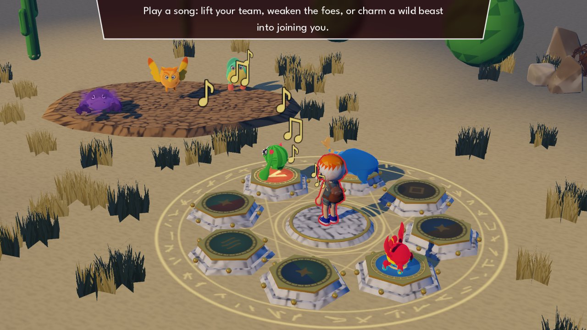<br><sub>A song's notes flying from your flute to its targets.</sub>

- **Learning songs**:
  - **Brass & Reed Music** in Cogsworth: Maestro Clef plays one song from his book for free, once. Play it back from memory to learn it. He also sells sheet music, which you can practise from your bag until you get it right.
  - **Flute trainers** play their own songs in battle: four route bards, three arena masters, Commander Nyx and General Vexmora. Win, then play the song back **without a single mistake** to learn it. Bards and arena masters will battle again for an encore.
- **Fast travel**:
  - Climb a **Sky Tower**: Skykeeper Aria's ticket desk is in the lobby, and the stairs lead up to an open-air platform on the roof, where the Tempestrix flies you to any town you've visited, for a fee.
  - Once you own an air beast of **Lv 40+** (in your ring, not storage), pick a town you've visited on the Start book's Map page and choose **Fly here** (or press A) to travel there from anywhere outdoors. It asks first: A: Yes flies, B: No stays.
- **Beast Centers** all look the same, inside and out, in every town (`scripts/gfx/beast_temple.gd`): a small temple that works by old magic, not machines, to the tune of "Hep Cats". Outside it is a squat eight-sided drum of smooth grey stone blocks on a plinth, with a gabled portal at the front (gold-trimmed eaves set with teal tiles, a pointed niche, the sign board with the pawprint) round an arched doorway with teal inlays and a closed blue door; stepped terracotta tiers, a little red drum ringed with posts and a golden thatched dome with a crest of coral petals round a teal jewel crown it. Inside is one room (12x9) with walls of the same grey blocks, pilasters with flame sconces and a glowing inlay in the Center's red; each relic has its own bay along the back wall.
  - The **healing font** is a stone basin on a fluted pedestal with a crystal turning over it and a rune stone per beast set in its rim; the rune stones light one by one and the crystal glows while it heals. Use it yourself, any time, for free.
  - The **storage reliquary** (a stone cabinet whose arched niche holds glowing spirit orbs) and the **merge altar** stand in the bays beside it.
  - Nurse Clover at her stone counter hatches eggs in the **incubator**, a warm cradle stone on a pedestal with a golden rune ring turning round the egg (with the hatch cinematic), and runs beast storage (**Drop off a beast**, into storage only, and **Pick up beast**) and the merge altar. A red phone stands on her counter, for calling Dad or Mom (see Saving).
  - The **kennel** is not in the Center: it is a barn of its own out on the roads and in the wilds, never in a town (route map letter `?`, `scripts/gfx/barn_builder.gd`): the supplied Small Barn in its region's paint with closed double doors, the pawprint sign and a lantern, and a fenced paddock with a trough and hay bales. Inside (room `kennel_barn`) are timber walls, hay bales and lanterns. Kennel Keeper Pip looks after beasts other trainers left behind; they wait in the pens behind his counter, close to your party's level, and each barn keeps its own pens. Adoption costs **40 gold at Lv 1, plus 2 gold per additional level** (78 at Lv 20, 118 at Lv 40). The list and confirmation show the fee; you need enough gold to adopt. Pip's menu is **Adopt a beast**, **Drop off a beast** and **Pick up beast** (B leaves). Drop one of yours off and Pip asks whether it goes to your storage (shared with the Beast Centers) or up for another trainer to adopt (Pip thanks you with a little gold); taking it back before another trainer adopts it is free. Tapping a pen walks you over to Pip. Empty pens fill up again after a few minutes of play.
  - Guide Dottie walks about the room and explains how it all works.
  - The Center's staff (and Pip at the barns) wear the temple's robe: ruby red with a gold collar and hem, and the pawprint from the sign over the door in gold on its front (`map_loader.gd` `CENTER_UNIFORM`; a look's `robe` and `emblem` in `townfolk.gd` and `voxel_person.gd`). No hats, no glasses. `--scene=robe-options` shows the robe colours that were considered, and `--preview=uniform` the chosen one up close.

  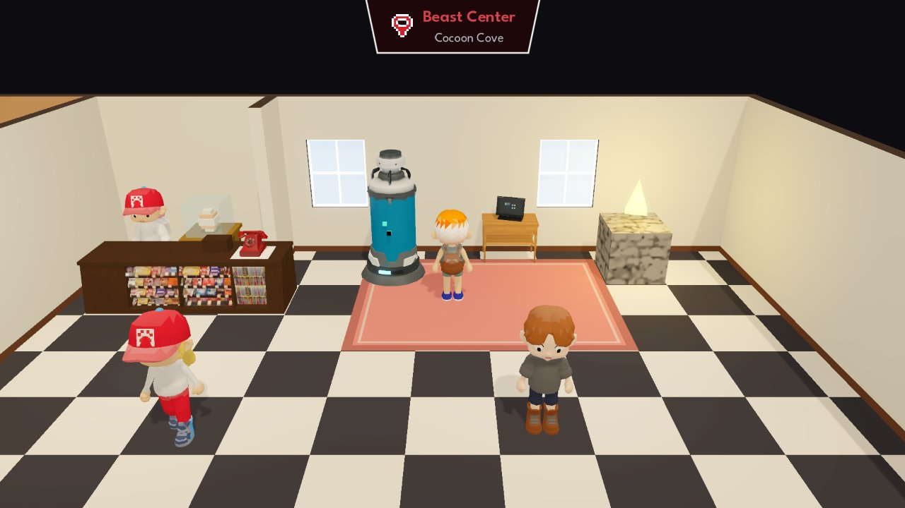<br><sub>Cocoon Cove's Beast Center: Nurse Clover's counter, the healing machine, the storage terminal, the merge altar and the red phone.</sub>

- **Saving**: your dad is away up north for work, and **calling him is how you save**. Tell him how your journey's going, he cheers you on, and the game is saved; then keep playing, or stop for now (back to the title screen).
  - Saving is free. Red phones stand in homes, every Beast Center, the apothecary, café and music shop, the arenas' lobbies and the doorways of the temples of winds, flame and roots. Only the red **payphone** by each town's square costs anything: 5 coins a call (no coins, no call).
  - In Beast Centers, shops and arena lobbies, phones sit on the attendant's counter or display case; house phones stay on their own tables.
  - On the first morning the phone rings as you go to leave home, and you can't go out until you've answered: it's Dad, wishing you luck.
  - Every phone asks who to call: **Mom** (advice), **Dad** (save) or **SkyTower Inc** (courier; a payphone still takes its 5 coins). At home Mom is in the room, so the home phone doesn't offer her. SkyTower Inc is only on the list once one of its employees has given you the number: Skykeeper Aria does, at any Sky Tower's desk, the first time you talk to her, explaining how the couriers' rides, pickups and deliveries work (`phone.gd` SKYTOWER_FLAG). While the phone's menus are open the camera swings round beside the hero to the phone (see the menu shot under Interface style). Mom saves nothing: she passes on a tip for what you're doing now (`chatter_db.gd` MOM_TIPS, by `Story.next_goal()`, taking turns call by call), always as something she saw on the TV news, something Grandma wants you to know, or a call from someone who saw you do something you've done, with advice for what's ahead. Then she looks in your father's old trainer guide: your beasts' average level next to the wild beasts where you are, or, where there are none, the road or arena master next on your journey (MOM_AHEAD), and whether you're too weak, about right or strong enough to press on (`phone.gd` level_advice).
  - Every phone stands on a white placemat on a boxy little chest of three drawers (`side_table`, baked by `tools/make_side_table.gd`) in the middle of its tile, out from the wall, so you stand right beside it to call.
  - Ten save slots, one per journey: you never pick a slot when you save. A new game takes the first empty slot the first time you save, and after that every save goes back into the same slot. If all ten are full, Dad asks (A: Yes / B: No) before writing over the save made longest ago.
  - Each save keeps a snapshot of that moment (the world without the UI) and your play time, shown right after you save.
  - Dad asks whether you want to save first (**A: Yes / B: No**). After saving, or if you decline, he asks whether you want to continue playing: **A: Yes** returns to your journey; **B: No** returns to the title screen.
  - The title screen's **Load Game** lists the slots with their snapshots; you can load, copy or delete them there.

  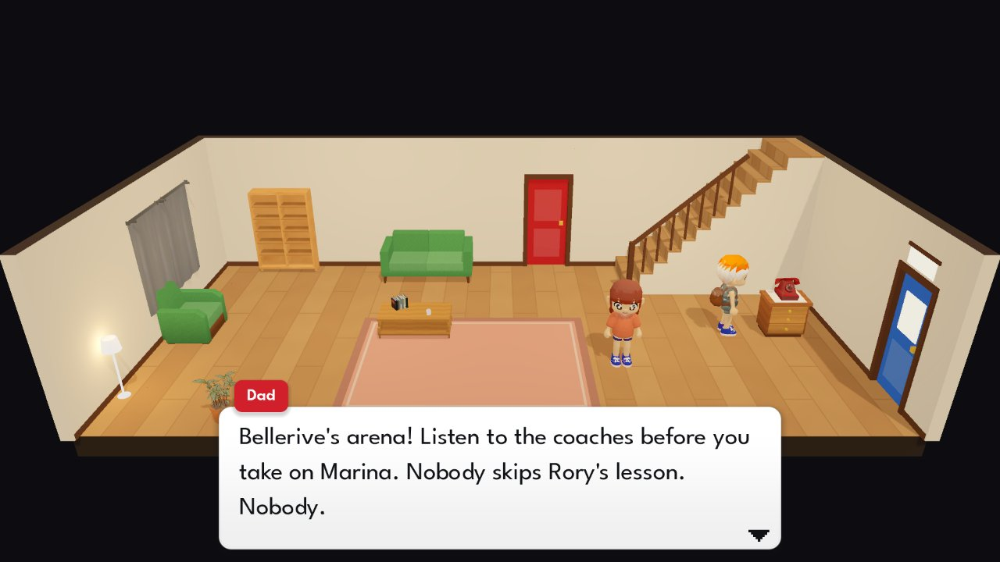<br><sub>Calling Dad from the phone at home: that's how you save.</sub>

- **Shops** differ per town. Small towns have a few; cities have many. Each building has a wordless sign fixed flat to its front above the door, showing what it is (houses have none).
- **Inside**, every house and shop is a compact room seen whole, like a stage set: no front wall, the camera holding still, and the front door in a side wall (the Beast Centers and arenas are bigger, and there the camera follows you). Blue doors open (a door to another room loads that room on its own): you stop in front of one and it swings open, away from you, as the room fades out, and the door you come in by swings shut behind you; red ones are locked. Every room has windows in at least one wall, never in a wall with a door to another room (the front door may share theirs). Homes have no kitchens to wander into: many townsfolk live in studios, bed and sofa in one room, while others have a bedroom through a door or up a flight of stairs. Stairs always come up into a landing, a hallway half a room deep, with the floor's rooms through doors off it, and you only get onto them at their open end: up from the foot of the flight, down from beside the top step of the stairwell, never through the handrail or the wall beside them. You walk on up (or down) them as the room fades out, and on the other floor you're seen walking the last of them as it fades in. Your own home has the living room downstairs, with Mom (she has your skin, hair and eyes) and the phone; upstairs, your bedroom (where you wake up), Mom's room and the bathroom open off the landing. The big dungeons (temples, the hideout, Gearhart Tower, the Sky Tower and the cathedral) keep their own layouts, open at the front too.
  - Everyone who works in a shop stands behind a counter and wears their shop's uniform: a polo in the shop's colour with a contrasting collar and cuffs, short sleeves, a name badge and usually a visor (the sensei and the fortune teller wear headbands, the music hall's usher a pillbox hat).

  Furniture follows the [interior staging rules](docs/interior_staging.md): side-wall furniture faces inward and other
  lounge seating opens towards the camera. Walls use smooth solid finishes or subtle striped wallpaper. Floors use
  warm wood, soft carpet or quiet tile/stone finishes. Bordered area rugs use 2x3, 3x4, 4x5 or 6x5 tile footprints
  (either orientation), fitted around walls and stairs. TVs are
  assumed to stand on the omitted fourth wall. Tall storage and scenery stay at the back or sides; low
  tables and displays leave the central playing area readable. Dining chairs face their tables in profile or towards
  the camera, and standing residents usually face the audience. Doors, stairs, phones and lesson routes stay clear.
  Shops keep their central floor open, with small displays and café/saloon seating at the sides. Roaming NPCs avoid
  door approaches, arrival tiles, service counters and other people's conversation space, and cannot occupy the
  only route through a passage. Both ends of their step stay reserved until they arrive.

  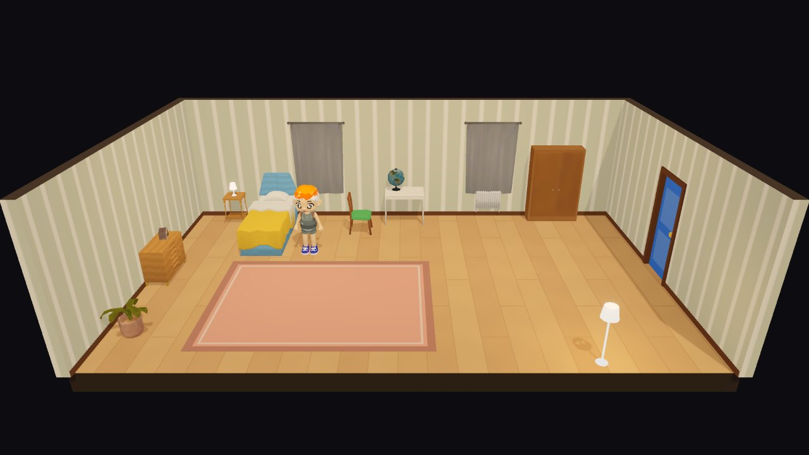<br><sub>Upstairs at home: your bedroom, where you wake up. The blue door leads out to the landing.</sub>

- **Doors**: blue doors open; red doors are locked. The same paint applies to exteriors and indoor wooden doors, including scenery homes with no enterable room. About a third of houses are locked, and so is Gravenmoor Cathedral until its Legion guard is beaten. Each interactive red exterior door has its permanent reply, tied to its saved identity; ordinary indoor red doors give a locked-door observation in the dark window, without inventing someone behind them. Puzzle stone doors retain their inscriptions and unlock rules. Home is red with a blue door; its phone stands against the staircase wall. Cocoon Cove's docks have no lightposts, and the waterfront paving keeps a grass verge beside the cliff.

## Art

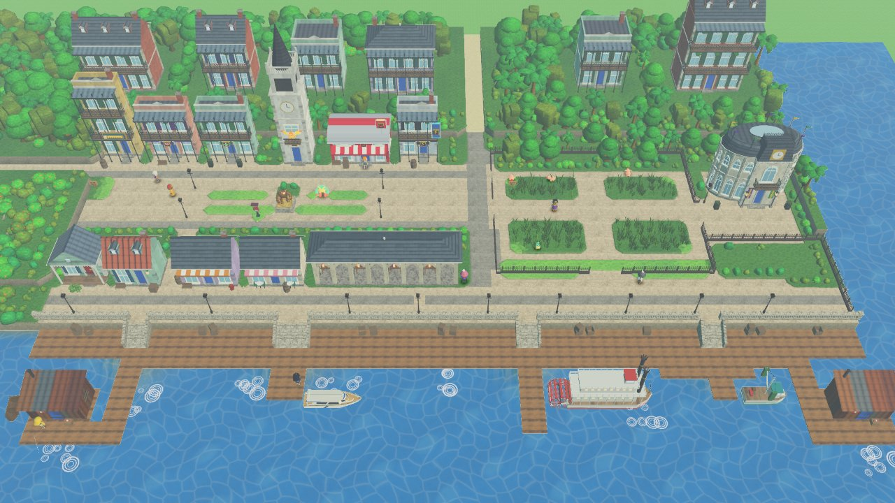<br><sub>Bellerive from above: Creole townhouses along Rue Royale, the bell tower over the Place d'Armes, the park and the arena, and the harbour below the quay.</sub>

- **Look**: the world aims for a modern, cozy, clean stylized finish with *Animal Crossing: New Horizons* as the
  primary reference for environmental cohesion: deliberate rounded forms, soft painted textures on every object,
  consistent turf lips, banks and shorelines, organized foliage and soft light, in gentle colours with clear contrast;
  never gritty, retro (PSX/PS2), voxel, blocky or pixelated. People, beasts and regional architecture keep their own
  identities. The overhaul toward this look is planned in small steps in [docs/visual_overhaul/](docs/visual_overhaul/README.md)
  (some of what follows describes the game before it). Outdoors, `scripts/gfx/outdoor_light.gd`
  keeps a gentle sun low in the south-east, so shadows fall beside things rather than hidden behind them and fronts
  still catch the light, and grades the world, open-air roofs and battles alike for contrast and rich colour without
  blowing out. Shade is lit partly by the sky itself (`OutdoorLight.ambient`: warm-tinted sky above, the ground's warm
  bounce below) rather than one flat colour, so shaded faces still read by which way they face; people carry a faint
  sheen round their outline, like the beasts. `--light_exposure=0.7` (and `_sun`, `_ambient`, `_sky`, `_contrast`,
  `_saturation`, `_white`, `_glow`) on a test run tries other values without editing; people and beasts also stand on a soft patch of shade (`scripts/gfx/contact_shadow.gdshader`). The packs' small textures are
  cleaned up by `scripts/gfx/smooth_texture.gd` (edge-preserving smoothing that keeps brick courses, boards and leaves
  but drops grain and speckle, eased contrast, then enlarged with a soft filter) and sampled with linear, mipmapped,
  anisotropic filtering. `tools/smooth_textures.gd` applies it in place to the surface, pattern and interior textures
  and to the baked scenery, house, landmark and furniture meshes (not people, beasts, robots or summons), recording
  each file in `tools/smoothed.json` so nothing is smoothed twice; run it after any re-bake, then `--import`. Baked
  resources are saved with lossless compression; `tools/smooth_textures.gd -- --compress-only` repacks older,
  already-smoothed resources without filtering them again. Ground
  layers blend softly across their wandering borders (`terrain.gdshader`). Shop-sign icons stay crisp pixel art, and
  the interface keeps its own look (see UI and audio).
- **Planned lighting workflow** (user direction, 2026-11-13): bake static illumination/contact shading into texture assets offline, with coherent existing direct lighting and actor shadows. Do not introduce multi-bounce AO approximation or runtime bounce-light GI. The unfinished [runbook 022a](docs/visual_overhaul/runbook.md) now prototypes this texture workflow; [010c](docs/visual_overhaul/010c-godot-48-plan.md) schedules Godot 4.8 testing before budget acceptance. This is planned work, not an engine upgrade already applied.
- **App icon**: the icon is painted like PS2 box art from the game's own models: the water summon
  rising as a ghost in a dusk sky over a dark hill, where a ruby glows on the crest. `tools/make_key_art.gd` renders
  the summon and a shrub and `tools/key_art.py` does the painting; `python tools/make_icon.py` writes Android's
  adaptive icon layers (background, foreground and the spirit's silhouette for themed icons, laid out over the whole
  108 dp) to `assets/icon/`, plus `icon.png` for the window. The boot splash image is disabled. The old tableau and
  `tools/make_splash.gd` remain available for artwork tooling, but are not loaded by the start menu.
- **Nature** uses the supplied **Environment Pack - Stylized Nature**, **Environment Pack - Grass**, and
  **Environment Pack - Stylized Rock** collections. Rounded and blocky canopies, upright and bent palms, leafy and
  berry shrubs, and broad stone outcrops share the existing chunked scenery batches and automatic mesh LODs.
  Blocking shrubs stay low and vary in silhouette, size and rotation. Broad thickets draw as single-tile-wide
  hedge borders around their planted ground, with no filled 2x2 bush blocks; their established solid footprints
  keep tutorial and story routes intact. Bushes only occupy blocked ground, and their full foliage stays clear of
  walkable tiles; open lawns get grass tufts instead of decorative walk-through shrubs. Tall grass uses three solid, low-poly blade clumps from the grass pack
  (353, 118 and 43 triangles), replacing the fine, densely cut foliage. Rock tiles draw grounded stone meshes on
  level ground; they no longer form terrain pyramids or support balancing boulders. Movement and puzzle tiles
  retain their existing rules. Trees, bushes and grass tufts wear a painted leaf texture (`foliage.gdshader`, given
  to every plant by `voxel_assets.gd`; `tools/build_foliage_texture.py` paints `foliage.png`), sunlit on top and
  deeper underneath, and each plant takes a shade of its own from where it stands, so neighbours never match. Woods
  are never crowded: no tree stands on a tile beside another's, in the map or the ring past its edge, and the tiles
  between hold low bushes (always along a wood's edge, so it still reads as a wall). Trees near one another differ in
  kind where the biome has more than one, in height and in build. Wooded tiles keep their collision.
  To rebuild from the three original ZIP files:

  ```
  python tools/prepare_stylized_nature.py "path/to/zip directory"
  godot --headless --path . --script res://tools/import_stylized_nature.gd
  godot --headless --path . --script res://tools/smooth_textures.gd
  godot --headless --path . --import
  ```

- **Fences** use the supplied iron, wooden picket and stone models, with their display lawns removed.
  Low wood fences mark nature-route boundaries; wood and stone enclose front lawns and planted back gardens
  around rural houses, with two-tile gates aligned to their doors. City-center houses and over-water shacks
  retain their compact street and dock frontages. Bellerive's park and Gravenmoor's cemetery use the supplied
  ironwork; the quay's stone balustrades remain. `scripts/gfx/fence_models.gd` joins sections at corners and
  junctions through the existing scenery batches: stone walls join at their full size (the through run reaches across
  the turned arms, which stop at its faces), and so does the picket fence, so its corners keep full-size pickets; the
  iron fence's bends and junctions are full-size half sections sharing one post at the tile's centre (`POSTED`). Every end that meets nothing, including where a run reaches a cliff's edge, is closed with its own face, so no
  fence shows its inside. A run carries on only between tiles whose ground meets level. Fences keep their painted shading and normal lighting but
  neither cast nor receive shadow maps, avoiding dark patches on the thin rails and pickets.
  The picket fence wears the game's one shared wood (`voxel_textures.gd` `WOOD` on the kit's plank grain,
  `wood_material()`, applied in `voxel_assets.gd` `WOODEN`), the same timber as the stairs, decks, stalls, signs and
  benches; the street pack's crates, barrels and kegs are tinted to it (`match_wood`). The rest of the game's wood is a
  family cut from the fence's grain (`tools/build_wood_textures.py`, each with vertical `_v` boards): `wood_board`
  (wall boards; the kit's `planks` kind draws it), `wood_deck` (narrow boards with end joints: docks, bridges, porches,
  boat decks), `wood_beam` (wide boards for posts, trim and frames; the kit's `wood_dark`) and `wood_drift` (the dock
  shacks), in the tones `WOOD` and `WOOD_DRIFT`. Rebuild with `python tools/build_wood_textures.py`, then
  `smooth_textures.gd -- --only=res://assets/textures/surfaces/wood_` and `--import`.
  Outdoor map letters `z` and `q` explicitly select wood and
  stone; `F` selects the biome's usual wood or iron fence. Saved building order is retained when houses are set
  back inside their gardens. Riverbend's stone fence stops a tile short of the waterfall, leaving its left bank clear.
  See [asset provenance and licenses](licenses/supplied_fences.md). To rebuild:

  ```
  python tools/prepare_fences.py "path/to/download directory"
  godot --headless --path . --script res://tools/import_fences.gd
  godot --headless --path . --script res://tools/smooth_textures.gd -- --only=res://assets/props/
  godot --headless --path . --import
  ```

- **Other world props** (campfires and the like) are PSX pack models baked by `tools/import_psx_models.gd` into `assets/nature/`, `assets/props/` and `assets/boats/`, and listed in `scripts/data/voxel_manifest.gd` (cacti and the head totem are drawn in code). The packs themselves aren't in the repository; with one downloaded again into `psx/`, re-bake and then let Godot rescan, or its file index (and so the exported game) won't include new files:

  ```
  godot --headless --path . --script res://tools/import_psx_models.gd
  # When rebuilding all legacy packs, restore the stylized nature bake prepared above:
  godot --headless --path . --script res://tools/import_stylized_nature.gd
  godot --headless --path . --script res://tools/smooth_textures.gd
  godot --headless --path . --import
  ```

- **Beasts** are the 39 untextured models of the "new beasts" folder (three to a line), painted and animated in the
  game:
  - `python tools/new_beasts/bake.py "path/to/new beasts"` cuts each form out of its .obj (some files hold a whole
    line side by side), turns it to face +x standing on y = 0, scales it to one size, drops the stray triangles the
    source meshes carry between parts, and labels each face with a part of the body (body, head, arms, wings, legs,
    tail, horns, eyes; `tools/new_beasts/forms.json` holds each form's corrections) and each part with its joint.
    `--debug out_dir` draws every form with its parts coloured. Then
    `godot --headless --path . --script res://tools/import_new_beasts.gd` makes `assets/beasts/<form>.res`, skinned to
    one bone per part.
  - `beast_toon.gdshader` paints them flat and bright by part, as the creature packs they came from were painted: each
    part's colour, tips (hands, feet, claws, spikes), stripes and bands, a belly patch, and painted cartoon eyes;
    `scripts/data/beast_looks.gd` holds each line's colours. A ghost is the same beast in black and purple.
  - `beast_rig.gd` builds a beast on its skeleton and moves it by hand: a bouncy idle, walking (a trot on four legs,
    a waddle on two, a wriggle, a hop, flying), lying down, and attacking; ghosts trail smoke. `beast_parts.gd` puts
    merged beasts together from their parents' parts.
  - Battle poses, for every body (quad, biped, flyer, serpent, blob), worked out from each beast's measured limbs so
    ghosts and merges take them from their frame: **attack** (rearing back and lunging: a plain move); **cast** (an
    elemental move: a long wind-up, standing tall and trembling as the element's glow, `cast_glow.gd`, gathers at its
    horns, its free hands or claws, or its mouth, then letting it go with its feet planted); **Defend** (braced, held
    while Defend lasts: low, head tucked, arms raised across, wings wrapped forward, a serpent coiled down);
    **block** (a quick guard and a shove back, when a defended, resisted or absorbed hit lands); **hit** (knocked back
    as hard as the hit was, eyes wincing shut; heavier and off balance for a critical or extra effective one); and
    **faint** (lying down quicker than to rest, slumped over, eyes shut). The legendaries' and robots' old models get
    whole-model versions (leaning, crouching, rocking, with a glow at their front). `beast_model.gd`'s `pose_cast`,
    `pose_guard`, `pose_block` and `pose_hit` play them on whatever a beast is drawn with. Preview every line's three
    forms through every pose with `--scene=newbeasts --anim=cycle --page=all` (see Developer test modes).
  - `beast_model.gd` picks what a beast is drawn with, everywhere (battle, the overworld, portraits): the rig for the
    lines' forms and their merges. The four legendary guardians are still the PSX creature models
    (`assets/psx/beasts/`, recoloured by `voxel_beast.gd`).
  - Menu icons: `tools/make_new_beast_icons.gd` renders every form and its ghost into `assets/beasts/icons/` (run it
    with a display: `godot --path . --script res://tools/make_new_beast_icons.gd`); a merge shows its frame's icon
    until the game has rendered its own (`beast_icons.gd`).
- **Gearhart robots** (`RaceDB.ROBOTS`) are PSX robots: the Clockwork Sentry with a wind-up key, the boiler-bodied
  Steam Mecha and the broad Iron Golem from Bricchi Games' Retro Robots, and the boxy Tank Walker from CokeEnthusiast's
  Robot guy (`RaceDB.ROBOT_MODELS`). `tools/import_psx_robots.gd` bakes them into `assets/robots/` (T-posed arms
  swung down, turned to face +x like the beasts, 1 unit tall) with their own textures and glowing eyes and vents; they
  are listed in `voxel_manifest.gd`, and `tools/make_beast_icons.gd` renders their menu icons too.
- **Houses and most shops** are houses from the PS1 House Pack (100 low-poly houses, `tools/import_psx_houses.gd` →
  `assets/houses/`): `house_models.gd` picks one per plot from the town style's list (weatherboard cottages on the
  coast, round thatched huts and stilt houses on the islands, terracotta huts in the desert, log cabins in the
  mountains, dark timber at the hot springs, stone on the moor), re-skins it in the style's own tiles, fits it to the
  plot and lines its front door up with the map's door. A porch's deck or a stoop in front of the door is squashed down
  to one easy step at the door's sill (at most 0.25, `house_models.gd` steps(), MAX_STEP), its posts stretching to
  meet it, and people step up onto it. A house may lean over the hedges and trees beside and behind
  its plot (never over a walkable tile); those trees are left out. Shops, the dojo, museum and music hall add a
  striped awning and a sign board with their icon; houses get flower planters by the door; locked doors stay crimson.
  The Beast Center is the small stone temple every town has.
- **Isle of Tides**: Kelpwick is a modest reef-diving village of round, timber-framed pastel plaster huts on wooden stilts,
  with centered solid blue-painted wood doors, six-tread entry stairs and broad, painted golden thatched roofs. The store has a round wooden interior. There is no Beast Center: the
  arena uses the supplied **Stylized House** model at one horizontal scale on a 7x6 plot, with a matching wooden door and its TV antenna removed. The healing hut is 25% wider and deeper than its initial model fit, with its stairs centered on the original approach. Its rectangular wooden hall keeps the village's healing machine in its
  back corner; flights and lost battles bring you back in front of it. Its general store sells essentials and basic beast gear at 30% below normal
  prices. Shellhaven's Beast Center occupies an 8x5 plot on the high street, with its established entrance at (40, 5).
  Shellhaven is a pastel stucco resort with Spanish mission arches, terracotta roofs, seaview villas,
  La Perla Restaurant, Pearl Coast Boutique (40% above normal prices), and Hotel Mariposa (`island_buildings.gd`). Its
  fronts have round-arched windows in white surrounds with louvred shutters, iron rejas below and French doors on
  railed Juliet balconies above, a painted base, lanterns and bougainvillea. The hotel is a long building on the quay
  behind the marina's docks: a three-storey entrance block (a tiled HOTEL sign over its arcade, its door placed by
  `building_looks` "door") facing a paved forecourt, and a two-storey west wing set back one tile behind a railed terrace; an arcade runs along its ground floor
  and every room above has a balcony set back inside the plot. Its lobby leads to two guest rooms, each with open
  doorways onto those balconies (`"!"` in a room template: drawn open, but walled, so they lead nowhere); a 150-gold
  stay restores the party. The broad beach has striped umbrellas standing in the sand over occupied chaise lounges,
  towels, and palms spaced along the foot of the cliff, with clear aisles and both beach ramps retained. The island's towns, trail and reef share dense tropical palms.
  Shellhaven's marina sits entirely west of the town and beach, reached by the original western pier, with
  three long berth fingers and an open, dock-free beachfront. Two-tile stone walks connect the marina landing
  to the high street and square, with branches down both beach ramps onto the sand. Captain Gull uses the same ferry as Bellerive; private berths hold a white flybridge motor yacht,
  a varnished pleasure launch and a furled-sail yacht, with water separating their hulls from the walking decks.
  The beach slopes smoothly into clear shallows, with soft wave crests washing toward the sand. Trainers can
  walk one tile into water no more than 5 cm (about two inches) deep, with light pitter-patter footsteps;
  the next, deeper tile stays blocked for walking, running and tap navigation.
  Every interior entrance is in a visible side wall, including temples, the hideout, Gearhart Tower and the cathedral.
  Kelpwick's buildings were renumbered when its Center went (older saves inside them are moved, game_state.gd
  _kelpwick_hut_rooms). The interiors retain their shared procedural wood finish. Kelpwick's exteriors use the supplied
  **Low poly stylized tribal tropical hut** mesh, painted timber, blue windows and straw fringe; only the plaster is recoloured.
  The source cloth panel is replaced by a solid blue-painted wooden door; the platform and stairs use painted brown wood.
  Hanging red decorations and attached leaf cards are removed. Small ground bushes flank the huts with the stair approaches clear.
  The hero walks up the hut stairs before entering; the original street approaches and room identities are retained.
  Run `bash tools/run_tests.sh island-towns island-towns-touch` for entrance, pricing, suite, A/B and beach-aisle checks.
  Run `bash tools/run_tests.sh kelpwick-huts kelpwick-huts-touch` to walk/tap into each raised hut, verify the rectangular arena's phone/healer/Nerissa approaches, and return to each stair foot.
  For a windowed preview and captures, use `-- --scene=island-towns --huts=1 --shot=build/shots/huts.png --quit=0`
  (add `--touch` for the phone layout); the focused scenario uses fresh state and never reads player saves.
  Rebuild the supplied huts with:

  ```text
  python tools/prepare_tribal_hut.py "path/to/Low poly stylized tribal tropical hut.zip"
  godot --headless --path . --script res://tools/import_tribal_hut.gd
  godot --headless --path . --script res://tools/smooth_textures.gd -- --only=res://assets/exteriors/tribal_hut
  godot --headless --path . --import
  ```

  Rebuild Kelpwick's supplied arena (its original model is kept untouched):

  ```text
  python tools/prepare_kelpwick_arena.py "path/to/stylized_house.glb"
  godot --headless --path . --script res://tools/import_kelpwick_arena.gd
  godot --headless --path . --script res://tools/smooth_textures.gd -- --only=res://assets/exteriors/kelpwick_arena
  godot --headless --path . --import
  ```
- **Exterior windows** use `scripts/gfx/cartoon_windows.gd`: broad bevelled surrounds, bowed caps on tall windows,
  deep sills with brackets, thick pane divisions and painted blue glass with bold glints, inspired by the supplied
  window packs listed in `licenses/window_references.md`. House surrounds keep their town's trim colour; shops keep
  their display bays, shutters, awnings and signs. Stone arenas, including Bellerive's, instead have round masonry
  arches with wedge stones, a large keystone, stone mullions and stone sills coloured from their walls. Kelpwick's
  open bamboo windows have heavier timber frames; Shellhaven keeps its Spanish windows. The dressing is cached
  with the existing house and wall meshes, preserving their openings, door anchors and fading. It adds no textures
  or transparent materials; the source packs and baked house files are unchanged.
- **Landmarks** are built from the wall sections of the Retro Modular House Pack (`assets/exteriors`: doors,
  windows and frames, laid round any outline by `HouseBuilder.span`), each with a shape of its own and its door on
  the map's door tile: the **arena** is an oval stadium (an arcade below, a parapet, open stands round a sand ring, a
  striped awning and pennants) behind a crenellated gatehouse between two turrets, in each region's stone;
  **Sparkwire Electronics** is a streamlined shop with a curved glass corner, a wrap-round canopy, a drum carrying a
  blade sign, a satellite dish and a radio mast; the **Sky Tower** is an eight-sided lookout in the town's finish,
  stepping in as it rises, with a gallery, a glazed lantern under a pointed roof and the Tempestrix on the rail.
  Gearhart Tower is stepped brick with a clock and a spire; Gravenmoor Cathedral a dark nave between two spired towers.
- **Grass** is a pillow laid on the ground (`terrain_mesh.gd` `LIFT`, `TURF`): it stands a little above paths, sand
  and paving, and rolls over its own edge in a soft, slightly wavy muffin top with the soil tucked in under it and a
  faint shadow at its foot, so paths and dirt read as lower. Where a path bends, the grass's corner is rounded off in a quarter circle
  (and a path's inside corner filled the same way: `CORNER_ARC`), so the grass's outline has no points. Bare grounds
  (path, plaza, sand, paving) run into each other over a ragged, soft band rather than along the tiles' square edges
  (`terrain.gdshader` `_soil_mix`): a stone road crumbles into the dirt, the dirt into the beach. At a cliff only grass rolls
  over the top; a path or sand meets the rock in a sharp edge. The lawn has sunnier and deeper stretches
  (`terrain.gdshader` `_mottle`) and a darker grass (`grass_dark`) that melts into it over half a tile: under and
  round the trees and hedges nobody can pass, under the tall grass, and in lush patches a few tiles across
  (`world.gd` `_lush`) where low tufts of long grass sprout that you walk straight through. People and props stand
  on the pillow (`world.gd` `_grass_lift`).
  Beach verges keep the same rounded pillow and cut corners as paths, with bright grass in a two-tile buffer
  beside the sand; the shoreline slope only lowers sand and water, never the grassy rim.
  Each grass-covered half of a diagonal cliff keeps the same pillow height as the adjoining lawn, above and
  below the cliff, including where another diagonal or a path meets it.
  Rocks along that rim stand wholly in the grass, fitted inside their blocked tile and grounded by their mesh base;
  they do not create separate bare pads or overhang the lower sand.
- **Cliffs** (`terrain_mesh.gd`) are simply the step between two levels of the terrain, drawn in a soft cartoon style:
  a rounded lip of the grass above rolls over the top, and below it the face is fluted into upright
  ribs and grooves, a little ragged, darker towards the foot and in the lip's shadow. Faces meeting at a corner share a
  mitred edge, so straight runs, diagonals and corners join without seams. Each biome has its own rock
  (`WorldDB.CLIFF_LOOKS`): warm orange-tan fluted rock on the coast, rivers and islands (mossy in the jungle and on
  the reef), banded sandstone in the desert, the west and the mesa, grey slate in the mountains and at the hot springs,
  dark basalt at the volcano and purple-grey stone on the moor; Cogsworth's are dressed-stone retaining walls. The rock
  is a greyed texture from the cliff packs in CREDITS.md, baked by `tools/import_cliffs.gd` and coloured per biome.
  A ramp is drawn in the ground of its tile, and a rope ladder lies along its slope.
- **Inside**, walls between the camera and you fade rather than sink (`room_builder.gd` `fade`): in a cone opening from
  you towards the camera, a wall ahead of you is clear, about 70% opaque while you pass through its doorway, and solid
  once it's behind you. Walls right beside you stay solid; doors, windows and pictures fade with their wall.
- **Past the map's edge** a ring of scenery nobody can reach keeps every edge and corner hidden: a deep wood to the
  north and sides, only shrubs and rocks to the south (between the camera and the map), the sea running on past
  coasts, roads leading on through exits, and around towns a few larger houses of the town's style among the trees.
  Nothing tall stands across a road leading out, or just south of one down the sides, so every way out stays in
  plain sight. Low hedge borders continue as low planting beyond the map edge; Bellerive's Dune Road approach
  has low hedges on both sides to keep its narrow exit visible. The desert lands (biomes with `"boulders"` in
  `world_db.gd`: Dune Road, Mesa Trail, Dune Sea, Dustwell and Sunwall) are walled by rock instead of plants (Sunwall's own wall and gardens inside it aside):
  boulders on tree tiles and in the ring, broken lines of low rocks on hedge tiles, in the last three rows and to
  the south, no scrub in the open, and only `"cacti"` of the tree tiles (a few percent) keeping a cactus; their
  edges step up as terrain cliffs (Dustwell's and the Dune Road's and Dune Sea's outer edges two levels).
  Backdrop scenery checks its full transformed mesh bounds against the continuing exit roads, so wide canopies cannot overhang them.
- **Dustwell Oasis** is an old western main street (map `"style": "frontier"`, `frontier_builder.gd`), after the
  western packs in CREDITS.md: plank-sided buildings painted red, orange, yellow and pink with cream trim, each set back
  behind a plank boardwalk under a porch roof on posts, all inside its plot (no porch over a path; the roof rests on
  the posts' tops). Stores wear tall false fronts (stepped, arched or flat) with their icon on a sign board and porch
  roofs striped in their colour; houses tin gable roofs. The **Oasis Saloon** (a cafe inside: room `saloon`) has two
  storeys, a balcony across its front, batwing doors and SALOON on its false front; **Dustwell Jail** (room `jail`) has
  barred windows, a sheriff's star and JAIL. The Beast Center is the small stone temple every town has. Missing posters hang on the porch posts;
  the readable ones are notice boards about town. Water troughs, a wagon, barrels and crates line the street.
- **Sunwall** (map id `sundown`) is an old walled adobe town (map `"style": "adobe"`, `adobe_town.gd`, biome
  `desert`). Its houses and shops are blocks of sun-dried mud in warm earth colours with rounded corners, flat roofs
  behind parapets stepped up at the corners, vigas (log beam ends) under the roof and wooden drain spouts; the back
  row's have a second storey set back on the roof with a ladder up to it, while a building with a street close behind
  it (world.gd `low`) keeps to one storey. Shops have wide windows under a striped awning in their colour and their
  icon on a board on the parapet; doors and windows are the house pack's. The town wall stands on the map's `W` tiles
  (`"town_wall"`): tall mud walls with merlons and vigas behind and beside the town, square gate towers with slit
  windows either side of the north road (the gateway open to the sky, so nobody walking through is hidden), and from
  row `low_from` south a knee-high parapet with broad gateposts, so the street beside it stays in view. The market
  round the mascot statue has striped stalls, clay jars and a stone well (`street_props` `adobe_stall`, `adobe_jars`,
  `adobe_well`); palms and low shrubs grow in the gardens behind the buildings (`"palm_groves"`), and open desert lies
  outside the walls. Inside, its houses and shops have terracotta tiles, warm plaster and a band of darker earth
  along the foot of the walls (`map_loader.gd` `_adobe_room`, `room_builder.gd` `_adobe_decor`); the Beast Center,
  arena and Sky Tower keep their own rooms. **Captain Dalton** of the gate watch stands by the plaza.
- **Dustwell's wagon and water troughs** come from the Low Poly Western pack, painted by part. To rebuild them from
  the download, unzip it into a folder `lpwestern/` and run:

  ```
  godot --headless --path . --script res://tools/import_western.gd -- "path/to/unzipped packs"
  godot --headless --path . --script res://tools/smooth_textures.gd
  godot --headless --path . --import
  ```

- **Bellerive** is the game's French Quarter (`world_db.gd` biome `quarter`, building style `creole`): the whole town
  stands on a raised stone quay, its streets cobbled setts (the biome's `stone_streets` draws paths as paving) between
  warm flagstone sidewalks and squares, paved too under its buildings and balustrade. Planted hedge beds retain
  grass ground. Trees, shrubs, flowers and grass tufts keep their full foliage bounds off streets and sidewalks.
  `creole_builder.gd`
  builds everything there but the Beast Center's temple and Gil's tin shack: Creole townhouses of two or three storeys
  in pastel stucco or red brick along Rue Royale, with louvred shutters and cast-iron galleries on slender posts recessed within
  their plots, clear of paths (or balconies on brackets), lace railings and hanging ferns, under slate hip roofs, dormered side gables
  or parapets; on the riverfront row, where a street runs close behind, one-storey Creole cottages and shotgun houses
  (world.gd "low"). Shops hang a sign board from the gallery over a striped awning in their colour; the low ones wear
  the awning and the sign on the wall. Sparkwire Electronics is a townhouse with a blue blade sign, the Sky Tower the
  white bell tower facing the Place d'Armes (a clock, a belfry and a black slate spire, Tempestrix on its balcony),
  and the arena a cream oval under a mansard ring, entered through a pavilion with a mansard roof, iron cresting, a
  clock and Mardi Gras banners. The French Market's arcade on the riverfront is scenery (no door). Along the quay a
  stone balustrade with lamps on its piers (an `F` or `L` tile with the water or lower ground just south: world.gd
  `_on_quay`); elsewhere `F` is a low iron railing with connected corners and junctions. Ramps step down from the promenade to the piers, nearer the water.
  The harbour's paddle steamer, shrimp trawler, sloops, skiff and schooner are `harbor_boats.gd`'s (a map's `boats`
  names them like the pack's).
- **People, eggs, signs and obstacles** are built procedurally:
  - `voxel_person.gd` builds people from the townfolk kit (`townfolk.gd`, `assets/townfolk/`, baked by `tools/import_townfolk.gd`): 80 people made of the kit's parts on one shared skeleton, coloured by `townfolk.gdshader` from each look's skin, hair, shirt, trousers and hat (the hero in the outfit, hairdo and colours the character creator gave them). Townsfolk pick the kit person who suits their look (a woman for long hair, robes, long sleeves for coats, a hat only if the look has one). Trainers out on the roads (and the arena ladder) wear `outfit: "camo"`: a padded jacket with a big upturned collar and a belt, combat trousers and boots, green or brown camo (`townfolk.gdshader` patches it in cells laid on the body at rest, so the pattern stays on the cloth), and a pack. Everyone can wear the pack (`look.pack`, in `look.pack_colour`): one kit person's round backpack and its straps (`Townfolk.PACK`; the kit's other packs sat badly), shaded like clothes in its own colour slot, and in their top's colour for the kit's people who wear it already. The hero always wears it, in the colour they pick in the character creator (brown to begin with). A few of the kit's parts are recoloured as they load (`Townfolk.PART_FIXES`: patchy shorts and tops made one colour, cuffs that kept the kit's tan, shoes all one colour with laces in the top's), and so is every head's eyes: the outline dark, the brows the hair's colour, only the iris the eye colour. People talk with their hands while they speak to you (`set_talking`), sit on a chair at a table (`set_pose`; `world.gd seat`) and, beaten in battle, drop to one knee (`set_pose` "kneel"). The walk is built on the animators' walk-cycle rules: the cadence follows the speed and the stride lengthens with it, so planted feet don't skate; each foot is placed (heel strike, roll, toe-off, a lift through the swing) and the knee bends just enough to reach it; the hips settle as a foot lands, twist with the stride while the chest twists back; arms swing against the legs and trail them a little; a stroll (NPCs) blends into the hero's jog (more lean, a moment in the air, elbows pumping) and a sprint. People turn smoothly to a new facing, ease into and out of their pace, and stand with an idle (breathing, shifting weight, looking about). `--scene=hero --pose=walk --speed=4.6` shows a stride (`--phase`, `--model=tf<n>` for one of the kit's people); `--pose=talk`, `--pose=sit` and `--pose=kneel` show the others; `--pose=ready --weapon=slingshot|boomerang|bat` a trainer's weapon held ready, and `--pose=throw|boomerang|catch|swing --at=0,0.07,0.15,0.25` four moments of using it; `--trainer=<seed>` four camo trainers; `--packs=1 --view=0|1` the hero's pack in four colours from behind or the side. `tools/townfolk/view.gd` renders the baked people in a grid.
  - `voxel_buildings.gd` uses ten architectural styles. Shops never look like houses: they have a shop front at street level (display windows, a sign board with the shop's icon and a striped awning in its colour), and in most towns a flat above. Cogsworth's darker brick with pipes; Riverbend's and Gravenmoor's have a jettied upper floor; Emberfall's a tiled skirt roof; the island and jungle villages have open market stalls; Copperpick has tin shops with false fronts. Out west, only shops wear false fronts.
  - `voxel_props.gd` builds the shop icons, eggs, shards, relics and obstacles.
  - Readable wooden notice boards carry three rows of dark mock lettering, raised just off the wood so it stays
    visible from the gameplay camera. Interacting with a board still opens its full text.
- The terrain is a textured height field with softly blended ground layers. Water has transparent sand/rock shallows,
  turquoise-to-blue depth colour, continuous small swells, a faint honeycomb of light that slowly reshapes and drifts
  with the flow, and foam at mesh intersections. Beaches have a gently curved sandy profile and washing crests;
  a few native rocks sit beyond the
  walkable wading row. Open water's bed slopes deeper offshore, while water beneath raised docks stays at the
  surrounding sea or river level. Water against a cliff is deep from the cliff's foot (only beaches and banks at the
  water's level count as shore), and a few rocks in the cliff's stone and colour stand in it (`world.gd`
  `_cliff_rocks`), never beside a bridge, dock, ford or boat. The shared `water.gdshader` uses one depth-texture sample and works in Forward+,
  Mobile and Compatibility; waterfalls share its palette and depth-based transparency, with subtle vertical flow lines,
  while lava keeps its animated texture. See
  [water rendering and previews](docs/water.md) for tuning and verification commands.
  Small notched lily pads float in sparse clusters along grassy freshwater banks, clear of crossings and fishing
  spots. Each leaf floats whole: its rim is kept over open water, clear of the sloping bank (checked against the built
  ground's height, `terrain_mesh.gd ground_y`), nudged toward the channel's middle or made smaller, or left out. They never appear in coastal regions or near sandy beaches or wading shelves.
- Furniture uses patterns from `ui/seamless patterns/` (smoothed like the rest): bookcases full of books, goods shelves, quilted beds, stove-front fireplaces, plank counters and benches, wood tables and metal terminals. `tools/build_patterns.py` cuts them into `assets/textures/patterns/`. Interior floors and area rugs instead use smooth, antialiased finishes (`interior_surface.gdshader`): warm boards, carpet, tile and stone, and muted rugs with broad borders.
- Rugs (and wood or tile floors) carry on under anyone standing on them and under furniture.
- People indoors face the middle of the room, or the table they're sitting at; they never stare at a wall.

## The Start book (menu)

Press **Start** (Space) to open the travel book. ◄ / ► change tabs; Up from the top of a page (its first row, the Bag's top row of slots, the Map's northernmost town) moves the cursor to the tabs, and Down or A from the tabs goes back into the page. Its bookmark tabs:

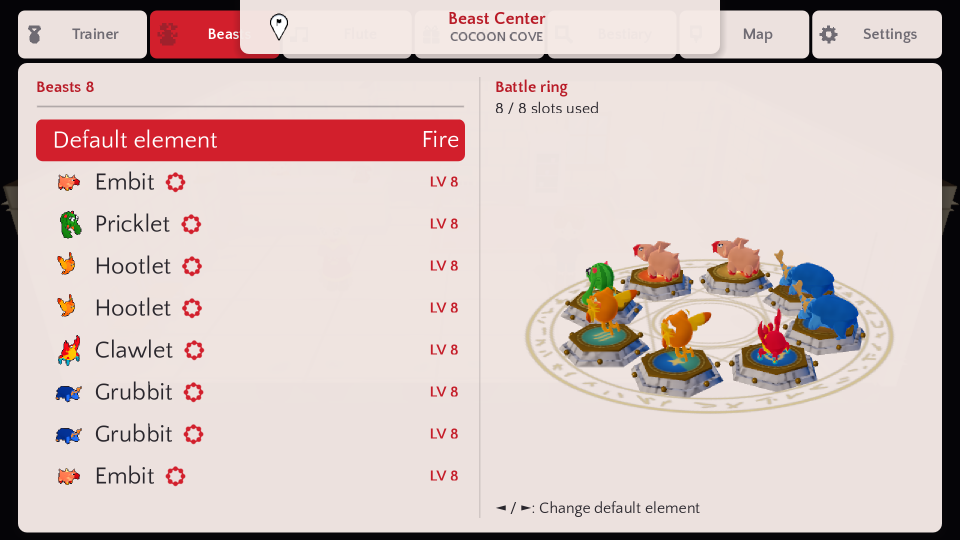<br><sub>The Start book's Beasts tab: roster, slot count and live 3D battle ring.</sub>

| Tab | What's in it |
|---|---|
| Trainer | Your portrait, gold, shield and shards, arena crests and trainer gear. |
| Beasts | One left list: **Default element** and its name first, then your carried beasts (the ones on your ring) with their levels and their HP and MP under their names, followed by eggs. The right pane shows **occupied / unlocked slots used** and the actual 3D battle ring and beasts, without the trainer or center dais, from the battle camera's perspective; the focused beast is lit on it. A opens the beast's actions under the ring: **Info**, **Move** (Left/Right preview its compatible spots, A confirms or swaps, B cancels), **Fly** when it can carry you, and **Equip**. Beasts are swapped in and out of storage only at Beast Centers and kennels. |
| Flute | Every song with its effect and mastery; press A to practise one. Unknown songs show where to learn them. |
| Bag | A grid of item slots on the left page, one per stack (its count at the corner when there's more than one), in the order care, battle items, weapons, beast gear, trainer gear, sheet music, fishing, key items and tomes; the heading shows stacks used, such as **18/24**. The right page names the focused item and describes it. Choose an item for its actions: **Use**, **Equip** (gear only), **Drop** and **Back**; one that can't be chosen now is dimmed with the reason beside it (battle items: **In battle**). Using an item on a beast, or Equip, turns the left page into your battle ring with you in the middle: each cell is named, and only the beasts (or, for trainer gear, you) it would affect can be chosen: the rest are disabled. A fainted beast's cell is tagged **KO** and an ailing one its status (**PSN**, **SLP**, ...). The right page shows the chosen one's HP and MP bars, its condition explained beside them, and its stats before and after, with **Confirm** and **Cancel** under them. Drop asks first and throws one away. Key items and weapons can't be dropped. B steps back a page at a time (`scripts/ui/bag_page.gd`, rules in `scripts/core/item_use.gd`). |
| Bestiary | All 39 forms with live portraits and where to find them. |
| Map | An aged-paper map of **Rubisa** across the left page: jagged coastlines, mountains and woodland, the twelve towns and their roads, question-mark pins for towns you haven't reached, and a flag where you are (on a road, halfway along it). The map has no town-name labels; the facing page names the selected town. Tap a town, or move the cursor with the d-pad, to read about it on the right page: its size, mascot, roads, places and arena. With an air beast that can carry you, the page offers **Fly here** (see Fast travel). |
| Settings | 3D resolution, graphics quality, music and sound volume, text speed, interface color, touch pad, key guide, fullscreen, credits and quit to title. |

The bag holds **24 stacks of up to 9** of the same item; a tenth starts another stack.
Key items, weapons, eggs and sheet music are exempt. Inventory remains item kind → count;
capacity is the sum of `ceil(count / 9)` for non-exempt kinds. `GameState.add_item` returns
how many could not fit. A full-bag world pickup offers to swap one stack or leave it;
the outgoing stack remains at that location, including across saves. Shops refuse purchases
that do not fit without charging gold. Rewards, story gifts and returned equipment send
overflow to shared **tower storage**, with a top-bar notice. Visit a Sky Tower desk to
deposit or withdraw items. Manual deposits respect its **48-stack**
limit; automatic overflow may exceed it so no items are lost. Loading an old save moves
excess bag items there once, even beyond the storage limit.

### Sky Tower locker and bird courier

Every Sky Tower lobby's ticket desk offers **Store items**, free. All towers share
one **48-stack locker**, using the bag's nine-item stacks and exemptions. The Inventory
and Locker lists sit side by side in equal-height windows, with item icons, counts
and shared scroll rails. Courier visits use **Inventory** on the left and **Bird**
on the right; delivery calls load the bird from the **Locker**. **A** or a row tap
stages **one item**. Each separate A press moves the next item from the
selected stack until it is empty; its displayed count decreases with each press.
Left/Right changes lists. **Confirm** applies the transfers; **Cancel** or B discards
them. These are the only two action buttons. Emptying the source keeps the transfer
direction; it never starts withdrawing items automatically.
Important key items stay in the bag. `GameState.locker` and `tower_inventory` refer
to the same dictionary, including automatic bag overflow.

Once Skykeeper Aria has given you the number, call **SkyTower Inc** from any phone for **Ride**, **Pick up items**,
**Deliver items**, or **Deliver and ride**. A payphone charges its normal five coins.
Select up to **12 stacks** from the locker during a delivery call. Completing a
new request replaces the old one; cancelling the call keeps the old one. Selected
items remain reserved in the locker until handed over. The pending request and its
remaining timer are saved with Dad's normal phone save.

The Tempestrix arrives after about **30 seconds outdoors and in control**. The
clock pauses indoors, in menus, dialogue and battles. It waits for a completed step
and a free, level adjacent tile; temples, dungeons and interiors never qualify.
The bird cries and swoops down while movement is frozen. The employee stays seated
on its back, facing the same way as the bird, and speaks from there. The mount's body
leans forward 45 degrees with its head level; the rider follows its back while staying upright.

A **ride** goes to a visited town for **twice the tower fare** (240 gold).
A **pickup** stores up to 12 stacks for **20 gold**, charged only for a successful
nonempty pickup. **Delivery is free** beyond the call: everything that fits goes
straight into your inventory. The transfer screen opens only when items cannot fit.
Send inventory items to the bird, then take the remaining delivery into the freed
space and confirm the exchange. Items handed back remain visible on the bird until
you confirm; anything left with it returns to the locker. Cancel discards the manual
exchange while keeping any items delivered automatically before the screen opened. **Deliver and ride** hands
over the delivery first, then offers travel. Insufficient gold cancels paid service
without blocking delivery. Pickup and ride are separate services.

Verify with `bash tools/run_tests.sh sky-courier sky-courier-touch phone bag-limit`.
The courier scenario uses isolated saves and a shortened arrival timer. For real
window captures, use `--scene=sky-courier --shots=res://build/shots/courier_desktop
--save_dir=res://build/courier_saves/` (plus `--resolution 2400x1080` before `--` and
`--touch` after it for the phone layout).
Use `--ui_only=1` to isolate the transfer controls or `--pose_only=1` to inspect the
mounted owl and its rider.

## UI and audio

- **One look** (`scripts/ui/frame_box.gd`, built through `scripts/ui/ui_kit.gd`; the user's 2026-11-13 direction):
  every window is a slightly rounded off-white box with a faint tint of the gem, with no border and no blur behind it,
  and a soft shadow under it. Rows, buttons, tags and item slots are the same rounded box with other fills; a thin
  plain line (`scripts/ui/divider_box.gd`) separates a window's sections. Text on the off-white is near-black, with
  headings in a deepened gem. The battle HUDs keep their own look (below): they still use the old near-black blurred
  box with Kenney's white border (`FrameBox.legacy`, `UIKit.battle_row_box`, `blur.gdshader`), and
  `UIKit.set_blur(false)` only affects them.
  Interface text belongs inside a visible button or HUD window: no floating action labels. Desktop Yes/No prompts
  show Yes and No side by side under the speaker's bubble (small white reply bubbles) or under the window. An outline
  marks the active answer, Yes to begin with; left / right (or the mouse) moves it. A picks the outlined answer and B
  always answers No. The picked answer fills with the gem with white text, the other disappears, a selection sound
  plays, and the prompt closes a moment later. A long question shows its answers on its last page. Touch uses the
  widened labelled A/B controls. Menus opened while talking to someone (a Beast Center attendant, a shopkeeper) or
  on the phone have no Leave row: a small gem **B: Cancel** button hangs under the menu's right end, over its bottom
  edge (`list_menu.gd` `cancel_button`, `edge_button.gd`), and B or a tap on it backs out. The beast summary and creator use bounded panes with scrolling instead of extending beyond the viewport.
  - List rows: dark text on the window; the selected or focused row is a rounded bar in the gem with white text, a
    deeper gem while pressed; disabled rows have dim text. List menus have no Select/Back buttons: A and B do that.
    Standalone buttons (page and scroll buttons,
    the touch A/B/Start/Pause) are the gem with white text, with a thin dark ring while focused and a deeper gem while
    pressed. Item slots: rounded tiles in a slightly deeper off-white with the count beneath, the selected one filled
    with the gem; focused tiles get the thin dark ring.
  - The menu color is picked in Start → Settings → Color: **Ruby** (the default), **Sapphire**, **Emerald** or **Hematite** (slate
    grey). It goes into the windows' off-white as a faint tint, the headings, the bars, buttons and filled slots; body
    text stays near-black. `UIKit.set_accent` derives the palette. The old Pixel / Classic style setting is gone, and a saved
    `ui_style` value is ignored.
  - **Item artwork** uses the supplied pack PNG illustrations with sharp nearest filtering and permanent colors for each item,
    independent of the interface gem. Potions, food, herbs, equipment and other items have their own shapes.
    `glyphs.gd` shares the artwork between the Bag, courier and pickup notices. Town arrival notices
    use a cluster of houses; arena towns retain their crests. Source details and the offline rebuild command
    are in [item icon provenance](licenses/item_icons.md). Verify with `bash tools/run_tests.sh item-icons
    item-icons-touch`; windowed `--scene=item-icons --shots=res://build/shots/icons` captures all four gems.
  - The **top bar** (`scripts/ui/top_bar.gd`) is the one place for short messages at the top centre: place names on
    entering a town, road or building, pickups, gold and battle messages. It is the windows' off-white box, hanging
    from the top edge with its bottom corners slightly rounded: [left icon] text [right icon]. It has exactly three
    sizes (`TopBar.SIZES`): **small** (360 UI units, one line), **medium** (640, one line) and **large** (640, two
    lines). Each message takes the smallest size that holds it; text never shrinks. A message too long even for the
    large size is split into pages shown one after another (a long second line gets pages of its own). All of its
    text is Quattrocento Sans; place names use Bold and the gem heading colour.
    - Outside battle it is hidden until there is something to say, then slides in, holds about 2.5 seconds and slides
      out. Messages queue; the same pickup or gold arriving while one shows or waits merges into it ("Potion x3",
      "+120 gold"). These always have a left icon (the item's illustration, a coin, town houses, a location pin or crest, a note for songs)
      and never a right one. `UI.toast(text, icon, key)`, `UI.pickup`, `UI.gold` and `UI.place_name` post to it;
      story gifts ("Received the Miner's Pass!") use it too rather than a line of dialogue.
    - In battle it is always shown with the battle's messages: the icon of whoever acts is on the left for the
      opposing side and on the right for yours, and the empty slot keeps its space so the text doesn't jump. Notices
      posted during a battle wait for it to end.
  - **The menu shot** (`world.gd` menu_shot_begin, from `UI.choose`): when someone you're talking to opens a menu (a
    shop's, a Beast Center's, an arena's...), the camera eases in over about a second to an over-the-shoulder close-up
    of them on the left of the screen, and the menu stands on the right (beside the A/B buttons on touch). At a phone
    it frames the phone with more of the hero beside it. Plain dialogue keeps the usual camera; the shot holds through
    a shop's next menu and eases back once the menus are done. `--scene=talk-menu` (`--place`, `--side`) and
    `--scene=call --presses=0` show it.
  - **Speech bubbles** (`dialog_box.gd`) are the one bright exception: rectangular white paper with gently rounded
    corners, subtle shading, a soft shadow and a seamless pointer. Dark body text stays top-aligned, normally three
    lines per page, with the existing advance triangle and typewriter reveal; short pages use a shorter bubble. Pages
    keep complete sentences together; a single unusually long sentence gets a taller bubble. The
    speaker's name sits in white on a small top-left plate filled with the selected gem, using the shared heading
    font. World conversations pass the actual NPC to
    `UI.say(lines, name, portrait, speaker_node)` or `UI.ask(question, name, yes, no, speaker_node)`.
    The bubble projects the stable head position every frame and snaps to whole screen pixels; idle animation
    doesn't shake it. It leaves a clear gap around the face, above or below it. Near the top edge it sits below the
    head, with the chevron on top. The bubble and name plate stay inside the safe area and clear of the touch clusters, and the chevron slides along the edge toward the
    speaker. White bubbles are only for speech. Phone calls, hidden speakers and off-screen voices use a stationary
    bottom-centre bubble without a chevron. Written signs, descriptions and system prompts use the shared dark
    window with white text, without speech sounds. Prefer visible changes and contextual NPC speech to narration;
    keep written explanations only where they help the player act. On desktop A picks the outlined Yes/No answer and B
    answers No; touch keeps A: Yes / B: No on the widened pad buttons.
    Someone speaking through a closed door gets a white bubble anchored to that door: above its top when there is
    room, or below its bottom near the top edge of the screen. The entire bubble and name plate stay in the safe
    area and clear of touch controls. This applies to locked outdoor doors and indoor room/staff doors.
    Cinematic spoken lines use the same speaker bubbles and fit a complete sentence on each automatic page.

  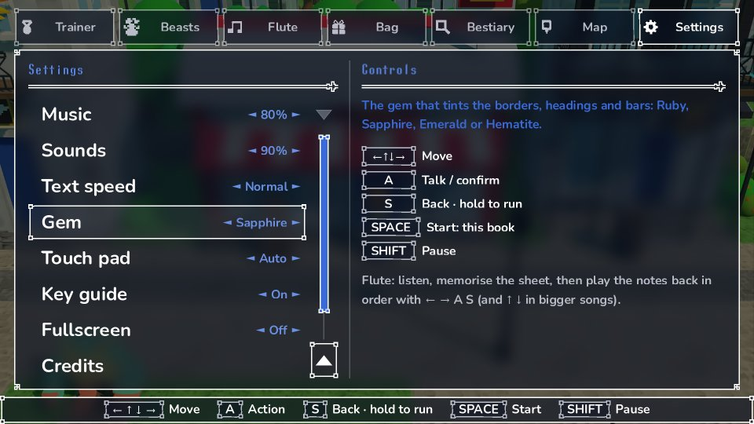<br><sub>Settings with the Sapphire gem.</sub>

- **Fonts** (user direction, 12 November 2026; title updated 13 November): Quattrocento Sans: Bold for headings/names, Bold upper case for small text (captions, tags, values, hints and damage numbers), Regular for body text, actions and descriptions; Fuzzy Bubbles for spoken dialogue at 29 UI units, about 10% smaller than the previous 32. Lettering on 3D world objects uses Noto Sans Old North Arabian through a shared English-to-glyph substitution map; retain readable English for interactions and accessibility. UI/dialogue stay English. The 3D intro/title logo uses Cormorant SC Bold, including the DEMO line. Preserve `UIKit` sizing, touch targets and readable wrapping; do not shrink text to fit. See `docs/visual_overhaul/standards.md` for the authoritative typography direction.
- **Button minimums**: menu text uses 32 UI units; rows and buttons, scroll buttons included, are at least 56 units
  tall on desktop and 80 on touch devices, including the title menu. Ordinary mobile lists scroll with Up/Down and
  direct taps; book pages, the save browser and long desktop menus get scroll buttons. Buttons never shrink to fit
  more entries (`UIKit.row_h`, `list_menu.gd`).
- **Save previews**: Load Game shows the selected slot's screenshot from its latest save beside the list, and keeps
  it visible when choosing Load, Copy or Delete. Saves from before screenshots were stored show a placeholder
  until saved again. Copying a save includes its screenshot.
- **Phones**: a joined cross-shaped d-pad with raised arrows, for getting about (hold B to run), battles and the flute
  game alike. Each arm answers in its own quarter of the pad (a wedge from the middle out past its arrow), and only one
  arrow is held at a time, so a thumb on the line between two arms still walks one of the four ways. With it, glossy
  round A and B buttons and Start / Pause pills, with no borders or blur: the d-pad's cross is the windows' off-white
  with dark arrows, and A, B, Start and Pause are buttons in the gem with white letters. A held button deepens; a held
  arm of the d-pad fills with the gem and its arrow turns white. The title menu and Start book keep the controls visible: use the d-pad and A/B or tap rows and tabs,
  and Start closes the book. A little overlap with the book is allowed; the Map page spreads its towns clear of the
  d-pad and A/B. The ring editor still moves the side controls aside for direct tapping. Yes/No questions widen A and B with an animation into
  **A: Yes** and **B: No**: each answers directly, without a separate choice list. Long questions show **A: Next**
  until their last page. Ordinary mobile choice lists sit toward the center, show several full-size options,
  and scroll as Up/Down moves the selection; each visible option can also be tapped.
  Anything that runs past one of the book's pages gets a scroll bar beside it with an **▲** button at its top and a
  **▼** button at its foot (`scripts/ui/scroll_rail.gd`): a tap scrolls half a page in whole rows, holding keeps it
  gliding, a tap on the bar above or below its thumb scrolls a page, and the thumb can be dragged; an arrow greys out
  at its end. So all of it can be reached with taps alone. The
  book's detail pane scrolls, so a tall page never runs under the buttons, and in battle the command menu takes the
  place of the battle text while it is open.
- A moonlit dragon rises for 4.2 seconds before the **New Game / Continue / Load Game** menu. **A / Enter**, gamepad
  **A**, or a tap/click anywhere skips the ascent and opens the menu immediately. The skip press never selects a
  menu item; release it before confirming a choice. The mobile controls remain available during the entrance.
  Continue and Load Game appear when a compatible save exists. With no save yet, **New Game** is a big, glowing
  pill in the gem with no box round it: a thick pale border inside a dark edge, a soft glow that breathes, a slow pulse
  and a band of light sweeping across it every few seconds (`list_menu.gd` "bare"; on desktops a plain Quit sits under
  it).
- The start menu appears over the same 3D tableau (`scripts/gfx/title_stage.gd`): the fully raised dragon, moon,
  drifting motes and gold **Ruby Cocoon** lettering remain visible. Skipping advances the ascent to its natural
  ending. Demo builds add **DEMO** below the logo in the same gold lettering. After the ascent,
  the dragon's hover, wingbeats and title animation continue as usual. Load Game and the character
  creator hide the lettering while retaining the background. World, creator,
  battle and book scripts load in the background after the entrance's first draw.
  Transitions wait for those requests without blocking the main thread (`main.gd` _title_backdrop, wait_for_script).
  The touch pad's faces are painted on a worker thread the first time and kept in `user://touch_pad/` for each gem,
  so later launches load them straight away (`controls_overlay.gd`).
- **Music**:
  - The title screen plays *Nerves*.
    It continues through character creation. Browser audio starts after a click, tap or key press;
    runtime Music and SFX buses grow through `AudioServer.bus_count` to preserve the web sample driver's
    route to the speakers (Godot 4.7's `add_bus()` append path disconnects it).
  - Normal battles use *Rising Tide*; bosses use *Rising Tide (faster)*. Bosses are temple guardians, arena masters, Bart the Jackal, Gearhart, Nyx and Vexmora.
    Both keep a beat for the weapons' beat attack (`Sfx.TEMPOS`, 106 and 122 BPM), with a quiet percussion layer playing along that comes up during one.
  - Cocoon Cove plays *Pennsylvania Rose*; Bellerive plays *Andreas Theme*; Gearhart Tower plays *Krampus Workshop*.
  - Every region and kind of room has its own track; see `TRACKS` in `scripts/autoload/sfx.gd` and `MAP_MUSIC` / `ROOM_MUSIC` in `world_db.gd`.
  - Desert, mountain, moor and some interiors add an ambient loop. Shellhaven adds quiet surf; the Coastal Path
    adds birds and insects. Gearhart Tower and the intro use the approved machine-room ambience. Moor exteriors
    use an evil-spell texture; the cathedral uses a mystic-forest drone. The five new recordings are 12-second
    Ogg loops with a one-second crossfade at the join. Outdoor loops fade out indoors.
  - `tools/convert_audio.py` makes 128 kbps copies of the tracks registered in `Sfx.TRACKS` in `assets/audio/music/`, trimming the 59-minute rainforest track to a 5-minute loop. The originals in `music/` are untouched.
- **Sound effects** from `sfx/` and `assets/audio/sfx/` cover:
  - menus, the book's page turns, dialogue voices (pitched per speaker) and footsteps
  - hits (metal clangs for robots), the weapons (the slingshot's whoosh, the boomerang's flight), bombs and the shield
  - pickups, doors, hatching, merging, flights, field moves, level-ups and the victory jingle
  - `tools/make_sfx.py` synthesises the game's own: the smack-and-puff when a foe is beaten and the soft thud when one of yours faints, and the knock on a locked door (`sfx/Custom/`)
  - Approved Sonniss GDC 2026 recordings add a paper page turn, a cloth opening for arranging beasts, a kalimba
    cue for gifts, ring placement and attaching bait, short healing plucks, coin payments, a mechanism latch,
    an energy-flow excerpt for merging/evolution, shrine rituals and departing summons, a physical battle hit,
    an attack-miss sweep, menu confirmations and unavailable-action feedback, plus the five ambient loops above.
    The merge cinematic has its own swell, crackle and reveal cues.
    Egg reveals use a short bird-flute chirp; critical hits use a 0.22-second edit of the old crate-breaking hatch
    sound. Small mechanical clicks cover toggles, quiet pop syllables follow dialogue three semitones higher
    while preserving each speaker's voice, and the muted rejection
    also covers unsuccessful flute and fishing attempts. The hatchery's earlier mechanism sound remains.
    Boss encounters randomly choose a short dread hit or a cinematic brass hit.
    These are 44.1 kHz Ogg Vorbis copies, with the source WAVs
    untouched. Rebuild with `python tools/convert_audio.py --sfx-pack "C:/path/to/Sonniss.com-GDC2026-GameAudioBundle"`,
    then `godot --headless --path . --import`. Source hashes and approved gain adjustments are in
    `tools/sfx_sources.json`; provenance is in `licenses/sonniss_gdc2026.md`.

## Mobile

- **Video settings**: Start → Settings → **Resolution** selects **540p, 720p, 1080p or 1440p** for the 3D scene,
  including hatch and merge films. Width follows the window's aspect ratio, so wide phones still gain usable space.
  Lower resolutions enlarge smoothly (bilinear), with a mild halo-free sharpen on Forward+ and Mobile
  (`resolve_sharpen.gdshader`); Compatibility (desktop OpenGL, the web) keeps plain bilinear. Rendering above the
  display's height is downsampled. Menus, dialogue and touch controls retain full resolution and their normal sizes.
  World textures keep their painted filtering; nothing is drawn as blocky pixels. The default is **540p**, with Graphics **Max**.
- **Graphics** independently selects **Min / Mid / Max** at every resolution, applies immediately and persists
  between launches. These are rendering presets using the established materials and lighting: **Min** disables
  dynamic shadows, glow and anti-aliasing; **Mid** keeps authored soft shadows and glow with 2x MSAA;
  **Max** uses 4x MSAA and authored ambient occlusion on Forward+ and Compatibility (other screen-space effects
  require Forward+). Max also gently blurs distant outdoor scenery on Forward+ and Mobile, keeping the hero,
  nearby paths and interactions sharp; interiors stay sharp. Compatibility skips this depth-of-field effect.
  Mobile and Compatibility skip unsupported effects. Deliberately shadowless scenery remains shadowless.
  The default is **Mid**. Use Left/Right to adjust a focused setting, or tap / press A to cycle it.

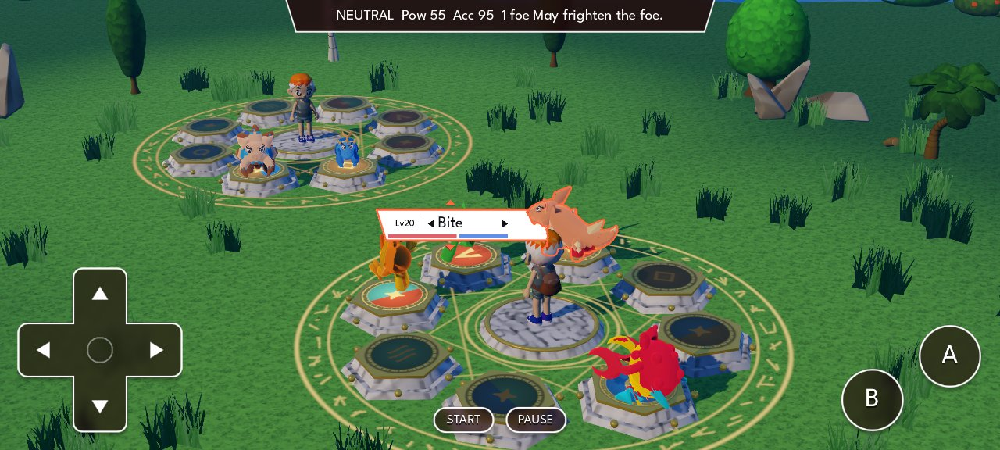<br><sub>On a 20:9 phone: the d-pad, A and B, and Start and Pause around a battle.</sub>

- **Performance**: outdoors, every batch of trees, grass, flowers and ground blocks is split into 8x8-tile chunks, so only what's near the camera gets drawn (a map-wide batch was drawn in full every frame, then again for every shadow layer). The sun uses two shadow layers out to 30 units; trees deep in a wood, grass tufts and flowers cast no shadow; street lamps only light up in gloomy places like Gravenmoor; the patch of shade under each character is one small shared quad with no lighting or texture; phones are capped at a steady 60 fps.
  Enclosed-room suns also use two shadow splits over 30 units on Mid/Max; Min disables their shadows.
  The indoor coverage is checked at reachable room edges, including the largest generated building interior.
- **Starting video settings**: fresh or missing video preferences use **540p** and Graphics **Max** on every platform. Existing saved choices are retained.
- **Web download**: playful phrases above the loading bar rotate while the game downloads; they disappear with the loader and leave engine error messages clear.
- **Stalls and loading**: a transition shows no loading message. The next map is built behind the black fade,
  yielding between terrain chunks, scenery rows, house plans and NPCs after 50 ms of work (12 ms on the web, which
  mixes its music on the same thread). The 3D view is switched off until the map is finished, and its first draw also
  happens while the screen is still black. The ground meshes of the last three outdoor maps are remembered, so walking
  back out of a house doesn't generate the street again. The first visible buildings are ready before the fade-in.
  Eight hidden buildings can remain cached for walking back; off-screen buildings stay
  invisible and stop processing. Stationary cameras reuse visibility results. Street-prop placement proves local
  connectivity where possible, retaining the full-map check for chokepoints. House geometry measurements are baked
  by `tools/bake_house_measurements.gd` after house imports; `-- --verify` checks them against the source meshes.
  The most recent outdoor scenery set also survives a room trip, avoiding repeated scenery construction and GPU
  uploads. Actors and interactions rebuild from current state; a changed layout or door lock invalidates the set.
  Only one detached outdoor set is retained. Item pickups replace arrival notices immediately, with short Bag hints.
- **Repeated work**: beast animation measurements are shared by recipe, with a bounded cache. The creator updates
  changed choices and reuses its swatch styles. Battle ring glyphs and encounter sweeps are baked by
  `tools/bake_battle_art.gd` (`-- --verify` checks exact image/audio data), so the first encounter does not paint or
  synthesize them. These are UI graphics and generated audio, not new world textures. Footstep/encounter sounds
  warm during loading, and the music cache retains three recent tracks while active crossfades keep their streams.
  Battles use the world's two shadow splits and 30-unit range; live portraits follow the graphics preset's MSAA.
  See [the performance audit](docs/performance.md) for measurements and remaining limits.
- **Shaders compiled at the title (prototype, step 009b)**: the dedicated desktop Compatibility build
  (`compatibility_build`, engine shader cache off) compiles every map's shader combinations while the title menu waits
  (`scripts/gfx/shader_precompile.gd`), a few per frame in small off-screen views lit as the maps are, and keeps them
  for the session; choosing a menu item stops it, and anything left compiles behind the next fade as before. The list
  is `assets/shaders/compat_warmup.scn`, written by `--scene=shader-manifest` (headless, every town, road and room;
  regenerate it after adding maps, lighting set-ups or material kinds). The web and native runs with the shader cache
  on skip it (both measured far slower); Forward+ and Mobile don't need it.
- **Ground on disk**: every outdoor map's ground meshes are baked into `assets/ground/` (`scripts/world/ground_store.gd`,
  `--scene=bake-ground`), so a map's ground is read back instead of generated behind the black screen; ground a story
  has changed some other way is generated once on the device and kept in `user://ground/` (at most 24 maps).
- **No building is built while you walk**: every building on a map is built behind the arrival fade and kept, hidden
  while its base is off-screen, so walking up to one no longer stalls a frame while it is built (10-150 ms each).
- **Light scenery**: the bushes, shrubs and trees are simplified to triangle budgets as they are baked
  (`tools/import_stylized_nature.gd`: about 700 for a bush, 1,400 for a tree, a quarter to a half of the pack's), since
  hundreds stand on every map.
- **Every object textured**: lit materials that would draw as bare flat colour get one of the soft finishes painted by
  `tools/build_soft_textures.py` (soft paint, woven fabric, brushed metal, satin), applied by `scripts/gfx/surface_finish.gd`
  as each object enters the scene; people wear fabric and satin and beasts satin in their own shaders. Each finish's
  average brightness is divided out, so colours stay as authored.
- Pack models over 300 triangles get levels of detail baked in by `tools/import_psx_models.gd`, so far-off trees and rocks draw fewer triangles. `godot --path . --rendering-method mobile -- --scene=perf --detail=1` prints what each map costs.
- The project uses the Mobile renderer on phones and tablets, sensor-landscape orientation, ETC2/ASTC textures, and an expanding aspect, so wide phones get extra width instead of black bars.
- On touch devices the d-pad, A/B and Start/Pause buttons appear automatically. Connecting a controller hides them unless Screen was explicitly selected in Settings. The controller guide appears on the book's Settings right page. Touch targets retain phone sizing while the pad is hidden. All connected inputs use the same actions, so every screen and the flute minigame work with them.
- HUD windows and menus, including the arena ladder's trainer list, must never overlap A/B or their enlarged hit areas. Only the Start menu may use that space while those buttons are hidden. Ordinary lists keep full-sized rows and paginate above the controls.
- Each button answers taps a little outside its drawn edge. The arrows are silent; A and B click softly at a low pitch, with B two notes below A.
- Tap the world to walk, double-tap to run, and tap things to use them (see Controls). Taps on or near the on-screen buttons never count as world taps or reach menu rows behind them: each cluster (the whole d-pad including its middle, A and B, Start and Pause) has a no-tap zone around it.
- To try the touch layout on desktop:

  ```
  godot --path . -- --touch
  ```

## Web version (iPhone and any browser)

On mobile browsers, a **Play fullscreen** button appears before play. Leaving fullscreen pauses the game and
silences audio until **Resume fullscreen** is tapped. The fullscreen icon at the top right toggles fullscreen.
Detection uses browser user-agent information (including iPads using a desktop agent), never viewport size.
Installed home-screen apps already run without browser chrome. Browsers without the fullscreen API offer
**Play in browser**, with an iPhone home-screen installation hint.

`python tools/make_web.py` builds a version that runs in the browser into `build/web/`, ready to host on Cloudflare
Pages. It needs Godot's web export templates (`web_nothreads_*.zip` in `%APPDATA%\Godot\export_templates\4.7.stable\`)
and ffmpeg.

- **Small download**: about 18 MB before the title screen. The engine and game data are gzipped and stored as
  parts under `data/` (Cloudflare Pages takes files of up to 25 MiB); a small script in `index.html` joins and unzips
  them in the browser. Both exports leave out unused sound effects, unused models and the full-size copies of
  models that have a `_lo` version (`tools/make_export_presets.py`).
- **Music on demand**: the web build doesn't contain the music. Each track is a small Ogg file under `music/`
  (about 1.3 MB) that the game downloads the first time it plays it, then keeps.
- It uses Godot's Compatibility renderer (WebGL 2), single-threaded, so it needs no special server headers. It needs
  Safari / iOS 16.4 or newer (or any current browser).
- **Deploy**: in the Cloudflare dashboard, go to Workers & Pages > Create > Pages > Upload assets, name the project and
  drop in the `build/web` folder. Or from a terminal (Node.js, after `npx wrangler login`):

  ```
  npx wrangler pages deploy build/web --project-name rubycoccon
  ```

  The site is then at [rubycoccon.pages.dev](https://rubycoccon.pages.dev). `_headers` caches the data parts
  forever (their names change whenever the game does) and the music for a week.
- **On an iPhone**: open the site in Safari, then Share > Add to Home Screen. It gets the app icon and opens full
  screen, in landscape.
- To try it locally: `python -m http.server 8060 --directory build/web`, then open http://localhost:8060.

For the isolated overhaul runtime benchmark, run `python tools/vo_web.py export`,
then `python tools/vo_web.py serve` and open `http://127.0.0.1:8061/?vo_perf=1`.
It makes two route passes and saves full traces under `build/perf/vo/baseline-web/`;
it does not measure the production compressed download pipeline. See
`docs/visual_overhaul/003-web.md` for results and cache limitations. When Claude
and Codex work concurrently, use `docs/visual_overhaul/parallel-handoff.md`:
model requests are serialized by the shared wrappers, and heavy renders/measured
native commands use `python tools/local_resource.py -- <command>`.

### Automatic web deployment and authentication

The [build workflow](.github/workflows/windows-build.yml) runs on every push to `main` (the current default
branch) or `master`, and can also run manually. A separate demo job checks progression and builds `build/web_demo/`
with the **Web Demo** preset's baked-in `demo` feature. It deploys to the existing `rubycoccon` Pages project with
`--branch=demo`, updating [demo.rubycoccon.pages.dev](https://demo.rubycoccon.pages.dev). It reuses the same Cloudflare
secrets as the full build. The demo and full Web packages are separate Actions artifacts (`RubyCocoon-web-demo`
and `RubyCocoon-web`). A failed demo check or export prevents that demo deployment.

The existing full-game publishing continues alongside the demo: successful runs update the native `latest` release,
and runs on `main` also deploy the full Web game to [rubycoccon.pages.dev](https://rubycoccon.pages.dev).
The demo job independently updates its own Pages alias on `main` or `master`. Manual runs from other branches
retain the existing native-release behavior but do not deploy either Web site. Repository visibility and release
access settings are unchanged; the repository and its non-draft releases are currently public.

**Password**: `functions/_middleware.js` is a Pages Function that asks for a password (any username) on every
address of the project except [demo.rubycoccon.pages.dev](https://demo.rubycoccon.pages.dev). That covers the full
game at rubycoccon.pages.dev, `main.rubycoccon.pages.dev` and each deploy's own address. Only the password's
SHA-256 is in the repository. To change it, replace `PASSWORD_SHA256` with the output of
`printf 'NewPassword' | sha256sum`. `wrangler pages deploy` picks up `functions/` from the folder it runs in, so run
deploys from the repository root, as the workflow does.

Build locally with `python tools/make_web.py --demo`; the normal command still builds the full Web game into
`build/web/`. To upload the demo manually using the existing Cloudflare login:

```sh
npx wrangler pages deploy build/web_demo --project-name=rubycoccon --branch=demo
```

The demo includes Cocoon Cove, Bellerive, Shellhaven, Kelpwick, Dustwell Oasis, their interiors and the roads/reef
between them. Lucille still teaches the full rhythm lesson at trainer Lv 4. She explains that Jasper's slippers
are available in the full game and awards no shoes in the demo. Jasper stays on both north-road tiles; travel to
Mesa Trail or any later town is refused even with a stale quest flag. Players can keep backtracking, training,
capturing, merging and battling without a time limit. Contextual hints explain this continued play.
Demo saves use `user://demo_saves/`, separate from full-game saves, with no automatic import from them. The exported
demo ignores development scenario arguments. For editor previews, add `--demo` after Godot's `--` separator.

Set these under the GitHub repository's **Settings → Secrets and variables → Actions → New repository secret**:

- `CLOUDFLARE_API_TOKEN`: create a Cloudflare custom API token with **Account → Cloudflare Pages → Edit**,
  restricted to the account that owns `rubycoccon`.
- `CLOUDFLARE_ACCOUNT_ID`: that account's **Account ID**, from the Cloudflare dashboard; an App ID or Pages
  project ID is not a substitute. The deploy command identifies the project by its name, `rubycoccon`.

Keep token values in GitHub secrets. No browser login is needed in CI. Without both secrets, the workflow
keeps building and saving the web artifact and reports a deployment-skipped warning. After adding them,
run the workflow on `main` to publish both Web versions. Keep the existing Pages project's production branch as
`main` so `demo` remains a preview alias.
See [Cloudflare's CI authentication guide](https://developers.cloudflare.com/pages/how-to/use-direct-upload-with-continuous-integration/).

For local builds, `GODOT` can override the Godot executable (`GODOT=/path/to/godot python tools/make_web.py`).
Run `node --test tools/tests/web_fullscreen.test.cjs` for the browser-shell regression checks.

## Editing the maps

The maps are plain text in `scripts/data/maps/`. Each string is one row of tiles, and the legend is at the top of each file.

- **Buildings** are solid rectangles of one letter, for example:
  - `C` Beast Center, `X` electronics, `V` Sky Tower
  - `I` Gearhart Tower, `B` cathedral, `J` hideout, `Q` temple
- **Weapon fixtures** use each road's `weapon_obstacles` list, rather than a tile letter. Every entry has a
  stable `id`, a `type` (`bullseye`, `bell`, `switches`, `cracked_rock`, `stump`), cardinal ordered `targets`, and
  a reachable default tap approach (`use_from`). A also works from another clear cardinal approach
  within seven tiles (one tile for the bat). Optional `blocks` retain their original floors when cleared; `effect` is `ladder`
  (an authored ramp becomes a rope ladder), `gate`, or `chest` (a suspended chest falls). `reward` gives a chest's
  `pos` and `item`. Keep firing lanes clear of trees, rocks, buildings and intervening terrain. Ranged weapons can
  cross water and shoot up to a visible ledge; a bat still needs an adjacent target on joined ground. Never rename
  an existing fixture's `id`: saves use `weapon_<map>_<id>` and a separate `_chest` flag. Keep rewards off the story route.
  Leave at least **12 tiles** between different fixtures' interaction areas (targets, barriers, rewards and firing
  tiles); the map checker enforces this spacing in both locked and solved layouts.
- **Signs** (`+`) belong on verges beside paths, never on paths, paved walking lanes, bridges or door approaches. Keep them readable and reachable from adjacent level ground. The map checker checks their inferred ground and interaction approach.
- **Obstacles** use `w j d o y l i | x m`, plus `n` (a washed-out footbridge, mended with the logs stacked by Old Hal's door) and `k` (a cliff that needs a winged beast).
- `a` is walkable shallow water. A map's `shoreline: [west_x, slope_start_z, east_x, offshore_end_z]` supplies
  the smooth sandy profile shared by terrain, character grounding and touch picking; only the authored shallow
  row is walkable. Ordinary `~` water remains blocked.
- `s` is Cocoon Cove's Old Gear Shack, at the end of the dock (room `shack` in `interior_maps.gd`).
- `b` is Youngster Kit's log cabin on the Coastal Path (room `kit_cabin` in `interior_maps.gd`, where an `anchors` entry puts Kit by the fire).
- **Push puzzles**: `u` is a boulder (moves one tile), `e` an ice block (slides), `c` an icy floor. An anchor named `puzzle_exit` marks the tile that counts as solved; `puzzle_area` draws the maze walls plain.
- **Anchors** named `item:<id>` place a fixed item (one anchor letter can be used on several tiles, each with its own flag); `inspector`, `warden` and `sentinel` place the road blockers. Room templates can have `anchors` too, `item:<id>` ones included.
- **Story gates** use `&`.
- **Rooms of several levels** (the Temple of Tides): a room's `heights` rows work as outdoors (`elevation.gd`), with
  `level_h` the height of a level and `top_level` the digit that is floor level, so the rest sink below it. Ramps are
  drawn as flights of steps and the drops between levels as stone faces (`room_builder.gd _levels`), and walls and doors
  reach down to the floor beside them. `water_levels` (`[[flag, y], ...]`) sets the water: it stands at the first `y`
  whose flag isn't set, drawn by `tide_water.gd`; `floods` decides which tiles are under it. `stone_doors` lists door
  characters drawn as engraved stone doors in an aqua frame, which sink into the floor to open. `puzzle` names a water
  puzzle in `scripts/data/tide_puzzles.gd`, whose letters in `rows` are its falls' spots and whose levers are anchors
  `switch:<n>`. An anchor `chest:<item>@<flag>` lies hidden until the flag is set.
- **Floods and levers**: a map's (or a room's) `floods` give a character for each stretch of water that a lever drains
  (`{"flag", "wet", "dry"}`; with `"rises": true`, a dry channel that fills instead). The character stands for its
  `wet` tile until the flag is set, then for its `dry` one: ground, floor, or a way on, such as stairs that are also in
  the room's `doors`. An anchor `lever:<flag>` places the lever that sets the flag, and the map's `levers[flag]`
  gives its words (`ask`, `lines`, `done`). An anchor `chest:<item>` places a treasure chest. `tools/check_maps.gd`
  checks every map both flooded and drained, and checks that no lever stands behind the water it drains.
- **Bridges**: `"bridge_rails": true` puts rails along a map's plank bridges, and `"ornate_bridges": [[x, y, w, d]]`
  builds a stone bridge with balustrades over those tiles (`temple_props.gd`). `"tall_trees": [[x, y, w, d]]` makes
  the trees in those areas an old wood, half as tall again with wider crowns; `"low_trees"` areas grow only thickets
  of shrubs on their tree tiles (undergrowth south of a path, where trees would hide you).
- In rooms, `_` is a pool of water, sunk in stone. A door symbol of `<` or `>` in `doors` is drawn as stairs. An
  `encounter` with `"roam": true` lets its wild beasts walk the room's floor (a temple's maze) instead of only its mist.
- **Cliffs and ramps**: a map's `heights` rows (one character per tile, lined up with `rows`) give each tile a level,
  `0`-`9`, one unit apiece; `^ v < >` is a ramp rising that way, and a run of them climbs evenly between the levels at
  its two ends (give it two tiles a level; runs side by side make a wide ramp). Neighbours on different levels meet
  at a cliff. `/` and a backslash (written `\\` in the GDScript strings) are diagonal cliffs across their tile: each
  half takes the level of the neighbours along its two sides, which must agree, and one half must be higher. A tile
  with a diagonal is out of bounds to everyone; walkable ground there becomes `MapGen.LEDGE` (its first type kept in
  `m["ledges"]` for the ground's look), and scenery on it moves onto the high half. Keep the back and sides high and
  the south low (the camera looks north), put every building, its doorstep and everyone standing about on level
  ground, and keep tall things off high ground just south of a road. `"cliffs": "walls"` draws a town's cliffs as
  stone retaining walls. Both checkers below know the levels and the diagonals.
- **Cutting corners**: `godot --headless --path . --script res://tools/cliff_corners.gd [-- --write] [map ids]` cuts the
  square corners of the maps' cliffs into diagonals (outer corners first, then inner ones). It reports each corner it
  leaves square and why (a doorstep, someone standing there, a shore, bridge or ramp beside it, or the only way
  through) and never cuts a corner that would shut anywhere off. Without `--write` it only reports. Run it after
  drawing new high ground, then both checkers.
- **Cliff rock** per biome is `WorldDB.CLIFF_LOOKS`: `tex` (`rock`, `sandstone` or `slate`, the greyed textures
  `tools/import_cliffs.gd` bakes from the cliff packs), `tint`, `scale` (repeats per unit along and down the face),
  `flutes` (how deep the ribs are), and optionally `band` (strata in a second colour) and `moss` (a green over the
  upper face). A biome's `"woods"` is the share of its wood tiles that grow a tree (the volcano's thin dead wood).
- **A town's own look**: `"style"` builds a town's buildings in a style of its own, whatever its biome's (Dustwell's
  `"frontier"`, `frontier_builder.gd`; Sunwall's `"adobe"`, `adobe_town.gd`). Its `building_looks` can set a building's `"paint"` (red, orange, yellow, pink,
  coral, gold, rose) and `"frontier"` (`"saloon"`, `"jail"`). Authored `street_props` may be the two-tile `wagon`,
  `water_trough` or `bench` (a two-seat bench in the shared wood, `voxel_props.gd` `bench()`; procedural benches
  also take the next front tile east, or become a planter where it isn't free), or Sunwall's `adobe_stall`, `adobe_jars` and `adobe_well`. `"town_wall": {"low_from": row}` builds
  a town wall on the map's `W` tiles (adobe_town.gd; low from that row south), and `"palm_groves": [[x, y, w, d]]`
  grows palms on a desert town's tree tiles and low shrubs on its bush tiles there instead of boulders. `prop_clearance: [[x, y, width, depth], ...]` reserves walking lanes and door approaches from
  both authored and procedural street furniture; authored cargo is also checked for route connectivity.
- **Shards** use `*`.
- **Room templates**: in `interior_maps.gd`, `>` and `<` are stairs to the next and previous floor, `K` is a kennel pen and `@` a red phone. Most rooms are `stage` rooms: one compact room seen whole like a stage set (no front wall, the camera still), the front door (`D`, blue, with a window over it) in a side wall. A building of several rooms (`SHOP_ROOMS`, `HOUSES`) joins them with doors in their walls (`doors`: a symbol for each, and the room it leads to), each room loaded on its own; locked doors (`L`, red) can say what's behind them (`locked`). A door that opens is its own leaf on a hinge (`room_builder.gd _hinged_leaf`; `world.gd _through_door` swings it open, `spawn_at` shuts the one you came in by). Stairs (`>`) lead to the next room in the set, which is always a landing (`home_hall`, `house_up_hall`: two tiles deep, the stairwell `<<<` at one end and the doors to that floor's rooms off it); Sky Tower lobbies have a visible side-wall entrance like home; lobbies and open-air decks use the same three-tile stair flights and recessed stairwells as home (`stair_flights` in their room templates). `RoomBuilder.stair_ways_in` says where each flight can be stepped onto from (its open end only), and coming back down you step off the foot of the flight. `world.gd _take_stairs` walks you on up or down the treads (`_on_flight`) while the screen goes dark (`goto_map`'s `fade`, `STAIR_FADE`), and `_arrive_by_stairs` walks the last of them on the other floor. `tools/check_maps.gd` also checks the windows: none in a wall with a door to another room, and at least one wall with them in every stage room; and every flight's open end can be reached. `--scene=doorway` walks round the house at home: through its doors, at its stairs from every side, and past Mom.

- **Towns** follow one plan: a main row of buildings with their backs to the tree line, a boulevard along their doors that the town's entrances lead straight onto, and a plaza with the statue in the middle. Shops sit around the plaza and houses at the ends. Big towns have a second row well to the south, behind deep back gardens (six rows behind two-storey shops).
  - Bellerive keeps the plan in a French Quarter's form: Creole townhouses along Rue Royale, the Place d'Armes (an
    open flower garden round the statue) before the bell tower, a riverfront row of cottages and shops with walled
    courtyard gardens behind them (the camera has to see over them), and the promenade on the quay. Its catching
    ground is a fenced park between the town and the arena (`"meadow": {"rect": [...]}`: wild beasts live only in it,
    in its long grass), where Miss Odile feeds them candy corn; the arena's forecourt is fenced off from the river, so
    the way there is through the park. The waterfront has a continuous boardwalk at least two tiles deep, flush against the stone retaining wall,
    with stone stairs and matching side parapets starting south of the quay balustrade. Lamps sit within continuous
    wall sections, garden fences end in capped posts, and the eastern shoreline is fenced below the arena.
    Crates and open boxes sit against the retaining wall, leaving two clear dock rows and the stairs accessible.
    The steamboat pier runs straight south, two tiles wide, without a crosswise landing.
    Boat berths leave clearance from docks and one another, including paddle wheels and sail booms. The eastern dock ends at a second fishing shack standing over the water,
    with a Rope Collar, Cloth Band and Twine Anklet (starter beast gear, each giving a 5% stat bonus) to collect inside.
    Gil's original shack and fishing lesson sit at the west end, with his berth extended south to keep the boardwalk clear.
  - Cocoon Cove uses the supplied, repaired pirate-cove kit (`cove_buildings.gd`). Its levels are gentle: the sea and
    dock 0, the town 1, one terrace 2, and every ramp three tiles long; a rim of tall cliffs (level 6) closes the north,
    the west and the east above the road out. Home and the two scenery homes stand on the terrace, the library (the
    kit's two-storey `whole_house`, door in the middle) and Beast Center at the land square, and the apothecary to the
    east. The plaster neighbor's home stands in the western garden. Only the right-hand stairs reach the short dock,
    whose only buildings are wooden shacks: one neighbor (room `cove_dock_shack`) and the gear shack (`s`, room
    `shack`) at the far end. A path leads to every door, the scenery homes' included. Where the camera can't see
    anyone (the strips behind tall buildings), the ground is a `low_trees` thicket, never hedge-filled lawn: a hedge
    (`t`) is drawn only along its edges, so a thick one would look like lawn you can't walk on.
    Crates and barrels occupy spare edge tiles; `prop_clearance` rectangles reserve walking lanes, stairs and door
    approaches for both authored and procedural furniture. Its starter gear remains as `item:<id>` anchors. Standard full-size doors
    come from `HouseModels`; the library's awning covers only its door. Each kit house's ground storey is stretched until its
    doorway takes that 1.8-unit door (clearly taller than the hero), and the kit's own door slab is cut away so the door
    lies on the wall. All source exterior openings are sealed.
    Its `building_order` lists building origins in saved interior order; `building_looks` selects preferred house
    models and skins (or `cove_model` for the pirate kit), and `scenery_houses` places noninteractive buildings on
    solid woodland footprints. After changing its plots, run `tools/bake_cove_measurements.gd` before the Python checker.
  - The camera looks down from the south, so a roof, a tower or a tree hides whatever is just north of it. `python tools/town_check.py` traces the camera's line of sight to every walkable tile (with each building's real roof shape) and reports any tile where the path or the player would be hidden, plus any door, exit or person you can't reach.

- **Nothing tall between a road and the camera**: `check_maps.gd` flags any tree or building up to three tiles south of a road, a bridge, the plaza or anyone standing about, further when it stands on higher ground (trees in a map's last three rows are drawn as shrubs, or low rocks in the desert, so they don't count). Use bushes, rocks, fences, water or tall grass there instead. On the Coastal Path everything south of the trail is low.
- **No slipping past a teacher**: `check_maps.gd` also walks every way from each of a map's exits to the others and
  flags a teacher (`world_db.gd` LESSON_TRAINERS, ARENA_LESSONS) whose line of sight (straight ahead, 4 tiles, up to
  the first wall or person) it can get past without crossing, and indoors one who doesn't see the tile you come in on.
  Teachers notice you as you arrive on a map and after another teacher's lesson, not only when you step into their
  sight (`world.gd` spot_you).

After editing, run the map checkers (the Godot one also flags anyone indoors who faces a wall):

```
godot --headless --path . --script res://tools/check_maps.gd
python tools/town_check.py
```

## Tests

`bash tools/run_tests.sh vo-alpha` checks the step-007 diagnostic route and merge-film setup.
`python tools/vo_alpha.py desktop --part=film --renderer=mobile --attempt=<new-name>` runs the
isolated zero-alpha beam/halo comparison; `--part=aa` separately compares 2x MSAA / FXAA / 2x MSAA
on moving Coastal Path foliage and the merge film. `--part=suite` retains the standard walking/battle route
for transparency attribution and tests zero-alpha film draws. These are diagnostic changes only, with isolated state,
three passes, raw traces and foreground validation. Material inventories are source/frustum estimates,
not renderer transparent-pass counts. Phone export/record commands are `export` and `phone`;
they use the separate benchmark package, never player saves. See `tools/vo_alpha.py --help`.

The runner supplies isolated save and preferences paths under `build/` when a scenario has no explicit override.
It rejects script errors, missing assets and deferred callback errors even if a scenario prints its success marker.
`bash tools/run_tests.sh vo-perf-route` checks the benchmark's cardinal routes and deferred rendering callbacks;
windowed measurements remain separate from this headless check.

`bash tools/run_tests.sh demo demo-touch mechanic-lessons` checks the demo boundary and the unchanged full-game
lesson, including real rhythm input, missing slippers, Jasper's two blocked road tiles, direct travel restrictions,
isolated save/reload, contextual hints, backtracking and remaining wild beasts. Capture the demo with:

```sh
godot --path . --resolution 1920x1080 -- --demo --scene=mechanic-lessons --part=dance --shots=res://build/shots/demo_desktop --shot_w=0 --save_dir=res://build/demo_preview/
```

Repeat at `2400x1080` with `--touch` and separate capture/save directories for phone layout and actual taps.

`bash tools/run_tests.sh controllers controllers-touch video-settings video-settings-touch walk walk-touch`
checks controller layout detection, nonzero device IDs, connect/disconnect fallback, eight stick directions, deadzone,
corner/stair protection, equal diagonal speed, menu input, available input choices, saved preferences and settings
focus/scroll retention. These inject joypad events; physical USB/Bluetooth pairing and Android drivers require device testing.
Windowed captures: `godot --path . --resolution 1920x1080 -- --scene=controllers
--controller="DualSense Wireless Controller" --shots=res://build/shots/controllers_desktop --shot_w=0
--prefs_path=res://build/controller_preview/settings.cfg --save_dir=res://build/controller_preview/saves/`.
Repeat at `2400x1080` with `--touch` and separate output/settings/save directories for a 20:9 phone layout;
`--controller="Nintendo Switch Pro Controller"` previews Nintendo, and an unknown name previews Xbox fallback.

Bag capacity regression and previews: `bash tools/run_tests.sh bag-limit bag-limit-touch`.
The Bag page's actions (use on the one beast it helps, blocked battle items, beast and trainer gear, drop with No then
Yes, key items): `bash tools/run_tests.sh bag-actions bag-actions-touch`; add `--shots=res://build/shots/bag/x` to
`--scene=bag-actions` in a window for each state.
Use `--scene=bag-limit --shots=res://build/shots/bag --shot_w=0
--save_dir=res://build/bag_preview/` at 1920x1080, or 2400x1080 with `--touch`.
The scenario checks stack boundaries, exemptions, lossless migration, refused purchases,
persistent swaps, focus, tapping, scrolling and empty lists, then captures all four gems.

- `beat-attack` (`--scene=beat-attack`, `tools/debug/beat_attack.gd`): the beat attack's rules on their own (hits by
  trainer level, grading windows, weak first hit, critical finish, foes' rolled chains, the baked percussion bars),
  then chains in a real trainer battle with presses injected at set offsets from each beat (1 to 4 hits, misses
  part-way, an early press, every beat let go, 6 and 10 hits at Lv 7 and 10, the guided and first-road windows), one
  real press of A through the input path, the plain throw below Lv 4, the boomerang and the bat, a blow at an open
  trainer and a boss's rolled chain. Add `--shots=res://build/shots/beat/attack` in a window for the cue spinning in
  and a hit. Headless, the dummy audio driver plays music at its own pace, so only a window checks the beat against
  the clock; audio latency on the web and Android is checked by ear and eye with `--scene=beat-click` on the device.
- `weapon-slingshot`, `weapon-boomerang`, `weapon-bat` and `weapon-touch`: road walks, unknown/known weapon hints,
  facing and blocked shots, automatic use, returning boomerangs, released ladders/gates, one-time treasure and
  isolated save/load persistence. Run `bash tools/run_tests.sh weapon-slingshot weapon-boomerang weapon-bat`.
  Windowed desktop captures: `godot --path . --resolution 1920x1080 -- --scene=weapon-walk
  --shots=res://build/shots/weapon_desktop --shot_w=0 --save_dir=res://build/weapon_preview/`.
  Repeat at `--resolution 2400x1080` with `--touch` and separate capture/save directories to exercise actual taps.


`bash tools/run_tests.sh fences fences-touch` checks the supplied sections, wood and stone collision,
two-tile yard gates and preserved Cove interior ids. For gameplay-camera captures, use
`--scene=fences --preview=wood|stone|iron|graveyard|nature|cove --shot=res://build/shots/fences.png --shot_w=0`;
add `--touch` and `--resolution 2400x1080` for a landscape phone view. Test saves stay under `build/`.

`bash tools/run_tests.sh audio` checks sound resources, ambient routing, playback past an Ogg loop boundary,
and rapid indoor/outdoor transitions, without reading or writing player saves.

`bash tools/run_tests.sh` runs every check and test scene headless (no windows), three at a time, and prints one
line per test, `ok` or `FAIL` with what went wrong; full logs go to `build/test_logs/`. A failing test gets a second
try before it counts. About three and a half minutes; `bash tools/run_tests.sh quick` runs only the fast checks
(seconds), and naming tests (`bash tools/run_tests.sh flow ringedit`) runs just those. Exits 0 when all passed.
- `beast-growth`: species egg names and unique shells, all three TCM tong tips against every shell shape,
  textured hatchery surfaces, scene geometry budget, downlight, plain unlit tongs and fog, every hatch including storage overflow,
  queued battle XP, full HP/MP restoration, sequential rewards, both evolution thresholds, and the merge film's timing, input and pause. Add `--verify_ui=1` to
  `--scene=growth` in a rendered window to check real taps, focus, confirmations, pause and sequential films.
  `--scene=growth --preview=hatch` (or `evolve`, `level`, `starters`) previews the scene or starter choice;
  `--race=0 --at=4.2 --shot=res://build/shots/hatch.png` holds a cinematic frame for inspection.
  `--preview=merge` plays the merge film (`--race`, `--other` and `--ghost=1` pick the parents): `--at` and `--shot`
  hold one instant, and `--shots=path` saves a frame at each beat.
  Add `--perf=1` to a held preview to print frame timing and draw/primitive counts on the renderer being tested.
  Rebuild the hatchery art (the procedural vault and column are in `tools/hatchery_chamber.gd`) with
  `python tools/prepare_hatchery.py "path/to/downloads"`,
  `godot --headless --path . --script res://tools/import_hatchery.gd` (add `-- --roundels` to bake only the merge film's chamber),
  `godot --headless --path . --script res://tools/smooth_textures.gd -- --only=res://assets/interiors/hatch_`,
  then `godot --headless --path . --import`. `--audit` on the importer and
  `tools/debug/hatchery_parts.gd -- core` (or `platform`) produce source-part inspection sheets.
- `check_scripts.gd`: every script parses and compiles.
- `video-settings` / `video-settings-touch`: all twelve resolution/quality combinations, aspect ratio and resize,
  world-coordinate mapping, smooth enlargement (sharpened only on Forward+/Mobile), authored effect restoration, supported renderers, isolated
  settings persistence/legacy defaults, actual taps, gamepad A, focus navigation and scrolling.
  For windowed captures use `--scene=video-settings --prefs_path=res://build/video_preview/settings.cfg
  --save_dir=res://build/video_preview/saves/ --shots=res://build/shots/video --shot_w=0` at 1920x1080, or
  2400x1080 with `--touch`. Captures include all four gems and four world resolutions.
  Add `--profile=1 --frames=120 --report=res://build/video_profile.json` to record warmed 3D viewport GPU/CPU
  render times for all twelve combinations. A Windows run with the Mobile renderer measures desktop hardware,
  not phone performance.
- `ring-start` / `ring-start-touch`: the book lists only carried beasts with HP/MP lines, focus lights a beast on the ring, the Info/Move/Equip actions bar and its focus, Move and B back to the actions, the storage screen (sections, swaps, healing on storing, the Storage stop, the last carried beast), Default element row, empty-side skipping, occupied corners and fainted beasts, focus/gamepad/tap input, tentative three-slot placement and cancellation, full-opacity selected models with continuous silhouette masks and faded other beasts, no swap arrow, occupied swaps from storage and within the ring, levels and membership icons, empty/full rosters, scrolling, 3D formation framing without the trainer/dais, isolated save compatibility and persistence across battle completion. `--battle=1` also opens a real battle on the chosen side. `--scene=ring-start --matrix=1 --shots=res://build/shots/ring_start --save_dir=res://build/ring_start_preview/` checks runtime changes through all four gems and captures each combination; add `--touch` for the phone layout.
- `check_nature.gd` (`bash tools/run_tests.sh nature`): single-tile hedge borders on every outdoor map, unchanged
  planted-ground collision, and the solid-blade grass meshes' triangle budgets.
- `scenery-lods`: recentering scenery preserves existing distance-detail thresholds/indices, base geometry,
  UVs, normals and materials, including both renderer index widths. `vo-scenery` checks the isolated
  three-map LOD-comparison route; windowed measurements use `python tools/vo_scenery.py desktop --part=lod
  --renderer=mobile --attempt=<new-name>`. `--part=chunks4` and `chunks16` compare against the existing 8x8
  chunks without changing gameplay defaults. Headless runs cannot verify renderer culling bounds.
- `check_terrain.gd` (`bash tools/run_tests.sh terrain`): raised grass on both halves of all four diagonal cliff
  directions, lawn joins beside paths and other diagonals, and surface-appropriate lips for grass, sand, path and beds.
- `check_data.gd`: everything the data names exists: the beasts (race ids) on routes, maps, trainers, leaders,
  coaches, temples, fishing pools and eggs; songs, moves, shop items and summon models; and everyone on every map,
  and the hero in every outfit and hairdo (and the pack, in the colour chosen), can be dressed.
- `check_maps.gd` (above) also checks stage furniture facing, tall scenery placement and the implied TV wall;
  `check_beasts.gd` checks the beast lines, growing up and merging.
- The test scenes: the story flow, cardinal walking (keys and touch), eight-direction controller walking, battle commands, the ring editor, the lessons,
  the coaches, the mascots, the doors and stairs at home, and each temple from its stone puzzle to capturing its
  guardian.
- `title-startup` / `title-startup-touch`, plus `title-startup-gamepad`, `title-startup-mouse`,
  `title-startup-touch-a` and `title-startup-natural`: skip the dragon with A, gamepad A, a click, a screen tap or the
  on-screen A button, or let it finish. Check one confirmation per press, the retained 3D tableau and title, keyboard
  focus, tapping New Game once and returning with B, using isolated save paths.
- `hero-maker` / `hero-maker-touch`: actual name/body navigation, outfit and hair arrows, every color row's swatches,
  preview updates, and cancellation. `--scene=creator --shots=res://build/shots/creator` captures both tabs.
- `performance`: cold/repeated creator and beast timings, map loading frame gaps, a bounded building cache, and
  cached animation measurements. `--scene=stalls --report=res://build/performance.json` writes the timing report;
  optionally pass `--baseline=res://build/performance/baseline.json` to compare collision-grid hashes.
- `polish` / `polish-touch`: glyph coverage and font metrics, home/door/dock rules, colored lamps, machine speech,
  reply feedback, bounded beast information, sequential level stats and immediate item notices. Windowed
  `--scene=polish --shots=res://build/shots/polish --shot_w=0` captures these states using isolated test data.
- `ground`: the shipped ground meshes in `assets/ground/` match what the terrain code generates for every outdoor map,
  as a new game finds it and with its story gates, obstacles and floods changed. After changing the terrain code or a
  map's tiles, rebake with `godot --headless --path . -- --scene=bake-ground`, then `godot --headless --path . --import`.
- `textures`: every 3D surface on every town, road and room, and every beast and ghost, is drawn with a texture
  (`scripts/gfx/surface_finish.gd`); only light, shade and glow effects may be plain. `--scene=texture-audit` lists the
  rest (add `--maps=caccoon,route1` or `--rooms=0` to narrow it, `--report=path.json` to save the list).
- `--scene=build-profile --maps=caccoon,tidewater` times each phase of building a map and every building on it, and
  counts what the finished map asks of the renderer (`--buildings=1` lists each building).
- `--scene=field-perf --report=res://build/field_frames.json` samples desktop frame intervals, script CPU and GPU
  times on a repeatable camera path behind buildings. Run with the same renderer and settings before and after.
- `transitions`: walks a route of towns, roads and rooms through the real transition, timing how long each stays black
  and failing if a loading message appears. `--scene=transitions --report=res://build/transitions.json` writes the
  timings; run it in a window for VSync-capped figures.
- `house-measurements` / `battle-art`: baked geometry measurements and exact generated ring/audio assets.
- `exteriors` (`--scene=exteriors`, `tools/debug/exteriors.gd`): every town building and scenery house, built as the
  world builds it, seen from outside (AGENTS.md "Building exteriors and scale"). From each point a building encloses,
  lines towards wherever the gameplay camera can be must meet an opaque face of the building turned towards it (no
  holes, open doorways, missing panes or culled faces show the inside), and every front door is at least 1.7 tall (the
  hero is 1.44) with its leaf no more than 0.12 in front of the wall beside it. `--town=` narrows it, `--verbose=1`
  prints every building's measurements.
- `intro` / `intro-touch`: holding Esc / B / Start to skip (the HUD saying to keep holding while its bar fills; a tap of B turns the page instead), the controls in the top-centre HUD for four seconds as a scene begins, every line a speech bubble on one page with no narration, the phone pad showing only a plain A and B, the New Game handoff to the bedroom and Mom's plan downstairs, untouched starter state, and Dustwell setting its news flag on arrival without a speech.
- `coastal-path` / `coastal-path-touch`: walking to and across the continuous beach, screen taps in the shallows,
  the wading limit, returning to the trail, and no beach waterfalls or beachgoers. Windowed preview:
  `--scene=coastal-path --shot=res://build/shots/coastal_beach.png --save_dir=res://build/coastal_preview_saves/`.
- `counter-phones`: every service phone sits on a counter; walks to each distinct layout and checks interact and handset taps. Captures go to `build/shots/counter_phones` (`--shots=...` overrides it); add `--touch` for the phone layout. Uses fresh state and cancels calls without saving.
- `phone-save` / `phone-save-touch`: Dad's save and continue Yes/No prompts, declined saves, one answer per press, and returning to the title. Preview with `--scene=phone-save --save_dir=res://build/phone_save_preview/ --shot=res://build/shots/dad.png` (captures both prompts; add `--touch` for touch inputs).
- `door-voices` / `door-voices-touch`: permanent door replies, real knocking/confirmation input, and white speech
  bubbles pointing to outdoor and indoor doors. Checks the top, bottom and side edges for safe-area and touch-control
  clearance. `--scene=door-voices --verify=1 --shot=res://build/shots/door_voice.png` captures those placements.
- `speech` / `speech-touch`: real NPCs at the top and bottom edges and beside the d-pad, indoor counter staff,
  three-page speech, idle stability, real movement, off-screen/hidden/freed speakers, all four gems, direct A/B
  answers and tap/gamepad/keyboard advancement without world movement. Capture with
  `--scene=speech --shots=res://build/shots/speech --shot_w=0 --save_dir=res://build/speech_preview/`;
  use `--resolution 1920x1080` for desktop or `--resolution 2400x1080 -- --scene=speech --touch` for the phone layout.
- `waterfront`: relocated library sign taps, all four dock stair flights, entering the over-water equipment shack, collecting starter beast gear and persistence on re-entry.
- `gravenmoor` / `gravenmoor-touch`: silent arrivals and retained progression flags, contextual local speech before
  and after the Legion, Mort's song, Clover's ghost-egg guidance, glowing lamp panes, and written notices in dark
  windows through all four gems, using real interaction and confirmation input. Capture with
  `--scene=gravenmoor --shots=res://build/shots/gravenmoor --shot_w=0 --save_dir=res://build/gravenmoor_preview/`;
  add `--touch` at 2400x1080 for the phone layout, or `--preview=arrival|talk|notice --quit=0` to hold a state.
- `shellhaven-marina` / `shellhaven-marina-touch`: western ramp access, walking all marina fingers, an open beachfront,
  the straight middle pier, ferry arrival placement, the shared ferry model and scale, shallow wading and its
  walking/running/tap limits, wet footfall playback, and old-save position compatibility.
- `cocoon`: compact pirate-cove layout, saved building identities, single right-hand dock access, shared door sizes,
  no thick hedges, one-level ramps of at most three tiles, the tall rim of cliffs, a path to every door, the two-storey
  library with its door in the middle, the pier neighbor's shack room,
  the path to the gear shack and its starter gear (`--preview=shack_path` or `shack`), the home-to-library route,
  entering the library (real door taps on touch), receiving the
  world map through the real dialogue controls, repeat visits and isolated save persistence. Run with
  `--scene=cocoon --verify=1 --save_dir=res://build/cocoon_saves/`; add `--touch` for touch input.
- `rescue`: locked freight control, three captives, rescue persistence across map reloads, repeat use, and the reunion.
- `arena-ladder`: trainer list clearance from touch controls, full-sized rows, focus navigation, scroll buttons, direct trainer taps and A/B confirmation. Add `--matrix=1` to the scene for all four gems.
- `kennel` / `kennel-ui`: level-based adoption fees, exact/insufficient funds, cancellation, free reclaiming, storage overflow, drop-off to storage or adoption (and the Beast Center's storage-only drop-off), and the real keeper/pen menus with touch and focus navigation. Preview with `--scene=kennel --shot=res://build/shots/kennel.png` (`--preview=poor` or `empty` for those states; `--verify=1` exercises inputs).
- `wild-grace`: wild battle return protection, smooth opacity bounds, sight and hearing, existing chases, contact, expiry, map changes, and trainer battle exclusion. Add `--shot=res://build/shots/wild_grace.png` for low, middle and high pulse opacity and the fully opaque player after expiry, or `--preview=pulse` to replay the effect in a game window.

Focused cinematic previews use the normal screenshot harness and fresh state (no player saves):

```
godot --path . -- --scene=intro --at=20 --shot=res://docs/screenshots/intro_tower.png
godot --path . -- --scene=intro --at=30 --shot=res://build/shots/intro_cages.png
godot --path . -- --scene=intro --at=46 --shot=res://docs/screenshots/intro_spring.png
godot --path . -- --scene=intro --at=63 --shot=res://build/shots/intro_bedroom.png
godot --path . -- --scene=intro --hold=0
godot --path . -- --scene=rescue --preview=locked --shot=res://docs/screenshots/trainer_cages.png
godot --headless --path . -- --scene=tidewater-arrival --verify=1
godot --path . -- --scene=tidewater-arrival --preview=talk --shot=res://build/shots/tidewater_nell.png
godot --path . -- --scene=tidewater-arrival --preview=house --shot=res://build/shots/tidewater_rafe.png
godot --path . -- --scene=tidewater-arrival --preview=odile --shot=res://build/shots/bellerive_odile.png
godot --path . -- --scene=saveui --touch --save_dir=res://build/save_ui_saves/ --shot=res://build/shots/save_ui.png
godot --path . -- --scene=saveui --touch --slot=9 --save_dir=res://build/save_ui_saves/ --shot=res://build/shots/save_ui_last.png
godot --path . --resolution 2400x1080 -- --scene=arena-ladder --touch --rank=10 --verify=1 --shot=res://build/shots/arena_ladder.png
```

Screenshots from a test scene (`--shot=path.png`) come out small: `--crop=x0,y0,x1,y1` keeps just part of the screen
(fractions, or pixels if any is over 1) and `--shot_w` caps the width (default 960; 0 keeps full size); a `.jpg`
path saves a JPEG instead (as for the pictures in `docs/screenshots/`, which Godot ignores). To check a
screenshot without looking at it, `bash tools/img.sh` measures it: `diff a.png b.png` (how much changed, and where),
`bbox x.png` (the box round whatever isn't background, or `--like=#rrggbb`), `color x.png 0.5 0.4` (the colour at a
point) and `crop x.png out.png`; each takes `--region` and `--tol`. For a question only eyes can answer ("is any door
blocked by furniture?"), `python tools/look.py x.png "question"` asks a local vision model (Qwen3-VL in Bionic or LM
Studio; `LOOK_URL` and `LOOK_MODEL` pick the server and model) and prints its short answer.

## Windows and Android builds

Every push to `main` or `master` builds the full game for Windows and Android on GitHub
(`.github/workflows/windows-build.yml`), alongside the separate public Web demo. Godot exports headless on Linux
after the quick checks and publishes the full native downloads as "Latest build". Successful runs on `main` also
publish the full Web game to production Pages, while the parallel demo job updates the demo alias. A build can
also be started by hand from the Actions tab, as before.

- `RubyCocoon-windows.zip`: one portable `RubyCocoon.exe` (unzip and run; it isn't signed, so the first time Windows
  SmartScreen asks: More info, Run anyway).
- `RubyCocoon-android.apk`: the phone app "Ruby Cocoon" (`com.rubycocoon.x`, beside the original Ruby Cocoon app). It's
  signed with the `ANDROID_KEYSTORE_BASE64` repository secret (Godot's debug keystore from the computer that builds the
  phone copies, base64-encoded), so a download installs over a copy built there. Without the secret only Windows is
  built.

## Project layout

The downloaded art, music and sound packs aren't in the repository, only the converted assets the game uses (see
CREDITS.md for where each came from, and `licenses/` for their licence files). The `tools/` importers need their pack
downloaded again to rebuild anything.

```
scripts/
  data/        race_db, move_db, item_db, song_db, world_db (towns, routes, temples, obstacles, biomes), voxel_manifest
  data/maps/   hand-made ASCII maps: towns, routes, room templates
  core/        beast.gd (a beast instance, growing up), beasts.gd (creation, merging, legendary dominance), ring.gd (the battle ring)
  gfx/         beast_rig, beast_parts, beast_model, beast_icons, beast_toon.gdshader (the beasts), voxel_mesher (greedy mesher), voxel_beast, voxel_person, voxel_buildings, voxel_props, voxel_textures, voxel_assets
  data/        ... beast_looks (each beast line's colours)
  world/       map_loader.gd (ASCII → map), world.gd (overworld + interiors), map_gen.gd (tile types), elevation.gd (levels, ramps, who can step where), terrain_mesh.gd (the ground, cliffs, water and waterfalls)
  battle/      battle.gd (ring battles, trainer turn, shields, egg drops), command_panel.gd (the stacked command rows)
  ui/          book_menu (Start book), list menu, dialog box, beast card, flute minigame, controls overlay (key guide / touch pad), pause
  data/        ... chatter_db (what townsfolk, residents, trainers and mascots say)
  autoload/    GameState (save data), Sfx (music + effects), Prefs (settings), UI, Story (quests), Places (shops, centers, music shop, Sky Towers), Menus
tools/         new_beasts/ (bake.py, forms.json, debug_draw.py), import_new_beasts.gd, make_new_beast_icons.gd, check_beasts.gd, import_psx_beasts.gd, import_psx_robots.gd, make_beast_icons.gd, import_psx_houses.gd, import_psx_*.gd, build_ui_assets.py, build_patterns.py, convert_audio.py, make_sfx.py, make_key_art.gd, key_art.py, make_icon.py, make_splash.gd, make_web.py, town_check.py, make_export_presets.py, check_maps.gd, debug/
```

## Developer test modes

The phone benchmark uses `python tools/vo_phone.py export`, then
`python tools/vo_phone.py run --serial=<adb-serial> --display=<SurfaceFlinger-display-id>`.
It installs a separate debug package, records at least 15 minutes at 720p / Mid and uses isolated
`user://bench/vo/` storage. `--attach` resumes a host observer without restarting the app.
The first real-device baseline measured approximately 29–30 fps on a razr 2024; see
[the phone report](docs/visual_overhaul/002-phone.md) for the thermal curve, loading stalls and measurement gaps.

`python tools/vo_perf.py` runs the fixed-seed visual-overhaul performance route twice on Forward+, Mobile and
Compatibility at 1920×1080, plus Mobile at 2400×1080 with touch controls. It uses isolated saves and preferences,
writes raw frame traces, median/p95/p99, worst frames, CPU/render/GPU counters, video memory, frustum material/surface
estimates and transition black holds under `build/perf/vo/`, and captures each segment under `build/shots/vo/001/`.
It checks identical routes and a 5% median repeatability limit. Run it alone, without other GPU jobs. These are
desktop measurements with presentation pacing enabled, not phone results. `GODOT` overrides the executable;
`--renderers mobile` selects one configuration. The underlying mode is
`--scene=vo-perf --report=res://build/perf/vo/run.json --shots=res://build/shots/vo/run --save_dir=res://build/vo_state/saves/ --prefs_path=res://build/vo_state/settings.cfg`;
`--verify=1` only checks route reachability and produces no performance baseline.

Cocoon Cove implements the selected pirate-cove layout, with a two-storey library, textured brown timber, painted stucco (`cove_stucco.gdshader`), clay tile roofs laid in courses along the eaves (`cove_roof.gdshader`), 2.6-unit ground storeys (3.1 at the apothecary and the Beast Center, so the sign over each awning sits on the wall under the eaves) and upper storeys at least 2.45 units high. See [the design and original layout studies](docs/cove_layout_proposals.md)
for asset preparation, fitted bounds, and the opaque-exterior check. `--scene=cocoon --preview=overview|square|library|neighbor|home|docks|gear|apothecary|apothecary-wide`
captures focused views with `--shot=`; add `--touch` for the phone controls.

```
godot --path . -- --scene=world:cogsworth --shot=C:/tmp/a.png            # screenshot any map (or world:cogsworth#10 for an interior)
godot --path . --resolution 1920x1080 -- --scene=interiors --shots=res://build/shots/interiors  # every distinct room, fresh state
godot --path . --resolution 2400x1080 -- --scene=interiors --touch --shots=res://build/shots/interiors_touch  # phone audit
godot --path . -- --scene=world:reef --spawn=33,10 --flags=island_peace  # spawn at a tile with story flags set
godot --path . -- --scene=battle --kind=robots --wait=5 --shot=C:/tmp/b.png
godot --path . --resolution 2400x1080 -- --touch --scene=battle --keys=r,r,r,a,a --shot=C:/tmp/t.png   # aiming a move: target arrows, with move info closed
godot --headless --path . -- --scene=sim --n=10                          # simulated auto battles
godot --headless --path . -- --scene=flow                                # scripted run through the whole story
godot --path . -- --scene=knock                                         # knock on locked doors (a Bellerive house, the cathedral)
godot --path . -- --scene=door-voices --preview=1 --shot=res://build/shots/cove_red_door.png # permanent voices and red/blue paint; add --touch for a phone preview
godot --path . -- --scene=skytower                                      # into a Sky Tower, up to the roof and away on the Tempestrix
godot --path . -- --scene=gallery:nature:0 --shot=C:/tmp/g.png           # asset gallery
godot --path . -- --scene=beasts:0 --shot=C:/tmp/v.png                   # beast gallery as the game draws them (pages 0-3: the forms, then the legendaries; 4 = merges)
godot --headless --path . --script res://tools/check_tidewater_layout.gd  # galleries clear of paths; solid arena entrance shoulders
godot --path . -- --scene=world:tidewater --overview=1 --shot=C:/tmp/o.png   # a whole map from high above
godot --path . -- --scene=world:tidewater --overview=13 --focus=34,21 --shot=C:/tmp/a.png   # one spot (a tile), 13 up
godot --path . -- --scene=book:settings --gem=sapphire --shot=C:/tmp/s.png  # try a gem for one run
godot --path . -- --scene=book:map --flip=cozy --wait=1 --shot=C:/tmp/f.png   # Settings > Style changed with the book open
godot --path . --resolution 2400x1080 -- --touch --scene=battle --shot=C:/tmp/p.png   # a 20:9 phone
godot --path . -- --scene=book:beasts --shot=C:/tmp/m.png               # the Start book on a tab (trainer, beasts, flute, bag, bestiary, map, settings); --flyer=1 adds an air beast that can fly, --visited=caccoon,tidewater sets the towns you've been to, --no_map=1 is before the library's map, --next=N taps a scroll bar's down arrow N times
godot --path . -- --touch --scene=battle --shot=C:/tmp/t.png            # touch layout
godot --headless --path . -- --scene=tutorial --lesson=ring --auto=1    # one Coastal Path teacher's guided battle (screen, turns, slingshot, items, ring)
godot --headless --path . -- --scene=tutorial --lesson=elements --auto=1  # a Bellerive arena coach's lesson (team, elements; --egg=24 starts with an earth beast)
godot --path . -- --scene=fishing --taps=4.6 --snap=10 --shot=C:/tmp/f.png  # Gil's lesson (--lesson=0: a cast at a ripple, --bait=worm_bait)
godot --path . -- --scene=battle --kind=fishing --shot=C:/tmp/d.png        # a reeled-in beast's battle: the dock and the water
godot --path . -- --scene=battlecmd --touch                             # the battle's command panel: one A is one confirm, every move's target picked (arrows, all-foe moves), ▲ turns the ring, Move (yours and a foe trainer's), the ring turning by itself ("BATTLE COMMANDS DONE: 0 problem(s)"); --stop=trainer|target|all|move --shot=C:/tmp/b.png
godot --path . -- --scene=battle-redirect --shots=res://build/shots/battle_redirect --save_dir=res://build/battle_redirect_saves/ # two beasts aim at one foe and the first knocks it out: the second goes to the next foe, then the trainer, then is dropped; heals, revives and items too ("BATTLE REDIRECT DONE: 0 problem(s)")
godot --path . -- --scene=battlecmd --stop=message --shot=C:/tmp/b.png   # compact message with beast avatar; also trainer-message, effective, resistant, long-message
godot --path . --resolution 2400x1080 -- --scene=top-bar --touch --gem=sapphire --shots=res://build/shots/top_bar --save_dir=res://build/top_bar_test_saves/ # the top bar's notices: quick pickups merging, gold adding up, a place name queued behind them, a long line wrapping, then hidden ("TOP BAR DONE: 0 problem(s)")
godot --headless --path . --script res://tools/check_battle_visuals.gd # closed arrow geometry, complete mural surfaces and mipmapped artwork for every biome

godot --path . --rendering-method mobile --resolution 1920x1080 -- --scene=battle-stage --shots=res://build/shots/battle_stage_desktop --shot_w=0 --save_dir=res://build/battle_stage_saves/ # every biome, dock, arena, five temples/crypt, four Gearhart floors and both Sky Tower rooms; four angles and victory per setting

godot --path . --rendering-method mobile --resolution 2400x1080 -- --scene=battle-stage --touch --shots=res://build/shots/battle_stage_touch --shot_w=0 --save_dir=res://build/battle_stage_saves/ # camera dwell, real action dispatch, enclosure, scenery shadows and menu/cluster clearance

godot --path . --rendering-method mobile --resolution 2400x1080 -- --scene=battle-stage --touch --setting=coast --profile=1 --frames=240 --report=res://build/battle_frames.json --save_dir=res://build/battle_stage_saves/ # warmed frame intervals (median/p95), CPU frame time and draw calls; repeat before/after on the same hardware, renderer and layout. A Windows Mobile-renderer run does not establish phone performance.

godot --path . --rendering-method gl_compatibility --script res://tools/bake_battle_backdrops.gd # offline mural rebuild; -- --biome=coast rebuilds one region

godot --headless --path . --import

godot --headless --path . --script res://tools/smooth_textures.gd -- --only=res://assets/battle/backdrops/

godot --headless --path . --import # reimport the smoothed, mipmapped murals; the smoothing record prevents double passes

godot --path . --resolution 1920x1080 -- --scene=battle-focus --shots=res://build/shots/cinematic_desktop --shot_w=0 --save_dir=res://build/cinematic_test_saves/ # 3D selection/targeting, gamepad A, HP tags, shields, long labels, four gems

godot --path . --resolution 2400x1080 -- --scene=battle-focus --touch --shots=res://build/shots/cinematic_touch --shot_w=0 --save_dir=res://build/cinematic_test_saves/ # actual touch menu/3D taps and cluster exclusion; --preview=trainer|beast|cost|target|hit|shield|action

godot --path . -- --scene=battle-focus --wild=1 --save_dir=res://build/cinematic_wild_saves/ # wild pack and a resolved action; --stage_map=route3 (desert), --arena=1, or --stage_map=reef#temple_water for enclosed scenery previews

godot --path . -- --scene=ringedit --touch                              # the ring editor: who may go where on the ring and in and out of storage, lit cells, taps ("RING EDIT DONE: 0 problem(s)")
godot --path . -- --scene=mobile-menus --touch --verify=1 --shots=res://build/shots/mobile_menu  # direct A/B answers, centered lists, scrolling, the Start book's retained controls and scroll buttons, and its Map page: tapping towns and flying (Yes / No)
godot --headless --path . -- --scene=lessons                            # every guided battle played by a button masher, with one beast and with two: one thing to pick on every bar and menu, nobody down, all won ("lessons DONE: 0 problem(s)")
godot --headless --path . -- --scene=coaches                            # Coastal Path teachers, Rory's arena approach, a clear lobby route, then speaking to Ondine ("coaches DONE: 0 problem(s)")
godot --headless --path . -- --scene=flutelesson                        # the guided first wild beast after the flute: Weaken, then beating it for its egg
godot --headless --path . -- --scene=mascot                             # mascots' signature moves: the rules, teaching at Lv 39 / 40, another line, a merge
godot --headless --path . --script res://tools/check_beasts.gd           # every form's name, elements and model; growing up at Lv 20 and 40; merging only final forms ("BEASTS CHECK DONE: 0 problem(s)")
godot --path . -- --scene=newbeasts --lines=dino,owl --shot=C:/tmp/n.png  # the beasts side by side, a column per line (--stages=1,3, --anim=idle|walk|lie|attack|cast|defend|block|hit|heavy|faint (--wait=0 --at=s: the shot that far into it), --ghost=1, --view=three|side|front, --zoom, --merge=dino_3+owl_3 --seeds=1,2,3)
godot --path . --resolution 1920x1080 -- --scene=newbeasts --anim=cycle --page=all --shots=res://build/shots/poses --shot_w=0  # every line's three forms (--page=0..2, five lines a page), then ghosts of every body and merges, through every battle pose, named over them; saves <page>_<pose>.png at each pose's telling moment (--quit=0 loops one page)
godot --path . --resolution 1920x1080 -- --scene=beat-attack --shots=res://build/shots/beat/attack --save_dir=res://build/beat_attack_saves/ # the weapons' beat attack: injected presses, a real A press, boomerang, bat, a boss's rolled chain ("BEAT ATTACK DONE: 0 problem(s)"); add --resolution 2400x1080 --touch for the phone layout
godot --path . -- --scene=beat-click                                     # press A along with the battle track's beat (--music=boss: the faster one): the average offset, to set Sfx.BEAT_LATENCY on a device; B ends it
godot --path . --resolution 1920x1080 -- --scene=battle-poses --shots=res://build/shots/battle_poses --shot_w=0 --save_dir=res://build/battle_poses_saves/ # the poses in a real battle through its camera: a cast's two cuts and its extra-effective hit, Defend and a block, a hit, a heal, a faint ("BATTLE POSES DONE: 0 problem(s)"); --old=1 the legendaries' and robots' models; add --resolution 2400x1080 --touch for the phone layout
godot --path . -- --scene=mascot --plaque=1 --pages=2 --shot=C:/tmp/q.png   # read Cocoon Cove's statue plaque
godot --headless --path . -- --scene=capture                            # eggs-only rules: Uncle Rafe's lesson, the arena's flute rule, no capture songs, egg chance with gear
godot --headless --path . -- --scene=puzzles                            # solves every road puzzle (bridge, cliff, rockslide, ice, checkpoint, warden, sentinel)
godot --headless --path . -- --scene=wilds                              # roaming wild beasts: sneak attack, chase, ambush, flee
godot --path . -- --scene=marks --shot=C:/tmp/k.png                     # the !, blue ! and ? marks
godot --path . -- --scene=ring --keys=a,a,d,d,d --shot=C:/tmp/r.png      # a ring battle driven by keys (a b l r u d); --kind=wild, --foe_level, --foe_shield
godot --path . -- --scene=spiral --kind=ambush --wait=0.6 --shot=C:/tmp/s.png   # the battle spiral (sneak / wild / ambush)
godot --path . -- --scene=tap                                           # tap to walk, double-tap to run, tap to talk / enter
godot --path . -- --scene=title --fixture=1 --keys=d,a --save_dir=res://build/title_saves/ --shot=C:/tmp/t.png   # title with a fresh test save; d,a opens Load Game (--saves=0: first-launch menu)
godot --path . -- --scene=title --hold=1 --quit=0 --save_dir=res://build/title_skip_preview/   # hold the rising dragon; press A or tap to check skipping
godot --path . -- --scene=walk4 --touch                                 # cardinal keys/d-pad, a near-cardinal stick push, B to run, touch walking and a porch; every stop on a tile's centre ("WALK TEST DONE: 0 problem(s)"); controllers covers eight stick directions
godot --headless --path . -- --scene=building-fade                      # buildings load when their base reaches the screen and fade in; also walks the western dock lane; --town=tidewater narrows the audit
godot --headless --path . -- --scene=exteriors --town=caccoon --verbose=1  # no building shows its inside from outside; full-size front doors set on their walls
godot --path . -- --scene=tapzone                                       # taps near the touch controls don't walk you anywhere
godot --path . -- --scene=saves --card=1 --shot=C:/tmp/c.png            # save slots and the "Game saved!" card
godot --path . -- --scene=call --shot=C:/tmp/c.png                       # calling Dad from the phone at home, up to his first line (--where=payphone|center, --town, --presses)
godot --path . -- --scene=call --where=center --town=tidewater --who=mom --tip=0 --level=8 --presses=5 --shot=C:/tmp/m.png   # calling Mom: her tip, then her level advice
godot --path . -- --scene=heal --shot=C:/tmp/h.png                      # the Beast Center healing machine (--what=hatch for the incubator)
godot --path . -- --scene=defeat --at=0.2 --shot=C:/tmp/d.png           # a beaten foe's puff of smoke and a damage number
godot --path . -- --scene=defeat --trainer=foe --at=1.6 --shot=C:/tmp/k.png   # a beaten trainer dropping to one knee (ally: you; robot: powering down)
godot --path . -- --scene=flute --song=weaken --mode=learn --lesson=1    # the flute game as a lesson (the teacher plays first); without --mode it's your turn straight away
godot --path . --resolution 2400x1080 -- --touch --scene=maker --verify=1  # the character creator's two tabs: rows, keys and taps ("MAKER TEST DONE: 0 problem(s)"); --picks=tab:1,row:eyes
godot --path . -- --scene=hero --shot=C:/tmp/h.png                      # the hero from four sides
```

World-map artwork previews: `godot --path . -- --scene=mobile-menus --preview=map --explored=1 --wait=1
--shot=res://build/shots/map.png --shot_w=0 --prefs_path=res://build/map_preview/settings.cfg
--save_dir=res://build/map_preview/saves/`. Use 1920x1080 on desktop, or 2400x1080 with `--touch`
for the phone layout. Omit `--explored=1` to retain question marks for unreached towns.
The supplied map artwork is rebuilt with `python tools/prepare_world_map.py` (Pillow), then
`godot --headless --path . --import`; these are 2D UI assets, not world textures.

## Trailer

`tools/trailer/` records and cuts the trailer from real play (it needs ffmpeg, and Python with Pillow and NumPy):

```
bash tools/trailer/record_all.sh               # every clip, 1920x1080 at 60 fps, into build/trailer/raw/ (name clips to record just those)
python tools/trailer/make_trailer.py           # the cut -> build/trailer/ruby_cocoon_trailer.mp4
python tools/trailer/make_trailer.py --sheet   # a still of every shot and card, for checking the cut
python tools/trailer/make_trailer.py --audio   # mix the sound again and lay it on the finished picture
```

Clips are recorded with Godot's movie writer from fresh state (their own settings and saves under `build/trailer/`),
with the game's sound effects and no music. `--scene=trailer` (`tools/debug/trailer.gd`) stages them: `--shot=film`
plays the opening film without the controls' hints, `--shot=world` runs the hero through a map behind a camera that
cranes down onto them, and `--shot=battle` plays a battle by itself on a chosen map with a chosen party and foes.
`--shot=play` plays from real key presses for plain gameplay footage: `--input=` lists them (`r@1.5` holds →, `a`
taps A, `m` Start, `w1` waits, `song` plays the flute sheet that's up, `fish` strikes and reels, `cell:p2` clicks a
ring editor cell); add `--battle=1 --auto=0` to choose a battle's moves by hand (`tools/debug/trailer.gd` lists them all).
The cut, its title cards and its sound are listed in `make_trailer.py` `build_cut()`; its shots land on the bar lines
of the coast theme and, for the finale, the boss theme. Every frame carries a pre-release footage notice along the
bottom. The music is the game's own: "Adventures in Adventureland", "Ether Vox" and "Rising Tide (faster)", listed in
`CREDITS.md` as Kevin MacLeod's under CC BY 4.0 (each still to be confirmed there). Credit him wherever the trailer
is posted.

## Credits

See **CREDITS.md**; the same list is in the game under Start → Settings → Credits.
- Most of the music appears to be Kevin MacLeod's (CC BY 4.0), which requires attribution.
- The TravelBook UI licence asks for credit and a note of changes.
- StickyBizcuit's asset pack asks for a hidden easter egg: look for Bizcuit in Cocoon Cove.
- Several packs (some sample models, the fonts, set1 and the sound effects) came without licence files. Check each source's terms before releasing the game.

The Start book caps its touch width at 1232 UI units on wide screens, centered to leave more room beside the d-pad. Raw touches and their releases in touch-control clusters are consumed before reaching menu rows. Beast Center, shop and phone menus close with B or their B: Cancel button, without a Leave row; beast summaries use A/B without a separate Close button. NPC item gifts post the shared pickup HUD. Cocoon Cove's two upper red-door houses answer knocks without opening. Outdoor buildings fade both ways on all renderers, including Compatibility/web.
