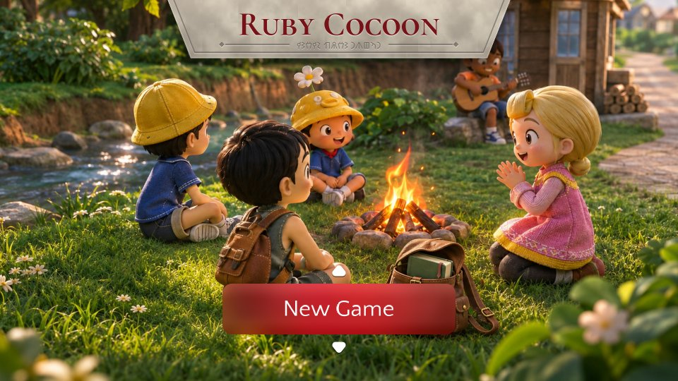

# Ruby Cocoon

A beast-training RPG with a clean, modern stylized look, for **Godot 4.8 beta 3**. You hatch your first beast from an egg, battle to make it stronger as it grows into its second and third forms, hatch every new beast from the eggs wild beasts leave behind, merge grown beasts into new ones built from both, and stop the Umbral Legion and their ghost beasts.

<br><sub>The start menu appears over a slowly zooming artwork slideshow.</sub>

## Running it

To just play, download the newest Windows or Android build from the [Releases page](../../releases/latest) (see
[Windows and Android builds](manual/builds.md)).

To run it from the source:

1. Install the pinned [Godot 4.8 beta 3](https://github.com/godotengine/godot-builds/releases/tag/4.8-beta3) standard build (the game has no C#), with matching `4.8.beta3` export templates when exporting.
2. Clone this repository, or download it as a zip and unpack it.
3. In Godot's Project Manager, choose **Import**, pick the `project.godot` in the repository's folder, then press
   **F5** to play. The first time, Godot imports all the assets before the game opens, which takes a while.

Or from a terminal, in the repository's folder:

```
godot --path .
```

Here and in the rest of the documentation, `godot` stands for your Godot 4.8 beta 3 executable, for example
`Godot_v4.8-beta3_win64.exe` on Windows or `Godot_v4.8-beta3_linux.x86_64` on Linux, with its folder in front if
it isn't on your PATH.

The local tools resolve the workspace editor under `build/tools/godot-4.8-beta3/`,
then the installation path; `GODOT` overrides that choice. The user approved this
beta target and comparison screenshots on 13 November 2026. Broader runbook 010c
feature/performance acceptance remains in progress; see the
[migration evidence and rollback](docs/visual_overhaul/010c-godot-48-results.md).

## System requirements

These are **provisional requirements for playing Ruby Cocoon**, not for developing it in the editor. OS and
graphics estimates retain the [Godot 4.7 exported-project baseline](https://docs.godotengine.org/en/4.7/about/system_requirements.html#exported-godot-project);
the [4.8 beta 3 validation report](docs/visual_overhaul/010c-godot-48-results.md) records tested targets and remaining gaps.
Hardware and free-space figures are estimates pending testing on lower-end PCs,
Macs and Android devices; they are not a guarantee of 60 fps. Existing [performance measurements](docs/performance.md)
come from a desktop Windows PC.

### Windows

| Component | Minimum (estimated) | Recommended (estimated) |
|---|---|---|
| OS | Windows 10, 64-bit | Windows 11, 64-bit |
| Processor | Intel Core i3-6100 / AMD Ryzen 3 1200 or equivalent; x86-64 with SSE4.2 | Intel Core i5-8400 / AMD Ryzen 5 2600 or better |
| Memory | 4 GB RAM | 8 GB RAM |
| Graphics | Intel HD Graphics 620 or equivalent, with full Vulkan 1.0 support and current drivers | NVIDIA GeForce GTX 1050 / AMD Radeon RX 560 or better, with 2 GB VRAM |
| Free storage | 1 GB | 2 GB on an SSD, including room for updates |
| Starting settings | 720p, Graphics **Min**; try 540p if needed | 1080p, Graphics **Mid** |

The downloadable Windows build is **x86-64 only**. Desktop play uses the Forward+ renderer by default.

### macOS

| Component | Minimum (estimated) | Recommended (estimated) |
|---|---|---|
| OS | macOS 13 Ventura | macOS 13 or newer |
| Processor | Apple M1, or a quad-core Intel Core i5 with compatible graphics | Apple M2 or newer |
| Memory | 8 GB RAM / unified memory | 16 GB unified memory |
| Graphics | Apple M1 integrated GPU, or an Intel Mac GPU with Metal 3 support | Apple M2 integrated GPU or better |
| Free storage | 1 GB | 2 GB on an SSD, including room for updates |
| Starting settings | 720p, Graphics **Min** | 1080p, Graphics **Mid** |

There is currently **no packaged macOS release or macOS export preset**. These estimates apply to running from
source with Godot 4.8 beta 3 (see [Running it](#running-it)); macOS compatibility and performance still need verification.

### Android

| Component | Minimum (estimated) | Recommended (estimated) |
|---|---|---|
| OS | Android 9.0 | Android 11 or newer |
| Processor | Snapdragon 660 or equivalent, with a 64-bit ARM CPU and OS | Snapdragon 865 or better, or an equivalent chipset |
| Memory | 4 GB RAM | 6 GB RAM or more |
| Graphics | Adreno 512 or equivalent, with full Vulkan 1.0 support | Adreno 650 or better, with working Vulkan drivers |
| Free storage | 1 GB | 2 GB, including room for installation and updates |
| Starting settings | 540p, Graphics **Min** | 720p, Graphics **Mid**; try 1080p on faster devices |

The APK is **ARM64 (`arm64-v8a`) only**; 32-bit Android and x86 Android devices are not included. It uses the
Mobile renderer and landscape touch controls. Android version alone does not establish Vulkan compatibility.

Change **Resolution** and **Graphics** in **Start → Settings**. The game's defaults are 540p / Max, so lower-end
devices should start with the settings above. Storage estimates cover the installed game and working space,
not the source checkout, Godot editor or asset-import cache. Browser play has separate requirements under
[Web version](manual/mobile-and-web.md#web-version-iphone-and-any-browser).

## Controls

| Action | Keyboard | Gamepad | Touch (phones and tablets) |
|---|---|---|---|
| Move (whole steps between tile centres) | Arrow keys; four ways by default | D-pad or left stick; four ways by default | D-pad, bottom left; four ways by default |
| Action: talk, confirm, use a beast or weapon on an obstacle | A (or Enter) | A | A, bottom right |
| Back; hold to run | S (or Esc) | B | B, bottom right |
| Start: the travel book menu | Space | Start | START, bottom centre |
| Pause | Shift | Back / Select | PAUSE, bottom centre |
| Flute notes (Esc / Pause stops a song) | ← → A S, then ↑ ↓ | ← → A B, then ↑ ↓ | ← → A B, then ↑ ↓ |
| Walk somewhere / run there / use something | Click / double-click / click it | | Tap / double-tap / tap it |

The Start book keeps the selected input's guide on Settings' right page: keyboard key mappings, screen-button
meanings, or a matching controller illustration and fixed mappings. Only Controller input shows controller artwork.
The book has no bottom key strip. Phones and tablets show their on-screen buttons when Screen input is selected.
Desktop browsers use a keyboard or controller guide instead of the touch pad, even on touchscreen computers. The
keyboard strip shows small grey key caps; the controller illustration's callouts use Kenney's *Input Prompts*: each
button is outlined in near-black, and fills with the gem while it is held (the controller's d-pad fills the arm being held). The
controller callouts show the connected controller's own buttons (Xbox, PlayStation or Switch). It also appears on the web title menu,
character creator and Load Game screen. Web builds have no Quit application
button; **Quit to title** in Settings still returns to the title menu.

USB and Bluetooth gamepads use Godot's automatic controller mappings, without a mapping screen. Connect or pair the
controller with your device, then play. The last controller used supplies the left stick. The full-width Start book
keeps two equal pages. Settings shows the matching **Controllercons duotone** illustration and fixed button guide
on the right page, without a bottom controller window. The controller is centred between labels above and below it,
with leader lines ending on the mapped buttons (both d-pad and left stick for Move). Flute controls are omitted
from this Settings guide for every input type. The title screen shows no controller illustration.
Layouts include Xbox, PlayStation, Switch/Joy-Cons,
Wii Classic/U Pro and Stadia layouts, with Xbox as the fallback for unidentified pads. Confirm is the bottom face button
(Xbox A, PlayStation Cross, Nintendo B); Back/run is the right face button (B, Circle, Nintendo A).
**Start → Settings → Diagonal movement** enables eight-way movement on every platform; it defaults to **Off**,
including with older settings files. On: hold two arrow keys or two controller d-pad directions, point the stick
diagonally, or hold a corner of the touch pad. Off: the pad holds one direction at a time, the stick chooses a cardinal
direction, and two held keyboard directions keep the current walking direction (otherwise the newest wins).
The stick keeps its radial deadzone. Diagonal steps retain normal ground speed and cannot cut corners, cross stair
rails, or approach ramps and doors diagonally. A blocked diagonal slides along a sole open cardinal component.
Started steps finish at their destination's centre even if the setting changes. Tap paths remain cardinal;
menus use cardinal navigation and flute chords keep their existing controls. Hold Back/B to run as usual.
Held screen controls reset when maps or battles change, or the app loses focus; lift and press again to resume.

**Start → Settings → Input** selects **Screen**, **Keyboard** or **Controller**, showing only available inputs.
Screen requires touch or mouse-emulated taps (desktop web uses guides); Keyboard requires a hardware keyboard on mobile;
Controller requires a connected pad. Your choice persists and sets the displayed controls/guide; connected inputs
remain usable. Controls are fixed; there is no remapping screen. With no explicit choice, connecting a controller hides Android/mobile touch buttons.
An explicit Screen choice restores the pad. Disconnecting falls back to an available input and restores
the phone pad when appropriate. Settings retain the selected row and scroll position while cycling or tapping values.

Tap (or click) anywhere in the world to walk there; double-tap to run. Tap a person, a door, a sign, an item, a weapon obstacle or a
wild beast to walk up to it and use it; if you're already next to it, you use it straight away.

## Documentation

The README covers running the game, system requirements and controls. Everything
else lives under `manual/`; start at the [manual index](manual/index.md), which lists
each page and what it covers:

| Document | What it covers |
|---|---|
| [Walkthrough](manual/walkthrough.md) | The journey in play order, map by map: what happens, who to talk to, and what opens next. |
| [Gameplay mechanics](manual/gameplay.md) | Beasts, eggs, growth, moves and elements, the battle ring, weapons, the flute, shops and saving. |
| [Progression and unlocks](manual/progression.md) | The story's objectives in order, the gate that holds each, what it opens, and the demo cutoff. |
| [Interface, journal and audio](manual/interface-and-audio.md) | The Start book and its pages, HUD and menus, speech bubbles, fonts, music and sound effects. |
| [Art and visuals](manual/art.md) | The game's look, asset packs, towns and architecture, interiors, props and rebuild commands. |
| [Settings and performance](manual/settings-and-performance.md) | Resolution, graphics presets, loading, baked assets and frame-rate notes. |
| [Mobile and web](manual/mobile-and-web.md) | Phone builds and touch controls, the browser version and its deployment. |
| [Development](manual/development.md) | Hub for working on the game, with the project layout and links to the pages below. |
| [Editing the maps](manual/map-editing.md) | The ASCII map format, tile letters, anchors, gates, heights, room templates, town plans and map checkers. |
| [Testing](manual/testing.md) | The test runner, the focused suites and what each one checks. |
| [Builds and releases](manual/builds.md) | The Windows, Android and Web builds published from GitHub. |
| [Debug scenes and trailer](manual/debug-scenes-and-trailer.md) | Developer preview scenes, the capture harness and the trailer pipeline. |
| [Performance measurements](docs/performance.md) | Measured frame times and the remaining performance limits. |
| [Visual overhaul](docs/visual_overhaul/README.md) | The step-by-step plan for the current art and lighting overhaul. |
| [Credits](CREDITS.md) | Every artist, pack and licence. |

## Credits

See **CREDITS.md**; the same list is in the game under Start → Settings → Credits.
- Most of the music appears to be Kevin MacLeod's (CC BY 4.0), which requires attribution.
- The TravelBook UI licence asks for credit and a note of changes.
- StickyBizcuit's asset pack asks for a hidden easter egg: look for Bizcuit in Cocoon Cove.
- Several packs (some sample models, the fonts, set1 and the sound effects) came without licence files. Check each source's terms before releasing the game.
