# Ruby Cocoon

A low-poly, PS1-style beast-training RPG for **Godot 4.7**. You hatch your first beast from an egg, battle to make it stronger as it grows into its second and third forms, charm wild beasts with your flute, merge grown beasts into new ones built from both, and stop the Umbral Legion and their ghost beasts.

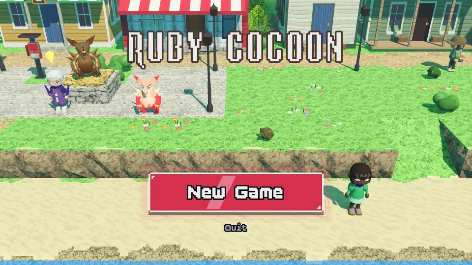<br><sub>The title screen, with Cocoon Cove behind it.</sub>

## Running it

To just play, download the newest Windows or Android build from the [Releases page](../../releases/latest) (see
[Windows and Android builds](#windows-and-android-builds)).

To run it from the source:

1. Install [Godot 4.7](https://godotengine.org/download) (the standard build; the game has no C#).
2. Clone this repository, or download it as a zip and unpack it.
3. In Godot's Project Manager, choose **Import**, pick the `project.godot` in the repository's folder, then press
   **F5** to play. The first time, Godot imports all the assets before the game opens, which takes a while.

Or from a terminal, in the repository's folder:

```
godot --path .
```

Here and in the rest of this README, `godot` stands for your Godot 4.7 executable, for example
`Godot_v4.7-stable_win64.exe` on Windows or `Godot_v4.7-stable_linux.x86_64` on Linux, with its folder in front if
it isn't on your PATH.

## Controls

| Action | Keyboard | Gamepad | Touch (phones and tablets) |
|---|---|---|---|
| Move (one of the four ways, a whole tile at a time) | Arrow keys (with two held, you keep going the way you were walking, else the newest one counts) | D-pad or left stick (the way it's pushed further) | D-pad, bottom left (one arrow at a time) |
| Action: talk, confirm, use a beast on an obstacle | A (or Enter) | A | A, bottom right |
| Back; hold to run | S (or Esc) | B | B, bottom right |
| Start: the travel book menu | Space | Start | START, bottom centre |
| Pause | Shift | Back / Select | PAUSE, bottom centre |
| Flute notes (Esc / Pause stops a song) | ← → A S, then ↑ ↓ | ← → A B, then ↑ ↓ | ← → A B, then ↑ ↓ |
| Walk somewhere / run there / use something | Click / double-click / click it | | Tap / double-tap / tap it |

On desktop, a key guide slides up along the bottom of the screen while the Start book is open, and hides again
during play. On phones and tablets the on-screen buttons take its place. You can switch either off in **Start → Settings**.

Tap (or click) anywhere in the world to walk there; double-tap to run. Tap a person, a door, a sign, an item or a
wild beast to walk up to it and use it; if you're already next to it, you use it straight away.

## The journey

New Game opens with a 72-second cinematic: the robot kidnapping scheme and a murder in **Gearhart Tower**, then the first
morning of spring in **Cocoon Cove**, as beasts leave hibernation and trainer season begins. Subtitles advance
automatically in the game's normal dialogue windows; **A / Enter** (or **Next**) reveals the typing, then advances a beat.
**Esc / B / Start** or **Skip intro** skips the
whole film. Keyboard, controller and touch all work. Continue and Load Game go straight to your saved game.
The murder is played straight, never slapstick (`scripts/story/opening.gd`): the office lights die, Vexmora calls up
a ghost beast that passes through Engineer Mara, Mara sinks to one knee and falls out of sight while the camera holds on
Vexmora's face, and the last shot is Vexmora walking away from her without a glance as Gearhart backs off. No flash and
no smack: the music stops dead, then a dread hit (`tools/make_sfx.py`). Both sets are built from the game's own pieces:
Gearhart's office by night (wood floor, brick, moonlit windows onto the neon city, the freight cages and lift) and the
hero's home on the first morning, Mom on the doorstep. The murder fades straight to the bright spring morning, and the
hero closes with an unwitting joke about anyone spoiling it.
The mounted Gearheart Industries sign uses an original vector gear-and-split-heart logo inspired by the supplied reference.

The hero knows nothing about the scheme. You start at home in **Cocoon Cove** with no beasts, no flute and no songs.
Mom gives the egg and flute objective even if the film was skipped. The first missing-trainer news is in **Dustwell Oasis**.
In Cogsworth, defeat Gearhart, then use the **Freight Lock Control** on his tower's top floor to release Lio, Bea and
Orin. The rescued trainers reunite in town, and their testimony points to Vexmora in Gravenmoor. Freeing them is
required before confronting Vexmora.

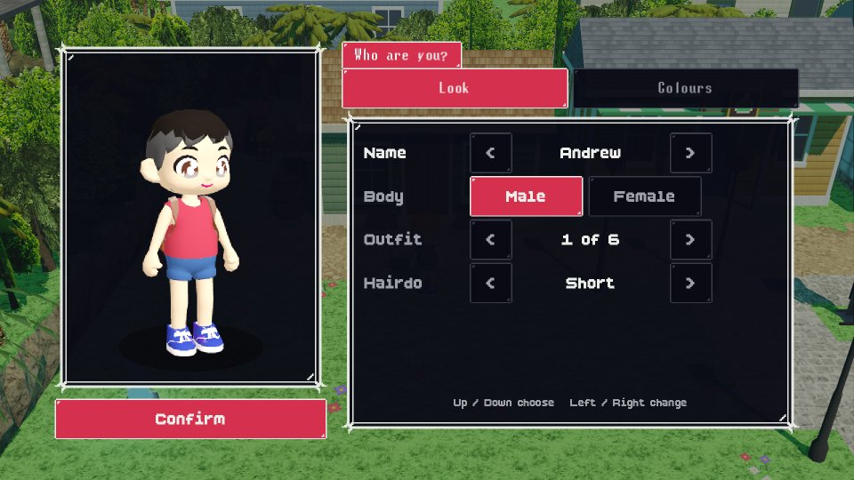<br><sub>The character creator's Look tab: name, body, outfit and hairdo; the Colours tab has the pack, skin, clothes, hair and eyes.</sub>

1. Mom tells you that your father's flute is waiting with **Uncle Rafe** in Tidewater, the next town east.
2. Elder Rowan lets you choose one of four elemental eggs.

   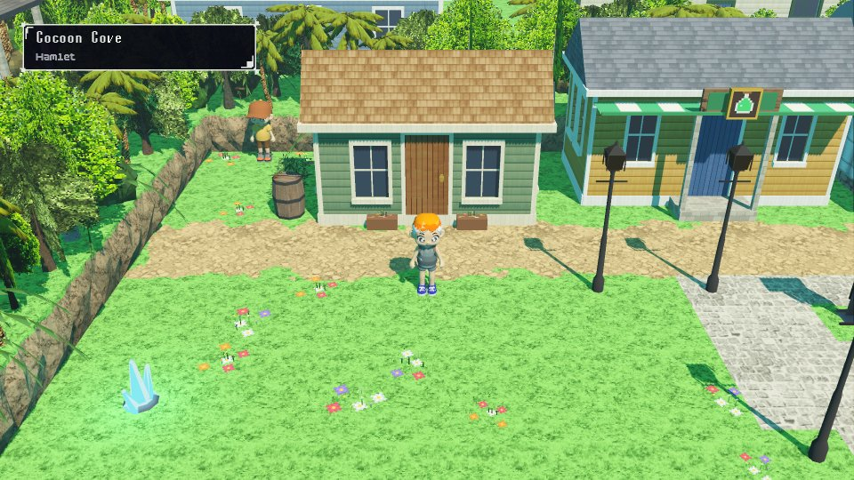<br><sub>Cocoon Cove, the seaside hamlet where you start.</sub>

3. The Beast Center hatches it into a **level 1** beast.
4. Scout Bram keeps the gate to the Coastal Path shut until you have a beast of your own.
5. The **Coastal Path** is the tutorial: a winding trail through the woods with five teachers on it (`world_db.gd`
   LESSON_TRAINERS, battle.gd LESSONS). Each looks straight across the trail where you can't slip past, so you always
   walk into their line of sight and they come over and stop you; you never need to talk to them first. Youngster Kit
   watches the trail where it reaches the creek. Each gives a guided battle, and so do the arena's coaches and
   the flute lesson (`battle.gd` LESSONS): every bar and every menu has just the one thing to pick, the one being
   taught (◄ ► stay put, and the teacher says what to do), the target and the beast to heal are chosen for you, and
   you can't lose: your beasts are healed first and always keep at least 1 HP, and nobody can run, forfeit or hit
   you. Your beast grows a level or so. Camper Tilly: the battle screen and
   fighting. Fisher Dale: turns, speed and Defend. Youngster Kit, on the trail by the creek: your own turn (slingshot, Watch, Run and Forfeit).
   Picnicker Mae: items (she gives you three Minor Potions). Ranger Holt: the ring, its middle beast, shields and
   striking an open trainer. Until you have a flute there are no wild beasts on the path, only its teachers.

   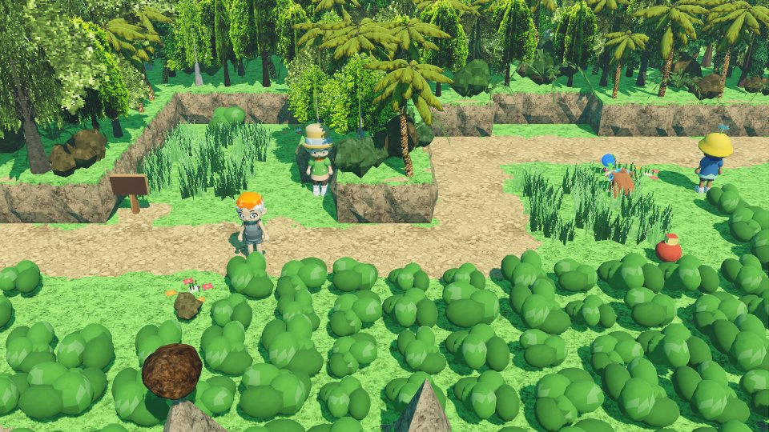<br><sub>The Coastal Path, the tutorial: a winding trail with teachers waiting on it.</sub>

6. Mend the washed-out footbridge on the Coastal Path to reach Tidewater (the sign only says there's a footbridge ahead
   and a builder's cabin by the creek). Old Hal the builder, in the cabin just west of it, is too tired to rebuild it
   himself: once you've talked to him you can take the logs stacked by his door and lay them across the creek. Go back
   in and he gives you a beast egg (a Tadlet) to hatch at Tidewater's Beast Center. Mended, it's a plank footbridge
   with railings.
7. Talk to **Neighbor Nell**, Rafe's old friend beside Tidewater's west entrance, for directions to his house: the one with the **golden flute sign** above the door. Uncle Rafe gives you the flute and teaches **Weaken** and **Capture I**, briefly: a couple of lines on how the sheet works, then he plays each song once and it's your turn to play it back. His lessons (and the guided battle after them) give you 30 seconds per song.
8. The first lone wild beast you meet after that is a guided battle too: Rafe's advice walks you through playing Weaken on it, then Capture (it always joins if you play the song through).
9. Arenas only take trainers with a flute. Each is one big room, like a Beast Center (the camera follows you round it):
   the host at the lobby desk runs the arena ladder and nothing else; the master waits in the hall on the other side of
   a wall that stops short of the front, and you challenge them there, in person.
10. Tidewater's arena teaches you to battle properly before you may face its master (`world_db.gd` ARENA_LESSONS,
    battle.gd LESSONS "team" and "elements"). Both coaches stand just inside the door; only Rory approaches you.
    **Coach Rory** stops you first and shows you fighting with a whole side of your ring (the arena's practice beasts
    fill your empty slots for the lesson). Then speak to **Coach Ondine** when you're ready for elemental
    weaknesses: her beast is weak to the element of the side facing it (with your earth
    side facing, you borrow the arena's air practice team, since nothing is weak to earth). Only then can you challenge
    **Tide Captain Marina**, and Captain Gull's ferry to the Isle of Tides only takes trainers with her Wave Crest.
11. The journey runs in one line: the Dune Road north of Tidewater stays shut by sandstorms until you've beaten the guardian of the Temple of Tides on the Isle of Tides.

Townsfolk and residents add a casual hint about what to do next to whatever else they say (`chatter_db.gd` HINTS, by
`Story.next_goal()`), so what they talk about moves on as soon as you've done it.

| Region | Towns | What happens |
|---|---|---|
| Coast | Cocoon Cove, Tidewater | Tidewater has the first arena (its coaches' lessons, then Tide Captain Marina, whose Wave Crest the ferry asks for), **Sparkwire Electronics** (shield points and beast slots), a Sky Tower and the ferry. |
| Isle of Tides | Shellhaven, Kelpwick | The two villages are feuding. Hear both chiefs, catch the smuggler on the Isle Trail who framed them, and they open the coral gate to the reef and the **Temple of Tides**. |
| Desert | Dustwell Oasis, Sundown Gulch (western town) | Bandits terrorise Sundown. Talk to the Sheriff, then beat Black Bart in the hideout to open the Dune Sea road. The **Temple of Winds** lies in the Dune Sea. |
| Mountains | Copperpick, Cogsworth (steampunk city) | CEO Magnus Gearhart is holding Cogsworth hostage and has sealed the road to the volcano. Fight up Gearhart Tower: each floor's robot sentries must fall before the stairs unlock. |
| Volcano | Emberfall | The **Temple of Flame** sits on the Caldera Road. |
| Jungle | Vinehollow | The village sells the finest gear in the land. The shaman needs the Sun, Moon and Earth relics; the ritual raises the hidden **Temple of Roots**. |
| River and moor | Riverbend, Gravenmoor | Gravenmoor is the Legion's town. Ghost beasts can be hatched and merged from here on. The gravedigger teaches the Requiem of Dusk. Commander Nyx guards the cathedral, and General Vexmora waits in the crypt beneath it. |

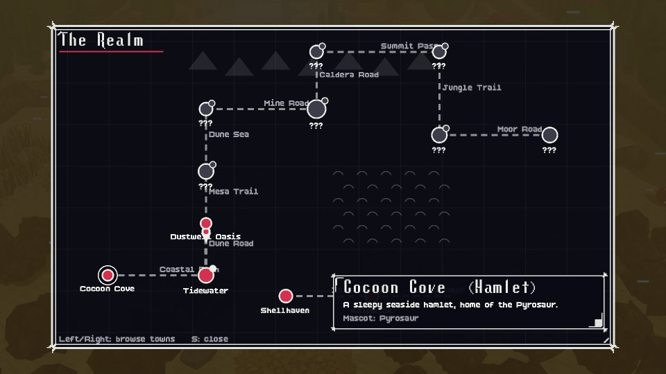<br><sub>The world map: the towns you've been to, and ??? for the ones you haven't reached yet.</sub>

Every road between towns narrows to one bottleneck with a puzzle, getting harder as you go:

| Road | Puzzle |
|---|---|
| Coastal Path | A washed-out footbridge. Old Hal the builder, in the cabin beside it, lends you the logs stacked by his door; lay them across the creek, then he gives you an egg. |
| Isle Trail | Thorny brambles. A fire beast burns them; an air beast slices them down. |
| Dune Road | A sheer cliff with a rope ladder coiled at the top. A beast with wings flies up and drops it. |
| Mesa Trail | A rockslide: push the boulders around until a path opens. |
| Dune Sea | Black Bart's barricade. Beat the bandit gang in their hideout. |
| Mine Road | The mine checkpoint. Foreman Gorran signs a Miner's Pass when you beat him at the Copperpick Arena. |
| Caldera Road | Gearhart's steam gate, then a stream of lava that a water beast cools. |
| Summit Pass | A frozen pond of ice blocks that slide until they hit something. |
| Jungle Trail | The Jungle Warden blocks the crossing until you beat him. |
| Moor Road | A fog bank that an air beast blows away, then a Legion sentinel to defeat. |

Leave a push puzzle and come back to reset it; once solved, the blocks stay where you left them. Smaller elemental
obstacles (driftwood, sand drifts, boulders, dust storms, ravines) still turn up off the main road.

## Systems

- **Fishing** (`scripts/world/fishing.gd`, `scripts/ui/fishing_game.gd`). Fisher Gil fishes off the deck of his rusty
  tin shack on Tidewater's docks. Talk to him and he offers his spare pole, leaning in the shack (take it before asking
  and you're told stealing is bad). Come back out with it and he stops you for a first cast: something always bites,
  the line is gentler, and he has you try again until you land it. After that, face any water and press A to cast.
  Where the water ripples (each map's `fish_spots`, plus a few picked along its shores) something nearly always bites,
  and quickly; anywhere else only now and then. When the float dips, tap A to strike, then reel: each tap pulls the
  line tighter and it slackens on its own; tap it up into the bright zone and keep it there with steady taps until the
  catch meter fills. Too fast and the line snaps, too slow and the beast slips off. Land it and it leaps out for a
  wild battle on a plank dock with the beast out on the water (`battle.gd` _fishing_scenery). Bait (put on your hook
  from the bag, worn until something bites) brings stronger, rarer water beasts, sooner: Wriggly Worms on the islands
  (Shellhaven, Kelpwick), a Spinner Lure from Copperpick, Cogsworth and Emberfall, a Glow Lure from Riverbend and
  Gravenmoor. Captain Gull's ferry is moored by the long pier, and Gil's rowboat by his shack (map `boats`).

  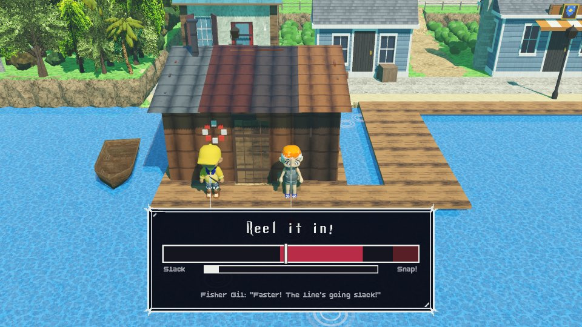<br><sub>Reeling one in with Gil, off his shack's deck in Tidewater.</sub>

- **13 beast lines** of three forms each (`race_db.gd` LINES): Fire has the spiky dino (Embit, Cinderex, Pyrosaur),
  the cactus (Pricklet, Spinesear, Saguaroar) and the pink imp (Impkin, Scampyre, Infernook); Earth the beetle
  (Grubbit, Shellhorn, Rhinoclad), the armoured boar (Tuskit, Bristlehog, Crystusk) and the tree (Saplet, Barkbrute,
  Elderoot); Water the crab (Clawlet, Snapshell, Crustacor) and the frog (Tadlet, Croakus, Toadmiral); Air the owl
  (Hootlet, Gustowl, Tempestrix), the bat (Flittle, Duskwing, Nocturna) and the berries (Berrypuff, Bramblume,
  Galeberry). Two lines are of two elements: the scorpion (Nipskit, Scorchpin, Calderak) is Fire and Earth, and the
  worm that is an eel in the sea (Wrigglet, Mudwhip, Abyssel) Earth and Water. The weaknesses are: Fire to Air, Earth
  to Water, Water to Air, and Air to Fire.

  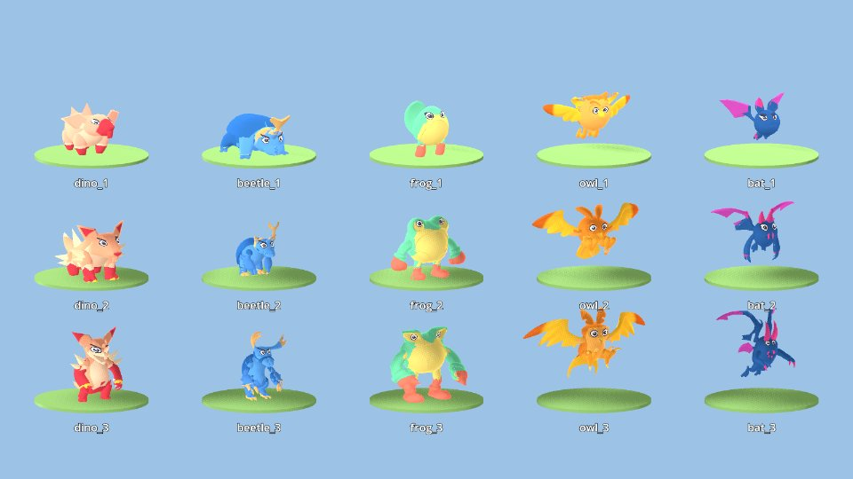<br><sub>Five of the lines, each in its three forms.</sub>

- **Growing up**: a beast hatches as its line's first form and grows into the second at **Lv 20** and the third at
  **Lv 40** (`RaceDB.EVOLVE`, `Beast.evolve`): bigger, stronger, with the new form's name (unless it has a name of its
  own). It keeps its moves, and a line learns the same moves at every form. Wild and trainers' beasts are whatever form
  their level gives.
- **Element roles**: Fire are offensive tanks, Water are healers, Earth are defenders, and Air handle status and evasion.
- **Eggs**:
  - A defeated wild beast has a **20%** chance to leave an egg at the end of the battle.
  - Trainers' beasts, robots and guardians never drop eggs.
  - Beast Centers hatch eggs into level 1 beasts, the first form of the egg's line.
  - **Sell eggs** at the Beast Center: ordinary eggs fetch **100 gold**, Shadow Eggs **200**, and radiant legendary eggs **500**. Select an egg and confirm the offer to sell it.
  - Arena hosts and masters offer to buy eggs only when you carry one matching the master's element, paying **twice the Beast Center price**. Marina, Nerissa and Skye buy Water eggs; Rosa buys Air; Gorran, Volta and Aeris buy Earth; Brann buys Fire. Shadow Eggs count as Ghost, and radiant eggs use their guardian's element. You can sell before completing the arena's lessons or challenging its master.
  - Ghost beasts drop Shadow Eggs only after you reach Gravenmoor.
- **Temple guardians** are summons: each elemental temple holds a legendary guardian (Abyssion, Zephyrax, Pyroclast
  and Terranox), and Gravenmoor's crypt holds the ghost Nocthrax. A stone puzzle in each teaches that temple's song.
  A guardian can't be knocked out (it rises again): weaken it and play its song to capture it. In battle the same song
  summons it, once per battle for one shield point, to hit every foe for about half their HP, more with an element
  advantage; bosses always survive it (`summon_fx.gd`).

  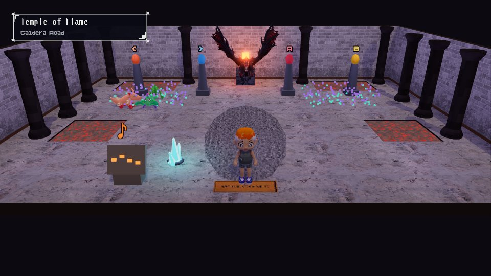<br><sub>Inside the Temple of Flame, on the Caldera Road.</sub>

  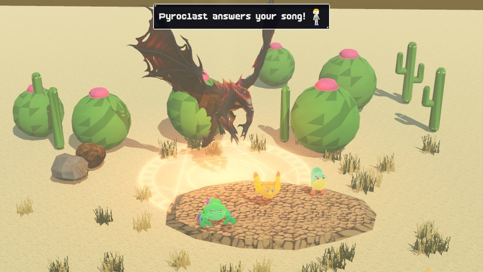<br><sub>Pyroclast answers your song: a summon arriving in battle.</sub>

- **Merging** happens at Beast Centers, between two beasts grown into their final form and at their level limit: **Lv
  40** at rank 1, and each merge raises the limit by 20 (`Beast.level_cap`). A normal merge is 50/50. The new beast is
  put together from both parents' models (`beast_parts.gd`): one gives its frame, the other some of its parts (its
  head, arms, wings, tail or legs, each set where the frame's own were), and it is painted in one parent's colours. A
  legendary parent dominates at **80/20** and keeps its race. Ghost merging unlocks in Gravenmoor.
- **Ghost beasts** aren't beasts of their own: they're the same beasts in black and purple, glowing faintly and
  wrapped in smoke.
  - Beasts of neighbouring elements on the ring (Fire–Air, Air–Water, Water–Earth, Earth–Fire) merge into a **dual beast** of both elements. Opposite elements (Fire–Water, Air–Earth) can't merge.
- **Everyone moves one of the four ways** on the tile grid, a whole tile at a time: you, strolling townsfolk and wild
  beasts. A step, once started, always ends in the middle of the next tile (whatever you let go of or press on the
  way), so you always stop lined up with people, doors and items. With two arrows held you keep walking the way you
  were going, else the newest arrow counts (`world.gd` _key_dir).
- **Cliffs and ramps**: every town and road has high ground (`scripts/world/elevation.gd`). Woods and rock stand on
  ridges along the back and sides of each map, so you're closed in there, with the roads out running through cuts in
  them; many maps have terraces too: Cocoon Cove above its beach, Tidewater's old town over the harbour, the Dune
  Road's escarpment (the rope ladder a flyer hangs climbs it), the Mesa Trail's canyon walls, Gravenmoor's graveyard
  knoll. Nobody climbs or drops down a cliff, and nobody talks, picks things up or sees across one (trainers and wild
  beasts included); ramps are walked up and down along their slope. Where a river runs over a cliff it falls as a
  waterfall (Riverbend). Behind high ground you're never lost from sight: whatever ground stands between the camera
  and you dissolves around your shape in a PS1-style dither (`terrain.gdshader` `hole`), as buildings in the way fade.
- **Town mascots and their signature moves**: every town has a mascot beast roaming its square and a statue of it
  beside, cast in bronze (the coast and the isles), silver (desert to mountains) or gold (the far towns). The mascot
  teaches a beast of its own line, once it reaches **Lv 40**, the town's signature move: an elemental attack mightier
  than any move of its element learnt by levelling (`world_db.gd` TOWNS "signature", `move_db.gd` SIGNATURE, e.g. the
  Pyrosaur's Bandit Blaze in Cocoon Cove; the frogs' Toadmiral is the mascot of both Tidewater and Riverbend, and
  teaches each town's own move). Nobody else teaches it, and a merge keeps it only for a beast of that line. The statue's plaque explains it, and townsfolk bring it up now and then (`chatter_db.gd` MASCOT_MOVE).
- **Wild beasts** roam the routes in plain sight; there are no random encounters (the tall grass is still there).
  - Each beast sees in a cone in front of it, half as far if you're in tall grass, and hears you running nearby.
  - Beasts come running when they spot you. Only a lone beast hopelessly outmatched by your best one (8+ levels below it) bolts.
  - Marks: a yellow **!** when one spots you, a blue **!** when it's scared and fleeing, and **?** when it loses you. Nothing shows while it charges, or once it goes back to roaming.
  - Walk into one from behind before it spots you: a **sneak attack** (green spiral, it loses its first turn). Meet one face to face: a normal battle (blue spiral). Let one catch you from behind: an **ambush** (red spiral, you lose your first turn).
  - After any wild battle, you receive **three seconds of protection** during field control. Wild beasts cannot see or hear you, drop any chase, and cannot start another encounter, even on contact. After a **victory**, your character smoothly pulses between 35% and 80% opacity until protection ends, then returns to full opacity. Escaping or losing (including the return to the Beast Center) keeps the character fully opaque. Trainer battles grant neither protection nor an opacity pulse. Menus, interactions and map transitions pause the countdown and opacity pulse.
  - Groups grow slowly through the game (`Story.pack_cap`): beasts roam alone on the early roads (always on the Coastal Path), in pairs from wild Lv 7, and in threes only from Lv 16. Within that, a beast no stronger than your best one usually (70%) roams with more of its own kind, and the pack stands its ground; on roads with wild Lv 16+, stronger four-legged beasts, flyers and serpents sometimes run in packs too.
  - Each road's trainers are stronger than any wild beast on it. The early levels climb slowly: Coastal Path Lv 2-4, Isle Trail 4-7, Coral Reef 7-10, the Temple of Tides 8-11 (its guardian Lv 12, with one helper), Dune Road 10-13.
- **Levelling** is slower than before: about twice as many wins per level.
- **MP**: elemental attacks cost MP (about a tenth of their power, at least 2); regular (neutral) attacks and every other move are free, and a regular attack is always there when MP runs out. MP comes back only from healing (the Beast Center machine, Mom, your bed) and items: Spirit Drop (15), Spirit Tonic (40), Spirit Elixir (all) from apothecaries, and Mint Tea at cafés.
- **The battle ring** (as in Jade Cocoon 2, `scripts/core/ring.gd`): every trainer stands in the middle of a ring of 8 slots.
  - The ring has a side per element, in this order round it: **Fire, Air, Water, Earth**. A side's middle slot holds a beast of that element; the **corner** between two sides holds a beast of either element, or a dual beast of both.
  - You carry as many beasts as you have **beast slots** wired up: 3 to start, up to 8. New beasts take a free slot they may stand in, joining the side most of your team stands on.
  - **Arranging your beasts** (`ring_editor.gd`, **Start → Beasts → Battle ring & storage**, anywhere outside battle): your ring's eight slots round you, the side facing the foe at the top, and your storage as a grid beside it. Tap a beast (or move to it with the d-pad and press A) to pick it up: only the cells it may go to light up, the rest darken. A slot it can stand on, trading places with whoever is there if they can stand on its old one; a stored beast, swapping with it; or storage's empty cell. A stored beast only takes an empty slot while your ring has room, and one beast always stays with you (`GameState.ring_move_reason` has the rules). Tap it again (or B) to put it back down. Beast Centers' storage terminals still heal a beast you deposit; the book doesn't.
- **Battles** (`battle.gd`, `command_panel.gd`, `battle_bars.gd`, `ring_grid.gd`): one side of each ring faces the foe, and only its three beasts fight, using **that side's element** or plain (neutral) moves. A dual beast in a corner uses whichever of its elements faces the foe.
  - The camera looks over your shoulder: you stand at the bottom right, the foe at the top left. Every slot is an ornate hexagonal pad with a glowing sigil of its element(s); the side facing the foe glows brighter.
  - The HUD is kept to JC2's: the foe's ring as a slanted 3x3 grid at the top left (a wild pack: a line of three tiles), yours at the bottom right, and a compact message box centred at the top. Battle messages show an icon of the beast or trainer they describe, on the left for enemies and on the right for your side; the message and move-info windows share the same padding and frame. Each grid tile is a slot: a beast's icon (with a small HP bar) stands on it, a fainted beast's icon is crossed out, and empty slots are faded. The trainer stands on the middle tile; the foe's shield points are blue orbs under its grid.
  - Beside your grid are the **move bars**, one per beast on the side facing the foe, level with its row: its level, then the move it will use, with its HP and MP underneath. If the move costs MP, the part of the MP bar it would spend slowly flashes. Your own bar comes first, on its own: while you choose your action only your grid's centre cell glows and the front three beast tiles fade. Your bar overlays that front column, at the same distance from your centre tile as the beasts' bars are from theirs, trimmed in gold and showing your trainer level and action; once you move on, the beasts' bars take its place. Your shield points are blue orbs under your grid.
  - Each round you choose your own action first, then each beast's move from the top: ◄ ► change it, A confirms, and then **every move aimed at someone has its target picked**, even with just one foe (◄ ► and A: a foe on the side facing you, or their trainer when that side's middle beast is down); a move that hits them all shows them all to confirm. A move isn't set until its target is, and the round only begins once every beast facing the foe is set. B goes back. One press of A is one confirm (on a phone, too). ▲ ▼ move between your beasts; **▲ on the top beast (or on your own bar, once your action is chosen) turns the ring (and the grid) anticlockwise, ▼ on the bottom one clockwise**, to the next side with a beast standing on it.
  - **The ring turns by itself** when a battle starts to a side with a beast standing in its middle (the side you last faced if it has one, else the nearest), and at the start of your turn when everyone on the side facing the foe is down. The bars, the grids and the battle text are drawn large (1.4x on desktops, 1.5x on phones). Phones (`--touch`): the bars and your grid stand centred just above START and PAUSE, clear of the d-pad and A and B; bars and the foe's tiles can be tapped.
  - **Choosing a target** (for every attack, the slingshot and items): the move-info window closes and an arcing arrow connects the attacker to the chosen target. A move that hits everyone draws an arch to each of them. There is no bobbing triangle over anyone's head. There are no target cards or weakness stars. ◄ ► (keys or d-pad) change the target; a tap on a grid tile aims at it (a second tap confirms), and A confirms. B returns to move selection and restores move info. After an elemental hit, a short message says when it was extra effective or the target is resistant.
  - **Move**: instead of its move, a beast on the side facing the foe can step over to another slot of the ring (choose the slot with ▲ ▼, as you would a target; the arrow marks the slot). Any slot it can stand on that's empty, or holds a fainted beast (they trade places); the side it moves to then turns to face the foe. It may not leave the side facing the foe without a beast standing in its middle (so the beast guarding you stays put, but a corner beast can step into a fallen middle beast's place). One beast moves each round, last in your side's turn, so the others' moves land first. Foe trainers Move too: when the beast in the middle of the side facing you falls, one of that side's beasts steps into a slot that covers its trainer again, unless turning the ring to a side whose middle beast stands would keep more of their beasts fighting (`battle.gd` _ai_shift).
  - Then the two sides take their turns, the **faster side first**: the speed of its beasts facing the foe, helped by its trainer's level. Within a side's turn, the trainer acts first, then its beasts by priority and speed. You never see what the foe has chosen: it happens on its turn (a trainer may turn its ring then too).
  - Your actions: **slingshot**, **items** (potions, cures, revives, elemental bombs, sleep, poison, flash, nets, snares, weaken powder, haste, iron and war-drum tonics), a **flute song**, **Watch**, and **Run** (wild) or **Forfeit** (trainers). Each beast: a move, **Defend** (half damage until its side's next turn), or **Move** (to another slot).
  - Winning plays *Android Sock Hop*. A beaten foe vanishes in a puff of smoke; your own fainted beasts lie on their pads. A beaten trainer (you too) drops to one knee, head bowed, catching their breath: never knocked flat, as nobody gets hurt (`voxel_person.gd` set_pose "kneel"); a beaten robot powers down. Damage numbers use BoldPixels.

  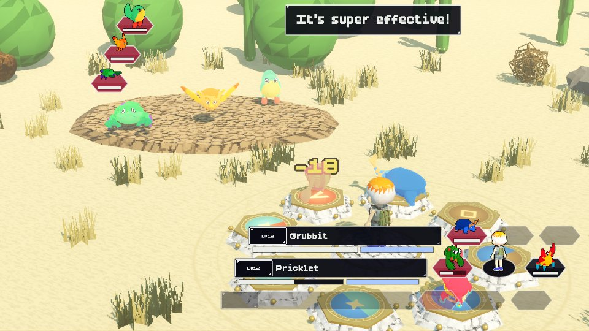<br><sub>A wild battle, picking Bite's target: your trainer and beasts on the ring (right), the foes across the sand.</sub>

- **Shield and the end of a battle**:
  - If the beast in the middle of the side facing the foe is down (or that slot is empty), its trainer can be **attacked directly**: each hit breaks one shield point. Turn your ring to a side whose middle still stands to cover yourself, or have a corner beast Move into the fallen one's place.
  - A trainer battle ends only when a trainer is hit with no shield left, or someone forfeits. Wild beasts have no trainer: beat them all to win. If you're the one hit with no shield left, you wake up at the nearest Beast Center you've visited.
  - Every trainer starts with 1 shield point; trainers on the roads have 0 to 3, depending on their strength. The shield recharges after every battle.
- **Trainer level**: beating trainers earns trainer XP, and clearing a rank of the **arena ladder** raises your trainer level to at least that rank + 1. The ladder (`ladder_db.gd`) is the same at every arena: ten ranks of three or four ring trainers each; beat them all to open the next rank. Each rank cleared earns a crystal shard; beaten trainers can be fought again.
- **Sparkwire Electronics** (Volt, Tidewater): **shield points** (5 crystal shards each, up to 4) and **beast slots** (3 shards each, up to 8). How many Volt can fit depends on your trainer level: one more slot per level, one more shield point every other level.
- **Flute songs** are a sheet-music game.
  - Only a song you're learning plays by itself (from a teacher, sheet music, a flute trainer, or the next level of Capture): it plays once while its notes light up on the staff. A song you already know (in battle, practising) doesn't: the sheet comes up and it's your turn straight away. Each line and space is a button: ← → A B from the bottom up.
  - The clock starts on your turn (*Your turn!* lights up over the sheet). Play the notes in order: the sheet stays up the whole time, with the notes you've played lit.
  - You have 10 seconds for four notes and 5 more for every four more (30 seconds in Uncle Rafe's lessons). The bar shrinks without numbers, going green, then yellow, orange and red. The colour you finish in sets the song's power: full in the green, about half in the red.
  - Each wrong note breaks one of three hearts and costs a little power. Lose all three, or run out of time, and the song fails.
  - Songs start at 4 notes and grow to 16 as they level up. Capture levels up through Capture I to XI; every other song levels up with mastery stars. Bigger songs add ↑, then ↓, and finally chords (A or B pressed together with a direction).
  - Uncle Rafe keeps it short the first time: he plays the song, then you play it back.
  - There are two kinds of song:
  - **Battle songs** work in any battle.
    - Some lift your team: Swift Jig, Battle Hymn, Iron Chorale, Mending Melody, Cleansing Canon, Mirage Minuet.
    - Others hinder the foe: Weaken, Sluggish Waltz, Dazzling Trill, Drowsy Lullaby, Venom Serenade, Static Polka, Discord, Dread March.
    - A great performance doubles stat changes and raises status odds. Mastery stars make songs stronger too.
  - **Capture** is the charm song, and it grows in levels.
    - Capture I charms wild beasts up to Lv 5. Later levels reach Lv 10, 15, 20, 25, 30, 40, 50, 60, 75 and 100.
    - It only works on beasts no stronger than your strongest beast. A **flawless** performance (no missed or wrong notes) can charm a stronger one.
    - The worse you play, the lower the chance.
    - When one of your beasts reaches the cap, you're told the next level is ready. You learn it by practising it on the Flute page of the Start book.
  - The **Requiem of Dusk** follows the same rules for ghost beasts.
  - Other trainers' beasts can't be charmed.
  - The **arena masters** teach strong combined battle songs, such as Tidewater Shanty (ATK and SPD up) and River Anthem (heal, cure, SPR up).

  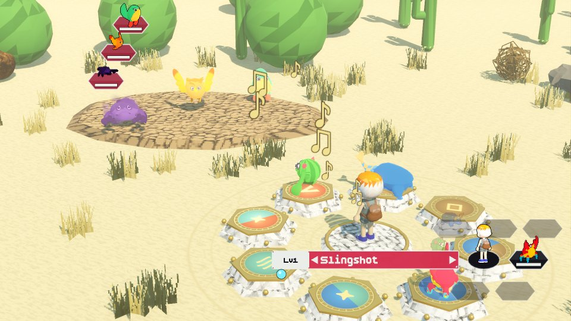<br><sub>A song's notes flying from your flute to its targets.</sub>

- **Learning songs**:
  - **Brass & Reed Music** in Cogsworth: Maestro Clef plays one song from his book for free, once. Play it back from memory to learn it. He also sells sheet music, which you can practise from your bag until you get it right.
  - **Flute trainers** play their own songs in battle: four route bards, three arena masters, Commander Nyx and General Vexmora. Win, then play the song back **without a single mistake** to learn it. Bards and arena masters will battle again for an encore.
- **Fast travel**:
  - Climb a **Sky Tower**: Skykeeper Aria's ticket desk is in the lobby, and the stairs lead up to an open-air platform on the roof, where the Tempestrix flies you to any town you've visited, for a fee.
  - Once you own an air beast of **Lv 40+**, pick *Fly* on the Trainer page of the Start book to travel from anywhere outdoors.
- **Beast Centers** all look the same: a 1950s roadside diner with the pawprint sign by the door, to the tune of "Hep Cats". It's one big room (17x9 tiles, bigger than the rest, so the camera follows you round it), the kennel on the left behind a wall that stops short of the front. Each machine has its own bay along the back wall.
  - The **healing machine** is a tall glass healing chamber with a lamp per beast round its foot; the glass glows while it heals. Use it yourself, any time, for free.
  - The **storage terminal** and the **merge altar** stand in the bays beside it.
  - Nurse Clover at the counter hatches eggs in the **incubator** beside her (it sparkles when an egg hatches), and runs storage and the merge altar. A red phone stands by the door, for calling Dad or Mom (see Saving).
  - Round the end of the wall, on its own wood floor, is the **kennel**, with two chairs in its front corner. Kennel Keeper Pip looks after beasts other trainers left behind; they wait in the pens behind his counter, close to your party's level. Adoption costs **40 gold at Lv 1, plus 2 gold per additional level** (78 at Lv 20, 118 at Lv 40). The list and confirmation show the fee; you need enough gold to adopt. Or drop one of yours off for another trainer (Pip thanks you with a little gold); taking it back before another trainer adopts it is free. Tapping a pen walks you over to Pip. Empty pens fill up again after a few minutes of play.
  - Guide Dottie walks about the room and explains how it all works.
  - All three wear the Beast Center uniform: white on top, red below, and a red cap with the pawprint from the sign over the door on a white panel at its front. None of them wears glasses.

  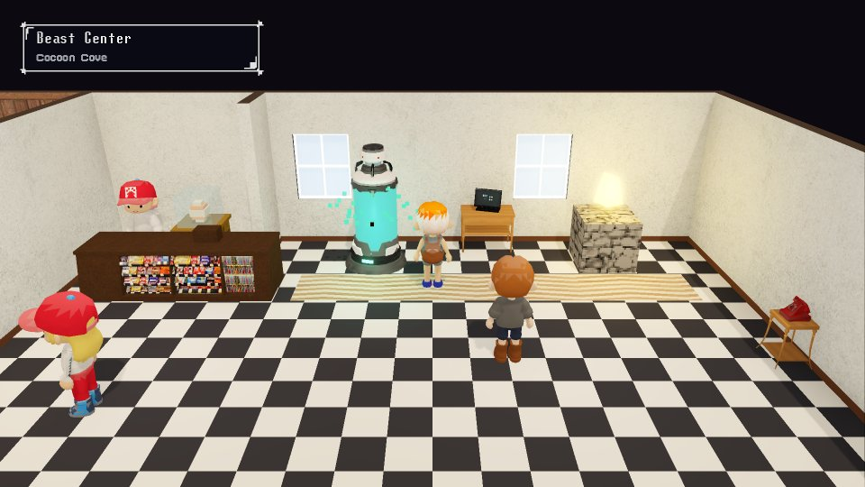<br><sub>Cocoon Cove's Beast Center: Nurse Clover's counter, the healing machine glowing in its bay, the storage terminal, the merge altar and the red phone.</sub>

- **Saving**: your dad is away up north for work, and **calling him is how you save**. Tell him how your journey's going, he cheers you on, and the game is saved; then keep playing, or stop for now (back to the title screen).
  - Saving is free. Red phones stand in homes, every Beast Center, the apothecary, café and music shop, the arenas' lobbies and the doorways of the temples of winds, flame and roots. Only the red **payphone** by each town's square costs anything: 5 coins a call (no coins, no call).
  - On the first morning the phone rings as you go to leave home, and you can't go out until you've answered: it's Dad, wishing you luck.
  - Away from home a phone asks who to call: **Dad** (save) or **Mom** (advice; a payphone still takes its 5 coins). At home Mom's in the room, so that phone only calls Dad. Mom saves nothing: she passes on a tip for what you're doing now (`chatter_db.gd` MOM_TIPS, by `Story.next_goal()`, taking turns call by call), always as something she saw on the TV news, something Grandma wants you to know, or a call from someone who saw you do something you've done, with advice for what's ahead. Then she looks in your father's old trainer guide: your beasts' average level next to the wild beasts where you are, or, where there are none, the road or arena master next on your journey (MOM_AHEAD), and whether you're too weak, about right or strong enough to press on (`phone.gd` level_advice).
  - Every phone stands on a wooden side table in the middle of its tile, out from the wall, so you stand right beside it to call.
  - Ten save slots, one per journey: you never pick a slot when you save. A new game takes the first empty slot the first time you save, and after that every save goes back into the same slot. If all ten are full, Dad asks (A: Yes / B: No) before writing over the save made longest ago.
  - Each save keeps a snapshot of that moment (the world without the UI) and your play time, shown right after you save.
  - The title screen's **Load Game** lists the slots with their snapshots; you can load, copy or delete them there.

  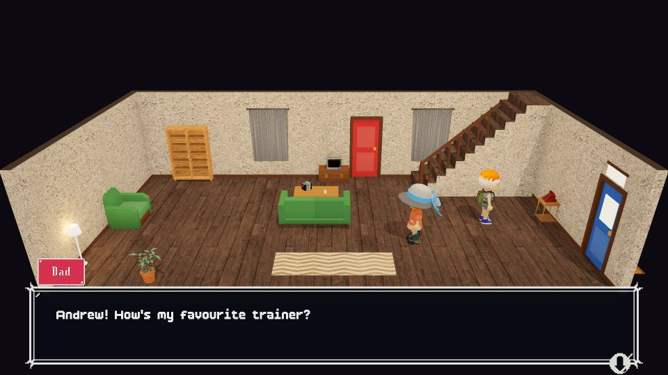<br><sub>Calling Dad from the phone at home: that's how you save.</sub>

- **Shops** differ per town. Small towns have a few; cities have many. Each building has a wordless sign fixed flat to its front above the door, showing what it is (houses have none).
- **Inside**, every house and shop is a compact room seen whole, like a stage set: no front wall, the camera holding still, and the front door in a side wall (the Beast Centers and arenas are bigger, and there the camera follows you). Blue doors open (a door to another room loads that room on its own): you stop in front of one and it swings open, away from you, as the room fades out, and the door you come in by swings shut behind you; red ones are locked. Every room has windows in at least one wall, never in a wall with a door to another room (the front door may share theirs). Homes have no kitchens to wander into: many townsfolk live in studios, bed and sofa in one room, while others have a bedroom through a door or up a flight of stairs. Stairs always come up into a landing, a hallway half a room deep, with the floor's rooms through doors off it, and you only get onto them at their open end: up from the foot of the flight, down from beside the top step of the stairwell, never through the handrail or the wall beside them. You walk on up (or down) them as the room fades out, and on the other floor you're seen walking the last of them as it fades in. Your own home has the living room downstairs, with Mom (she has your skin, hair and eyes) and the phone; upstairs, your bedroom (where you wake up), Mom's room and the bathroom open off the landing. The big dungeons (temples, the hideout, Gearhart Tower, the Sky Tower and the cathedral) keep their own layouts, open at the front too.
  - Everyone who works in a shop stands behind a counter and wears their shop's uniform: a polo in the shop's colour with a contrasting collar and cuffs, short sleeves, a name badge and usually a visor (the sensei and the fortune teller wear headbands, the music hall's usher a pillbox hat).

  Furniture follows the [interior staging rules](docs/interior_staging.md): side-wall furniture faces inward and other
  lounge seating opens towards the camera. Walls use smooth solid finishes or subtle striped wallpaper. Floors use
  warm wood, soft carpet or quiet tile/stone finishes. Bordered area rugs use 2x3, 3x4, 4x5 or 6x5 tile footprints
  (either orientation), fitted around walls and stairs. TVs are
  assumed to stand on the omitted fourth wall. Tall storage and scenery stay at the back or sides; low
  tables and displays leave the central playing area readable. Dining chairs face their tables in profile or towards
  the camera, and standing residents usually face the audience. Doors, stairs, phones and lesson routes stay clear.

  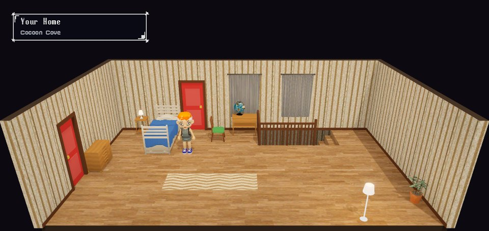<br><sub>Upstairs at home: your bedroom, where you wake up. The blue door leads out to the landing.</sub>

- **Locked doors**: about a third of houses are locked, and so is Gravenmoor Cathedral until its Legion guard is beaten. Locked doors are crimson with iron straps and a brass padlock in every town. Try one and you knock (knock-knock-knock), and whoever is inside shouts something silly through it.

## Art

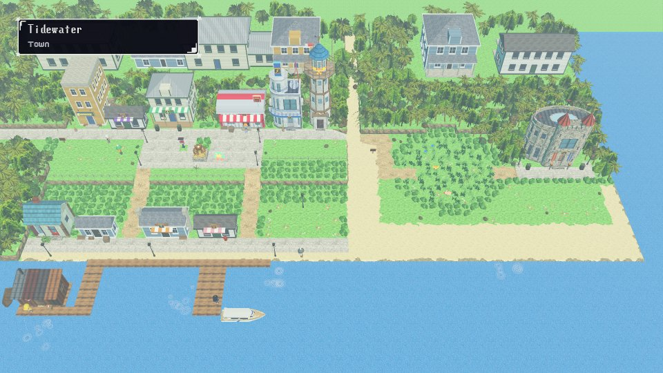<br><sub>Tidewater from above: its houses, the arena, the Sky Tower and the docks.</sub>

- **App icon**: the game's original Redcoon, from before the 13 lines (with a cuter, icon-only face: big shiny eyes, a muzzle and pink ears) on a floating meadow island over a green valley. `python tools/make_icon.py` renders it with `tools/make_icon.gd` and writes Android's adaptive icon layers (background, foreground and a monochrome silhouette for themed icons) to `assets/icon/`, plus `icon.png` for the window.
- **World and props** (trees, rocks, fences and the like) are PSX pack models baked by `tools/import_psx_models.gd` into `assets/nature/`, `assets/props/` and `assets/boats/`, and listed in `scripts/data/voxel_manifest.gd` (cacti and the head totem are drawn in code). The packs themselves aren't in the repository; with one downloaded again into `psx/`, re-bake and then let Godot rescan, or its file index (and so the exported game) won't include new files:

  ```
  godot --headless --path . --script res://tools/import_psx_models.gd
  godot --headless --path . --import
  ```

- **Beasts** are the 39 untextured models of the "new beasts" folder (three to a line), painted and animated in the
  game:
  - `python tools/new_beasts/bake.py "path/to/new beasts"` cuts each form out of its .obj (some files hold a whole
    line side by side), turns it to face +x standing on y = 0, scales it to one size, drops the stray triangles the
    source meshes carry between parts, and labels each face with a part of the body (body, head, arms, wings, legs,
    tail, horns, eyes; `tools/new_beasts/forms.json` holds each form's corrections) and each part with its joint.
    `--debug out_dir` draws every form with its parts coloured. Then
    `godot --headless --path . --script res://tools/import_new_beasts.gd` makes `assets/beasts/<form>.res`, skinned to
    one bone per part.
  - `beast_toon.gdshader` paints them flat and bright by part, as the creature packs they came from were painted: each
    part's colour, tips (hands, feet, claws, spikes), stripes and bands, a belly patch, and painted cartoon eyes;
    `scripts/data/beast_looks.gd` holds each line's colours. A ghost is the same beast in black and purple.
  - `beast_rig.gd` builds a beast on its skeleton and moves it by hand: a bouncy idle, walking (a trot on four legs,
    a waddle on two, a wriggle, a hop, flying), lying down, and attacking; ghosts trail smoke. `beast_parts.gd` puts
    merged beasts together from their parents' parts.
  - `beast_model.gd` picks what a beast is drawn with, everywhere (battle, the overworld, portraits): the rig for the
    lines' forms and their merges. The four legendary guardians are still the PSX creature models
    (`assets/psx/beasts/`, recoloured by `voxel_beast.gd`).
  - Menu icons: `tools/make_new_beast_icons.gd` renders every form and its ghost into `assets/beasts/icons/` (run it
    with a display: `godot --path . --script res://tools/make_new_beast_icons.gd`); a merge shows its frame's icon
    until the game has rendered its own (`beast_icons.gd`).
- **Gearhart robots** (`RaceDB.ROBOTS`) are PSX robots: the Clockwork Sentry with a wind-up key, the boiler-bodied
  Steam Mecha and the broad Iron Golem from Bricchi Games' Retro Robots, and the boxy Tank Walker from CokeEnthusiast's
  Robot guy (`RaceDB.ROBOT_MODELS`). `tools/import_psx_robots.gd` bakes them into `assets/robots/` (T-posed arms
  swung down, turned to face +x like the beasts, 1 unit tall) with their own textures and glowing eyes and vents; they
  are listed in `voxel_manifest.gd`, and `tools/make_beast_icons.gd` renders their menu icons too.
- **Houses and most shops** are houses from the PS1 House Pack (100 low-poly houses, `tools/import_psx_houses.gd` →
  `assets/houses/`): `house_models.gd` picks one per plot from the town style's list (weatherboard cottages on the
  coast, round thatched huts and stilt houses on the islands, terracotta huts in the desert, log cabins in the
  mountains, dark timber at the hot springs, stone on the moor), re-skins it in the style's own tiles, fits it to the
  plot and lines its front door up with the map's door. A porch's deck or a stoop in front of the door is squashed down
  to one easy step at the door's sill (at most 0.25, `house_models.gd` steps(), MAX_STEP), its posts stretching to
  meet it, and people step up onto it. A house may lean over the hedges and trees beside and behind
  its plot (never over a walkable tile); those trees are left out. Shops, the dojo, museum and music hall add a
  striped awning and a sign board with their icon; houses get flower planters by the door; locked doors stay crimson.
  The Beast Center is a railcar diner with a curved steel roof and a sign on its roof.
- **Landmarks** are built from the wall sections of the Retro Modular House Pack (`assets/exteriors`: doors,
  windows and frames, laid round any outline by `HouseBuilder.span`), each with a shape of its own and its door on
  the map's door tile: the **arena** is an oval stadium (an arcade below, a parapet, open stands round a sand ring, a
  striped awning and pennants) behind a crenellated gatehouse between two turrets, in each region's stone;
  **Sparkwire Electronics** is a streamlined shop with a curved glass corner, a wrap-round canopy, a drum carrying a
  blade sign, a satellite dish and a radio mast; the **Sky Tower** is an eight-sided lookout in the town's finish,
  stepping in as it rises, with a gallery, a glazed lantern under a pointed roof and the Tempestrix on the rail.
  Gearhart Tower is stepped brick with a clock and a spire; Gravenmoor Cathedral a dark nave between two spired towers.
- **Cliffs** (`terrain_mesh.gd`) are faces of the crags' rock, bulging a little here and there and darker towards the
  foot, with a ragged lip of the grass or paving above along the top; Cogsworth's are dressed-stone retaining walls.
  A ramp is drawn in the ground of its tile, and a rope ladder lies along its slope.
- **Inside**, walls between the camera and you fade rather than sink (`room_builder.gd` `fade`): in a cone opening from
  you towards the camera, a wall ahead of you is clear, about 70% opaque while you pass through its doorway, and solid
  once it's behind you. Walls right beside you stay solid; doors, windows and pictures fade with their wall.
- **Past the map's edge** a ring of scenery nobody can reach keeps every edge and corner hidden: a deep wood to the
  north and sides, only shrubs and rocks to the south (between the camera and the map), the sea running on past
  coasts, roads leading on through exits, and around towns a few larger houses of the town's style among the trees.
  Nothing tall stands across a road leading out, or just south of one down the sides, so every way out stays in
  plain sight.
- **People, eggs, signs and obstacles** are built procedurally:
  - `voxel_person.gd` builds people from the townfolk kit (`townfolk.gd`, `assets/townfolk/`, baked by `tools/import_townfolk.gd`): 80 people made of the kit's parts on one shared skeleton, coloured by `townfolk.gdshader` from each look's skin, hair, shirt, trousers and hat (the hero in the outfit, hairdo and colours the character creator gave them). Townsfolk pick the kit person who suits their look (a woman for long hair, robes, long sleeves for coats, a hat only if the look has one). Trainers out on the roads (and the arena ladder) wear `outfit: "camo"`: a padded jacket with a big upturned collar and a belt, combat trousers and boots, green or brown camo (`townfolk.gdshader` patches it in cells laid on the body at rest, so the pattern stays on the cloth), and a pack. Everyone can wear the pack (`look.pack`, in `look.pack_colour`): one kit person's round backpack and its straps (`Townfolk.PACK`; the kit's other packs sat badly), shaded like clothes in its own colour slot, and in their top's colour for the kit's people who wear it already. The hero always wears it, in the colour they pick in the character creator (brown to begin with). A few of the kit's parts are recoloured as they load (`Townfolk.PART_FIXES`: patchy shorts and tops made one colour, cuffs that kept the kit's tan, shoes all one colour with laces in the top's), and so is every head's eyes: the outline dark, the brows the hair's colour, only the iris the eye colour. People talk with their hands while they speak to you (`set_talking`), sit on a chair at a table (`set_pose`; `world.gd seat`) and, beaten in battle, drop to one knee (`set_pose` "kneel"). The walk is built on the animators' walk-cycle rules: the cadence follows the speed and the stride lengthens with it, so planted feet don't skate; each foot is placed (heel strike, roll, toe-off, a lift through the swing) and the knee bends just enough to reach it; the hips settle as a foot lands, twist with the stride while the chest twists back; arms swing against the legs and trail them a little; a stroll (NPCs) blends into the hero's jog (more lean, a moment in the air, elbows pumping) and a sprint. People turn smoothly to a new facing, ease into and out of their pace, and stand with an idle (breathing, shifting weight, looking about). `--scene=hero --pose=walk --speed=4.6` shows a stride (`--phase`, `--model=tf<n>` for one of the kit's people); `--pose=talk`, `--pose=sit` and `--pose=kneel` show the others; `--trainer=<seed>` four camo trainers; `--packs=1 --view=0|1` the hero's pack in four colours from behind or the side. `tools/townfolk/view.gd` renders the baked people in a grid.
  - `voxel_buildings.gd` uses ten architectural styles. Shops never look like houses: they have a shop front at street level (display windows, a sign board with the shop's icon and a striped awning in its colour), and in most towns a flat above. Tidewater's are brick with a flat roof behind a parapet; Cogsworth's darker brick with pipes; Riverbend's and Gravenmoor's have a jettied upper floor; Sundown's a false front and a balcony; Dustwell's adobe with beam ends; Emberfall's a tiled skirt roof; the island and jungle villages have open market stalls; Copperpick has tin shops with false fronts. Out west, only shops wear false fronts.
  - `voxel_props.gd` builds the shop icons, eggs, shards, relics and obstacles.
- The terrain is made of textured blocks, one per tile; water and lava sit one step lower.
- Furniture uses pixel patterns from `ui/seamless patterns/`: bookcases full of books, goods shelves, quilted beds, stove-front fireplaces, plank counters and benches, wood tables and metal terminals. `tools/build_patterns.py` cuts them into `assets/textures/patterns/`. Interior floors and area rugs instead use smooth, antialiased finishes (`interior_surface.gdshader`): warm boards, carpet, tile and stone, and muted rugs with broad borders.
- Rugs (and wood or tile floors) carry on under anyone standing on them and under furniture.
- People indoors face the middle of the room, or the table they're sitting at; they never stare at a wall.

## The Start book (menu)

Press **Start** (Space) to open the travel book. Its bookmark tabs:

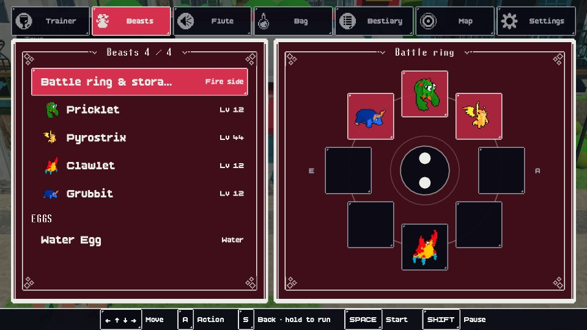<br><sub>The Start book's Beasts tab: your battle ring and storage.</sub>

| Tab | What's in it |
|---|---|
| Trainer | Your portrait, gold, shield and shards, arena crests, trainer gear, Fly, and how to save (call Dad from a phone). |
| Beasts | Your battle ring and storage (tap a beast, then where it should go: see Arranging your beasts), your party and eggs. Each beast's page shows its element(s), its slot, stats, skills, traits and its family tree: the parents and grandparents that were merged into it. |
| Flute | Every song with its effect and mastery; press A to practise one. The Capture page shows your level and when the next one is ready to learn. Unknown songs show where to learn them. |
| Bag | Items grouped as care, battle items, beast gear, trainer gear, sheet music and tomes. |
| Bestiary | All 39 forms with live portraits and where to find them. |
| Map | The twelve towns, with the full world map on A. |
| Settings | Music and sound volume, text speed, the gem the menus are cut from, the style (Pixel or Classic), touch pad, key guide, fullscreen, credits and quit to title. |

## UI and audio

- **Two looks**, picked in Start → Settings → Style (`UIKit.set_style`, kept as `Prefs.ui_style`):
  - **Pixel** (the default): the 1-bit kit's crisp white frames on near-black windows, every pixel of them two UI
    pixels (three screen pixels on a 1080p phone). Text and lines are plain white; the **gem** goes behind the white,
    never into it: the selected row, the open tab, the chosen battle bar, the target aimed at, tags, name plates,
    New Game and the held touch buttons are filled with it. The Start book is two of Humble Gift's paper pages, dark
    with the gem and lined in white, each with its ornament frame and its title written into the gap atop it: the left
    page unfolds as the book opens, and the right one slides out from behind it whenever a tab opens. The touch pad,
    bars, battle bars, ring tiles and the key guide are drawn the same way. Its pieces are cut from the
    two kits by `tools/build_pixel_ui.gd` into `assets/ui/pixel_ui.res`, stored as tones (fill, mid, line) that
    `UIKit.piece` paints in any colours.
  - **Classic**: soft rounded windows with a gentle gradient, a pale border and a drop shadow
    (`scripts/ui/cozy_box.gd`), drawn smooth at any screen scale, every window, border, text, bar and tag a shade of
    the gem.
  The gem is picked in Start → Settings → Gem: **Ruby** (the default), **Sapphire**, **Emerald** or **Hematite** (slate
  grey). `UIKit.set_accent` derives the whole palette from the gem (and the style).

  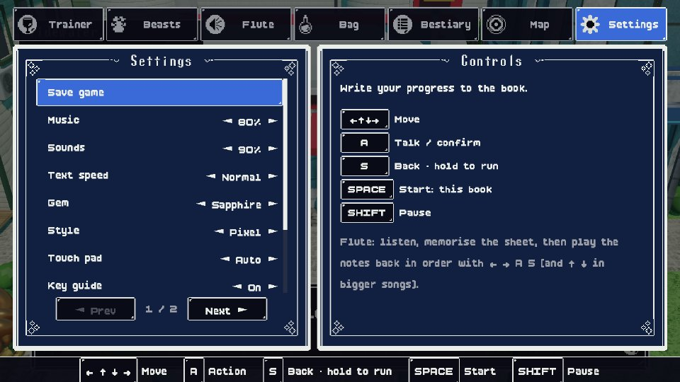<br><sub>Settings in the Pixel style with the Sapphire gem.</sub>

- **Fonts**: **BoldPixels** for body text, menus and dialogue; **Lunchtime Doubly So** only for headings (window and
  page titles, tabs' section headers, name plates, map names). Both are drawn on a 16-pixel grid, so every size is
  snapped to one where their pixels land on whole screen pixels (`UIKit.body_px` / `head_px`): on a 1080p screen body
  text is 32 screen pixels and dialogue 48. The desktop window opens at 1920x1080 for the same 1.5x scale as phones.
  Dialogue is three lines to a page. Text sits at the top of every text box.
- **Button minimums**: menu text uses 32 UI units; rows and page buttons are at least 56 units tall on desktop and
  80 on touch devices, including the title menu. Ordinary mobile lists scroll with Up/Down and direct taps;
  book pages and the save browser retain Prev / Next controls. Buttons never shrink to fit more entries
  (`UIKit.row_h`, `list_menu.gd`).
- **Save previews**: Load Game shows the selected slot's screenshot from its latest save beside the list, and keeps
  it visible when choosing Load, Copy or Delete. Saves from before screenshots were stored show a placeholder
  until saved again. Copying a save includes its screenshot.
- **Phones**: a joined cross-shaped d-pad with raised arrows, for getting about (hold B to run), battles and the flute
  game alike. Each arm answers in its own quarter of the pad (a wedge from the middle out past its arrow), and only one
  arrow is held at a time, so a thumb on the line between two arms still walks one of the four ways. With it, glossy
  domed A and B buttons that sink when pressed (BoldPixels letters), and Start / Pause pills, all tinted with
  the gem. The title menu and Start book keep the controls visible: use the d-pad and A/B or tap rows and tabs,
  and Start closes the book. A little overlap with the book is allowed. The full world map and ring editor still
  move the side controls aside for direct tapping. Yes/No questions widen A and B with an animation into
  **A: Yes** and **B: No**: each answers directly, without a separate choice list. Long questions show **A: Next**
  until their last page. Ordinary mobile choice lists sit toward the center, show several full-size options,
  and scroll as Up/Down moves the selection; each visible option can also be tapped.
  Anything that runs past one of the book's pages gets **◄ Prev** and **Next ►** buttons
  with "page / pages" at its foot, each turning a whole page (`scripts/ui/pager.gd`), so all of it can be reached
  with taps alone. The
  book's detail pane scrolls, so a tall page never runs under the buttons, and in battle the command menu takes the
  place of the battle text while it is open.
- The game starts straight into the title screen (no engine splash). With no save yet, **New Game** is a big, glowing
  pill in the gem with no box round it: a thick pale border inside a dark edge, a soft glow that breathes, a slow pulse
  and a band of light sweeping across it every few seconds (`list_menu.gd` "bare"; on desktops a plain Quit sits under
  it).
- The title's menu comes up first, on the splash colour; the town behind it is built a moment later and fades in. The world and battle scripts, the travel book and the world map (the slowest scripts to compile) aren't preloaded: they load in the background while the menu is up (`main.gd` _title_backdrop, `loaded_script`). The touch pad's faces, painted pixel by pixel (a second or more on a phone), are painted on a worker thread the first time and kept in `user://touch_pad/` for each gem, so later launches load them straight away (`controls_overlay.gd`).
- **Music**:
  - Normal battles use *Rising Tide*; bosses use *Rising Tide (faster)*. Bosses are temple guardians, arena masters, Smuggler Rook, Black Bart, Gearhart, Nyx and Vexmora.
  - Tidewater plays *Andreas Theme*; Gearhart Tower plays *Krampus Workshop*.
  - Every region and kind of room has its own track; see `TRACKS` in `scripts/autoload/sfx.gd` and `MAP_MUSIC` / `ROOM_MUSIC` in `world_db.gd`.
  - Desert, mountain, moor and some interiors add an ambient loop.
  - `tools/convert_audio.py` makes 128 kbps copies in `assets/audio/music/`, trimming the 59-minute rainforest track to a 5-minute loop. The originals in `music/` are untouched.
- **Sound effects** from `sfx/` cover:
  - menus, the book's page turns, dialogue voices (pitched per speaker) and footsteps
  - hits (metal clangs for robots), the slingshot, bombs and the shield
  - pickups, doors, hatching, merging, flights, field moves, level-ups and the victory jingle
  - `tools/make_sfx.py` synthesises the game's own: the smack-and-puff when a foe is beaten and the soft thud when one of yours faints, and the knock on a locked door (`sfx/Custom/`)

## Mobile

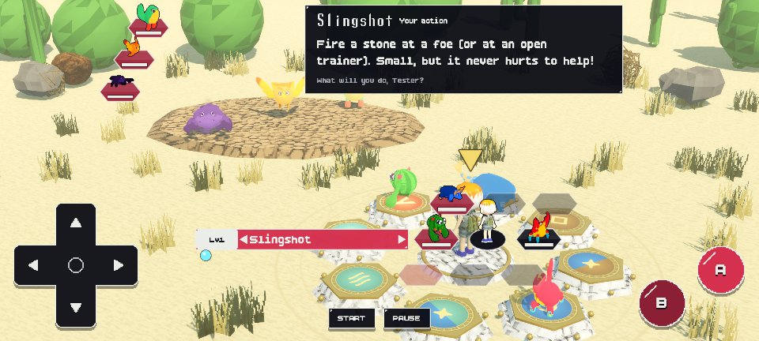<br><sub>On a 20:9 phone: the d-pad, A and B, and Start and Pause around a battle.</sub>

- **Performance**: outdoors, every batch of trees, grass, flowers and ground blocks is split into 8x8-tile chunks, so only what's near the camera gets drawn (a map-wide batch was drawn in full every frame, then again for every shadow layer). The sun uses two shadow layers out to 30 units; trees deep in a wood, grass tufts and flowers cast no shadow; street lamps only light up in gloomy places like Gravenmoor; phones are capped at a steady 60 fps.
- Pack models over 300 triangles get levels of detail baked in by `tools/import_psx_models.gd`, so far-off trees and rocks draw fewer triangles. `godot --path . --rendering-method mobile -- --scene=perf --detail=1` prints what each map costs.
- The project uses the Mobile renderer on phones and tablets, sensor-landscape orientation, ETC2/ASTC textures, and an expanding aspect, so wide phones get extra width instead of black bars.
- On touch devices the d-pad, A/B and Start/Pause buttons appear automatically. They send the same input actions as the keyboard, so every screen and the flute minigame work with them. Dialogue boxes and menus stay clear of the buttons.
- HUD windows and menus, including the arena ladder's trainer list, must never overlap A/B or their enlarged hit areas. Only the Start menu may use that space while those buttons are hidden. Ordinary lists keep full-sized rows and paginate above the controls.
- Each button answers taps a little outside its drawn edge. The arrows are silent; A and B click softly at a low pitch, with B two notes below A.
- Tap the world to walk, double-tap to run, and tap things to use them (see Controls). Taps on or near the on-screen buttons never count as world taps: each cluster (the whole d-pad including its middle, A and B, Start and Pause) has a no-tap zone around it.
- To try the touch layout on desktop:

  ```
  godot --path . -- --touch
  ```

## Web version (iPhone and any browser)

`python tools/make_web.py` builds a version that runs in the browser into `build/web/`, ready to host on Cloudflare
Pages. It needs Godot's web export templates (`web_nothreads_*.zip` in `%APPDATA%\Godot\export_templates\4.7.stable\`)
and ffmpeg.

- **Small download**: about 18 MB before the title screen. The engine and game data are gzipped and stored as
  parts under `data/` (Cloudflare Pages takes files of up to 25 MiB); a small script in `index.html` joins and unzips
  them in the browser. Both exports leave out unused sound effects, unused models and the full-size copies of
  models that have a `_lo` version (`tools/make_export_presets.py`).
- **Music on demand**: the web build doesn't contain the music. Each track is a small Ogg file under `music/`
  (about 1.3 MB) that the game downloads the first time it plays it, then keeps.
- It uses Godot's Compatibility renderer (WebGL 2), single-threaded, so it needs no special server headers. It needs
  Safari / iOS 16.4 or newer (or any current browser).
- **Deploy**: in the Cloudflare dashboard, go to Workers & Pages > Create > Pages > Upload assets, name the project and
  drop in the `build/web` folder. Or from a terminal (Node.js, after `npx wrangler login`):

  ```
  npx wrangler pages deploy build/web --project-name ruby-cocoon
  ```

  The site is then at `https://ruby-cocoon.pages.dev` (or whatever you named it). `_headers` caches the data parts
  forever (their names change whenever the game does) and the music for a week.
- **On an iPhone**: open the site in Safari, then Share > Add to Home Screen. It gets the app icon and opens full
  screen, in landscape.
- To try it locally: `python -m http.server 8060 --directory build/web`, then open http://localhost:8060.

## Editing the maps

The maps are plain text in `scripts/data/maps/`. Each string is one row of tiles, and the legend is at the top of each file.

- **Buildings** are solid rectangles of one letter, for example:
  - `C` Beast Center, `X` electronics, `V` Sky Tower
  - `I` Gearhart Tower, `B` cathedral, `J` hideout, `Q` temple
- **Obstacles** use `w j d o y l i | x m`, plus `n` (a washed-out footbridge, mended with the logs stacked by Old Hal's door) and `k` (a cliff that needs a winged beast).
- `b` is Youngster Kit's log cabin on the Coastal Path (room `kit_cabin` in `interior_maps.gd`, where an `anchors` entry puts Kit by the fire).
- **Push puzzles**: `u` is a boulder (moves one tile), `e` an ice block (slides), `c` an icy floor. An anchor named `puzzle_exit` marks the tile that counts as solved; `puzzle_area` draws the maze walls plain.
- **Anchors** named `item:<id>` place a fixed item (one anchor letter can be used on several tiles, each with its own flag); `inspector`, `warden` and `sentinel` place the road blockers. Room templates can have `anchors` too.
- **Story gates** use `&`.
- **Cliffs and ramps**: a map's `heights` rows (one character per tile, lined up with `rows`) give each tile a level,
  `0`-`9`, one unit apiece; `^ v < >` is a ramp rising that way, and a run of them climbs evenly between the levels at
  its two ends (give it two tiles a level; runs side by side make a wide ramp). Neighbours on different levels meet
  at a cliff. Keep the back and sides high and the south low (the camera looks north), put every building, its
  doorstep and everyone standing about on level ground, and keep tall things off high ground just south of a road.
  `"cliffs": "walls"` draws a town's cliffs as stone retaining walls. Both checkers below know the levels.
- **Shards** use `*`.
- **Room templates**: in `interior_maps.gd`, `>` and `<` are stairs to the next and previous floor, `K` is a kennel pen and `@` a red phone. Most rooms are `stage` rooms: one compact room seen whole like a stage set (no front wall, the camera still), the front door (`D`, blue, with a window over it) in a side wall. A building of several rooms (`SHOP_ROOMS`, `HOUSES`) joins them with doors in their walls (`doors`: a symbol for each, and the room it leads to), each room loaded on its own; locked doors (`L`, red) can say what's behind them (`locked`). A door that opens is its own leaf on a hinge (`room_builder.gd _hinged_leaf`; `world.gd _through_door` swings it open, `spawn_at` shuts the one you came in by). Stairs (`>`) lead to the next room in the set, which is always a landing (`home_hall`, `house_up_hall`: two tiles deep, the stairwell `<<<` at one end and the doors to that floor's rooms off it); `RoomBuilder.stair_ways_in` says where each flight can be stepped onto from (its open end only), and coming back down you step off the foot of the flight. `world.gd _take_stairs` walks you on up or down the treads (`_on_flight`) while the screen goes dark (`goto_map`'s `fade`, `STAIR_FADE`), and `_arrive_by_stairs` walks the last of them on the other floor. `tools/check_maps.gd` also checks the windows: none in a wall with a door to another room, and at least one wall with them in every stage room; and every flight's open end can be reached. `--scene=doorway` walks round the house at home: through its doors, at its stairs from every side, and past Mom.

- **Towns** follow one plan: a main row of buildings with their backs to the tree line, a boulevard along their doors that the town's entrances lead straight onto, and a plaza with the statue in the middle. Shops sit around the plaza and houses at the ends. Big towns have a second row well to the south, behind deep back gardens (six rows behind two-storey shops).
  - The camera looks down from the south, so a roof, a tower or a tree hides whatever is just north of it. `python tools/town_check.py` traces the camera's line of sight to every walkable tile (with each building's real roof shape) and reports any tile where the path or the player would be hidden, plus any door, exit or person you can't reach.

- **Nothing tall between a road and the camera**: `check_maps.gd` flags any tree or building up to three tiles south of a road, a bridge, the plaza or anyone standing about, further when it stands on higher ground (trees in a map's last three rows are drawn as shrubs, so they don't count). Use bushes, rocks, fences, water or tall grass there instead. On the Coastal Path everything south of the trail is low.
- **No slipping past a teacher**: `check_maps.gd` also walks every way from each of a map's exits to the others and
  flags a teacher (`world_db.gd` LESSON_TRAINERS, ARENA_LESSONS) whose line of sight (straight ahead, 4 tiles, up to
  the first wall or person) it can get past without crossing, and indoors one who doesn't see the tile you come in on.
  Teachers notice you as you arrive on a map and after another teacher's lesson, not only when you step into their
  sight (`world.gd` spot_you).

After editing, run the map checkers (the Godot one also flags anyone indoors who faces a wall):

```
godot --headless --path . --script res://tools/check_maps.gd
python tools/town_check.py
```

## Tests

`bash tools/run_tests.sh` runs every check and test scene headless (no windows), three at a time, and prints one
line per test, `ok` or `FAIL` with what went wrong; full logs go to `build/test_logs/`. A failing test gets a second
try before it counts. About three and a half minutes; `bash tools/run_tests.sh quick` runs only the fast checks
(seconds), and naming tests (`bash tools/run_tests.sh flow ringedit`) runs just those. Exits 0 when all passed.
- `check_scripts.gd`: every script parses and compiles.
- `check_data.gd`: everything the data names exists: the beasts (race ids) on routes, maps, trainers, leaders,
  coaches, temples, fishing pools and eggs; songs, moves, shop items and summon models; and everyone on every map,
  and the hero in every outfit and hairdo (and the pack, in the colour chosen), can be dressed.
- `check_maps.gd` (above) also checks stage furniture facing, tall scenery placement and the implied TV wall;
  `check_beasts.gd` checks the beast lines, growing up and merging.
- The test scenes: the story flow, four-way walking (keys and touch), battle commands, the ring editor, the lessons,
  the coaches, the mascots, the doors and stairs at home, and each temple from its stone puzzle to capturing its
  guardian.
- `intro`: keyboard/controller skipping, New Game handoff, untouched starter state, and the one-time Dustwell reveal.
- `rescue`: locked freight control, three captives, rescue persistence across map reloads, repeat use, and the reunion.
- `arena-ladder`: trainer list clearance from touch controls, full-sized rows, focus navigation, pagination, direct trainer taps and A/B confirmation. Add `--matrix=1` to the scene for both styles and all four gems.
- `kennel` / `kennel-ui`: level-based adoption fees, exact/insufficient funds, cancellation, free reclaiming, storage overflow, and the real keeper/pen menus with touch and focus navigation. Preview with `--scene=kennel --shot=res://build/shots/kennel.png` (`--preview=poor` or `empty` for those states; `--verify=1` exercises inputs).
- `wild-grace`: wild battle return protection, smooth opacity bounds, sight and hearing, existing chases, contact, expiry, map changes, and trainer battle exclusion. Add `--shot=res://build/shots/wild_grace.png` for low, middle and high pulse opacity and the fully opaque player after expiry, or `--preview=pulse` to replay the effect in a game window.

Focused cinematic previews use the normal screenshot harness and fresh state (no player saves):

```
godot --path . -- --scene=intro --at=20 --shot=res://docs/screenshots/intro_tower.png
godot --path . -- --scene=intro --at=37 --shot=res://build/shots/intro_murder.png
godot --path . -- --scene=intro --at=44 --shot=res://docs/screenshots/intro_spring.png
godot --path . -- --scene=intro --hold=0
godot --path . -- --scene=rescue --preview=locked --shot=res://docs/screenshots/trainer_cages.png
godot --headless --path . -- --scene=tidewater-arrival --verify=1
godot --path . -- --scene=tidewater-arrival --preview=talk --shot=res://build/shots/tidewater_nell.png
godot --path . -- --scene=tidewater-arrival --preview=house --shot=res://build/shots/tidewater_rafe.png
godot --path . -- --scene=saveui --touch --save_dir=res://build/save_ui_saves/ --shot=res://build/shots/save_ui.png
godot --path . -- --scene=saveui --touch --slot=9 --save_dir=res://build/save_ui_saves/ --shot=res://build/shots/save_ui_last.png
godot --path . --resolution 2400x1080 -- --scene=arena-ladder --touch --rank=10 --verify=1 --shot=res://build/shots/arena_ladder.png
```

Screenshots from a test scene (`--shot=path.png`) come out small: `--crop=x0,y0,x1,y1` keeps just part of the screen
(fractions, or pixels if any is over 1) and `--shot_w` caps the width (default 960; 0 keeps full size); a `.jpg`
path saves a JPEG instead (as for the pictures in `docs/screenshots/`, which Godot ignores). To check a
screenshot without looking at it, `bash tools/img.sh` measures it: `diff a.png b.png` (how much changed, and where),
`bbox x.png` (the box round whatever isn't background, or `--like=#rrggbb`), `color x.png 0.5 0.4` (the colour at a
point) and `crop x.png out.png`; each takes `--region` and `--tol`. For a question only eyes can answer ("is any door
blocked by furniture?"), `python tools/look.py x.png "question"` asks a local vision model (Qwen3-VL in Bionic or LM
Studio; `LOOK_URL` and `LOOK_MODEL` pick the server and model) and prints its short answer.

## Windows and Android builds

Every push to `main` builds the game for Windows and Android on GitHub (`.github/workflows/windows-build.yml`): Godot
exports it headless on Linux, after the quick checks, and the newest build is on the repository's Releases page as
"Latest build". A build can also be started by hand from the Actions tab.

- `RubyCocoon-windows.zip`: one portable `RubyCocoon.exe` (unzip and run; it isn't signed, so the first time Windows
  SmartScreen asks: More info, Run anyway).
- `RubyCocoon-android.apk`: the phone app "Ruby Cacoon X" (`com.rubycocoon.x`, beside the original Ruby Cocoon app). It's
  signed with the `ANDROID_KEYSTORE_BASE64` repository secret (Godot's debug keystore from the computer that builds the
  phone copies, base64-encoded), so a download installs over a copy built there. Without the secret only Windows is
  built.

## Project layout

The downloaded art, music and sound packs aren't in the repository, only the converted assets the game uses (see
CREDITS.md for where each came from, and `licenses/` for their licence files). The `tools/` importers need their pack
downloaded again to rebuild anything.

```
scripts/
  data/        race_db, move_db, item_db, song_db, world_db (towns, routes, temples, obstacles, biomes), voxel_manifest
  data/maps/   hand-made ASCII maps: towns, routes, room templates
  core/        beast.gd (a beast instance, growing up), beasts.gd (creation, merging, legendary dominance), ring.gd (the battle ring)
  gfx/         beast_rig, beast_parts, beast_model, beast_icons, beast_toon.gdshader (the beasts), voxel_mesher (greedy mesher), voxel_beast, voxel_person, voxel_buildings, voxel_props, voxel_textures, voxel_assets
  data/        ... beast_looks (each beast line's colours)
  world/       map_loader.gd (ASCII → map), world.gd (overworld + interiors), map_gen.gd (tile types), elevation.gd (levels, ramps, who can step where), terrain_mesh.gd (the ground, cliffs, water and waterfalls)
  battle/      battle.gd (ring battles, trainer turn, shields, egg drops), command_panel.gd (the stacked command rows)
  ui/          book_menu (Start book), list menu, dialog box, beast card, flute minigame, controls overlay (key guide / touch pad), pause
  data/        ... chatter_db (what townsfolk, residents, trainers and mascots say)
  autoload/    GameState (save data), Sfx (music + effects), Prefs (settings), UI, Story (quests), Places (shops, centers, music shop, Sky Towers), Menus
tools/         new_beasts/ (bake.py, forms.json, debug_draw.py), import_new_beasts.gd, make_new_beast_icons.gd, check_beasts.gd, import_psx_beasts.gd, import_psx_robots.gd, make_beast_icons.gd, import_psx_houses.gd, import_psx_*.gd, build_ui_assets.py, build_patterns.py, convert_audio.py, make_sfx.py, make_icon.py, make_web.py, town_check.py, make_export_presets.py, check_maps.gd, debug/
```

## Developer test modes

```
godot --path . -- --scene=world:cogsworth --shot=C:/tmp/a.png            # screenshot any map (or world:cogsworth#10 for an interior)
godot --path . --resolution 1920x1080 -- --scene=interiors --shots=res://build/shots/interiors  # every distinct room, fresh state
godot --path . --resolution 2400x1080 -- --scene=interiors --touch --shots=res://build/shots/interiors_touch  # phone audit
godot --path . -- --scene=world:reef --spawn=33,10 --flags=island_peace  # spawn at a tile with story flags set
godot --path . -- --scene=battle --kind=robots --wait=5 --shot=C:/tmp/b.png
godot --path . --resolution 2400x1080 -- --touch --scene=battle --keys=r,r,r,a,a --shot=C:/tmp/t.png   # aiming a move: target arrows, with move info closed
godot --headless --path . -- --scene=sim --n=10                          # simulated auto battles
godot --headless --path . -- --scene=flow                                # scripted run through the whole story
godot --path . -- --scene=knock                                         # knock on locked doors (a Tidewater house, the cathedral)
godot --path . -- --scene=skytower                                      # into a Sky Tower, up to the roof and away on the Tempestrix
godot --path . -- --scene=gallery:nature:0 --shot=C:/tmp/g.png           # asset gallery
godot --path . -- --scene=beasts:0 --shot=C:/tmp/v.png                   # beast gallery as the game draws them (pages 0-3: the forms, then the legendaries; 4 = merges)
godot --path . -- --scene=world:tidewater --overview=1 --shot=C:/tmp/o.png   # a whole map from high above
godot --path . -- --scene=world:tidewater --overview=13 --focus=34,21 --shot=C:/tmp/a.png   # one spot (a tile), 13 up
godot --path . -- --scene=book:settings --gem=sapphire --shot=C:/tmp/s.png  # try a gem for one run (--style=cozy / pixel: a style)
godot --path . -- --scene=book:map --flip=cozy --wait=1 --shot=C:/tmp/f.png   # Settings > Style changed with the book open
godot --headless --path . --script res://tools/build_pixel_ui.gd          # cut the Pixel style's pieces from the two UI kits
godot --path . --resolution 2400x1080 -- --touch --scene=battle --shot=C:/tmp/p.png   # a 20:9 phone
godot --path . -- --scene=book:beasts --shot=C:/tmp/m.png               # the Start book on a tab (trainer, beasts, flute, bag, bestiary, map, settings)
godot --path . -- --touch --scene=battle --shot=C:/tmp/t.png            # touch layout
godot --headless --path . -- --scene=tutorial --lesson=ring --auto=1    # one Coastal Path teacher's guided battle (screen, turns, slingshot, items, ring)
godot --headless --path . -- --scene=tutorial --lesson=elements --auto=1  # a Tidewater arena coach's lesson (team, elements; --egg=24 starts with an earth beast)
godot --path . -- --scene=fishing --taps=4.6 --snap=10 --shot=C:/tmp/f.png  # Gil's lesson (--lesson=0: a cast at a ripple, --bait=worm_bait)
godot --path . -- --scene=battle --kind=fishing --shot=C:/tmp/d.png        # a reeled-in beast's battle: the dock and the water
godot --path . -- --scene=battlecmd --touch                             # the battle's command panel: one A is one confirm, every move's target picked (arrows, all-foe moves), ▲ turns the ring, Move (yours and a foe trainer's), the ring turning by itself ("BATTLE COMMANDS DONE: 0 problem(s)"); --stop=trainer|target|all|move --shot=C:/tmp/b.png
godot --path . -- --scene=battlecmd --stop=message --shot=C:/tmp/b.png   # compact message with beast avatar; also trainer-message, effective, resistant, long-message
godot --path . -- --scene=ringedit --touch                              # the ring editor: who may go where on the ring and in and out of storage, lit cells, taps ("RING EDIT DONE: 0 problem(s)")
godot --path . -- --scene=mobile-menus --touch --verify=1 --shots=res://build/shots/mobile_menu  # direct A/B answers, centered lists, scrolling and the Start book's retained controls
godot --headless --path . -- --scene=lessons                            # every guided battle played by a button masher, with one beast and with two: one thing to pick on every bar and menu, nobody down, all won ("lessons DONE: 0 problem(s)")
godot --headless --path . -- --scene=coaches                            # Coastal Path teachers, Rory's arena approach, a clear lobby route, then speaking to Ondine ("coaches DONE: 0 problem(s)")
godot --headless --path . -- --scene=flutelesson                        # the guided Weaken-then-Capture of the first wild beast after the flute
godot --headless --path . -- --scene=mascot                             # mascots' signature moves: the rules, teaching at Lv 39 / 40, another line, a merge
godot --headless --path . --script res://tools/check_beasts.gd           # every form's name, elements and model; growing up at Lv 20 and 40; merging only final forms ("BEASTS CHECK DONE: 0 problem(s)")
godot --path . -- --scene=newbeasts --lines=dino,owl --shot=C:/tmp/n.png  # the beasts side by side, a column per line (--stages=1,3, --anim=idle|walk|lie|attack, --ghost=1, --view=three|side|front, --zoom, --merge=dino_3+owl_3 --seeds=1,2,3)
godot --path . -- --scene=mascot --plaque=1 --pages=2 --shot=C:/tmp/q.png   # read Cocoon Cove's statue plaque
godot --headless --path . -- --scene=capture                            # Capture rules, Uncle Rafe's lessons and the arena's flute rule
godot --headless --path . -- --scene=puzzles                            # solves every road puzzle (bridge, cliff, rockslide, ice, checkpoint, warden, sentinel)
godot --headless --path . -- --scene=wilds                              # roaming wild beasts: sneak attack, chase, ambush, flee
godot --path . -- --scene=marks --shot=C:/tmp/k.png                     # the !, blue ! and ? marks
godot --path . -- --scene=ring --keys=a,a,d,d,d --shot=C:/tmp/r.png      # a ring battle driven by keys (a b l r u d); --kind=wild, --foe_level, --foe_shield
godot --path . -- --scene=spiral --kind=ambush --wait=0.6 --shot=C:/tmp/s.png   # the battle spiral (sneak / wild / ambush)
godot --path . -- --scene=tap                                           # tap to walk, double-tap to run, tap to talk / enter
godot --path . -- --scene=walk4 --touch                                 # four-way walking: two keys at once, a turn mid-step, gamepad d-pad and stick, B to run, the touch d-pad, tap to walk and a porch; every stop on a tile's centre ("WALK TEST DONE: 0 problem(s)")
godot --path . -- --scene=tapzone                                       # taps near the touch controls don't walk you anywhere
godot --path . -- --scene=saves --card=1 --shot=C:/tmp/c.png            # save slots and the "Game saved!" card
godot --path . -- --scene=call --shot=C:/tmp/c.png                       # calling Dad from the phone at home, up to his first line (--where=payphone|center, --town, --presses)
godot --path . -- --scene=call --where=center --town=tidewater --who=mom --tip=0 --level=8 --presses=5 --shot=C:/tmp/m.png   # calling Mom: her tip, then her level advice
godot --path . -- --scene=heal --shot=C:/tmp/h.png                      # the Beast Center healing machine (--what=hatch for the incubator)
godot --path . -- --scene=defeat --at=0.2 --shot=C:/tmp/d.png           # a beaten foe's puff of smoke and a damage number
godot --path . -- --scene=defeat --trainer=foe --at=1.6 --shot=C:/tmp/k.png   # a beaten trainer dropping to one knee (ally: you; robot: powering down)
godot --path . -- --scene=flute --song=weaken --mode=learn --lesson=1    # the flute game as a lesson (the teacher plays first); without --mode it's your turn straight away
godot --path . --resolution 2400x1080 -- --touch --scene=maker --verify=1  # the character creator's two tabs: rows, keys and taps ("MAKER TEST DONE: 0 problem(s)"); --picks=tab:1,row:eyes
godot --path . -- --scene=hero --shot=C:/tmp/h.png                      # the hero from four sides
```

## Credits

See **CREDITS.md**; the same list is in the game under Start → Settings → Credits.
- Most of the music appears to be Kevin MacLeod's (CC BY 4.0), which requires attribution.
- The TravelBook UI licence asks for credit and a note of changes.
- StickyBizcuit's asset pack asks for a hidden easter egg: look for Bizcuit in Cocoon Cove.
- Several packs (some sample models, the fonts, set1 and the sound effects) came without licence files. Check each source's terms before releasing the game.
