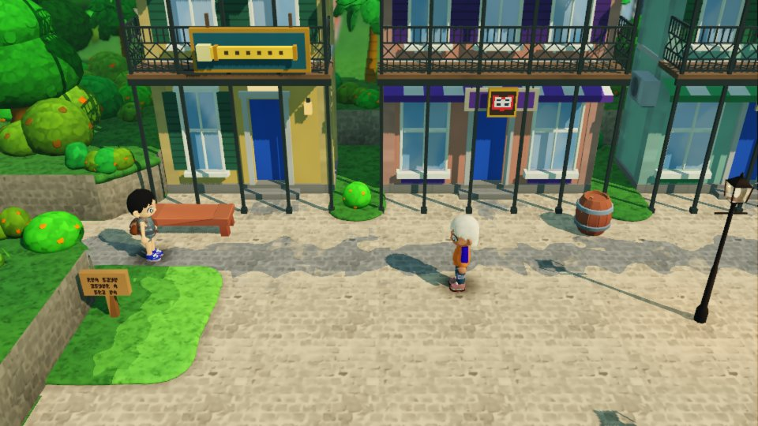

# Art and visuals

[◀ Manual index](index.md)

The game's modern, cozy, clean stylized look and the assets that build it: the nature, fence, house, prop and creature packs, their importers, the regional town styles and the interior staging rules.

- The step-by-step overhaul lives in the [visual overhaul plan](../docs/visual_overhaul/README.md).
- The interface has its own look; see [interface and audio](interface-and-audio.md).

<br><sub>A Bellerive street by the Place d'Armes: Creole townhouses with iron balconies, awnings, gas lamps and the park's trees.</sub>

## Contents

- [The look](#the-look)
- [Planned lighting workflow](#planned-lighting-workflow)
- [The app icon](#the-app-icon)
- [Nature](#nature)
- [Fences](#fences)
- [Puzzle switches](#puzzle-switches)
- [Other world props](#other-world-props)
- [Beasts](#beasts)
- [Gearheart robots](#gearheart-robots)
- [Houses and shops](#houses-and-shops)
- [The Isle of Tides](#the-isle-of-tides)
- [Exterior windows](#exterior-windows)
- [Landmarks](#landmarks)
- [Grass](#grass)
- [Cliffs](#cliffs)
- [Inside](#inside)
- [Past the map's edge](#past-the-maps-edge)
- [Dustwell Oasis](#dustwell-oasis)
- [Scaraba](#scaraba)
- [Bellerive](#bellerive)
- [People, eggs, signs and obstacles](#people-eggs-signs-and-obstacles)
- [Terrain and water](#terrain-and-water)
- [Interior furniture](#interior-furniture)
- [Interior notes](#interior-notes)

## The look

The world aims for a modern, cozy, clean stylized finish, with *Animal Crossing: New Horizons* as the primary reference for environmental cohesion: deliberate rounded forms, soft painted textures on every object, consistent turf lips, banks and shorelines, organized foliage and soft light, in gentle colours with clear contrast. It is never gritty, retro (PSX/PS2), voxel, blocky or pixelated.

- People, beasts and regional architecture keep their own identities.
- The overhaul toward this look is planned in small steps in [docs/visual_overhaul/](../docs/visual_overhaul/README.md); some of what follows describes the game before it.

**Light.** Outdoors, `scripts/gfx/outdoor_light.gd` keeps a gentle sun low in the south-east, so shadows fall beside things rather than hidden behind them and fronts still catch the light. It grades the world, open-air roofs and battles alike for contrast and rich colour without blowing out.

- Shade is lit partly by the sky itself (`OutdoorLight.ambient`: warm-tinted sky above, the ground's warm bounce below) rather than one flat colour, so shaded faces still read by which way they face.
- People carry a faint sheen round their outline, like the beasts.
- `--light_exposure=0.7` (and `_sun`, `_ambient`, `_sky`, `_contrast`, `_saturation`, `_white`, `_glow`) on a test run tries other values without editing.
- People and beasts also stand on a soft patch of shade (`scripts/gfx/contact_shadow.gdshader`).

**Textures.** The packs' small textures are cleaned up by `scripts/gfx/smooth_texture.gd`: edge-preserving smoothing that keeps brick courses, boards and leaves but drops grain and speckle, eased contrast, then enlarged with a soft filter. They are sampled with linear, mipmapped, anisotropic filtering.

- `tools/smooth_textures.gd` applies it in place to the surface, pattern and interior textures and to the baked scenery, house, landmark and furniture meshes (not people, beasts, robots or summons).
- It records each file in `tools/smoothed.json` so nothing is smoothed twice. Run it after any re-bake, then `--import`.
- Baked resources are saved with lossless compression; `tools/smooth_textures.gd -- --compress-only` repacks older, already-smoothed resources without filtering them again.
- Ground layers blend softly across their wandering borders (`terrain.gdshader`). Shop-sign icons stay crisp pixel art.

## Planned lighting workflow

User direction, 2026-11-13:

- Bake static illumination and contact shading into texture assets offline, with coherent existing direct lighting and actor shadows.
- Do not introduce multi-bounce AO approximation or runtime bounce-light GI.
- The unfinished [runbook 022a](../docs/visual_overhaul/runbook.md) prototypes this texture workflow; [010c](../docs/visual_overhaul/010c-godot-48-results.md) records the approved Godot 4.8 beta 3 cutover and remaining validation before budget acceptance.
- The lighting workflow remains planned work.

## The app icon

The icon is painted like PS2 box art from the game's own models: the water summon rising as a ghost in a dusk sky over a dark hill, where a ruby glows on the crest.

- `tools/make_key_art.gd` renders the summon and a shrub, and `tools/key_art.py` does the painting.
- `python tools/make_icon.py` writes Android's adaptive icon layers (background, foreground and the spirit's silhouette for themed icons, laid out over the whole 108 dp) to `assets/icon/`, plus `icon.png` for the window.
- The boot splash image is disabled. The old tableau and `tools/make_splash.gd` remain available for artwork tooling, but are not loaded by the start menu.

## Nature

Nature uses the supplied **Environment Pack - Stylized Nature**, **Environment Pack - Grass** and **Environment Pack - Stylized Rock** collections. Rounded canopies, upright and bent palms, leafy and berry shrubs, and broad stone outcrops share the existing chunked scenery batches and automatic mesh LODs.

**Retired models:** the cuboid birch, both squared-off round trees, the tree-shaped `shrub_2`, and the jagged modular street bush (`hedge_round`) everywhere, including its exterior importer. Biome choices and window boxes use the remaining plants.

**Placement:**

- Blocking shrubs stay low and vary in silhouette, size and rotation.
- Broad thickets draw as single-tile-wide hedge borders around their planted ground, with no filled 2x2 bush blocks; their established solid footprints keep tutorial and story routes intact.
- Bushes only occupy blocked ground, and their full foliage stays clear of walkable tiles; open lawns get grass tufts instead of decorative walk-through shrubs.
- Tall grass uses three solid, low-poly blade clumps from the grass pack (353, 118 and 43 triangles), replacing the fine, densely cut foliage.
- Rock tiles draw grounded stone meshes on level ground; they no longer form terrain pyramids or support balancing boulders. Movement and puzzle tiles keep their existing rules.

**Foliage and wind:**

- Trees, bushes and grass tufts wear a painted leaf texture (`foliage.gdshader`, given to every plant by `voxel_assets.gd`; `tools/build_foliage_texture.py` paints `foliage.png`), sunlit on top and deeper underneath.
- Each plant takes a shade of its own from where it stands, so neighbours never match.
- One wind blows across each map (`foliage.gdshader`): every tree, palm, bush and grass tuft bends along the same line, mostly downwind, as broad slow gusts roll across and a quicker flutter rides on them. Tops move, bases stay rooted. The bend is a share of each plant's own height (`voxel_assets.gd` `WIND_TREES`, `WIND_GRASS`, `WIND_BUSHES`).
- Woods are never crowded: no tree stands on a tile beside another's, in the map or the ring past its edge, and the tiles between hold low bushes (always along a wood's edge, so it still reads as a wall). Trees near one another differ in kind where the biome has more than one, in height and in build. Wooded tiles keep their collision.

To rebuild from the three original ZIP files:

```sh
python tools/prepare_stylized_nature.py "path/to/zip directory"
godot --headless --path . --script res://tools/import_stylized_nature.gd
godot --headless --path . --script res://tools/smooth_textures.gd
godot --headless --path . --import
```

## Fences

Fences use the supplied iron, wooden picket and stone models, with their display lawns removed.

**Where each kind goes:**

- Low wood fences mark nature-route boundaries.
- Wood and stone enclose front lawns and planted back gardens around rural houses, with two-tile gates aligned to their doors.
- City-centre houses and over-water shacks keep their compact street and dock frontages.
- Bellerive's park and Gravenmoor's cemetery use the iron fence; the quay's stone balustrades remain.

**How sections join** (`scripts/gfx/fence_models.gd`, through the existing scenery batches):

- Stone walls join at their full size (the through run reaches across the turned arms, which stop at its faces).
- So does the picket fence, so its corners keep full-size pickets.
- The iron fence's railing bends and junctions are full-size half sections sharing one post at the tile's centre (`POSTED`).

**The iron fence** is cozy and stout:

- A low plinth cut from the stone fence's upper half, its stone a warm grey, joined like the stone wall (`iron_fence_base`), under a thick-barred railing with ball finials on stone piers level with the plinth's top (their cobbles at the plinth's own size). The bottom rail rests along both (`iron_fence`, built by `tools/import_fences.gd`; one shared texture atlas).
- Its foot is sunk below the ground and every run stands at the grass's height, so it stays level where it crosses from paving onto the raised turf (`SINK`, `PLINTHS`).
- Every end that meets nothing, including where a run reaches a cliff's edge, is closed with its own face, so no fence shows its inside. A run carries on only between tiles whose ground meets level.
- Fences keep their painted shading and normal lighting but neither cast nor receive shadow maps, avoiding dark patches on the thin rails and pickets.

**Wood.** The picket fence wears the game's one shared wood (`voxel_textures.gd` `WOOD` on the kit's plank grain, `wood_material()`, applied in `voxel_assets.gd` `WOODEN`), the same timber as the stairs, decks, stalls, signs and benches. The street pack's crates, barrels and kegs are tinted to it (`match_wood`).

The rest of the game's wood is a family cut from the fence's grain (`tools/build_wood_textures.py`, each with vertical `_v` boards):

| Texture | Used for |
|---|---|
| `wood_board` | Wall boards; the kit's `planks` kind draws it. |
| `wood_deck` | Narrow boards with end joints: docks, bridges, porches, boat decks. |
| `wood_beam` | Wide boards for posts, trim and frames; the kit's `wood_dark`. |
| `wood_drift` | The dock shacks. |

They come in the tones `WOOD` and `WOOD_DRIFT`. Rebuild with `python tools/build_wood_textures.py`, then `smooth_textures.gd -- --only=res://assets/textures/surfaces/wood_` and `--import`.

Outdoor map letters `z` and `q` explicitly select wood and stone; `F` selects the biome's usual wood or iron fence. Saved building order is retained when houses are set back inside their gardens. Riverbend's stone fence stops a tile short of the waterfall, leaving its left bank clear. See [asset provenance and licenses](../licenses/supplied_fences.md).

To rebuild:

```sh
python tools/prepare_fences.py "path/to/download directory"
godot --headless --path . --script res://tools/import_fences.gd
godot --headless --path . --script res://tools/smooth_textures.gd -- --only=res://assets/props/
godot --headless --path . --import
```

## Puzzle switches

Puzzle switches use simplified derivatives of the supplied **Levers & Switches** collection (`temple_props.gd`, `assets/props/switch_*.res`).

- Floor levers have flat grey stone bases and stone axle arches, shafts in the picket fence's exact wood grain and tone, and red grips.
- The reference's third, smaller wall switch is smooth stone with a red handle, used in the maze's hidden drain cubby. That cubby is 0.55 tiles deep (the treasure cubby remains 1.2).
- Push buttons have stone housings and red caps; `weapon_obstacles.gd` supports all three supplied button shapes on sturdy pedestals at the existing boomerang height, with caps that depress.
- Current maps have no authored boomerang switch line; the isolated `--scene=switch-props` preview stages them on a lawn.
- Pull angles, puzzle flags and save states are preserved; the hidden wall switch leaves its old floor-anchor tile clear so the hero can stand right at the cubby.
- The five models together use 1,280 triangles, 68% fewer than their nondegenerate source geometry. See [provenance and rebuild](../licenses/supplied_switches.md).

## Other world props

- Campfires and the like are PSX pack models baked by `tools/import_psx_models.gd` into `assets/nature/`, `assets/props/` and `assets/boats/`, and listed in `scripts/data/voxel_manifest.gd` (cacti are drawn in code).
- Vinehollow's Old Shrine uses the supplied bird-topped **Cube World Totem - Proto Series** stack.
- Sliding ice blocks use the supplied **Ice cube study** mesh and its painted turquoise and deep-blue fracture texture (`tools/prepare_requested_props.py`, `tools/import_requested_props.gd`).
- Mist uses soft local fog wisps and drifting particles (`field_mist.gd`), with no floating cubes.
- Rope-cliff obstacles show a rope laid against the existing terrain slope, with no extra rock block; their climbing puzzle and collision are unchanged.

The packs themselves aren't in the repository. With one downloaded again into `psx/`, re-bake and then let Godot rescan, or its file index (and so the exported game) won't include new files:

```sh
godot --headless --path . --script res://tools/import_psx_models.gd
# When rebuilding all legacy packs, restore the stylized nature bake prepared above:
godot --headless --path . --script res://tools/import_stylized_nature.gd
godot --headless --path . --script res://tools/smooth_textures.gd
godot --headless --path . --import
```

## Beasts

Beasts are the 39 untextured models of the "new beasts" folder (three to a line), painted and animated in the game.

### Importing and painting

- `python tools/new_beasts/bake.py "path/to/new beasts"` cuts each form out of its .obj (some files hold a whole line side by side). It turns the form to face +x standing on y = 0, scales it to one size, drops the stray triangles the source meshes carry between parts, and labels each face with a body part (body, head, arms, wings, legs, tail, horns, eyes; `tools/new_beasts/forms.json` holds each form's corrections) and each part with its joint. `--debug out_dir` draws every form with its parts coloured.
- `godot --headless --path . --script res://tools/import_new_beasts.gd` then makes `assets/beasts/<form>.res`, skinned to one bone per part.
- `beast_toon.gdshader` paints them flat and bright by part, as the creature packs they came from were painted: each part's colour, tips (hands, feet, claws, spikes), stripes and bands, and a belly patch.
- Evolving beasts use elemental skin palettes:

| Element | Palette |
|---|---|
| Fire | Red, orange and purple. |
| Water | Dark blue, teal and green. |
| Earth | Brown, grey and yellow-green. |
| Air | Light blue, yellow and pink. |

  Feet, horns and other trim use their authored colours. New scorpions (Fire/Earth) and worms (Earth/Water) can show either palette throughout evolution. Earlier saves use the line's primary palette.

- Each evolving form has individually fitted left and right sockets in `scripts/data/beast_looks.gd`. A smooth white eye follows the lower rim and upper lid, with a round black pupil. The upper lid carries a subtle shade from the creature's palette. Young forms lift the inner brow, and final forms keep the sculpt's brow angle. Ghosts and merges inherit the eyes of their face.
- `beast_rig.gd` builds a beast on its skeleton and moves it by hand: a bouncy idle, walking (a trot on four legs, a waddle on two, a wriggle, a hop, flying), lying down, and attacking; ghosts trail smoke. `beast_parts.gd` puts merged beasts together from their parents' parts.

### Blender exports

- `tools/export_beasts_blender.gd` exports all 48 roster entries and the 39 normal forms' ghost variants through the shared model builders, baking their procedural paint into UV textures.
- `tools/blender/save_beasts.py` converts these to self-contained `.blend` files with packed textures and the existing skeletons, under `build/beasts_blender/`.
- These are editable resting models; runtime animation code, particle smoke and generated merge combinations are not exported. See that folder's `README.md` for commands.

### Battle poses

Battle poses exist for every body (quad, biped, flyer, serpent, blob), worked out from each beast's measured limbs so ghosts and merges take them from their frame.

| Pose | What it looks like |
|---|---|
| **attack** | Rearing back and lunging: a plain move. |
| **cast** | An elemental move: a long wind-up, standing tall and trembling as the element's glow (`cast_glow.gd`) gathers at its horns, its free hands or claws, or its mouth, then letting it go with its feet planted. |
| **Defend** | Braced, held while Defend lasts: low, head tucked, arms raised across, wings wrapped forward, a serpent coiled down. |
| **block** | A quick guard and a shove back, when a defended, resisted or absorbed hit lands. |
| **hit** | Knocked back as hard as the hit was, eyes wincing shut; heavier and off balance for a critical or extra-effective one. |
| **faint** | Lying down quicker than to rest, slumped over, eyes shut. |

The legendaries' and robots' old models get whole-model versions (leaning, crouching, rocking, with a glow at their front). `beast_model.gd`'s `pose_cast`, `pose_guard`, `pose_block` and `pose_hit` play them on whatever a beast is drawn with. Preview every line's three forms through every pose with `--scene=newbeasts --anim=cycle --page=all` (see [Developer test modes](debug-scenes-and-trailer.md)).

### Models and icons

- `beast_model.gd` picks what a beast is drawn with, everywhere (battle, the overworld, portraits): the rig for the lines' forms and their merges. The four legendary guardians are still the PSX creature models (`assets/psx/beasts/`, recoloured by `voxel_beast.gd`).
- **Menu icons:** `tools/make_new_beast_icons.gd` renders every form and its ghost into `assets/beasts/icons/` (run it with a display: `godot --path . --script res://tools/make_new_beast_icons.gd`). A merge shows its frame's icon until the game has rendered its own (`beast_icons.gd`).

## Gearheart robots

**Gearheart robots** (`RaceDB.ROBOTS`) are PSX robots:

- the Clockwork Sentry with a wind-up key, the boiler-bodied Steam Mecha and the broad Iron Golem from Bricchi Games' Retro Robots
- the boxy Tank Walker from CokeEnthusiast's Robot guy (`RaceDB.ROBOT_MODELS`)

`tools/import_psx_robots.gd` bakes them into `assets/robots/` (T-posed arms swung down, turned to face +x like the beasts, 1 unit tall) with their own textures and glowing eyes and vents. They are listed in `voxel_manifest.gd`, and `tools/make_beast_icons.gd` renders their menu icons too.

## Houses and shops

**Houses and most shops** are houses from the PS1 House Pack (100 low-poly houses, `tools/import_psx_houses.gd` → `assets/houses/`).

- `house_models.gd` picks one per plot from the town style's list: weatherboard cottages on the coast, round thatched huts and stilt houses on the islands, terracotta huts in the desert, log cabins in the mountains, dark timber at the hot springs, stone on the moor.
- It re-skins the house in the style's own tiles, fits it to the plot and lines its front door up with the map's door.
- A porch's deck or a stoop in front of the door is squashed down to one easy step at the door's sill (at most 0.25, `house_models.gd` `steps()`, `MAX_STEP`), its posts stretching to meet it, and people step up onto it.
- A house may lean over the hedges and trees beside and behind its plot (never over a walkable tile); those trees are left out.
- Shops, the dojo, museum and music hall add a striped awning and a sign board with their icon; houses get flower planters by the door; locked doors stay crimson. The Beast Center is the small stone temple every town has.

## The Isle of Tides

### Kelpwick

Kelpwick is a modest reef-diving village of round, timber-framed pastel plaster huts on wooden stilts, with centred solid blue-painted wood doors, six-tread entry stairs and broad, painted golden thatched roofs. The store has a round wooden interior.

- **No Beast Center.** The arena uses the supplied **Stylized House** model at one horizontal scale on a 7x6 plot, with a matching wooden door and its TV antenna removed.
- The healing hut is 25% wider and deeper than its initial model fit, with its stairs centred on the original approach. Its rectangular wooden hall separates the entrance and healing lobby from the battle area with a wall. Its healing crystal stands one tile farther back, with plain reception counters and no merchandise displays; flights and lost battles bring you back in front of it.
- Homes have compact, furnished timber rooms. Villagers wear woven wrap skirts and sleeveless tops, without hats or glasses; two matching villagers block the paved reef path until Nerissa is beaten.
- Its general store sells essentials and basic beast gear at 30% below normal prices.
- Kelpwick's exteriors use the supplied **Low poly stylized tribal tropical hut** mesh, painted timber, blue windows and straw fringe; only the plaster is recoloured. The source cloth panel is replaced by a solid blue-painted wooden door; the platform and stairs use painted brown wood. Hanging red decorations and attached leaf cards are removed. Small ground bushes flank the huts with the stair approaches clear. The hero walks up the hut stairs before entering; the original street approaches and room identities are retained.
- Kelpwick's buildings were renumbered when its Center went (older saves inside them are moved, `game_state.gd` `_kelpwick_hut_rooms`). The interiors retain their shared procedural wood finish.

**Checks:** `bash tools/run_tests.sh island-towns island-towns-touch island-updates island-updates-touch` covers entrances, pricing, hotel room links, lobby stairs, hot-tub healing, the one-time ice-maker item and beach aisles. `bash tools/run_tests.sh kelpwick-huts kelpwick-huts-touch` walks and taps into each raised hut, verifies the arena's phone, healer and Nerissa approaches, and returns to each stair foot.

**Preview:** `-- --scene=island-towns --huts=1 --shot=build/shots/huts.png --quit=0` (add `--touch` for the phone layout). The focused scenario uses fresh state and never reads player saves.

Rebuild the supplied huts with:

```text
python tools/prepare_tribal_hut.py "path/to/Low poly stylized tribal tropical hut.zip"
godot --headless --path . --script res://tools/import_tribal_hut.gd
godot --headless --path . --script res://tools/smooth_textures.gd -- --only=res://assets/exteriors/tribal_hut
godot --headless --path . --import
```

Rebuild Kelpwick's supplied arena (its original model is kept untouched):

```text
python tools/prepare_kelpwick_arena.py "path/to/stylized_house.glb"
godot --headless --path . --script res://tools/import_kelpwick_arena.gd
godot --headless --path . --script res://tools/smooth_textures.gd -- --only=res://assets/exteriors/kelpwick_arena
godot --headless --path . --import
```

### Shellhaven

Shellhaven is a pastel stucco resort with Spanish mission arches, terracotta roofs, seaview villas, La Perla Restaurant, Pearl Coast Boutique (40% above normal prices), and Hotel Mariposa (`island_buildings.gd`).

- Its Beast Center occupies an 8x5 plot on the high street, with its established entrance at (40, 5).
- Its fronts have round-arched windows in white surrounds with louvred shutters (no grilles on the ground floor) and French doors on railed Juliet balconies above, a painted base, lanterns and bougainvillea.

**Hotel Mariposa** is a long building on the quay behind the marina's docks.

- A three-storey entrance block (a tiled HOTEL sign over its arcade, its door placed by `building_looks` "door") faces a paved forecourt, and a two-storey west wing is set back one tile behind a railed terrace.
- An arcade runs along its ground floor and every room above has a balcony set back inside the plot.
- Its two-storey lobby has a walkable staircase and balcony in one room. Both use stout, capped wooden posts, broad slats and continuous bevelled handrails with a warm painted wood texture; each stair handrail is one unbroken sloping beam.
- Both left-hand corridors have open doorways, with the downstairs opening near the back; a wall seals the space beneath the balcony.
- The balcony's rear wall has a row of large round-arched open doorways (a dark carved band round each arch head, maroon curtains hanging straight either side from an iron rod).
  - Each doorway opens onto a little balcony half a tile deep that runs half a tile past it at either end. The room's own floor carries out through the doorway under an all-iron railing; neighbours' balconies join into one.
  - Each looks down into one window box of the island's nature whose garden lies about half a storey below the sill, with plants on side tables between them.
  - Each guest room's back wall has two such doorways with clear floor between them, with a print over the bed (the user's 2026-11-15 direction).
- The lobby uses leafy plants, with no cacti. Low wooden double doors, slightly below countertop height, block the staff passages at either end of reception.
- The front and back reception counters are separate; the rear counter sits flush against the balcony wall, with shelves and large paintings above it and flat paper stacks on it.
- Large leafy floor planters frame the lobby, and the lounge areas have armchairs, a reading lamp and dressed coffee tables, with the seats facing their table. The lobby has two pairs of facing armchairs with the coffee tables between them turned a quarter turn.
- The floor planter below the reception phone is removed, and a small potted plant sits on the countertop beside the phone. Larger framed paintings also dress the lobby side walls, both hallways, guest rooms, pool and gym.
- Guest rooms open off both corridors. Guest rooms and the suite have no phones or phone drawer units; the reception phone remains available.
- Downstairs are a swimming pool with two guests and floor-to-ceiling windows, paired into two-tile-wide panes in stout, chunky wooden frames (a thick frame, a deep rail along the floor and a broad casing over each pier), with softly blurred, shining glass, clear of the room's decorative wood trim, looking into a shallow garden box with small bushes in front of its landscape backdrop.
- A hot tub healing spring sits on an enterable raised deck in the back-left corner with inset steps, pink water sharing the pool's texture and opacity, rising steam, one low curved step outside its rim at the front-right (the only way in), and a steam-cloud sign on the outward face of its front railing, beside the clear inset entrance. You climb in by the step and stand still: a faint pinkish-white haze fills the screen, thickens after five seconds, then a top-bar notice says the party's HP and MP are restored and ailments cleared (once per visit to the water). Dale's spring in the Dustwell Well works the same way, with the same sign on the cave's back wall; every spa gets this sign. A gym has two running guests who struggle to talk.
- Each floor has a broken ice maker; the upstairs tray contains one Revival Seed.
- The snooty receptionist refuses guests without reservations, replacing the old 150-gold healing stay.

**The marina and beach.**

- Shellhaven's marina sits entirely west of the town and beach, reached by the original western pier, with three long berth fingers and an open, dock-free beachfront.
- Two-tile stone walks connect the marina landing to the high street and square, with branches down both beach ramps onto the sand.
- Captain Gull uses the same ferry as Bellerive; private berths hold a white flybridge motor yacht, a varnished pleasure launch and a furled-sail yacht, with water separating their hulls from the walking decks.
- The beach slopes smoothly into clear shallows, with soft wave crests washing toward the sand. Trainers can walk one tile into water no more than 5 cm (about two inches) deep, with light pitter-patter footsteps; the next, deeper tile stays blocked for walking, running and tap navigation.
- The broad beach has striped umbrellas standing in the sand over occupied chaise lounges, towels, and palms spaced along the foot of the cliff, with clear aisles and both beach ramps retained. The island's towns, trail and reef share dense tropical palms.

Every interior entrance is in a visible side wall, including temples, the hideout, Gearheart Tower and the cathedral.

## Exterior windows

Exterior windows use `scripts/gfx/cartoon_windows.gd`: broad bevelled surrounds, bowed caps on tall windows, deep sills with brackets, thick pane divisions and opaque glass that reflects the sky.

- The glass (`scripts/gfx/window_glass.gd`, `window_glass.gdshader`) is a soft blue sky with painted clouds from `assets/textures/surfaces/glass_sky.png`, baked by `python tools/build_glass_texture.py`, shifting with the reflected view as the camera moves; never a room behind it.
- Exterior and interior glazing share the user-supplied Aero diagonal shimmer mask (`assets/textures/surfaces/glass_shimmer.png`, sampled by `glass_reflection.gdshaderinc`), softened with mip filtering and blended faintly into the glass. The image spans the whole screen rather than repeating per pane.
- Interior glazing keeps the softened view of its window box behind these reflections. Ordinary recessed windows and full-height windows both use the shared interior glass shader; where no box fits, the painted view sits behind the same glazing.
- The surrounds are inspired by the supplied window packs listed in `licenses/window_references.md`. House surrounds keep their town's trim colour; shops keep their display bays, shutters, awnings and signs.
- Stone arenas, including Bellerive's, have round masonry arches with wedge stones, a large keystone, stone mullions and stone sills coloured from their walls. Kelpwick's open bamboo windows have heavier timber frames; Shellhaven keeps its Spanish windows.
- The dressing is cached with the existing house and wall meshes, preserving their openings, door anchors and fading. It adds no textures or transparent materials; the source packs and baked house files are unchanged.

## Landmarks

Landmarks are built from the wall sections of the Retro Modular House Pack (`assets/exteriors`: doors, windows and frames, laid round any outline by `HouseBuilder.span`), each with a shape of its own and its door on the map's door tile.

| Landmark | Shape |
|---|---|
| **Arena** | An oval stadium (an arcade below, a parapet, open stands round a sand ring, a striped awning and pennants) behind a crenellated gatehouse between two turrets, in each region's stone. |
| **Sparkwire Electronics** | A streamlined shop with a curved glass corner, a wrap-round canopy, a drum carrying a blade sign, a satellite dish and a radio mast. |
| **Sky Tower** | An eight-sided lookout in the town's finish, stepping in as it rises, with a gallery, a glazed lantern under a pointed roof and the Hoobertus on the rail. |
| **Gearheart Tower** | Stepped brick with a clock and a spire. |
| **Gravenmoor Cathedral** | A dark nave between two spired towers. |

## Grass

Grass is a pillow laid on the ground (`terrain_mesh.gd` `LIFT`, `TURF`): it stands a little above paths, sand and paving, and rolls over its own edge in a soft, slightly wavy muffin top with the soil tucked in under it and a faint shadow at its foot, so paths and dirt read as lower.

- Where a path bends, the grass's corner is rounded off in a quarter circle (and a path's inside corner filled the same way: `CORNER_ARC`), so the grass's outline has no points.
- Bare grounds (path, plaza, sand, paving) run into each other over a ragged, soft band rather than along the tiles' square edges (`terrain.gdshader` `_soil_mix`): a stone road crumbles into the dirt, the dirt into the beach. At a cliff only grass rolls over the top; a path or sand meets the rock in a sharp edge.
- The lawn has sunnier and deeper stretches (`terrain.gdshader` `_mottle`) and a darker grass (`grass_dark`) that melts into it over half a tile: under and round the trees and hedges nobody can pass, under the tall grass, and in lush patches a few tiles across (`world.gd` `_lush`) where low tufts of long grass sprout that you walk straight through.
- People and props stand on the pillow (`world.gd` `_grass_lift`).
- Beach verges keep the same rounded pillow and cut corners as paths, with bright grass in a two-tile buffer beside the sand; the shoreline slope only lowers sand and water, never the grassy rim.
- Each grass-covered half of a diagonal cliff keeps the same pillow height as the adjoining lawn, above and below the cliff, including where another diagonal or a path meets it.
- Rocks along that rim stand wholly in the grass, fitted inside their blocked tile and grounded by their mesh base; they do not create separate bare pads or overhang the lower sand.

## Cliffs

Cliffs (`terrain_mesh.gd`) are simply the step between two levels of the terrain, drawn in a soft cartoon style: a rounded lip of the grass above rolls over the top, and below it the face is fluted into upright ribs and grooves, a little ragged, darker towards the foot and in the lip's shadow.

- Faces meeting at a corner share a mitred edge, so straight runs, diagonals and corners join without seams.
- Each biome has its own rock (`WorldDB.CLIFF_LOOKS`): warm orange-tan fluted rock on the coast, rivers, islands, jungle and reef; banded sandstone in the desert, the west and the mesa; grey slate in the mountains and at the hot springs; dark basalt at the volcano; purple-grey stone on the moor. Cogsworth's are dressed-stone retaining walls.
- The rock is a greyed texture from the cliff packs in CREDITS.md, baked by `tools/import_cliffs.gd` and coloured per biome.
- A ramp is drawn in the ground of its tile, and a rope ladder lies along its slope.

## Inside

Walls between the camera and you fade rather than sink (`room_builder.gd` `fade`): in a cone opening from you towards the camera, a wall ahead of you is clear, about 70% opaque while you pass through its doorway, and solid once it's behind you. Walls right beside you stay solid; doors, windows and pictures fade with their wall.

## Past the map's edge

A ring of scenery nobody can reach keeps every edge and corner hidden: a deep wood to the north and sides, only shrubs and rocks to the south (between the camera and the map), the sea running on past coasts, roads leading on through exits, and around towns a few larger houses of the town's style among the trees.

- Nothing tall stands across a road leading out, or just south of one down the sides, so every way out stays in plain sight.
- Low hedge borders continue as low planting beyond the map edge; Bellerive's Dune Road approach has low hedges on both sides to keep its narrow exit visible.
- The desert lands (biomes with `"boulders"` in `world_db.gd`: Dune Road, Mesa Trail, Scaraba Desert, Riposo Valley, Dustwell and Scaraba) are walled by rock instead of plants (Scaraba's own wall and gardens inside it aside): boulders on tree tiles and in the ring, broken lines of low rocks on hedge tiles, in the last three rows and to the south, no scrub in the open, and only `"cacti"` of the tree tiles (a few percent) keeping a cactus. Their edges step up as terrain cliffs (Dustwell's, the Dune Road's and the Scaraba Desert's outer edges two levels).
- Backdrop scenery checks its full transformed mesh bounds against the continuing exit roads, so wide canopies cannot overhang them.

## Dustwell Oasis

Dustwell Oasis is an old western main street (map `"style": "frontier"`, `frontier_builder.gd`), after the western packs in CREDITS.md.

- Plank-sided buildings painted red, orange, yellow and pink with cream trim, each set back behind a plank boardwalk under a porch roof on posts, all inside its plot (no porch over a path; the roof rests on the posts' tops).
- Stores wear tall false fronts (stepped, arched or flat) with their icon on a sign board and porch roofs striped in their colour; houses have tin gable roofs.
- The **Oasis Saloon** (a cafe inside: room `saloon`) has two storeys, a balcony across its front, batwing doors and SALOON on its false front. **Dustwell Jail** (room `jail`) has barred windows, a sheriff's star and JAIL.
- The Beast Center is the small stone temple every town has. Missing posters hang on the porch posts; the readable ones are notice boards about town. Water troughs, a wagon, barrels and crates line the street.

**Dustwell's wagon and water troughs** come from the Low Poly Western pack, painted by part. To rebuild them from the download, unzip it into a folder `lpwestern/` and run:

```sh
godot --headless --path . --script res://tools/import_western.gd -- "path/to/unzipped packs"
godot --headless --path . --script res://tools/smooth_textures.gd
godot --headless --path . --import
```

## Scaraba

Scaraba (map id `sundown`, called Sunwall until 24 November 2026) is an old walled adobe town (map `"style": "adobe"`, `adobe_town.gd`, biome `desert`).

- Its houses and shops are blocks of sun-dried mud in warm earth colours with rounded corners, flat roofs behind parapets stepped up at the corners, vigas (log beam ends) under the roof and wooden drain spouts.
- The back row's houses have a second storey set back on the roof with a ladder up to it, while a building with a street close behind it (`world.gd` `low`) keeps to one storey.
- Shops have wide windows under a striped awning in their colour and their icon on a board on the parapet; doors and windows are the house pack's.
- The town wall stands on the map's `W` tiles (`"town_wall"`): tall mud walls with merlons and vigas behind and beside the town, square gate towers with slit windows either side of the north road (the gateway open to the sky, so nobody walking through is hidden), and from row `low_from` south a knee-high parapet with broad gateposts, so the street beside it stays in view.
- The market round the mascot statue has striped stalls, clay jars and a stone well (`street_props` `adobe_stall`, `adobe_jars`, `adobe_well`); palms and low shrubs grow in the gardens behind the buildings (`"palm_groves"`), and open desert lies outside the walls.
- Inside, its houses and shops have terracotta tiles, warm plaster and a band of darker earth along the foot of the walls (`map_loader.gd` `_adobe_room`, `room_builder.gd` `_adobe_decor`); the Beast Center, arena and Sky Tower keep their own rooms. **Captain Dalton** of the gate watch stands by the plaza.

## Bellerive

Bellerive is the game's French Quarter (`world_db.gd` biome `quarter`, building style `creole`). The whole town stands on a raised stone quay, its streets cobbled setts (the biome's `stone_streets` draws paths as paving) between warm flagstone sidewalks and squares, paved too under its buildings and balustrade. Planted hedge beds retain grass ground. Trees, shrubs, flowers and grass tufts keep their full foliage bounds off streets and sidewalks.

`creole_builder.gd` builds everything there but the Beast Center's temple and Gil's tin shack:

- Creole townhouses of two or three storeys in pastel stucco or red brick along Rue Royale, with louvred shutters and cast-iron galleries on slender posts recessed within their plots, clear of paths (or balconies on brackets), lace railings and hanging ferns, under slate hip roofs, dormered side gables or parapets.
- On the riverfront row, where a street runs close behind, one-storey Creole cottages and shotgun houses (`world.gd` `low`).
- Shops hang a sign board from the gallery over a striped awning in their colour; the low ones wear the awning and the sign on the wall.
- Sparkwire Electronics is a townhouse with a blue blade sign, the Sky Tower the white bell tower facing the Place d'Armes (a clock, a belfry and a black slate spire, Hoobertus on its balcony), and the arena a cream oval under a mansard ring, entered through a pavilion with a mansard roof, iron cresting, a clock and Mardi Gras banners. The French Market's arcade on the riverfront is scenery (no door).
- Along the quay a stone balustrade with lamps on its piers (an `F` or `L` tile with the water or lower ground just south: `world.gd` `_on_quay`); elsewhere `F` is a low iron railing with connected corners and junctions. Ramps step down from the promenade to the piers, nearer the water.
- The harbour's paddle steamer, shrimp trawler, sloops, skiff and schooner are `harbor_boats.gd`'s (a map's `boats` names them like the pack's).

## People, eggs, signs and obstacles

### People

`voxel_person.gd` builds people from the townfolk kit (`townfolk.gd`, `assets/townfolk/`, baked by `tools/import_townfolk.gd`): 80 people made of the kit's parts on one shared skeleton, coloured by `townfolk.gdshader` from each look's skin, hair, shirt, trousers and hat.

- **The hero** wears the shirt, pants, shoes, hat, glasses, hairdo and colours the character creator gave them: each piece cut from its own kit person (see `wardrobe_db.gd`). Glasses have their own colour slot (`Townfolk.GLASSES_SLOT`) and no lenses: `Townfolk.LENSES` drops the kit's lens parts and cuts the goggles' lenses out as they load.
- **Townsfolk** pick the kit person who suits their look (a woman for long hair, robes, long sleeves for coats, a hat only if the look has one).
- **Trainers** out on the roads (and the arena ladder) wear `outfit: "camo"`: a padded jacket with a big upturned collar and a belt, combat trousers and boots, green or brown camo (`townfolk.gdshader` patches it in cells laid on the body at rest, so the pattern stays on the cloth), and a pack.
- **Packs:** everyone can wear one (`look.pack`, in `look.pack_colour`) — one kit person's round backpack and its straps (`Townfolk.PACK`; the kit's other packs sat badly), shaded like clothes in its own colour slot, and in their top's colour for the kit's people who wear it already. The hero always wears it, in the colour they pick in the character creator (brown to begin with).
- **Recolouring:** a few of the kit's parts are recoloured as they load (`Townfolk.PART_FIXES`: patchy shorts and tops made one colour, cuffs that kept the kit's tan).
  - Every piece in the hero's wardrobe is dyed all over, nothing left in the kit's own colours (`Townfolk._dye_part`).
  - A shirt takes two colours (the look's `top` and `top2`: a plain shirt's sleeves, else the trim the kit painted in a second colour: collar, yoke, stripes, bow, flames; the creator names the row for it). Pants, shoes and hats take one each, their other colours becoming lighter and darker shades of it.
  - A few details keep their own colours whatever the dye (`Townfolk.FIXED`: shoes' laces always white, the Runners' white toe tip, the Garden Hat's red ribbon and bow, the Sun Hat's pink ones, the Duckie Hat's yellow bill, sky-blue eyes, pink cheeks, green stem and yellow flower, the Wizard Hat's black band and its gold buckle, `_buckled`).
  - The Striped Jumper is drawn in thick bands of its two colours (`Townfolk.STRIPES`, `townfolk.gdshaderinc`), and the Bow Blouse's collar matches its skirt (`FLAT_TRIM`). Townsfolk wearing the same parts keep their old look.

- **Derived pieces:** two pieces are made from the kit's parts as they load (`Townfolk.DERIVED`): the Long Skirt (female heroes, and non-binary heroes on either body), the A-line skirt let down to the shin, and the baggy Cargo Shorts with a pocket on each thigh.
- **Older looks:** a look from an older wardrobe keeps what it wore (`wardrobe_db.gd` `upgrade`, `RETIRED`).
- **Eyes:** every head's eyes are drawn with the outline dark, the brows the hair's colour and only the iris the eye colour.

### Movement

- **Talking and sitting:** people talk with their hands while they speak to you (`set_talking`), sit on a chair at a table (`set_pose`; `world.gd seat`) and, beaten in battle, drop to one knee (`set_pose` "kneel").
- **Walk cycle:** the walk is built on the animators' walk-cycle rules. The cadence follows the speed and the stride lengthens with it, so planted feet don't skate. Each foot is placed (heel strike, roll, toe-off, a lift through the swing) and the knee bends just enough to reach it. The hips settle as a foot lands, twist with the stride while the chest twists back. Arms swing against the legs and trail them a little. A stroll (NPCs) blends into the hero's jog (more lean, a moment in the air, elbows pumping) and a sprint.
- **Turning and idle:** people turn smoothly to a new facing, ease into and out of their pace, and stand with an idle (breathing, shifting weight, looking about).

**Previews:**

- `--scene=hero --pose=walk --speed=4.6` shows a stride (`--phase`, `--model=tf<n>` for one of the kit's people); `--pose=talk`, `--pose=sit` and `--pose=kneel` show the others.
- `--pose=ready --weapon=slingshot|boomerang|bat` shows a trainer's weapon held ready, and `--pose=throw|boomerang|catch|swing --at=0,0.07,0.15,0.25` four moments of using it.
- `--trainer=<seed>` shows four camo trainers; `--packs=1 --view=0|1` the hero's pack in four colours from behind or the side.
- `tools/townfolk/view.gd` renders the baked people in a grid.

### Buildings, props and boards

- `voxel_buildings.gd` uses ten architectural styles. Shops never look like houses: they have a shop front at street level (display windows, a sign board with the shop's icon and a striped awning in its colour), and in most towns a flat above. Cogsworth's darker brick with pipes; Riverbend's and Gravenmoor's have a jettied upper floor; Emberfall's a tiled skirt roof; the island and jungle villages have open market stalls; Copperpick has tin shops with false fronts. Out west, only shops wear false fronts.
- `voxel_props.gd` builds the shop icons, eggs, shards, relics and obstacles.
- Readable wooden notice boards carry three rows of dark mock lettering, raised just off the wood so it stays visible from the gameplay camera. Interacting with a board still opens its full text.

## Terrain and water

The terrain is a textured height field with softly blended ground layers. Water has transparent sand and rock shallows, turquoise-to-blue depth colour, continuous small swells, a faint honeycomb of light that slowly reshapes and drifts with the flow, and foam at mesh intersections.

- Beaches have a gently curved sandy profile and washing crests; a few native rocks sit beyond the walkable wading row.
- Open water's bed slopes deeper offshore, while water beneath raised docks stays at the surrounding sea or river level.
- Water against a cliff is deep from the cliff's foot (only beaches and banks at the water's level count as shore), and a few rocks in the cliff's stone and colour stand in it (`world.gd` `_cliff_rocks`), never beside a bridge, dock, ford or boat.
- The shared `water.gdshader` uses one depth-texture sample and works in Forward+, Mobile and Compatibility. Waterfalls share its palette and depth-based transparency, with subtle vertical flow lines, while lava keeps its animated texture. See [water rendering and previews](../docs/water.md) for tuning and verification commands.
- Small notched lily pads float in sparse clusters along grassy freshwater banks, clear of crossings and fishing spots. Each leaf floats whole: its rim is kept over open water, clear of the sloping bank (checked against the built ground's height, `terrain_mesh.gd ground_y`), nudged toward the channel's middle or made smaller, or left out. They never appear in coastal regions or near sandy beaches or wading shelves.

## Interior furniture

Furniture uses patterns from `ui/seamless patterns/` (smoothed like the rest): bookcases full of books, goods shelves, plank counters and benches and metal terminals.

**Fireplaces** use the approved rounded fieldstone and stout limestone models (`scripts/gfx/fireplaces.gd`, `assets/interiors/fireplaces/`).

- Two squares wide and half a square deep including their hearth and thick wooden mantel, flush against a solid wall. Two adjacent `q` tiles reserve one fireplace; both full occupied squares have tile flooring in place of the room's wood or carpet.
- Room templates select `fireplace_style` (`fieldstone` or `limestone`) and `fireplace_stone` (a hex colour); a shared smooth painted rock texture stays visible under the tint.
- Mantels and their supports match the room's furniture `wood` colour, defaulting to KayKit's warm brown, independently of the floor. Old Hal's cabin and the dock neighbour's shack use fieldstone; two-room houses use limestone.

**Recessed wall shelves** use the shelves' wood texture and colour for their backing and lining. Click or tap their framed glass door (or face the shelf and press A) to slide it across to the other half. Some reveal a small item; use the open shelf again to collect it. Finds persist with the journey and never reroll on a room visit. Room templates can set `shelf_items: {Vector2i(x, y): "item_id"}` on the recess's leftmost wall tile; an empty item ID disables that find.

**KayKit *Furniture Bits*** (`tools/import_kaykit_furniture.gd`) supplies houseplants (potted cacti; the medium KayKit pair for floor plants, including the hotel gym), floor and table lamps, chairs and stools, beds, tables and coffee tables, drawers (small chests about one tile wide, large dressers 1.7 tiles wide with two-tile footprints) and area rugs.

- Their blue cloth is recoloured in the game (`RoomBuilder.fabric_material`): a building's chairs and stools share one colour, each bed has its own blanket, and a rug takes its room's rug colour, softened toward wool.
- Short wooden double doors, shared with the hotel reception desk, close staff-only counter passages; potted plants are decorative and never serve as staff barriers. Rooms have no radiators. The old freestanding wardrobe asset is removed throughout the game.
- A coffee table in front of a couch must be centred on the couch along its facing direction, never offset to one side.
- `tools/build_patterns.py` cuts the patterns into `assets/textures/patterns/`. Interior floors use smooth, antialiased finishes (`interior_surface.gdshader`): warm boards, carpet, tile and stone.

**No repeats:** in every interior, identical furniture assets must not be neighbours, including diagonals; chairs may match.

- The shared builder selects another model or alternative, and unresolved duplicates fail the interior audit (`--scene=interiors --instances=1 --noshots=1`).
- A continuous counter assembly or the connected tiles of one furniture piece count as one unit.
- Never shrink the large KayKit chest (`kk_drawers`) into one tile: author two tiles along its wall (`QQ` / `FF`); use the small chest (`kk_cabinet_small`, 0.96 tiles wide) for a one-tile cupboard or desk pedestal.

**Studio homes** use compact living-room sets, separated from their sleeping area and its rug by a clear tile-wide passage. Dedicated living rooms use fuller arrangements. Beds have nightstands on both head sides unless a side is against a corner wall, and most get a rug underneath. Similar side and storage units cannot be neighbours even when they differ in width, decoration or model. These refinements are currently staged in the ten-house review trial.

**Bookshelves** use the four [approved bookshelves](../docs/bookshelf_candidates.md): tall classic, low drawer console, double library and staggered cubbies.

- They keep their native proportions, thin rounded boards, mixed shelf decorations and coloured book covers; frames and decor inherit the room's colours.
- One-tile `B` footprints use the tall case, wider footprints vary the three wider designs. Cases belong against back and side walls, clear of doors, paths and bedside nightstands.
- Only the lowest design (the drawer console) may stand in front of a window, with its full two-tile footprint; never shrink a tall case to fit under one. The old home cupboard stand-in is removed.

**Living rooms.** The six reusable living-room templates now have a [ten-house review trial](../docs/living_room_house_trial.md), including the player's home, with three orientations and inherited room palettes. `--scene=interiors --home-layouts=1` renders and checks the trials with isolated test state. Game-wide placement is pending the user's review; ordinary map loading does not apply these templates yet.

The [six living-room arrangement proposals](../docs/living_room_layout_options.md) leave a visible non-walkable gap between central tables and seating, too narrow to walk through; each has exactly one couch and one or more chairs, with circulation around their ends.

- Square low side tables (`side_coffee_table`) hold a plant or short table lamp.
- For these arrangements, `close_lounge` enables 2x1 or 2x2 low-table variants made by extending the existing KayKit geometry while retaining its height, rounded corners, leg thickness and painted materials.

Rugs (and wood or tile floors) carry on under anyone standing on them and under furniture. People indoors face the middle of the room, or the table they're sitting at; they never stare at a wall.

## Interior notes

Indoor raised platforms share the hotel lobby's continuous bevelled wooden balustrade, capped posts and broad slats (`room_builder.gd` `_indoor_railing`).

Every window on a back or side wall looks out into a sealed window box (`room_builder.gd` `_window_boxes`), sized by its windows:

- `BOX_SIZES`: an ordinary window's box is two tiles deep and runs one tile past its end windows, shrinking to one tile deep where space is short; the hotel pool's full-height windows get three deep and two past.
- A box is never behind a door or into another room or box. Its plants and rocks stay wholly inside it, with a grass floor (parched in dry regions), the region's own nature (its small trees, shrubs, tufts, the odd rock and sometimes a stretch of its fence, seeded per box so it never changes), and the region's pre-blurred landscape round its back and ends. Its outsides and lid are the room's black background.
- Rebake the landscapes with `godot --headless --path . --script res://tools/bake_window_views.gd` (from `assets/battle/backdrops/` into `assets/interiors/window_views/`), then `--import`.
