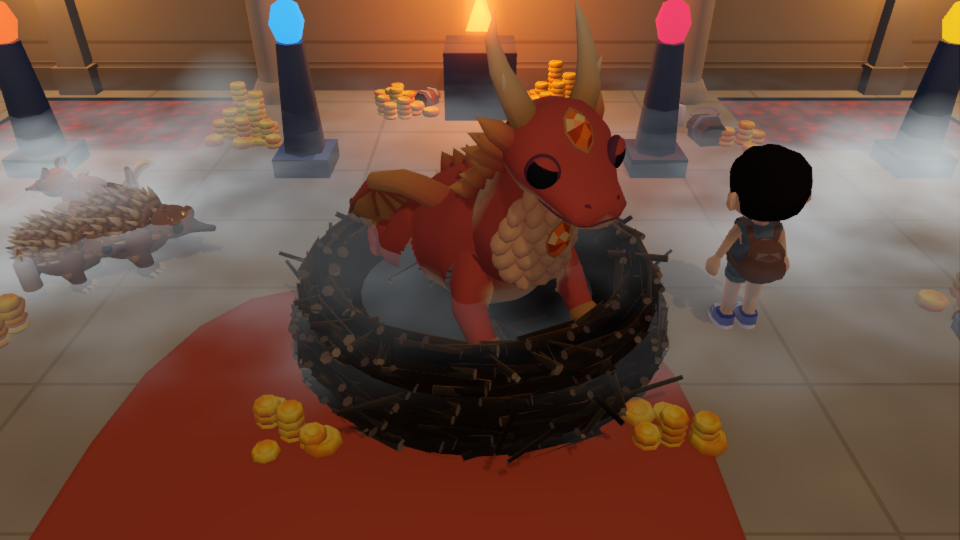
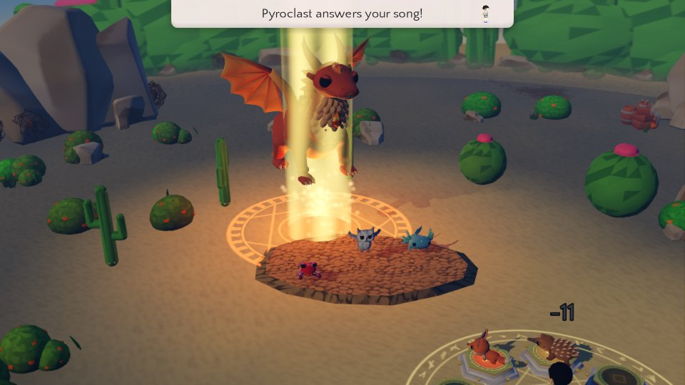
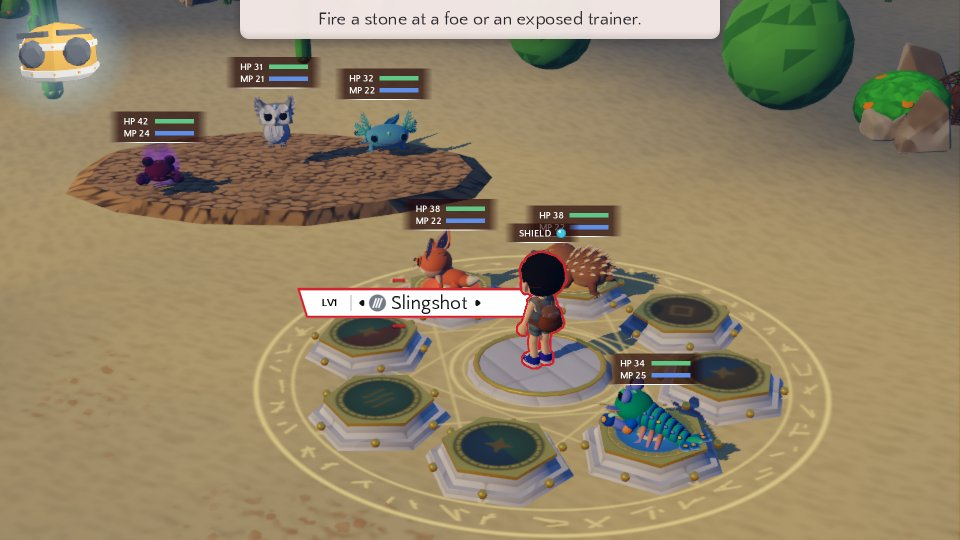
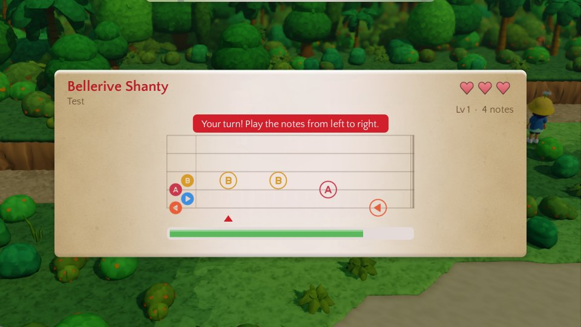
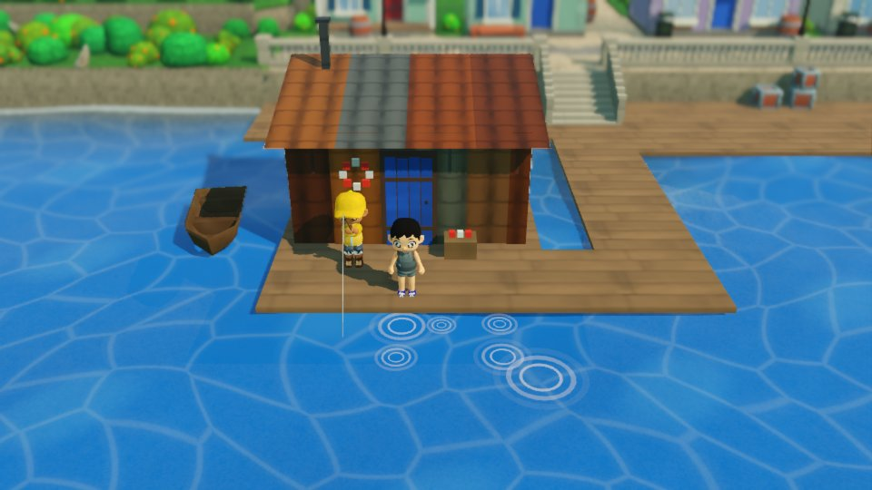
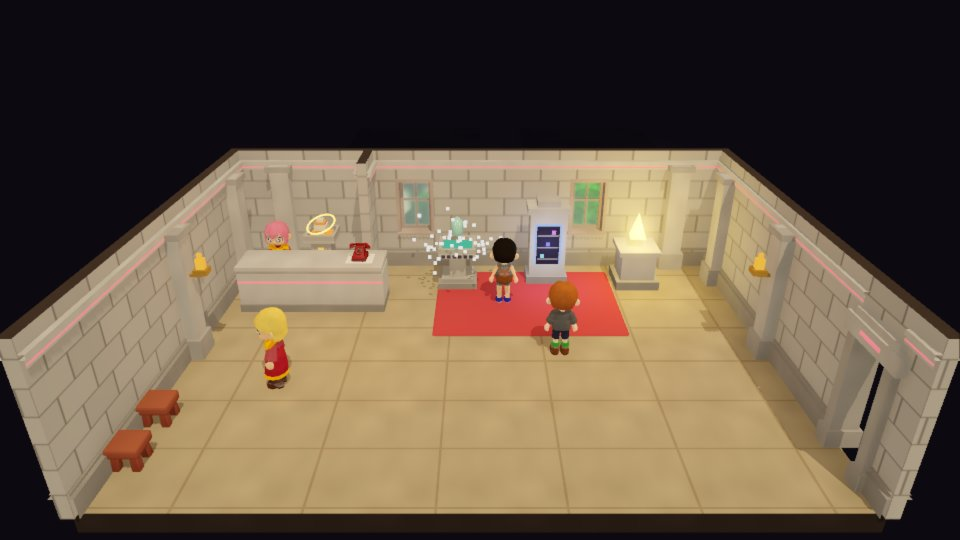
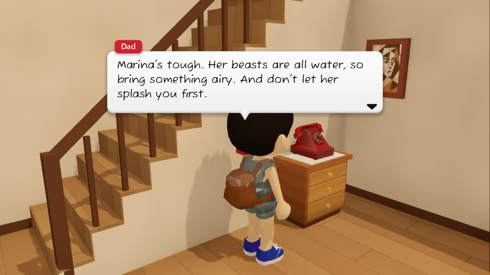
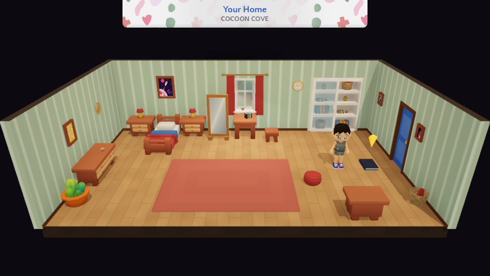

# Gameplay mechanics

[◀ Manual index](index.md)

Everything that happens between one map and the next: your beasts, their growth and moves, temples and summons, battles, songs, and the field, shops and phones that keep a journey going.

- The [walkthrough](walkthrough.md) shows where each system first comes up.
- Controls are in the [README](../README.md).

## Contents

- [Learning the game: the Codex and AUTO](#learning-the-game-the-codex-and-auto)
- [Your beasts](#your-beasts)
- [Temples and their guardians](#temples-and-their-guardians)
- [Battles](#battles)
- [Songs and the flute](#songs-and-the-flute)
- [Exploring the world](#exploring-the-world)
- [Towns, services and saving](#towns-services-and-saving)

## Learning the game: the Codex and AUTO

### The Codex

**The Codex** (`scripts/ui/codex.gd`, topics in `scripts/data/codex_db.gd`) explains everything after the Coastal Path. It is a little orange robot head (Quaternius's *Animated Robot*, head only, `tools/import_codex_head.gd`).

- It floats in a soft bluish glow at the top-left of the screen in battle. Its white speech bubbles hang under it, its brows change with the mood of every bubble, and now and then it starts one with "Beep boop!" or the like.
- Its face follows the fight: sad when one of your beasts faints, excited when a foe's does, and it bounces with joy when you win.
- The first time something new comes up in battle it chimes in once (`codex_seen_<topic>`). It covers:
  - your first trainer battle (guarding your trainer, shields)
  - the first battle with two beasts on a side (choosing for each beast, aiming)
  - a fainted middle beast (Move)
  - more than three beasts (turning the ring: you must turn it once before confirming moves)
  - your flute, a summon and eggs
  - the first time you pick a move with an accuracy roll, a recharge, ally or group targets, status, stat changes, recoil/drain, protection, an element, the Boomerang or the Bat
- You can ask it anything you're eligible to know, without using your turn: **Ask Codex** at the end of your trainer's bar, a tap on the head, or the **Codex** page of the Start book. Whenever the head shows, a tap on it brings up the list (it says so when you get it).
- Complete every one of its lessons without ever skipping one, and keep its tips on, and once a battle it heals any standing beast at 10% HP or below.
- Topics about something you don't have yet (the flute, a summon, the Bat) stay hidden, and move rules appear once you've met them.
- Lesson completion is saved through normal phone calls. See [tutorial coverage](../docs/tutorials.md).

**Lessons** take over the battle:

- The stage turns into its green wireframe simulation (mostly black, with its own music, *Bit Quest*; the stage pixelates in and out). Only the action being taught is allowed and nobody takes damage.
- A lesson about something you do (choosing for each beast, Move, the flute, summons, the Boomerang or the Bat) ends with one practice turn on rails, after which everything is put back for the real round.
- **Hold B: Skip lesson** beside the head skips it.

**Turning tips off:** switch them off under **Settings ► Codex tips**. Its head then leaves the battle screen, showing only while it talks or you ask it something (**Ask Codex** on the trainer's bar). On a journey played for more than three hours before the Codex existed, it says it's switching them off itself the first time it appears.

### AUTO

**AUTO** (`battle.gd` `_beasts_auto`, `_auto_fill`, `_codex_menu`) chooses your beasts' moves and targets for you, so you only choose your own action.

- While the Codex's tips are on, **Ask Codex** (or a tap on its head) first offers **AUTO** or **Help with something** (its topics).
- AUTO can be on for **every battle** (flag `codex_auto`), **just this battle**, or **off**, and can be changed at any time. The beasts' choices fill in or clear at once.
- It never runs in a lesson or a Codex practice.
- The Start book's Codex page has the same on/off switch and a strategy for each ring beast (`Beast.auto_plan`, saved with the beast; `battle.gd` `_auto_plan_score`):

| Strategy | What it does |
|---|---|
| **Full attack** | Its hardest attacks, MP no object. |
| **Save MP** | Attacks, free moves first. |
| **Status** | Boost an ally who isn't boosted, impair a foe who isn't impaired. |
| **Healing** | Heal the hurt, cure statuses, revive the fallen. |

Status and Healing go back to attacking when there's nothing for them to do. The Codex explains AUTO (topic `auto`) in a battle after the one that taught choosing for each beast.

## Your beasts

### The roster

- **25 creature lines, 75 forms** (`race_db.gd` `LINES`) use the supplied modular creature models, their original colours and forehead crystals.
- Draco, Axolotl and Fennec Fox each have Fire, Water, Earth and Air variants. Jerboa has Earth and Fire, Elephant Shrew has Fire, Water and Air, Mantis Shrimp has Water and Fire, and Poodle Moth has Air and Earth. Earth Echidna, Air Grey Owl, Water Yellow Boxfish and Water Stubby Squid complete the roster.
- Every line is released, appears in a suitable wild habitat, and is eligible for eggs, adoption and arena opponents.
- The supplied temple dragons replace the five existing temple and crypt guardians; their established names and story roles remain. The additional Spirit dragon is imported for previews and future placement; no new Spirit encounter is added.

**Names.** Each element has its own root and each species one set of suffixes for its low, mid and high forms, so a family reads as one and every name stays short.

| Species | Suffixes | Fire | Water | Earth | Air |
| --- | --- | --- | --- | --- | --- |
| Draco | o, one, omni | Draco | Dropo | Rocco | Floppo |
| Axolotl | lo, lotl, lotec | Sizzlo | Driblo | Muddlo | Pufflo |
| Fennec Fox | kit, fen, vix | Ashkit | Rillkit | Dunekit | Gustkit |
| Elephant Shrew | y, eek, eekor | Fizzy | Sippy | | Zippy |
| Mantis Shrimp | ip, imp, imperor | Scrip | Shrip | | |
| Echidna | let, ler, lord | | | Quillet | |
| Jerboa | pip, hop, hopper | Hotpip | | Clodpip | |
| Grey Owl | bit, bert, bertus | | | | Hoobit |
| Poodle Moth | let, wing, wingus | | | Fuzzlet | Pooflet |
| Yellow Boxfish | it, box, boxer | | Bloopit | | |
| Stubby Squid | by, ink, inkus | | Stubby | | |

Draco grows into Dracone, then Dracomni. Existing race ids remain stable; loading an older save translates its appearance and default species name (`RaceDB.canonical_name`: the first roster's names and the interim "Young <species>"/"Guardian <species>" ones) while keeping player nicknames, stats, equipment, moves and progress.

**Size.** Every form is fitted to the shared beast box on import (height 1, or 1.6129 long: `tools/import_generated_creatures.gd`), then drawn at its stage's size (`RaceDB.STAGE_SIZE`, 72%, 86% and 100%). Flyers float well clear of the ground and swimmers bob above it (`beast_rig.gd` `hover()`).

### Growing up

- A beast hatches as its line's first form and grows into the second at **Lv 20** and the third at **Lv 40** (`RaceDB.EVOLVE`, `Beast.evolve`): bigger, stronger, with the new form's name unless it has a name of its own.
- It keeps its moves, and a line learns the same moves at every form. Wild and trainers' beasts are whatever form their level gives.
- Battle XP is applied after the fighting ends. Every level-up and evolution fully restores HP and MP.
- Each beast gets a short level-up celebration and a longer before-and-after evolution reveal, one beast at a time.
- **The level film** shows the beast on the left and one window on the right: its name and element, its level going up, then HP, MP, Attack, Defense, Spirit and Speed one line at a time with the actual previous value, new value and gain, plus any move it learned at that level with the move's icon (`--scene=growth --preview=level --to=N`).
- A battle's rewards run straight from one to the next: between the films, the messages and menus that follow stand on the films' quiet stage (`UI.hold_reward_stage`), and the world fades back in only when the battle is over (`--scene=growth --preview=rewards`).

### Move slots

A beast holds two plain (neutral) moves, so it can always fight off its element, and a number of elemental moves (`Beast.slot_size`, `Beast.learn`):

- **2** as a hatchling.
- **One more each time it grows into its next form:** 3 at Lv 20, 4 at Lv 40.
- On a **merge**, the better parent's count **plus two**; a fully grown pair gives 6.

A beast of two elements splits its elemental slots evenly between them (the odd one to its main element). A move of another element (a ghost's, or a merge's lineage) uses its main element's slots.

**Learning a move.** When it learns a move (levelling up, a tutor, a mascot) and that kind of slot is full, you choose there and then which move to forget for good, or let the new one go (`Menus.decide_learn`).

- One window shows the new move's card on the left (its element, MP cost, targets, power, accuracy, cooldown and what it does), the moves it knows in the middle with their MP cost, and the highlighted one's card greyed out on the right.
- Letting the new move go raises a stat by 2 for good instead (`Beast.boosts`: Attack for an attack, Spirit for a heal or cure, Defense otherwise), shown on the right while "Don't learn" is highlighted.
- There is no list of remembered moves to swap from later.
- A merge keeps its parents' moves that fit its slots, mostly from the dominant parent. Older saves keep each beast's newest moves that fit.

### Elements

**Roles.** Fire are offensive tanks, Water are healers, Earth are defenders, and Air handle status and evasion.

**Weaknesses** (`scripts/data/elements.gd`) run in a cycle:

| Element | Weak to | Beats |
|---|---|---|
| Air | Fire | Earth |
| Fire | Water | Air |
| Water | Earth | Fire |
| Earth | Air | Water |

- A weak beast takes double damage.
- Every element is not very effective against itself (three quarters).
- Ghosts have no weakness, and plain attacks ignore elements.

### Eggs

- Eggs are the only way to get more beasts, apart from adopting one at a kennel: no song charms a wild beast.
- A defeated wild beast has a **20%** chance to leave an egg at the end of the battle (`GameState.egg_chance`). **At most one egg drops per battle**, even against a group: once one beast leaves an egg, the others cannot.
- Some trainer gear adds a little: the Worn Cap +1%, Explorer Hat +3%, Lure Charm +2%, and the Silver, Golden and Jade Flutes +2%, +4% and +6%.
- Trainers' beasts, robots and guardians never drop eggs. Ghost beasts drop Shadow Eggs only after you reach Gravenmoor.
- Beast Centers hatch eggs into level 1 beasts, the first form of the egg's line.
- Each egg found plays a short film after the battle, like a level-up's (`beast_cinematic.gd` "egg"): the egg drops into the light on the quiet growth stage and turns, with its name and who left it in the shared top-centre HUD. The egg drop has no button.
- The first post-battle reward film retires the battle view. Closing egg, level-up or evolution films returns to the world, including between multiple rewards; the arena never reappears afterward.
- Eggs name the beast inside (for example **Sizzlo Egg**), with the element beside the starter choices. Every species has its own shell colours, markings and silhouette; Shadow and Radiant variants keep the species' design.
- **Hatching** plays a cinematic in the same dark, misty roundel chamber as the merge film, with a stepped plinth in the middle:
  - The platform holds the egg, and the TCM Core lowers above it, hanging from a column of metal and bundled wires that runs up out of frame.
  - Its three steel tongs close against the shell and stay plain metal throughout: they never glow or change colour. A warm light inside the core shines down onto the egg.
  - The glowing egg disappears in a whiteout with a hatch sound, then the light fades to reveal the beast. Ground mist, drifting dust and depth fog set the mood.
  - Evolutions and level rewards play in the hatching vault, a dark stone chamber shaped like the inside of a great cocoon, with curved ribs, a stepped plinth and a horseshoe of lanterns.
- Hatchlings show their six stats in a window on the right. Hatch, egg-drop and level-up films wait for a fresh A/B confirmation after the reveal; their notices use the shared top-centre HUD, with no bottom caption.
- On a hatching or level-up, A (or B) during the stats' reveal skips it; then a small gem **A: Continue** button hangs under the stats window's right end, over its bottom edge (`edge_button.gd`), and the next A, or a tap on it, carries on.
- **Sell eggs** at the Beast Center: ordinary eggs fetch **100 gold**, Shadow Eggs **200**, and radiant legendary eggs **500**. Select an egg and confirm the offer in a short window replacing the egg list at the same HUD position, with **A: Confirm** and **B: Cancel** along its bottom. Cancel restores the same list and selection. The camera stays close to the keeper; the sale result appears in the top HUD.
- Arena hosts run the ladder; masters explain the crest, song and gold awarded for winning, then ask whether you want to battle. Neither buys eggs.

### Merging

Merging happens at Beast Centers, between two beasts grown into their final form and at their level limit: **Lv 40** at rank 1, and each merge raises the limit by 20 (`Beast.level_cap`).

- A normal merge is 50/50. The new beast is put together from both parents' models (`beast_parts.gd`): one gives its frame, the other some of its parts (its head, arms, wings, tail or legs, each set where the frame's own were), and it is painted in one parent's colours.
- A legendary parent dominates at **80/20** and keeps its race.
- Ghost merging unlocks in Gravenmoor.
- Beasts of neighbouring elements on the ring (Fire–Air, Air–Water, Water–Earth, Earth–Fire) merge into a **dual beast** of both elements. Opposite elements (Fire–Water, Air–Earth) can't merge.

**The merge film** (`scenes/MergeCinematic.tscn`) plays in a dark, misty chamber behind the Beast Center:

- Plaster walls set with glowing aqua bottle-bottom glass, columns where the walls meet, cables draped across the ceiling, a stone floor and three stepped platforms.
- The parents stand on two in the background, each in a pool of light from a hanging white-and-steel TCM Core, and the centre one is empty.
- The parents rise into their own light and fade, and only then does a column of light come down from the core over the centre platform.
- When it lands, a white wash reveals the merged beast, with the light now on it. The camera holds still until then, and circles the new beast very slowly to show its form.

### Ghost beasts

Ghost beasts aren't beasts of their own: they're the same beasts in black and purple, glowing faintly and wrapped in smoke.

## Temples and their guardians

### Guardians

- **Temple guardians** are summons. Each elemental temple holds a legendary guardian (Abyssion, Zephyrax, Pyroclast and Terranox), and Gravenmoor's crypt holds the ghost Nocthrax.
- A stone puzzle in each teaches that temple's song.
- A guardian can't be knocked out (it rises again): weaken it and play its song to befriend it.
- It doesn't join your party or leave: it stays in its nest and greets you as a friend when you visit (`Story.GUARDIAN_LINES` "friend").
- In battle the same song summons it, once per battle for one shield point, to hit every foe for about half their HP, more with an element advantage. Bosses always survive it (`summon_fx.gd`).

### The nest

The four temple dragons sleep in the middle of their chambers, curled up in a raised, round nest of woven sticks with a lipped rim (`beast_nest.gd`; three tiles across, none of them walkable; talk to the guardian from any side of it).

- They lie in a resting pose baked from their flying models by `tools/summon_rest.gd` (wings folded along their backs, legs tucked, the sky serpent coiled with its head on its coils; `assets/summons/<element>_rest.res`), perfectly still.
- Their song wakes them: each says that only the worthy may befriend it before the battle, and once won over says it will now come to your aid in battle (`Story.GUARDIAN_LINES`, in their own bubbles). The crypt's ghost keeps its usual model.
- The Temple of Tides' guardian chamber is round (`round_chamber.gd`, the room's "round"): a raised stone platform almost fills it over a pit, and water pours from a ledge all round the wall into the pool filling the pit below (the wall stands low on the camera's side, the water pouring over its top).
- A bridge crosses from the door, and a lane between heaps of hoard and bundles of candles (every candle a different height and thickness) leads straight to the nest, raised on a round dais of three steps. The chamber is dark; a soft shaft of sunlight falls from an opening overhead onto the dragon.

### Temple rooms

- Every temple room is dark (`world.gd` `_build_room`) and lit by KayKit wall torches on its pilasters (at most six giving light per room, for the Mobile renderer; `temple_lights.gd`, `room_builder.gd` `_pilasters`). The Beast Centers keep their bronze flame bowls.
- Dragons hoard: each chamber's "hoard" tiles (`interior_maps.gd`) and the nest's corners are heaped with gold coins, coin stacks, golden arms, trunks, candles, keys and plates from the KayKit Dungeon Pack (`dragon_hoard.gd`, one merged mesh; `tools/import_kaykit.gd -- --hoard`). These chambers are the only place gold coins appear as props.
- Temple rooms are built as ancient stone (`room_builder.gd` `ancient`): ashlar walls, plinths and cornices with a glowing inlay, pilasters against the walls (spaced out from the middle of each wall in mirrored pairs, flame sconces on every other one), and open stone portals instead of doors.

### The Temple of Tides

**Temples are several rooms** (`WorldDB.TEMPLES` `rooms`, the first room being the way in). The first is the **Temple of Tides**.

**The Coral Reef road.** Its road is a jungle trail along cliffs above the sea.

- It crosses rivers falling from the high ground on railed bridges, until the old ford runs too deep to wade: a sluice lever on the ledge above turns the river into its old channel.
- Past the great falls, the trail runs down to the shore and over an ornate stone bridge to the temple's isle, where Keeper Pell explains its waterworks.
- The temple stands on its stepped platform under a dome, overgrown with moss and vines (`ruin_stone.gdshader`), its way in a gatehouse at the front.

**Inside** is one long descent:

1. You come in from the west onto a raised walkway along the back of a great hall, the water just below it. The first door, in the back wall, is open; further east the walkway steps down into the water.
2. That door, on the room's east side, opens onto a single path along its back wall. Three waterfalls run down that wall into deep basins, open to the pool at the front of the room: where each one runs out, that stretch of the path has sunk to the pool's floor, so basin, gap and pool are one level sheet of water. When a fall stops, its stretch rises back up out of the pool.
3. Four red levers stand against the wall between the falls. All three falls are running when you arrive; each pull stops one, starts one or does both, by a fixed rule (`scripts/data/tide_puzzles.gd`), and the falls only stop when all four stand in the right pattern: a chime sounds, the pool drains and a treasure comes to light on its floor, with two flights of steps down to it.
4. Back in the hall the water has dropped a level, so you can go down the first stairs to the second door: a maze of walkways over a pool, where three waterfalls drop from the ceiling through metal lattices and block them.
5. Each of the maze's four levers moves a fall from one lattice to another, opening one way and closing another, and the four must all be pulled down. Each one pulled down rings two soft bell notes, a step higher for every lever already down, and the stone panel over a cubby in the back wall sinks a little, the cubby glowing brighter behind it; thrown back up, it rises again (the puzzle's `hint` in `tide_puzzles.gd`). By the second, the top of a red lever shows over it.
6. With the fourth, a chime and a brief camera focus announce the panel sliding the rest of the way open, revealing a brightly lit, shallow cubby with a compact stone wall switch and red handle within reach from the walkway. The four levers lock down; pulling the fifth stops the falls and drains the pool, and with another chime and camera focus a second panel further along the back wall sinks the same way, showing the treasure's chest in its own lit cubby, opened from the walkway in front of it. Both cubbies stay open on return visits.
7. That empties the hall, and the last stairs lead down to a stone door in an aqua-blue frame in the east wall. Behind it the singing stones teach the temple's song, and learning it on your flute sinks a second stone door into the floor: beyond is an octagonal chamber of water, with a path to the island in its middle where the guardian waits.

The two puzzle rooms are where strong water beasts prowl in plain sight. `--scene=tides-walk` plays the temple on foot, from the front door to the guardian's island, in a solving order (`--shots=dir` saves each stage, as you'd see it and from high above).

### Valkoog

**The air temple** stands on its stepped pyramid in the Scaraba Desert (`route5`'s `valkoog` section), with a storm-haze of blowing grit over the approach until its guardian is won. Tam and Saffi's stones gust the doors open (`valkoog_doors`).

- Four floors (`valkoog_1..4`), each a hall with the stair on at the back and five points on its walls: vent grilles, fan blades, gust plates or spear slots. Each floor's trap stands across its stair (`air_temple.gd`'s `air_trap`, the parts animated by `scripts/gfx/air_trap.gd`): something spinning, swinging, pouring.
- The star is the desert stone's own order (`star_locks.gd`: 1, 3, 5, 2, 4, 1). A touch lights its point, a wrong one darkens the floor, and the sixth stills the trap and tells you the next floor's first point. The points are air-keyed (the twins or the stone), and a trap is only passed once disarmed, never dodged.
- Above them the keepers' chamber (`valkoog_keepers`): five bald mages in thick hoods at the star's points, Khepri speaking. She gives the air stone, watches the hero's first cast, and answers questions about the arch-wizard; the four singing stones and their tablet teach the Song of Winds, and the song opens the wind-cut seam to the summit.
- The summit (`temple_air`) is the guardian's nest and hoard, and the twins come up too. Zephyrax is fought through the shared guardian flow with Tam and Saffi as guests, under the Air Shield, in a room a loss only restarts. Won over, it becomes the air summon (`guardian_air`).
- The released wind scours the dune below: the valley's `haze` variant gives way to `scoured`, the gear conduit lies bare, and its rubbing (`conduit_rubbing`) goes in the bag.

 Inside the Temple of Flame, on the Caldera Road.

 Pyroclast answers your song: a summon striking the opposing team.

## Battles

### Levelling and MP

- **Levelling** is slower than before: about twice as many wins per level.
- **Elemental attacks** cost MP (about a tenth of their power, at least 2). Regular (neutral) attacks and every other move are free, and a regular attack is always there when MP runs out.
- Every level-up and evolution fully restores HP and MP. MP also comes back from healing (the Beast Center machine; Mom and your bed at home don't heal) and items: Spirit Drop (15), Spirit Tonic (40), Spirit Elixir (all) from apothecaries, and Mint Tea at cafés.

### The battle ring

Every trainer stands in the middle of a ring of 8 slots (as in Jade Cocoon 2, `scripts/core/ring.gd`).

- The ring has a side per element, in this order round it: **Fire, Air, Water, Earth**. A side's middle slot holds a beast of that element; the **corner** between two sides holds a beast of either element, or a dual beast of both.
- You carry as many beasts as you have **beast slots** wired up: 3 to start, up to 8. New beasts take a free slot they may stand in, joining the side most of your team stands on.
- **You carry only the beasts on your ring.** Which beasts you carry changes only at a Beast Center (Nurse Clover, or the storage reliquary) or a kennel barn (Kennel Keeper Pip):
  - **Drop off a beast** puts one you carry in your storage.
  - **Pick up beast** opens beast storage, where stored beasts go onto your ring.
  - At a kennel, Pip asks whether a beast you drop off goes to **your storage** or **up for adoption**; a Beast Center only stores it.
  - Storage is one for the whole land: a beast stored at one kennel can be taken out at a Beast Center in another town.

**Default element** (**Start → Beasts**, first row):

- The element's name appears beside the label in the left list. Left/Right changes it; A or a tap cycles forward.
- The 3D ring turns to the next side with a beast in any of its three slots. Fully empty sides are skipped; fainted beasts still occupy their slots.
- The preference is kept with your normal phone save and survives turns made during battle. Until you choose a side, existing saves keep using the last battle's facing. There are no arrows above the ring.

**Arranging your beasts** (`beasts_page.gd`, **Start → Beasts**, anywhere outside battle):

- The left list holds **Default element**, then your carried beasts, each with its level on the right and its **HP and MP** under its name (`HP 34/50   MP 20`: what it has and its limit, or one number when it's full), then your eggs.
- Focusing a beast lights it on the ring on the right (fully opaque and outlined, the others faded).
- A or a tap opens its actions in a bar under the ring: **Info** (its details and stats), **Move**, any field action it can do right now (**Fly**, for an air beast of Lv 40+ outdoors) and **Equip** (what it wears, and changing it). ◄ / ► move along the bar and B returns to the list.
- **Move** picks it up: Left/Right cycle its element-compatible ring spots (three for a single-element beast), including occupied ones, which it trades places with; A confirms and B returns to its actions. The formation is unchanged until confirmation, and there is no yellow arrow.
- The right pane shows **occupied / unlocked slots used** and the actual 3D battle ring and beasts from the battle camera's perspective, without the trainer or center dais. The beasts stand still in their resting pose there (`BeastRig.hold`), and the preview's views render only after a change and while something moves (`battle_ring_preview_stage.gd` `redraw`), to keep the book light on phones.

**Beast storage** (`Menus.storage_screen`: the same page, without the book's tabs):

- The list has **With you** and **In storage** sections.
- Pick a beast with A or a tap, then Left/Right choose a ring spot for it, trading places with whoever stands there; for a carried beast the last stop is **Storage** (also the **Store** button), so storing works with the d-pad. A confirms and B cancels; B again closes.
- **Info** shows the focused beast. A stored beast only takes an empty spot while your ring has room, and one beast always stays with you (`GameState.ring_move_reason` has the rules). A beast that goes into storage is healed.

**New beasts:** a hatchling or an adopted beast takes a free ring spot it can stand on, and you're asked to **Keep** it with you (A) or **Store** it (B). With no free spot it's placed in storage and you're told so (`Places.keep_or_store`). Your very first beast is always kept.

### How a battle runs

One side of each ring faces the foe, and only its three beasts fight, using **that side's element** or plain (neutral) moves. A dual beast in a corner uses whichever of its elements faces the foe (`battle.gd`, `command_panel.gd`, `floating_hud.gd`).

- **The camera** looks over your shoulder: you stand at the bottom right, the foe at the top left. Every slot is an ornate hexagonal pad with a glowing sigil of its element or elements; the side facing the foe glows brighter.
- **Chooser bars.** There are no fixed foe/ally grids or shield panels. The trainer or beast choosing an action gets a flat outline round their silhouette (one clean line, never across their features): you in the selected gem; a beast in the colour of the element its ring's facing side fights with, a wild beast in its own element. The camera gently frames them.
- **The bar itself** is one compact white bar standing to their left (to the right when the left has no room), framed in that same outline colour and sliding out from behind them; its far end runs behind the model, so the bar's frame meets the outline behind them. Its left edge leans in towards the bottom at the top-centre bar's angle.
  - It shows the level in small black text, a thin divider, then small ◄ the action ►.
  - A beast's HP and MP run full width along the bottom inside the same shape (square, not slanted), each in a white border, with a small margin on the right (the MP the move would spend slowly flashes).
  - Above and below it a ▲ / ▼ in the outline colour shows that up / down lead to another beast or a turn of the ring; where they lead nowhere, a short, thick rounded line takes its place.
  - Only one chooser bar shows at a time: yours first, then each beast's in turn. ◄ ► change the action and **A confirms**; the whole bar is a full-height tap target. What the action does, and warnings, use the shared top-centre bar.
- **Choosing.** Each round you choose your own action first, then each beast's move from the top. Every aimed move has a separate target confirmation, even with one foe; a move that hits everyone shows all its targets. B goes back. One press or tap confirms once.
- **Moving between beasts.** **▲ ▼ move between your beasts; ▲ past the top (or from your trainer after choosing their action) turns the 3D ring anticlockwise, ▼ past the bottom clockwise**, to the next side with a standing beast. You can also tap an available 3D ally to choose their move.
- **Saved facing.** A ring rotation chosen during battle becomes the preferred front for the next battle and is saved with the game. Automatic guard fallbacks and lesson formations do not replace that choice.
- **The ring turns by itself** at the start of battle to a side with a standing middle beast (the preferred starting side if covered, otherwise the nearest; without a preference, the last facing), and when everyone on the facing side falls. Guided lessons keep their teaching formation and restricted choices. Fainted beasts on either trainer's ring remain lying on their pads; empty pads stay dim. Turning is shown by the actual ring and beasts moving.
- **Move.** Instead of its move, a beast on the side facing the foe can step over to another slot of the ring (choose the slot with ▲ ▼, as you would a target; the arrow marks the slot).
  - Any slot it can stand on that's empty, or holds a fainted beast (they trade places); the side it moves to then turns to face the foe.
  - It may not leave the side facing the foe without a beast standing in its middle, so the beast guarding you stays put, but a corner beast can step into a fallen middle beast's place.
  - One beast moves each round, last in your side's turn, so the others' moves land first.
  - Foe trainers Move too: when the beast in the middle of the side facing you falls, one of that side's beasts steps into a slot that covers its trainer again, unless turning the ring to a side whose middle beast stands would keep more of their beasts fighting (`battle.gd` `_ai_shift`).
- **Turn order.** The two sides take their turns, the **faster side first**: the speed of its beasts facing the foe, helped by its trainer's level. Within a side's turn, the trainer acts first, then its beasts by priority and speed. You never see what the foe has chosen: it happens on its turn (a trainer may turn its ring then too).
- **Your actions** are your equipped **weapon**, **Items**, **Flute**, **Watch**, and **Run** (wild) or **Forfeit** (trainers). Summon and Ask Codex appear when available. Attacks come first and aim straight away: the weapon by name (its plain shot), then any elemental attacks learned through it.
- **A beast's moves** sit on its main bar: plain attacks first, then elemental attacks, then support moves, followed by **Defend** to halve damage until its side's next turn and **Move** to change slots.

### Targeting and retargeting

**A target that falls first** (`ring.gd` `retarget`, `battle.gd` `_retarget`; the same rule for your beasts, your slingshot and items, and the foe's AI):

- When an action's turn comes and its target is down or has left the side facing the attacker, it goes to another beast standing on that side instead, the nearest slot first (a tie goes to the one facing the attacker's own row).
- With nobody standing there, an attack or the slingshot is turned on their trainer, who is open because that side's middle is down or empty; anything else, and any attack on a wild pack, is dropped without a message. A move that hits everyone just leaves the fallen out.
- A heal, boost or care item meant for an ally that has fallen goes to the standing ally with the least of its HP left; a revive is never passed on.
- MP is spent (and an item used up) only when the action has someone to land on. Lessons never turn a blow on a trainer by themselves.

**Aiming:**

- The chooser stays outlined and their bar names the target after the action, with a yellow arrow between them ("Bite ► Driblo"; "► All" for a move that hits everyone).
- Each target is outlined too and gets its own white bar (name, level and HP) in its outline colour, tucked behind it the same way.
- A translucent yellow 3D arrow rises from behind the actor (so they stand in front of it) and arcs to the target. It is a slim, flat rectangular shaft with a long four-sided pyramid head, with translucent depth-tested faces; white chevrons on the stem point and scroll towards the target, while the head stays plain yellow in every gem. All-target moves draw one arrow to each target.
- ◄ ► aim; **tap a 3D beast once to aim, then again to confirm**; A also confirms. B returns to choosing the action. Move uses ▲ ▼ or a tap on a legal 3D pad (the pad gets a hull outline). Item and song targeting use the same arrows, outlines and target bars without a chooser bar. Guided battles retain their automatic target restrictions.
- The top-centre bar says the action, the target with its HP, and what the move does.
- The outlined models are rendered a second time, alone, for their shapes only (`battle.gd` `front_texture`; `floating_hud.gd` draws the outlines from it and shows the 3D view through it over the bars' ends).

### Battle HUD

**Action icons** (`scripts/battle/action_icons.gd`): a round icon stands before the action's name on the chooser's bar.

- An elemental attack's disc is its element's colour with the element's glyph (flame, drop, peaks, wind, ghost).
- A plain attack (and your weapons) is grey with claw marks.
- Every action that isn't an attack is navy, with a glyph for what it does (Defend's shield, a heal's cross, chevrons up for a boost and down for a hex, Move's arrows, Items' bottle, the Flute's note, Watch's eye, Summon's star, Run's arrow).
- `--scene=action-icons --shot=...` shows the whole set.

**Weak and resistant targets:** while an attack is aimed, each target's bar shows a mark after its name.

- A red burst with "!" when it is weak to that attack (double damage).
- A slate shield when it resists it (an attack of its own element does three quarters).
- The top-centre bar says "Weak!" or "Resists" after the target's HP.
- Elemental bombs show the marks too; plain attacks, weapons and ghosts have none.

**HP and shield plates** while you choose your own action (and aim it):

- Every standing beast without a bar of its own shows its HP over its MP in a small square plate above its head ("HP 63" over "MP 31" on the left, each beside its gauge). The HP gauge is green above 50%, and both the gauge and label turn yellow at 50% HP and red below 25%.
- Each trainer (you, and a rival trainer) shows their shield points in the same kind of plate: a "SHIELD" label, then an orb per point.
- The plates use the top-centre bar's dark fill with no frame, fading out towards both sides, and a thin white line along the bottom that fades the same way.
- None of these show while a beast is choosing. **During actions** no bars or readouts appear at all: HP changes show only as damage numbers. Shield orbs appear beside a trainer only while targeted or for about a second after a hit, and bars keep clear of them.

**Touch:** the chooser's bar is drawn compact but taps as a full-height row (at least 80 logical units on touch, 56 on desktop). Its left end (level and ◄) and right end (►) change the action and the middle confirms. Bars stay in the safe area and outside the d-pad and A/B clusters' enlarged exclusion zones: a bar that fits on neither side of its model rests nearby with a pointer to it. Keyboard, gamepad and direct taps share the command controller; taps cannot pass into world movement.

### Battle presentation

**Surroundings.**

- Outdoor, fishing and arena battles sit inside one continuous textured surround, with a curved foot blended into the stage's own floor.
- Each of the 14 biome palettes has its own repeating mural, baked from the game's existing regional assets.
- Batched clusters of regional trees, shrubs and rocks frame all four perimeter corners and hide joins; desert clusters use boulders, fishing keeps trees on land and uses rock outcrops over water, and arenas use pillars and banners.
- Indoor battles retain their enclosed walls and ceiling, with tall corner columns, lower temple or tower props and coloured practical lights concealing wall junctions.
- The mural uses mipmapped anisotropic filtering and scenery casts no shadows. There is no runtime artwork generation.

**Lighting** (`stage_lighting.gd`, `stage_floor.gdshaderinc`).

- A softer warm key and cool rim separate the fighters from deeper blue/violet shade.
- The two rings sit in a broad pool of light fading gently toward darker, cooler corners; the floor and surround share the same falloff.
- Filmic highlights stay controlled, colours stay saturated, and only real highlights glow. Indoor corner accents replace the old row of seven lamps.
- The rim and practical lights cast no shadows, and the rim dims with the stage during summons. This lighting is specific to battles and works on Mobile and Compatibility.

**Clear sightlines** (`scenery_visibility.gd`). Scenery in front of the fighters or across a camera-to-fighter sightline hides, including foreground columns, trees and rocks. Instances hide individually within their batches and return when the camera clears them. Cached bounds and a short update interval keep slow drifts cheap; cuts and quick camera moves update immediately. The floor, walls, ceiling and painted surround remain intact, and corner dressing stays around the perimeter so visible wall joins stay covered.

**Camera director** (`scripts/battle/battle_camera.gd`).

- A short opening sweep settles over your shoulder; choosing drifts around the commanded trainer or beast.
- Actions move to the attacker, follow to the actual target, hold its reaction and return. Captures, knockouts and summons have their own shots; victory slowly orbits your side.
- Shot changes are at least half a second apart and never add waits to a round.
- Every position, including summon shake, stays inside the room or surround; large indoor summons widen the lens instead of crossing the ceiling.
- The surround mesh is cached, regional props use cached meshes and batches, and scenery (including pads, dock and floor) casts no shadows. Floating menus and the top bar keep their existing safe areas.

**Hits and casting.**

- A plain attack lunges at its target.
- Any other move is cast: the camera cuts to the caster as its element's glow (white for a plain move) gathers and it lets go, then cuts to where it lands as the glow streaks in, a burst there (rising motes for a heal or a boost) with the target's hit pose and number on the same frame.
- A beast that Defends holds a braced stance until its side's next turn; a defended or resisted hit is blocked, and other hits knock a beast back as hard as they were (`battle_camera.gd` "cast" / "impact", `battle.gd` `_cast`).

**Winning and losing.** Winning plays *Android Sock Hop*. A beaten wild foe vanishes in a puff of smoke; fainted beasts on either trainer's ring lie on their pads, slumped with their eyes shut. A beaten trainer (you too) drops to one knee, head bowed, catching their breath: never knocked flat, as nobody gets hurt (`voxel_person.gd` `set_pose` "kneel"); a beaten robot powers down. Damage numbers use Quattrocento Sans Bold.

 A wild battle in a desert clearing: the Slingshot command with its prompt, both battle rings and compact HP and MP bars.

### Weapons

Equip a weapon in **Journal → Trainer → Weapon**. Your selection is saved, and older saves start with the **Slingshot** (`item_db.gd` WEAPONS, `battle.gd` `_do_weapon`).

| Weapon | How it works | Where it comes from |
|---|---|---|
| **Slingshot** | Fires one stone at a beast or an exposed trainer. 90% accuracy. | Your starting weapon. |
| **Boomerang** | Sweeps every foe on the facing side for less damage per target and returns to your hand. | Chief Coralie gives it in Kelpwick once the reef path opens. |
| **Bat** | The hardest hit (1.6× slingshot damage), with 75% accuracy. You run up to one foe before swinging. | Captain Dalton hands it over with the Scaraba bounty. |

All three are key items with no bag stack cost.

- Each weapon attack uses the weapon once and rolls accuracy for each beast it targets. A hit on an exposed trainer breaks one shield point.
- Bosses and arena masters sometimes use weapons against your beasts, and they choose either a song or a weapon on their turn.
- Trainer attacks cannot critically hit. A beast's base critical chance is 0% above 50% HP, rises from 5% to 15% between 50% and 25% HP, and rises to 30% as HP approaches zero. A move's critical bonus adds to that base chance.

### Shield and the end of a battle

- If the beast in the middle of the side facing the foe is down (or that slot is empty), its trainer can be **attacked directly**: each hit breaks one shield point. Turn your ring to a side whose middle still stands to cover yourself, or have a corner beast Move into the fallen one's place.
- A trainer battle ends only when a trainer is hit with no shield left, or someone forfeits. Wild beasts have no trainer: beat them all to win. If you're the one hit with no shield left, you wake up at the nearest Beast Center you've visited.
- Every trainer starts with 1 shield point; trainers on the roads have 0 to 3, depending on their strength. The shield recharges after every battle.

### Trainer level and Sparkwire

- Beating trainers earns trainer XP, and clearing a rank of the **arena ladder** raises your trainer level to at least that rank + 1.
- The ladder (`ladder_db.gd`) is the same at every arena: twelve ranks of four ring trainers each; beat them all to open the next rank. Sovereign and Mythic follow Champion. Each rank cleared earns a crystal shard; beaten trainers can be fought again.
- The host stays on the left and the ladder menu on the right. Unlocked ranks appear as tabs: left/right or a tap changes rank, with all four trainers visible without vertical scrolling.
- **Sparkwire Electronics** (Volt, Bellerive) sells **shield points** (5 crystal shards each, up to 4) and **beast slots** (3 shards each, up to 8). How many Volt can fit depends on your trainer level: one more slot per level, one more shield point every other level.

## Songs and the flute

### Playing a song

**Flute songs** are a sheet-music game.

- Only a song you're learning plays by itself (from a teacher, sheet music or a flute trainer): it plays once while its notes light up on the staff. A song you already know (in battle, practising) doesn't: the sheet comes up and it's your turn straight away.
- Each line and space is a button: ← → A B from the bottom up. The notes are the buttons' prompts in their colours on faint staff lines, on a window whose sides fade into aged paper; each stays outlined until it's played, then swells and comes back filled.
- The outcome pops up on a bouncy card in its own colour (green, gold, orange or red by the timer's colour; purple for a failed song) and stays until you dismiss it with A or its small "A: Dismiss" button, which appears a second after the card.
- The clock starts on your turn (*Your turn!* lights up over the sheet). Play the notes in order: the sheet stays up the whole time, with the notes you've played lit.
- You have 10 seconds for four notes and 5 more for every four more (30 seconds in Uncle Rafe's lessons). The bar shrinks without numbers, going green, then yellow, orange and red. The colour you finish in sets the song's power: full in the green, about half in the red.
- Each wrong note breaks one of three hearts and costs a little power. Lose all three, or run out of time, and the song fails.
- Songs start at 4 notes (a temple song as many as its stones sang, never more than 8) and grow to 16 as they level up. Songs level up with mastery stars, earned only by practising the whole song (Start book ► Flute, or the music hall); each star makes the song stronger. Bigger songs add ↑, then ↓, and finally chords (A or B pressed together with a direction).
- In battle (effect songs, a guardian's song and summons) you only ever play the song's original melody, its first level, however far it has grown; its mastery still sets its strength.
- Uncle Rafe keeps it short the first time: he plays the song, then you play it back.

### Song types

**Battle songs** work in any battle. No song wins a wild beast over.

- Some lift your team: Swift Jig, Battle Hymn, Iron Chorale, Mending Melody, Cleansing Canon, Mirage Minuet.
- Others hinder the foe: Weaken, Sluggish Waltz, Dazzling Trill, Drowsy Lullaby, Venom Serenade, Static Polka, Discord, Dread March.
- A great performance doubles stat changes and raises status odds. Mastery stars make songs stronger too.

**Temple songs** bind a temple's guardian as a summon (see Temple guardians and summons); they don't add beasts to your ring. The **arena masters** teach strong combined battle songs, such as Bellerive Shanty (ATK and SPD up) and River Anthem (heal, cure, SPR up).

 The flute sheet open over a battle, with the notes of the song to play.

### Learning songs

- **Brass & Reed Music** in Cogsworth: Maestro Clef plays one song from his book for free, once. Play it back from memory to learn it. He also sells sheet music, which you can practise from your bag until you get it right.
- **Flute trainers** play their own songs in battle: four route bards, three arena masters, Commander Nyx and General Vexmora. Win, then play the song back **without a single mistake** to learn it. Bards and arena masters will battle again for an encore.

## Exploring the world

### Weapon field obstacles

- Face a target or barrier and press A, or tap it to walk to its firing spot. An owned weapon is used automatically with one short animation; there is no aiming game or confirmation menu.
- Slingshot bullseyes and bells release ladders, gates or treasure. A boomerang strikes an entire line of switches in one throw and returns; the bat breaks cracked rocks and split stumps.
- Without the weapon, the description names the required weapon. A ranger beside each unsolved fixture explains its mechanism, the controls, whether you own the right weapon and where to get a missing one. They greet you at the firing spot, can also be spoken to directly, and leave once you solve it; solved guides are not loaded again.
- These fixtures are optional road detours, never required story gates. They begin after the Coastal Path; the first road focuses on its battle teachers and footbridge.
- Solves and collected chests have separate permanent flags, retained by ordinary phone saves.

### Key-item field tools

**Riposo Valley** (`route5b`), north of Scaraba, is a long valley road that turns from sand to prairie grass at a rock ridge. The ridge's two-tile pass is shut by person-sized **crayon statues**: face one and press A, or tap it, to learn what it is (`riposo_statues_seen`); a sign points at Volt in Bellerive, and Scaraba's Sky Tower flies there and back. Volt's **Crayon Eater** is a key item, not a weapon: with it in the bag, facing a statue and pressing A (or tapping it) crunches the statue away, sets `crayon_statue_<n>` and clears its tile. Side branches hide shards behind more statues. The statues are the one required story lock built like the weapon fixtures; the old drovers' cut in the valley is a boulder-blocked shortcut (earth).

### Fishing

Fisher Gil fishes off the deck of his rusty tin shack on Bellerive's docks (`scripts/world/fishing.gd`, `scripts/ui/fishing_game.gd`).

1. Talk to him and he offers his spare pole, leaning in the shack. Take it before asking and you're told stealing is bad.
2. Come back out with it and he stops you for a first cast: something always bites, the line is gentler, and he has you try again until you land it.
3. After that, face any water and press A to cast. Where the water ripples (each map's `fish_spots`, plus a few picked along its shores) something nearly always bites, and quickly; anywhere else only now and then.
4. When the float dips, tap A to strike, then reel: each tap pulls the line tighter and it slackens on its own. Tap it up into the bright zone and keep it there with steady taps until the catch meter fills. Too fast and the line snaps, too slow and the beast slips off.
5. Land it and it leaps out for a wild battle on a plank dock with the beast out on the water (`battle.gd` `_fishing_scenery`).

**Bait** goes on your hook from the bag and is worn until something bites. It brings stronger, rarer water beasts, sooner: Wriggly Worms on the islands (Shellhaven, Kelpwick), a Spinner Lure from Copperpick, Cogsworth and Emberfall, a Glow Lure from Riverbend and Gravenmoor. Captain Gull's ferry is moored by the long pier, and Gil's rowboat by his shack (map `boats`).

 Gil's dock in Bellerive: his shack, the rowboat and the fishing spot off the deck.

### Moving and terrain

- **Everyone moves one of the four ways** on the tile grid, a whole tile at a time: you, strolling townsfolk and wild beasts. A step, once started, always ends in the middle of the next tile (whatever you let go of or press on the way), so you always stop lined up with people, doors and items. With two arrows held you keep walking the way you were going, else the newest arrow counts (`world.gd` `_key_dir`).
- **Cliffs and ramps.** Every town and road has high ground (`scripts/world/elevation.gd`). Woods and rock stand on ridges along the back and sides of each map, so you're closed in there, with the roads out running through cuts in them.
  - Many maps have terraces too: Cocoon Cove's garden terrace under its rim of tall cliffs, Bellerive's stone quay over the harbour, the Dune Road's escarpment (the rope ladder a flyer hangs climbs it), the Mesa Trail's canyon walls, Gravenmoor's graveyard knoll.
  - Nobody climbs or drops down a cliff, and nobody talks, picks things up or sees across one (trainers and wild beasts included); ramps are walked up and down along their slope.
  - Cliffs seldom turn a square corner: most corners are cut by a diagonal cliff across one tile, and nobody (you, beasts or townsfolk) can stand on a tile with a diagonal cliff in it, high half or low.
  - Where a cliff drops into the sea or a river the water at its foot is deep, never wading shallows, with now and then a rock of the cliff's own stone standing in it. Where a river runs over a cliff it falls as a waterfall (Riverbend).
- **Seeing behind high ground.** Behind high ground you're never lost from sight: whatever ground stands between the camera and you dissolves around your shape in a fine dither (`terrain.gdshader` `hole`).
  - Buildings stay unloaded until their ground footprint reaches the screen. They fade in as their base comes into view and unload when it leaves.
  - Arrival fades use isolated material opacity on Forward+ and Mobile, then restore their original opaque materials.
  - On Compatibility (the web) buildings appear without the fade: each see-through copy compiled a shader of its own on first sight, freezing play for up to half a second as a building came into view.

### Town mascots

Every town has a mascot beast roaming its square and a statue of it beside, cast in bronze (the coast and the isles), silver (desert to mountains) or gold (the far towns).

- The mascot teaches a beast of its own line, once it reaches **Lv 40**, the town's signature move: an elemental attack mightier than any move of its element learnt by levelling (`world_db.gd` TOWNS "signature", `move_db.gd` SIGNATURE, e.g. the Dracomni's Bandit Blaze in Cocoon Cove).
- Each town's mascot is a different species: Dracomni (Cocoon Cove), Driblotec (Bellerive), Shrimperor (Shellhaven), Stubinkus (Kelpwick), Zippeekor (Dustwell), Poofwingus (Scaraba), Quillord (Copperpick), Clodhopper (Cogsworth), Ashvix (Emberfall), Fuzzwingus (Vinehollow), Bloopboxer (Riverbend) and Hoobertus (Gravenmoor).
- With 11 species for 12 towns, the Poodle Moth is the one that serves twice, in two elements. Nobody else teaches it, and a merge keeps it only for a beast of that line.
- The statue's plaque explains it, and townsfolk bring it up now and then (`chatter_db.gd` MASCOT_MOVE).

### Wild beasts

Wild beasts roam the routes in plain sight; there are no random encounters (the tall grass is still there).

- Each beast sees in a cone in front of it, half as far if you're in tall grass, and hears you running nearby.
- Beasts come running when they spot you. Only a lone beast hopelessly outmatched by your best one (8+ levels below it) bolts.
- Marks: a yellow **!** when one spots you, a blue **!** when it's scared and fleeing, and **?** when it loses you. Nothing shows while it charges, or once it goes back to roaming.
- **Sneak attack:** walk into one from behind before it spots you. It leaps in fright without turning round (green spiral, it loses its first turn).
- **Normal battle:** meet one face to face (blue spiral).
- **Ambush:** let one catch you from behind (red spiral, you lose your first turn).
- **Battle entry** is a swirl: two thick, flat-ended arms, one in each of two flat tones of the encounter's colour, wind out from the centre of the screen round each other.
  - The moment that pair is halfway to covering the screen, a second pair starts from the centre on top of it, a shade apart with a soft shadow under its edges; it covers the screen and keeps turning while the battle loads.
  - White sparkles live inside the solid arms (never the see-through first pair on Max): they ride outward along them, growing and blurring toward the screen's edge. Wild encounters use their encounter colour; trainer battles are a deep, dark purple.
  - A last pair of arms, of nothing, then opens from the centre onto the battle. The Graphics setting picks how much it draws (`scripts/ui/spiral.gdshaderinc`): Max has the shadows, the sparkles and a 70%-opaque first pair (the battle waits until the second pair covers the screen); Mid drops the shadows; Min draws flat arms only.
- **Protection.** After any wild battle, you receive **three seconds of protection** during field control.
  - Wild beasts cannot see or hear you, drop any chase, and cannot start another encounter, even on contact.
  - After a **victory**, your character smoothly pulses between 35% and 80% opacity until protection ends, then returns to full opacity. Escaping or losing (including the return to the Beast Center) keeps the character fully opaque.
  - Trainer battles grant neither protection nor an opacity pulse. Menus, interactions and map transitions pause the countdown and opacity pulse.
- **Groups** grow slowly through the game (`Story.pack_cap`): beasts roam alone on the early roads (always on the Coastal Path), in pairs from wild Lv 7, and in threes only from Lv 16.
  - Within that, a beast no stronger than your best one usually (70%) roams with more of its own kind, and the pack stands its ground; on roads with wild Lv 16+, stronger four-legged beasts, flyers and serpents sometimes run in packs too.
  - Each road's trainers are stronger than any wild beast on it. The early levels climb slowly: Coastal Path Lv 2-4, Isle Trail 4-7, Coral Reef 7-10, the Temple of Tides' puzzle rooms 10-12 (its guardian Lv 12, with one helper), Dune Road 10-13. Arena masters on that stretch: Marina Lv 9-10, then Nerissa Lv 10-11, who opens the reef.

### Fast travel

- **Sky Tower.** Climb a Sky Tower: Skykeeper Aria's ticket desk is in the lobby, and the stairs lead up to an open-air platform on the roof, where the Hoobertus flies you to any town you've visited, for a fee.
- **Fly.** Once you own an air beast of **Lv 40+** (in your ring, not storage), pick a town you've visited on the Start book's Map page and choose **Fly here** (or press A) to travel there from anywhere outdoors. It asks first: A: Yes flies, B: No stays.

Leave a push puzzle and come back to reset it; once solved, the blocks stay where you left them. Smaller elemental obstacles (driftwood, sand drifts, boulders, dust storms, ravines) still turn up off the main road.

## Towns, services and saving

### Beast Centers

Beast Centers all look the same, inside and out, in every town (`scripts/gfx/beast_temple.gd`): a small temple that works by old magic, not machines, to the tune of "Hep Cats".

- **Outside:** a squat eight-sided drum of smooth grey stone blocks on a plinth, with a gabled portal at the front (gold-trimmed eaves set with teal tiles, a pointed niche, the sign board with the pawprint) round an arched doorway with teal inlays and a closed blue door. Stepped terracotta tiers, a little red drum ringed with posts and a golden thatched dome with a crest of coral petals round a teal jewel crown it.
- **Inside:** one room (12x9) with walls of the same grey blocks, pilasters with flame sconces and a glowing inlay in the Center's red; each relic has its own bay along the back wall.
- **The healing font** is a stone basin on a fluted pedestal with a crystal turning over it and a rune stone per beast set in its rim. The rune stones light one by one and the crystal glows while it heals. Use it yourself, any time, for free.
- **The storage reliquary** (a stone cabinet whose arched niche holds glowing spirit orbs) and **the merge altar** stand in the bays beside it.
- **Nurse Clover** at her stone counter hatches eggs in the **incubator**, a warm cradle stone on a pedestal with a golden rune ring turning round the egg (with the hatch cinematic), and runs beast storage (**Drop off a beast**, into storage only, and **Pick up beast**) and the merge altar. A red phone stands on her counter, for calling Dad or Mom (see Saving).
- **Guide Dottie** walks about the room and explains how it all works.
- **The staff uniform:** ruby red with a gold collar and hem, and the pawprint from the sign over the door in gold on its front (`map_loader.gd` `CENTER_UNIFORM`; a look's `robe` and `emblem` in `townfolk.gd` and `voxel_person.gd`). No hats, no glasses. `--scene=robe-options` shows the robe colours that were considered, and `--preview=uniform` the chosen one up close.
- **Mages** (Dale, Brother Shoal, Keeper Nerine: a look's `robe: "hooded"`) are always bald, with no hat and no glasses.
  - Their hood is built in code (`townfolk.gd` `MAGE_HOOD`, `_mage_hood`; the kit's own was a thin faceted shell): a deep two-walled cowl in the robe's colour with a soft point falling back and a fat rolled lining round the face. There is no capelet: below the hood they wear the Beast Center staff's temple robe.
  - Mage robes are two-toned in their element's beast colours (a look's `element`; `Townfolk.MAGE_COLOURS` picks swatches from `beast_looks.gd` `SKIN_PALETTES`): the first for the robe and hood, the second for the face lining, collar and hem. The face lining is never the old gold.
  - `tools/check_data.gd` fails a mage with hair, a hat or glasses. `--scene=mage-preview --shot=...` shows Dale in his workroom; `tools/debug/mage_sheet.gd` renders the mages front, side, above and behind.

 Cocoon Cove's Beast Center: Nurse Clover's counter, the healing machine, the storage terminal and the red phone.

### The kennel

- **The kennel** is not in the Center: it is a barn of its own out on the roads and in the wilds, never in a town (route map letter `?`, `scripts/gfx/barn_builder.gd`).
- Outside: the supplied Small Barn in its region's paint with closed double doors, the pawprint sign and a lantern, and a fenced paddock with a trough and hay bales. Inside (room `kennel_barn`) are timber walls, hay bales and lanterns.
- Kennel Keeper Pip looks after beasts other trainers left behind; they wait in the pens behind his counter, close to your party's level, and each barn keeps its own pens.
- Adoption costs **40 gold at Lv 1, plus 2 gold per additional level** (78 at Lv 20, 118 at Lv 40). The list and confirmation show the fee; you need enough gold to adopt.
- Pip's menu is **Adopt a beast**, **Drop off a beast** and **Pick up beast** (B leaves). Drop one of yours off and Pip asks whether it goes to your storage (shared with the Beast Centers) or up for another trainer to adopt (Pip thanks you with a little gold); taking it back before another trainer adopts it is free.
- Tapping a pen walks you over to Pip. Empty pens fill up again after a few minutes of play.

### Saving

Your dad is away up north for work, and **calling him is how you save**. Tell him how your journey's going, he cheers you on, and the game is saved; then keep playing, or stop for now (back to the title screen).

- Saving is free. Red phones stand in homes, every Beast Center, the apothecary, café and music shop, the arenas' lobbies and the doorways of the temples of winds, flame and roots. Only the red **payphone** by each town's square costs anything: 5 coins a call (no coins, no call).
- In Beast Centers, shops and arena lobbies, phones sit on the attendant's counter or display case; house phones stay on their own tables.
- On the first morning the phone rings as you go to leave home, and you can't go out until you've answered: it's Dad, wishing you luck.
- Every phone asks who to call: **Dad** (save, always first), **Mom** (advice) or **SkyTower Inc** (courier; a payphone still takes its 5 coins). At home Mom is in the room, so the home phone doesn't offer her.
- SkyTower Inc is only on the list once one of its employees has given you the number: Skykeeper Aria does, at any Sky Tower's desk, the first time you talk to her, explaining how the couriers' rides, pickups and deliveries work (`phone.gd` `SKYTOWER_FLAG`). While the phone's menus are open the camera swings round beside the hero to the phone (see the menu shot in [interface and audio](interface-and-audio.md)).
- **Mom saves nothing.** She passes on a tip for what you're doing now (`chatter_db.gd` `MOM_TIPS`, by `Story.next_goal()`, taking turns call by call). It is always one of:
  - something she saw on the TV news
  - something Grandma wants you to know
  - a call from someone who saw you do something you've done, with advice for what's ahead
- Then she looks in your father's old trainer guide: your beasts' average level next to the wild beasts where you are, or, where there are none, the road or arena master next on your journey (`MOM_AHEAD`), and whether you're too weak, about right or strong enough to press on (`phone.gd` `level_advice`).
- Every phone stands on a white placemat on a boxy little chest of three drawers (`side_table`, baked by `tools/make_side_table.gd`) in the middle of its tile, out from the wall, so you stand right beside it to call.
- **Ten save slots**, one per journey: you never pick a slot when you save. A new game takes the first empty slot the first time you save, and after that every save goes back into the same slot. If all ten are full, Dad asks (A: Yes / B: No) before writing over the save made longest ago.
- Each save keeps a snapshot of that moment (the world without the UI) and your play time, shown right after you save.
- Dad asks whether you want to save first (**A: Yes / B: No**). After saving, or if you decline, he asks whether you want to continue playing: **A: Yes** returns to your journey, once he's told you not to work too hard (`phone.gd` `_save`); **B: No** returns to the title screen.
- The title screen's **Load Game** lists the slots with their snapshots; you can load, copy or delete them there.

 Calling Dad from the phone at home: that's how you save.

### Shops and houses

- **Shops** differ per town. Small towns have a few; cities have many. Each building has a wordless sign fixed flat to its front above the door, showing what it is (houses have none).
- **Inside**, every house and shop is a compact room seen whole, like a stage set: no front wall, the camera holding still, and the front door in a side wall (the Beast Centers and arenas are bigger, and there the camera follows you).
- **Windows:** every room has windows in at least one wall, never in a wall with a door to another room (the front door may share theirs).
- **Homes** have no kitchens to wander into: many townsfolk live in studios, bed and sofa in one room, while others have a bedroom through a door or up a flight of stairs.
- **Stairs** always come up into a landing, a hallway half a room deep, with the floor's rooms through doors off it. You only get onto them at their open end: up from the foot of the flight, down from beside the top step of the stairwell, never through the handrail or the wall beside them. You walk on up (or down) them as the room fades out, and on the other floor you're seen walking the last of them as it fades in.
- **Your home** has the living room downstairs, with Mom (she has your skin, hair and eyes) and the phone; upstairs, your bedroom (where you wake up), Mom's room and the bathroom open off the landing.
- **The big dungeons** (temples, the hideout, Gearheart Tower, the Sky Tower and the cathedral) keep their own layouts, open at the front too.
- **Shop staff** stand behind a counter and wear their shop's uniform: a polo in the shop's colour with a contrasting collar and cuffs, short sleeves, a name badge and usually a visor (the sensei and the fortune teller wear headbands, the music hall's usher a pillbox hat).

**Interior staging rules** ([interior staging](../docs/interior_staging.md)):

- Book props use coloured covers, never white covers.
- Side-wall furniture faces inward and other lounge seating opens towards the camera. Living-room templates must face the room's centre or the omitted front wall, never outward towards a visible wall; the couch defines the main viewing direction and chairs face their group.
- Walls use smooth solid finishes or subtle striped wallpaper. Floors use warm wood, soft carpet or quiet tile/stone finishes.
- Bordered area rugs use 2x3, 3x4, 4x5 or 6x5 tile footprints (either orientation), fitted around walls and stairs.
- TVs are assumed to stand on the omitted fourth wall. Tall storage and scenery stay at the back or sides; low tables and displays leave the central playing area readable.
- Dining chairs face their tables in profile or towards the camera, and standing residents usually face the audience. Doors, stairs, phones and lesson routes stay clear.
- Shops keep their central floor open, with small displays and café/saloon seating at the sides.
- Roaming NPCs avoid door approaches, arrival tiles, service counters and other people's conversation space, and cannot occupy the only route through a passage. Both ends of their step stay reserved until they arrive.

 Upstairs at home: your bedroom, where you wake up. The blue door leads out to the landing.

### Doors

- Blue doors open; red doors are locked. The same paint applies to exteriors and indoor wooden doors, including scenery homes with no enterable room.
- About a third of houses are locked, and so is Gravenmoor Cathedral until its Legion guard is beaten.
- Each interactive red exterior door has its permanent reply, tied to its saved identity; ordinary indoor red doors give a locked-door observation in the dark window, without inventing someone behind them. Puzzle stone doors retain their inscriptions and unlock rules.
- Home is red with a blue door; its phone stands against the staircase wall.
- Cocoon Cove's docks have no lightposts, and the waterfront paving keeps a grass verge beside the cliff.
