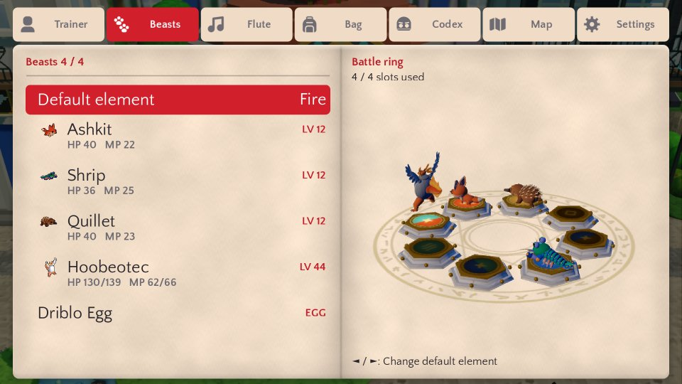
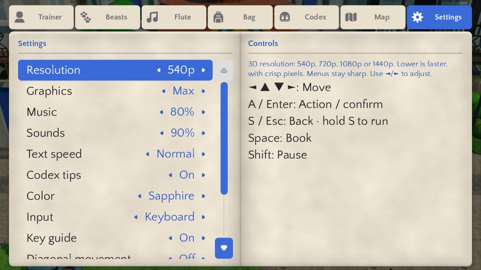

# Interface, journal and audio

[◀ Manual index](index.md)

How the game presents itself: the journal that is also the main menu, every
window and menu built on it, the battle HUD, speech bubbles, fonts, music and sound
effects. Touch layout and the browser build are in [mobile and web](mobile-and-web.md);
resolution and graphics settings are in [settings and performance](settings-and-performance.md).

## Contents

- [The journal (Start menu)](#the-journal-start-menu)
  - [Sky Tower locker and bird courier](#sky-tower-locker-and-bird-courier)
- [UI and audio](#ui-and-audio)
- [Additional interface notes](#additional-interface-notes)

## The journal (Start menu)

The first morning's journal pickup has a guided tour over the real pages, with small explanatory windows and no
extra action buttons. Its A and B hints reuse the flute game's coloured circle prompts. A advances one tab at a time;
holding B fills the skip bar and ends the tour. A quick B tap
does nothing. `bash tools/run_tests.sh journal journal-touch` checks the doorway, tour, touch controls and saved ownership.

While the book is open, its active touch controls use 55% opacity so the pages show through them.
After two seconds without touching the screen, controls fade to 40% opacity, in the book and in the field.
Any touch brightens them immediately and still performs its usual action; held fingers keep them active.
Their touch targets and no-tap zones stay the same. Outside the book, active controls use full opacity.

Press **Start** (Space) to open your journal: two pages of light tan paper with a soft spine between them (`book_paper.gd`; the only window that isn't the off-white), with a page-turn sound as it opens, as you change tabs and as you open a beast's Info. ◄ / ► change tabs; Up from the top of a page (its first row, the Bag's top row of slots, the Map's northernmost town) moves the cursor to the tabs, and Down or A from the tabs goes back into the page. Its bookmark tabs:

 The Start book's Beasts tab: roster, slot count and live 3D battle ring.

| Tab | What's in it |
|---|---|
| Trainer | Your portrait, gold, shield and shards, arena crests and trainer gear. |
| Beasts | One left list: **Default element** and its name first, then your carried beasts (the ones on your ring) with their levels and their HP and MP under their names, followed by eggs. The right pane shows **occupied / unlocked slots used** and the actual 3D battle ring and beasts, without the trainer or center dais, from the battle camera's perspective; the focused beast is lit on it. A opens the beast's actions under the ring: **Info**, **Move** (Left/Right preview its compatible spots, A confirms or swaps, B cancels), **Fly** when it can carry you, and **Equip**. Beasts are swapped in and out of storage only at Beast Centers and kennels. |
| Flute | Every song with its effect and mastery; press A to practise one. Unknown songs show where to learn them. |
| Bag | A grid of item slots on the left page, one per stack (its count at the corner when there's more than one), in the order care, battle items, weapons, beast gear, trainer gear, sheet music, fishing, key items and tomes; the heading shows stacks used, such as **18/24**. The right page names the focused item and describes it. Choose an item for its actions: **Use**, **Equip** (gear only), **Drop** and **Back**; one that can't be chosen now is dimmed with the reason beside it (battle items: **In battle**). Using an item on a beast, or Equip, turns the left page into your battle ring with you in the middle: each cell is named, and only the beasts (or, for trainer gear, you) it would affect can be chosen: the rest are disabled. A fainted beast's cell is tagged **KO** and an ailing one its status (**PSN**, **SLP**, ...). The right page shows the chosen one's HP and MP bars, its condition explained beside them, and its stats before and after, with **Confirm** and **Cancel** under them. Drop asks first and throws one away. Key items and weapons can't be dropped. B steps back a page at a time (`scripts/ui/bag_page.gd`, rules in `scripts/core/item_use.gd`). |
| Codex | AUTO on or off, and each ring beast's AUTO strategy (◄ ►), then the topics your Codex can explain (only those you're eligible to know), grouped: battle basics, your team, moves, and gear and songs. The right page shows the explanation; A has the Codex say it. |
| Map | An aged-paper map of **Rubisa** across the left page: jagged coastlines, mountains and woodland, the twelve towns and their roads, question-mark pins for towns you haven't reached, and a flag where you are (on a road, halfway along it). The map has no town-name labels; the facing page names the selected town. Tap a town, or move the cursor with the d-pad, to read about it on the right page: its size, mascot, roads, places and arena. With an air beast that can carry you, the page offers **Fly here** (see Fast travel in [gameplay](gameplay.md)). |
| Settings | 3D resolution, graphics quality, music and sound volume, text speed, interface color, touch pad, key guide, fullscreen, credits and quit to title. |

The bag holds **24 stacks of up to 9** of the same item; a tenth starts another stack.
Key items, weapons, eggs and sheet music are exempt. Inventory remains item kind → count;
capacity is the sum of `ceil(count / 9)` for non-exempt kinds. `GameState.add_item` returns
how many could not fit. Items lying about the world sit in treasure chests (KayKit's, `temple_props.gd`
`chest()`, the same plain one for a temple's treasures; every chest is empty inside, with no coins, and
the item goes straight into the bag): the lid swings open as you take the item, a golden light and
shimmering sparkles welling out of it for a moment (`TempleProps.chest_glow`), and the emptied
chest stays where it is, open and solid, on every later visit (`world.gd` `opened_chests`; check with
`bash tools/run_tests.sh item-chests`). A full-bag world pickup offers to swap one stack or leave it;
the outgoing stack remains in that chest, including across saves. Shops refuse purchases
that do not fit without charging gold. Rewards, story gifts and returned equipment send
overflow to shared **tower storage**, with a top-bar notice. Visit a Sky Tower desk to
deposit or withdraw items. Manual deposits respect its **48-stack**
limit; automatic overflow may exceed it so no items are lost. Loading an old save moves
excess bag items there once, even beyond the storage limit.

### Sky Tower locker and bird courier

Every Sky Tower lobby's ticket desk offers **Store items**, free. All towers share
one **48-stack locker**, using the bag's nine-item stacks and exemptions. The Inventory
and Locker lists sit side by side in equal-height windows, with item icons, counts
and shared scroll rails. Courier visits use **Inventory** on the left and **Bird**
on the right; delivery calls load the bird from the **Locker**. **A** or a row tap
stages **one item**. Each separate A press moves the next item from the
selected stack until it is empty; its displayed count decreases with each press.
Left/Right changes lists. **Confirm** applies the transfers; **Cancel** or B discards
them. These are the only two action buttons. Emptying the source keeps the transfer
direction; it never starts withdrawing items automatically.
Important key items stay in the bag. `GameState.locker` and `tower_inventory` refer
to the same dictionary, including automatic bag overflow.

Once Skykeeper Aria has given you the number, call **SkyTower Inc** from any phone for **Ride**, **Pick up items**,
**Deliver items**, or **Deliver and ride**. A payphone charges its normal five coins.
Select up to **12 stacks** from the locker during a delivery call. Completing a
new request replaces the old one; cancelling the call keeps the old one. Selected
items remain reserved in the locker until handed over. The pending request and its
remaining timer are saved with Dad's normal phone save.

The Hoobertus arrives after about **30 seconds outdoors and in control**. The
clock pauses indoors, in menus, dialogue and battles. It waits for a completed step
and a free, level adjacent tile; temples, dungeons and interiors never qualify.
The bird cries and swoops down while movement is frozen. The employee stays seated
on its back, facing the same way as the bird, and speaks from there. The mount's body
leans forward 45 degrees with its head level; the rider follows its back while staying upright.

A **ride** goes to a visited town for **twice the tower fare** (240 gold).
A **pickup** stores up to 12 stacks for **20 gold**, charged only for a successful
nonempty pickup. **Delivery is free** beyond the call: everything that fits goes
straight into your inventory. The transfer screen opens only when items cannot fit.
Send inventory items to the bird, then take the remaining delivery into the freed
space and confirm the exchange. Items handed back remain visible on the bird until
you confirm; anything left with it returns to the locker. Cancel discards the manual
exchange while keeping any items delivered automatically before the screen opened. **Deliver and ride** hands
over the delivery first, then offers travel. Insufficient gold cancels paid service
without blocking delivery. Pickup and ride are separate services.

Verify with `bash tools/run_tests.sh sky-courier sky-courier-touch phone bag-limit`.
The courier scenario uses isolated saves and a shortened arrival timer. For real
window captures, use `--scene=sky-courier --shots=res://build/shots/courier_desktop
--save_dir=res://build/courier_saves/` (plus `--resolution 2400x1080` before `--` and
`--touch` after it for the phone layout).
Use `--ui_only=1` to isolate the transfer controls or `--pose_only=1` to inspect the
mounted owl and its rider.

## UI and audio

- **One look** (`scripts/ui/frame_box.gd`, built through `scripts/ui/ui_kit.gd`; the user's 2026-11-13 direction):
  every window is a slightly rounded off-white box with a faint tint of the gem, with no border and no blur behind it,
  a slight soft bezel (its top edge lit, its bottom edge shaded) and a soft shadow under it. Rows, buttons, tags and item slots are the same rounded box with other fills; a thin
  plain line (`scripts/ui/divider_box.gd`) separates a window's sections. Text on the off-white is near-black, with
  headings in a deepened gem. The battle HUDs keep their own look (below): they still use the old near-black blurred
  box with Kenney's white border (`FrameBox.legacy`, `UIKit.battle_row_box`, `blur.gdshader`), and
  `UIKit.set_blur(false)` only affects them.
  Interface text belongs inside a visible button or HUD window: no floating action labels. Desktop Yes/No prompts
  show Yes and No side by side under the speaker's bubble (small white reply bubbles) or under the window. An outline
  marks the active answer, Yes to begin with; left / right (or the mouse) moves it. A picks the outlined answer and B
  always answers No. The picked answer fills with the gem with white text, the other disappears, a selection sound
  plays, and the prompt closes a moment later. A long question shows its answers on its last page. Touch uses the
  widened labelled A/B controls. Menus opened while talking to someone (a Beast Center attendant, a shopkeeper) or
  on the phone have no Leave row: a small gem **B: Cancel** button hangs under the menu's right end, over its bottom
  edge (`list_menu.gd` `cancel_button`, `edge_button.gd`), and B or a tap on it backs out. Every such hanging button
  shows the button's own prompt from Kenney's *Input Prompts* in place of "A:" or "B:" (`edge_button.gd` `prompt`:
  the keyboard key, the controller's face button, or the pad's A/B on touch), then its word. The beast summary and creator use bounded panes with scrolling instead of extending beyond the viewport.
  - List rows: dark text on the window; the selected or focused row is a rounded bar in the gem with white text, a
    deeper gem while pressed; disabled rows have dim text. List menus have no Select/Back buttons: A and B do that.
    Standalone buttons (page and scroll buttons,
    the touch A/B/Start/Pause) are the gem with white text, with a thin dark ring while focused and a deeper gem while
    pressed. Item slots: rounded tiles in a slightly deeper off-white with the count beneath, the selected one filled
    with the gem; focused tiles get the thin dark ring.
  - The menu color is picked in Start → Settings → Color: **Ruby** (the default), **Sapphire**, **Emerald** or **Hematite** (slate
    grey). It goes into the windows' off-white as a faint tint, the headings, the bars, buttons and filled slots; body
    text stays near-black. `UIKit.set_accent` derives the palette. The old Pixel / Classic style setting is gone, and a saved
    `ui_style` value is ignored.
  - **Icons** are smooth and painted in one cozy look: each shape in its own colour with soft top light, its inner
    detail in a light tint, a warm dark outline and a soft shadow. Every item has its own shape and permanent colours,
    independent of the interface gem. `tools/build_icons.gd` bakes them at 128 px from the vector sources in
    `tools/icon_src` (game-icons.net, at-icons and Kenney's Input Prompts; see [credits](../CREDITS.md)) as listed in
    `tools/icon_manifest.gd`: items (`assets/ui/icons/items`, shared by the Bag, courier and pickup notices through
    `glyphs.gd`), notice symbols (`icons/glyphs`), the small menu symbols and arena crests (`icons/ui`), the travel
    book's white tab icons (`icons/tabs`) and the flute game's direction and A / B prompts (`icons/prompts`). Rebake with
    `godot --headless --path . --script res://tools/build_icons.gd` (`-- --only=a,b --sheet=build/shots/icons.png`
    for some, with a review sheet), then `--import`; set `mipmaps/generate=true` in new icons' `.import` files.
    Town arrival notices use a cluster of houses. Verify with `bash tools/run_tests.sh item-icons
    item-icons-touch`; windowed `--scene=item-icons --shots=res://build/shots/icons` captures all four gems.
  - The **top bar** (`scripts/ui/top_bar.gd`) is the one place for short messages at the top centre: place names on
    entering a town, road or building, pickups, gold and battle messages (the title screen has its own stone plaque). It is the windows' off-white box, hanging
    from the top edge with its bottom corners slightly rounded and the bezel only along its bottom: [left icon] text [right icon]. It has exactly three
    sizes (`TopBar.SIZES`): **small** (360 UI units, one line), **medium** (640, one line) and **large** (640, two
    lines). Each message takes the smallest size that holds it; text never shrinks. A message too long even for the
    large size is split into pages shown one after another (a long second line gets pages of its own). All of its
    text is Quattrocento Sans; place names use Bold and the gem heading colour. A place name has no icon: a faint
    picture of the town or road (a room shows its town's) fills the bar instead, strongest at its ends and nearly clear
    behind the text (`assets/ui/place_banners/<map>.png`, baked from the user's SVG prints by
    `python tools/place_banners/build.py`; `--scene=top-bar --banners=1` shows every one). Walking into any building
    from outside, homes included, shows its name over a pattern chosen by its kind (`UI.ROOM_PATTERNS`: blobs for
    homes and cafes, arches for Beast Centers, pills for towers and arenas...) in one of eight colourways the building
    keeps (picked by its id); going between its rooms or floors shows nothing. Interior patterns are never mirrored.
    No building is named vaguely: a home is its owner's, in the town's word for a home ("Ada's Townhouse", "Bram's
    Hut"; `map_loader.gd` HOME_WORDS), and the owner is the first person inside; each town's shops have names of their
    own (`SHOP_TITLES`: "Café du Port", "Iron Peak Dojo"); kennels are Pip's Kennel Barn. The chains (Beast Center,
    Sky Tower) keep their names. Inside, the second line is just the town (or road).
    - Outside battle it is hidden until there is something to say, then slides in, holds about 2.5 seconds and slides
      out. Messages queue; the same pickup or gold arriving while one shows or waits merges into it ("Potion x3",
      "+120 gold"). These always have a left icon (the item's illustration, a coin, town houses, a location pin or crest, a note for songs)
      and never a right one. `UI.toast(text, icon, key)`, `UI.pickup`, `UI.gold` and `UI.place_name` post to it;
      story gifts ("Received the Miner's Pass!") use it too rather than a line of dialogue.
    - In battle it is always shown with the battle's messages: the icon of whoever acts is on the left for the
      opposing side and on the right for yours, and the empty slot keeps its space so the text doesn't jump. Notices
      posted during a battle wait for it to end.
  - **The menu shot** (`world.gd` menu_shot_begin, from `UI.choose`): when someone you're talking to opens a menu (a
    shop's, a Beast Center's, an arena's...), the camera eases in over about a second to an over-the-shoulder close-up
    of them on the left of the screen, and the menu stands on the right (beside the A/B buttons on touch). At a phone
    it frames the phone with more of the hero beside it. Plain dialogue keeps the usual camera; the shot holds through
    a shop's next menu and eases back once the menus are done. `--scene=talk-menu` (`--place`, `--side`) and
    `--scene=call --presses=0` show it.
  - **Speech bubbles** (`dialog_box.gd`) are the one bright exception: rectangular white paper with gently rounded
    corners, subtle shading, a soft shadow and a seamless pointer. Dark body text stays top-aligned, normally three
    lines per page, with the existing advance triangle and typewriter reveal; short pages use a shorter bubble. Pages
    keep complete sentences together; a single unusually long sentence gets a taller bubble. The
    speaker's name sits in white on a small top-left plate filled with the selected gem, using the shared heading
    font. World conversations pass the actual NPC to
    `UI.say(lines, name, portrait, speaker_node)` or `UI.ask(question, name, yes, no, speaker_node)`.
    The bubble projects the stable head position every frame and snaps to whole screen pixels; idle animation
    doesn't shake it. It leaves a clear gap around the face, above or below it. Near the top edge it sits below the
    head, with the chevron on top. The bubble and name plate stay inside the safe area and clear of the touch clusters, and the chevron slides along the edge toward the
    speaker. White bubbles are only for speech. Phone calls, hidden speakers and off-screen voices use a stationary
    bottom-centre bubble without a chevron. Written signs, descriptions and system prompts use the shared dark
    window with white text, without speech sounds. Prefer visible changes and contextual NPC speech to narration;
    keep written explanations only where they help the player act. On desktop A picks the outlined Yes/No answer and B
    answers No; touch keeps Yes / No in gem pills beside the A and B buttons, and a phone whose pad is hidden
    (a controller or keyboard in use) shows the desktop answers instead.
    Someone speaking through a closed door gets a white bubble anchored to that door: above its top when there is
    room, or below its bottom near the top edge of the screen. The entire bubble and name plate stay in the safe
    area and clear of touch controls. This applies to locked outdoor doors and indoor room/staff doors.
    Cinematic spoken lines use the same speaker bubbles and fit a complete sentence on each automatic page.

   Settings with the Sapphire gem.

- **Fonts** (user direction, 12 November 2026; title updated 13 November): Quattrocento Sans: Bold for headings/names, Bold upper case for small text (captions, tags, values, hints and damage numbers), Regular for body text, actions and descriptions; Fuzzy Bubbles for spoken dialogue at 29 UI units, about 10% smaller than the previous 32. Lettering on 3D world objects uses Noto Sans Old North Arabian through a shared English-to-glyph substitution map; retain readable English for interactions and accessibility. UI/dialogue stay English. The 3D intro/title logo uses Cormorant SC Bold, including the DEMO line. Preserve `UIKit` sizing, touch targets and readable wrapping; do not shrink text to fit. See `docs/visual_overhaul/standards.md` for the authoritative typography direction.
- **Button minimums**: menu text uses 32 UI units; rows and buttons, scroll buttons included, are at least 56 units
  tall on desktop and 80 on touch devices. Ordinary mobile lists scroll with Up/Down and
  direct taps; book pages, the save browser and long desktop menus get scroll buttons. Buttons never shrink to fit
  more entries (`UIKit.row_h`, `list_menu.gd`), with one exception (the user's direction, 14 November 2026): a menu
  opened while talking to someone or on the phone shortens its rows (to 48 units on desktop, 60 on touch, with 28-unit
  text) rather than scroll for a row or two (`list_menu.gd` `COMPACT_ROW`).
- **Save previews**: Load Game is one open book on the Start book's tan paper, with the spine at the fold: the slots
  are listed on the left page and the selected slot's screenshot and details (from its latest save) on the right,
  staying there when choosing Load, Copy or Delete. Gem "A: Select" and "B: Cancel" buttons hang centred under the
  book (`list_menu.gd` `book_page` and `ab_buttons`). Saves from before screenshots were stored show a placeholder
  until saved again. Copying a save includes its screenshot.
- **Phones** (restored 14 November 2026 at the user's request, since the Kenney prompt pad drew blurry): a joined
  cross-shaped d-pad with raised arrows, for getting about (hold B to run), battles and the flute game alike, painted
  at the screen's own resolution so it stays crisp (`controls_overlay.gd`). Each arm answers in its own quarter of the
  pad (a wedge from the middle out past its arrow), and only one arrow is held at a time, so a thumb on the line
  between two arms still walks one of the four ways. With it, glossy round A and B buttons and Start / Pause pills,
  with no borders or blur: the d-pad's cross is the windows' off-white with dark arrows, and A, B, Start and Pause are
  buttons in the gem with white letters. A held button deepens; a held arm of the d-pad fills with the gem and its
  arrow turns white. The title menu and Start book keep the controls visible: use the d-pad and A/B or tap rows and tabs,
  and Start closes the book. A little overlap with the book is allowed; the Map page spreads its towns clear of the
  d-pad and A/B. The ring editor still moves the side controls aside for direct tapping. Yes/No questions widen A and B with an animation into
  **A: Yes** and **B: No**: each answers directly, without a separate choice list. Long questions show **A: Next**
  until their last page. Ordinary mobile choice lists sit toward the center, show several full-size options,
  and scroll as Up/Down moves the selection; each visible option can also be tapped.
  Anything that runs past one of the book's pages gets a scroll bar beside it with an **▲** button at its top and a
  **▼** button at its foot (`scripts/ui/scroll_rail.gd`): a tap scrolls half a page in whole rows, holding keeps it
  gliding, a tap on the bar above or below its thumb scrolls a page, and the thumb can be dragged; an arrow greys out
  at its end. So all of it can be reached with taps alone. The
  book's detail pane scrolls, so a tall page never runs under the buttons, and in battle the command menu takes the
  place of the battle text while it is open.
- The title menu appears immediately over sixteen detailed landscape scenes (`scripts/ui/art_slideshow.gd`),
  including Gearheart's meeting, merging, a Beast Center visit, trainer combat, a Quillet hatching in its cracked egg,
  and a flute song. The trainer battle uses the corrected turtle facing its opponent.
  Title, general in-game loading and web loading shuffle all sixteen pictures for each pass, with a random first image
  and no immediate repeats between passes. In-game screens also avoid reopening on the previous screen's last image.
  Pictures zoom slowly and smoothly by five percent (drawn at sub-pixel positions, so the zoom never steps a pixel
  at a time) and crossfade over two and a half seconds; each new scene begins ten seconds after the last. Artwork
  fills the screen without stretching, cropping gently on wider phones; the crop and zoom centre a third of the way
  down each picture, so scenes sit a little lower, clear of the title plaque. The web loader matches this timing
  and framing. Only the current
  picture and next picture are held as textures; the unused 3D viewport sleeps. Continue and Load Game appear
  when a compatible save exists. The menu sits low, clear of the picture's subject (`scripts/ui/title_carousel.gd`):
  one gently rounded button of the gem over the blurred art, most opaque across its middle (`title_pill.gdshader`),
  showing one choice, with ▲ and ▼ arrows above and below it (none when New Game is the only choice). Up or down
  slides the words that way inside the button, cropped at its edges, as the next choice slides in from the other
  edge, looping round forever; A or a tap on the button picks it, and the arrows can be tapped. On phones the button
  rests just above Start and Pause. Keyboard, gamepad and touch navigation remain available. Once the title menu is up, the game's name hangs at the top centre on
  this screen's own HUD, a carved stone plaque (`scripts/ui/title_plaque.gd`) a little wider at the top, each side
  one straight slant: the name large in Cormorant SC Bold, in a deepened shade of the chosen gem, with runes cut
  under it (DEMO there in demos). It steps up while the shared top bar has a notice. Load Game and the character
  creator hide it while the artwork continues. World, creator, battle and book
  scripts load after the title's first draw.
- **Music**:
  - The title screen plays *Nerves*.
    It continues through character creation. Browser audio starts after a click, tap or key press;
    runtime Music and SFX buses grow through `AudioServer.bus_count` to preserve the web sample driver's
    route to the speakers (Godot 4.7's `add_bus()` append path disconnects it).
  - Normal battles use *Rising Tide*; bosses use *Rising Tide (faster)*. Bosses are temple guardians, arena masters, Bart the Jackal, Gearheart, Nyx and Vexmora.
  - Cocoon Cove plays *Pennsylvania Rose*; Bellerive plays *Andreas Theme*; Gearheart Tower plays *Krampus Workshop*.
  - Every region and kind of room has its own track; see `TRACKS` in `scripts/autoload/sfx.gd` and `MAP_MUSIC` / `ROOM_MUSIC` in `world_db.gd`.
  - Desert, mountain, moor and some interiors add an ambient loop. Shellhaven adds quiet surf; the Coastal Path
    adds birds and insects. Gearheart Tower and the intro use the approved machine-room ambience. Moor exteriors
    use an evil-spell texture; the cathedral uses a mystic-forest drone. The five new recordings are 12-second
    Ogg loops with a one-second crossfade at the join. Outdoor loops fade out indoors.
  - `tools/convert_audio.py` makes 128 kbps copies of the tracks registered in `Sfx.TRACKS` in `assets/audio/music/`, trimming the 59-minute rainforest track to a 5-minute loop. The originals in `music/` are untouched.
- **Sound effects** from `sfx/` and `assets/audio/sfx/` cover:
  - menus, the book's page turns, dialogue voices (pitched per speaker) and footsteps
  - hits (metal clangs for robots), the weapons (the slingshot's whoosh, the boomerang's flight), bombs and the shield
  - pickups, doors, hatching, merging, flights, field moves, level-ups and the victory jingle
  - `tools/make_sfx.py` synthesises the game's own: the smack-and-puff when a foe is beaten and the soft thud when one of yours faints, and the knock on a locked door (`sfx/Custom/`)
  - Approved Sonniss GDC 2026 recordings add a paper page turn, a cloth opening for arranging beasts, a kalimba
    cue for gifts, ring placement and attaching bait, short healing plucks, coin payments, a mechanism latch,
    an energy-flow excerpt for merging/evolution, shrine rituals and departing summons, a physical battle hit,
    an attack-miss sweep, menu confirmations and unavailable-action feedback, plus the five ambient loops above.
    The merge cinematic has its own swell, crackle and reveal cues.
    Egg reveals use a short bird-flute chirp; critical hits use a 0.22-second edit of the old crate-breaking hatch
    sound. Small mechanical clicks cover toggles, quiet pop syllables follow dialogue three semitones higher
    while preserving each speaker's voice, and the muted rejection
    also covers unsuccessful flute and fishing attempts. The hatchery's earlier mechanism sound remains.
    Boss encounters randomly choose a short dread hit or a cinematic brass hit.
    These are 44.1 kHz Ogg Vorbis copies, with the source WAVs
    untouched. Rebuild with `python tools/convert_audio.py --sfx-pack "C:/path/to/Sonniss.com-GDC2026-GameAudioBundle"`,
    then `godot --headless --path . --import`. Source hashes and approved gain adjustments are in
    `tools/sfx_sources.json`; provenance is in `licenses/sonniss_gdc2026.md`.

## Additional interface notes

The Start book caps its touch width at 1232 UI units on wide screens, centered to leave more room beside the d-pad. Raw touches and their releases in touch-control clusters are consumed before reaching menu rows. Beast Center, shop and phone menus close with B or their B: Cancel button, without a Leave row; beast summaries use A/B without a separate Close button. NPC item gifts post the shared pickup HUD. Cocoon Cove's two upper red-door houses answer knocks without opening. Outdoor buildings fade both ways on all renderers, including Compatibility/web.
