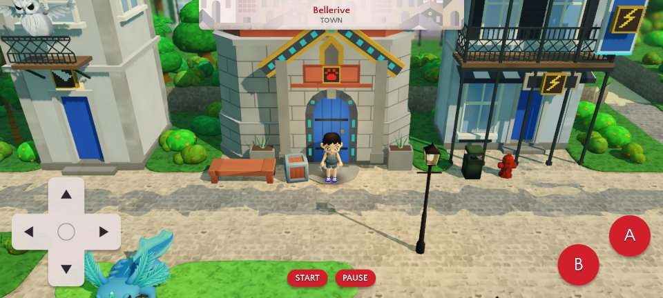

# Settings and performance

[◀ Manual index](index.md)

Resolution, graphics presets and the work done to keep loading and play smooth:
baked ground and props, light scenery, shader warm-up and texture finishes. Measured
numbers and remaining limits are in [performance measurements](../docs/performance.md).

## Video, graphics and loading

- **Video settings**: Start → Settings → **Resolution** selects **540p, 720p, 1080p or 1440p** for the 3D scene,
  including hatch and merge films. Width follows the window's aspect ratio, so wide phones still gain usable space.
  Lower resolutions enlarge smoothly (bilinear), with a mild halo-free sharpen on Forward+ and Mobile
  (`resolve_sharpen.gdshader`); Compatibility (desktop OpenGL, the web) keeps plain bilinear. Rendering above the
  display's height is downsampled. Menus, dialogue and touch controls retain full resolution and their normal sizes.
  World textures keep their painted filtering; nothing is drawn as blocky pixels. The default is **540p**, with Graphics **Max**.
- **Graphics** independently selects **Min / Mid / Max** at every resolution, applies immediately and persists
  between launches. These are rendering presets using the established materials and lighting: **Min** disables
  dynamic shadows, glow and anti-aliasing; **Mid** keeps authored soft shadows and glow with 2x MSAA;
  **Max** uses 4x MSAA and authored ambient occlusion on Forward+ and Compatibility (other screen-space effects
  require Forward+). Max also gently blurs distant outdoor scenery on Forward+ and Mobile, keeping the hero,
  nearby paths and interactions sharp; interiors stay sharp. Compatibility skips this depth-of-field effect.
  Mobile and Compatibility skip unsupported effects. Deliberately shadowless scenery remains shadowless.
  The default is **Mid**. Use Left/Right to adjust a focused setting, or tap / press A to cycle it.

 On a 20:9 phone: the d-pad, A and B, and Start and Pause around a Bellerive street.

- **Performance**: outdoors, every batch of trees, grass, flowers and ground blocks is split into 8x8-tile chunks, so only what's near the camera gets drawn (a map-wide batch was drawn in full every frame, then again for every shadow layer). The sun uses two shadow layers out to 30 units; trees deep in a wood, grass tufts and flowers cast no shadow; street lanterns stay lit in every town, with translucent glass panes with corner rails tapering to meet them, warm glowing burners and small shadowless lights that fade beyond the nearby view; the patch of shade under each character is one small shared quad with no lighting or texture; phones are capped at a steady 60 fps.
  Enclosed-room suns also use two shadow splits over 30 units on Mid/Max; Min disables their shadows.
  The indoor coverage is checked at reachable room edges, including the largest generated building interior.
- **Starting video settings**: fresh or missing video preferences use **540p** and Graphics **Max** on every platform. Existing saved choices are retained.
- **Web download**: the same artwork slideshow fills the browser during download, with a progress window at the
  bottom and no title (the game's name first appears on the title screen's stone plaque). The bar retains the engine's real download progress. Game-specific silly captions
  stay for five seconds; their trailing dots cycle through blank, one, two and three dots every half second,
  in both the web loader and in-game loading screens. Artwork and captions share `assets/loading/slideshow.json` with the game. Errors
  keep their original engine notice and hide the progress window. Browser reduced-motion preferences stop
  the zoom. Artwork and fonts are copied beside the export so they appear before the game data is ready.
- **Stalls and loading**: entering a different outdoor town or path (including returning from a building and the
  first outdoor load) shows the artwork slideshow with a bar along the bottom: the destination on the left, a playful
  game-specific caption on the right (its trailing dots hidden in place, so the line never shifts) and a thin gem
  progress bar under them (`loading_screen.gd`; `--scene=loading` previews it). Towns with matching artwork use their
  own scene for the whole load, with the same slow zoom: Cocoon Cove's dock, Bellerive's fountain, Sunwall's sparring,
  Emberfall's springs, Vinehollow's grove and Gravenmoor's ghosts. `assets/loading/slideshow.json` maps town IDs to art;
  destinations without a matching scene retain the shuffled slideshow. Preview a match with `--scene=loading --map=tidewater`.
  Progress measures completed construction phases, rather than elapsed time, and reaches full after arrival state
  and audio are ready. Fast transitions add no minimum display delay. Room-to-room moves and same-map reloads
  keep short black fades. Input and pause are blocked during loading; the overlay fades away on arrival.
  Getting into the game from the title (New Game's character creator, Continue and Load Game) winds in the
  multicolour swirl instead (`UI.enter_swirl`): the bar along the bottom says only "Entering Rubisa" over its
  progress, with no artwork, standing between the d-pad and A/B on touch, and the swirl winds out to show the creator
  or the saved place (`UI.swirl_cover` / `leave_swirl`). New Game starts the creator while the swirl is still winding
  in (`UI.make_hero`): the creator stays hidden and paused behind it (its mirror's camera off until it shows), and its
  bedroom goes up a step at a time (`RoomBuilder.build_sliced`, the same steps as `build`; film sets give way after
  8 ms rather than 50), so the creator is ready about when the swirl has covered the screen (about 1.0 s after the
  press against about 1.3 s loading afterwards, desktop measurement). The title reads the creator's files in the
  background while it waits (`assets/loading/creator_preload.json`, listed by `tools/bake_creator_preload.gd`; not on the
  web) and builds the hero's model once, so the swirl keeps only a 30-50 ms frame or two as the room goes up, and its first draw.
  `--scene=title --burst=<path> --burst_every=0.2` captures frames through it; `--idle=<s>` sits at the menu first,
  as a player would, while the title loads scripts in the background.
  The next map is built behind the artwork/fade,
  yielding between terrain chunks, scenery rows, house plans and NPCs after 50 ms of work (12 ms on the web, which
  mixes its music on the same thread). The 3D view is switched off until the map is finished, and its first draw also
  happens while the screen is still black. The ground meshes of the last three outdoor maps are remembered, so walking
  back out of a house doesn't generate the street again. The first visible buildings are ready before the fade-in.
  Eight hidden buildings can remain cached for walking back; off-screen buildings stay
  invisible and stop processing. Stationary cameras reuse visibility results. Street-prop placement proves local
  connectivity where possible, retaining the full-map check for chokepoints. House geometry measurements are baked
  by `tools/bake_house_measurements.gd` after house imports; `-- --verify` checks them against the source meshes.
  The most recent outdoor scenery set also survives a room trip, avoiding repeated scenery construction and GPU
  uploads. Actors and interactions rebuild from current state; a changed layout or door lock invalidates the set.
  Only one detached outdoor set is retained. Item pickups replace arrival notices immediately, with short Bag hints.
- **Repeated work**: beast animation measurements are shared by recipe, with a bounded cache. The creator updates
  changed choices and reuses its swatch styles. Battle ring glyphs and encounter sweeps are baked by
  `tools/bake_battle_art.gd` (`-- --verify` checks exact image/audio data), so the first encounter does not paint or
  synthesize them. These are UI graphics and generated audio, not new world textures. Footstep/encounter sounds
  warm during loading, and the music cache retains three recent tracks while active crossfades keep their streams.
  Battles use the world's two shadow splits and 30-unit range; live portraits follow the graphics preset's MSAA.
  See [the performance audit](../docs/performance.md) for measurements and remaining limits.
- **Shaders compiled at the title (prototype, step 009b)**: the dedicated desktop Compatibility build
  (`compatibility_build`, engine shader cache off) compiles every map's shader combinations while the title menu waits
  (`scripts/gfx/shader_precompile.gd`), a few per frame in small off-screen views lit as the maps are, and keeps them
  for the session; choosing a menu item stops it, and anything left compiles behind the next fade as before. The list
  is `assets/shaders/compat_warmup.scn`, written by `--scene=shader-manifest` (headless, every town, road and room;
  regenerate it after adding maps, lighting set-ups or material kinds). The web and native runs with the shader cache
  on skip it (both measured far slower); Forward+ and Mobile don't need it.
- **Ground on disk**: every outdoor map's ground meshes are baked into `assets/ground/` (`scripts/world/ground_store.gd`,
  `--scene=bake-ground`), so a map's ground is read back instead of generated behind the black screen; ground a story
  has changed some other way is generated once on the device and kept in `user://ground/` (at most 24 maps).
- **Generated meshes on disk**: Cocoon Cove's houses (each kit house reshaped for its plot), the voxel props (signposts,
  flowers, obstacles), the house pack's painted doors and windows, the fences and the townsfolk's dyed body parts are
  baked into `assets/baked_meshes/` (`scripts/gfx/mesh_store.gd`, `--scene=bake-meshes`) and read back on a map's first
  visit instead of generated. Their shared materials are saved once, and their textures link back to the game's own.
  First builds on desktop: Cocoon Cove about 945 -> 647 ms, Bellerive about 1076 -> 907 ms.
- **No building is built while you walk**: every building on a map is built behind the arrival fade and kept, hidden
  while its base is off-screen, so walking up to one no longer stalls a frame while it is built (10-150 ms each).
- **Light scenery**: the bushes, shrubs and trees are simplified to triangle budgets as they are baked
  (`tools/import_stylized_nature.gd`: about 700 for a bush, 1,400 for a tree, a quarter to a half of the pack's), since
  hundreds stand on every map.
- **Every object textured**: lit materials that would draw as bare flat colour get one of the soft finishes painted by
  `tools/build_soft_textures.py` (soft paint, woven fabric, brushed metal, satin), applied by `scripts/gfx/surface_finish.gd`
  as each object enters the scene; people wear fabric and satin and beasts satin in their own shaders. Each finish's
  average brightness is divided out, so colours stay as authored.
