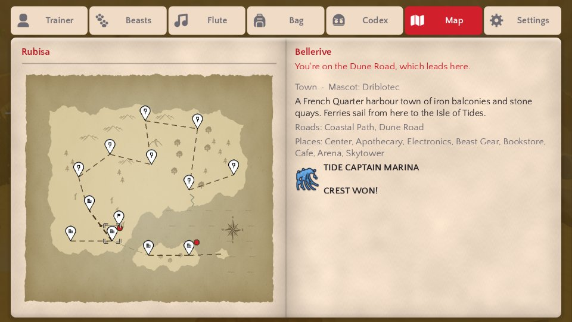
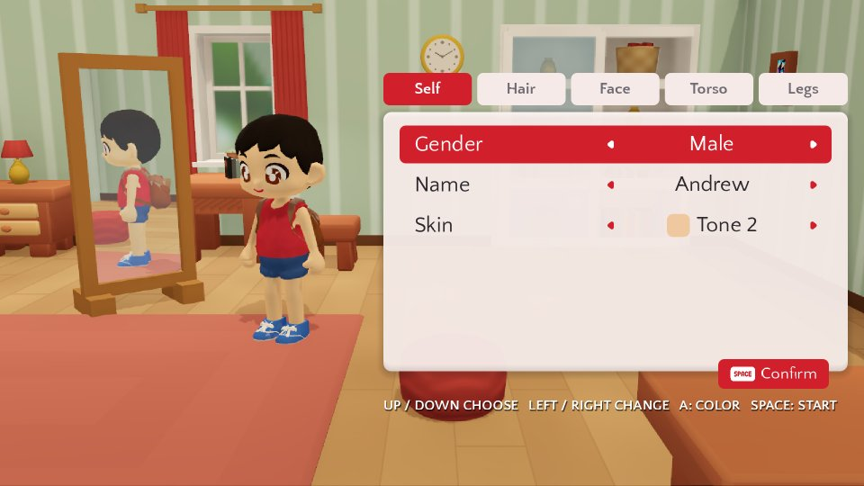
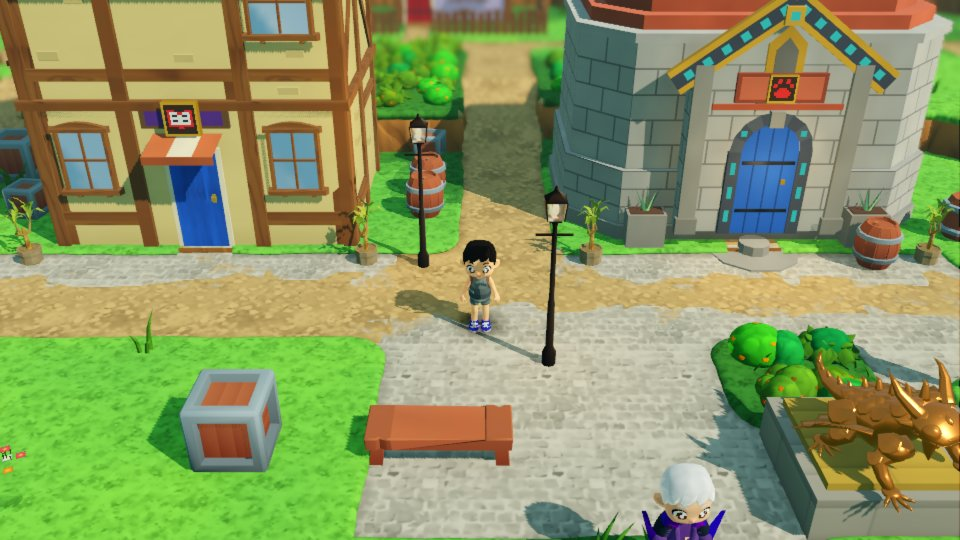
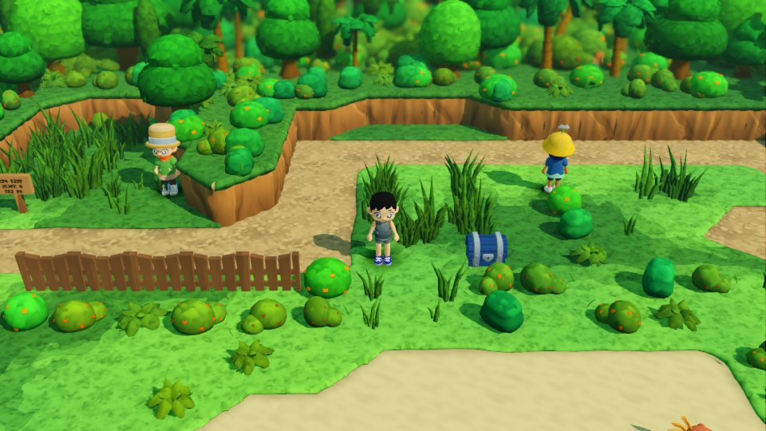

# Walkthrough

[◀ Manual index](index.md)

Ruby Cocoon is played in one line, one area at a time. This walkthrough follows that line from the opening film to the crypt beneath Gravenmoor, with a section for each map in the order you reach it.

- Controls are in the [README](../README.md).
- The rules behind what happens here are in [gameplay mechanics](gameplay.md).
- The gates and unlocks in order are listed in [progression and unlocks](progression.md).

Every road between towns narrows to one bottleneck with a puzzle, getting harder as you go; each map below describes its own.

 The world map on aged paper in the Start book: town markers, question marks for unexplored towns, and a flag where you are. Town names appear on the facing page.

## Contents

- [Hints from the people around you](#hints-from-the-people-around-you)
- [Prologue: Gearheart Tower and the nightmare](#prologue-gearheart-tower-and-the-nightmare)
- [Before you set out: the character creator](#before-you-set-out-the-character-creator)
- [The Coast](#the-coast)
  - [Cocoon Cove](#cocoon-cove)
  - [Coastal Path](#coastal-path)
  - [Bellerive](#bellerive)
- [The Isle of Tides](#the-isle-of-tides)
  - [Isle Trail](#isle-trail)
  - [Shellhaven and Kelpwick](#shellhaven-and-kelpwick)
  - [Temple of Tides](#temple-of-tides)
- [The Desert](#the-desert)
  - [Dune Road](#dune-road)
  - [Dustwell Oasis](#dustwell-oasis)
  - [Mesa Trail](#mesa-trail)
  - [Sunwall and the Dune Sea](#sunwall-and-the-dune-sea)
- [The Mountains](#the-mountains)
  - [Copperpick and the Mine Road](#copperpick-and-the-mine-road)
  - [Cogsworth and Gearheart Tower](#cogsworth-and-gearheart-tower)
- [The Volcano](#the-volcano)
  - [Caldera Road](#caldera-road)
  - [Emberfall](#emberfall)
- [Summit Pass](#summit-pass)
- [The Jungle](#the-jungle)
  - [Jungle Trail](#jungle-trail)
  - [Vinehollow](#vinehollow)
- [The River and the moor](#the-river-and-the-moor)
  - [Moor Road](#moor-road)
  - [Riverbend and Gravenmoor](#riverbend-and-gravenmoor)
- [Planned story additions](#planned-story-additions)
- [Appendix: story revision of 17 November 2026](#appendix-story-revision-of-17-november-2026)

## Hints from the people around you

Townsfolk and residents add a casual hint about what to do next to whatever else they say (`chatter_db.gd` HINTS, by `Story.next_goal()`), so what they talk about moves on as soon as you've done it.

## Prologue: Gearheart Tower and the nightmare

**Narrative revision (spoilers):** [Story direction and implementation status](../docs/story-direction.md) covers Jared/Vexmora, Marlyse, Matt Gearheart, the spirit-energy shutdown and the brothers' spaceships ending. The revised development plan is [here](../docs/development-plan.md).

### The opening film

New Game opens with a 113-second cinematic:

1. Matt Gearheart's kidnapping scheme in **Gearheart Tower**.
2. A close-up of the sleeping hero.
3. A separate dungeon nightmare.
4. Waking at home in **Cocoon Cove**.

Everything is told by people talking: there is no narration and no title card. Lines advance automatically, in the game's white speech bubbles over whoever is speaking. A voice from off screen, like Mom calling up the stairs, gets the stationary bottom-centre bubble.

- **A / Enter**, or a tap on the dialogue, reveals the typing and then advances a beat.
- A tap of **B** also advances.
- **Holding B** (or Esc, or Start) for a second skips the whole film.

The top-centre HUD names those controls over the scene's place for the first four seconds of each scene (`Enter: Next · Hold Esc: Skip`, or `A: Next · Hold B: Skip` on a pad or phone), then slides away. Hold B and it comes back to say keep holding, with a thin bar filling under it.

On a phone only the pad's A and B show during the film, looking as they always do. Nothing can move, so the d-pad, Start and Pause step aside (`controls_overlay.gd` `set_film_mode`). Keyboard, controller and touch all work. Continue and Load Game go straight to your saved game.

### The meeting and the warehouse

The reveal is played straight (`scripts/story/opening.gd`):

- It opens on a friendly end-of-quarter meeting, where Engineer Mara, Foreman Briggs and Clerk Nell ask how the company made such a huge profit.
- Gearheart answers with a riddle (a cargo that "walks aboard by itself") and sends them home.
- He watches them into the lift until its doors shut on the last of them, then walks alone to a steel door in his office wall.
- As he steps through, the music stops dead and a dread hit sounds (`tools/make_sfx.py`).

Behind the door is a freight warehouse under soft white hanging lamps:

- Rusted iron cages down its aisle, full of trainers (Lio, Bea and Orin among them, as the hero later finds them).
- At its far end, their beasts in smaller cages on pallets.

| Set | What it is built from |
|---|---|
| Gearheart's office by night | The game's own pieces: wood floor and a red rug, brick and dark panelling under timber beams, hanging lamps, three brass gears turning on the west wall, his new robots on lit plinths before the moonlit windows onto the neon city, the company sign over his desk, a drafting table, crates and the freight lift. |
| The warehouse | A concrete shed with a steel truss roof, a band of factory windows high in each long wall and a roller door (modelled on a low-poly warehouse supplied as a reference), filled with the game's own crates, barrels, racks and pallets beside shipping containers. |
| The cages | The **Rustbound Iron Cage** model (`tools/import_iron_cage.gd`, `assets/props/iron_cage.res`). |

### The nightmare

The spring scenes use the real places as sets (`main.gd` `build_set`):

- **Bedroom at night:** an open lawn and the sleeping hero's face, in dark blue moonlight, tucked in under a duvet with the sheet turned down, eyes shut and brows knitted. Crickets outside and no music: the `night` ambience, synthesised by `tools/make_sfx.py`.
- **The dungeon:** from their cell the hero watches a duck climb out of the channel of water in front of it, waddle over and eat a crust of bread outside the bars (a long, quiet watch; ducks only quack), then asks why there are ducks in a dungeon.
- **The voice in the dark** behind them says those are his ducks, adds a duck fact, and asks for **a spork**, **your left sock**, or **a roll of toilet paper**. The chosen tool is highlighted in red as each letter types in and saved once per journey.
- **Waking:** the hero jokes about a maniac putting "ruin spring" on their calendar.

Skipping or replaying never rerolls the clue. Older saves receive a stable clue, and the later flute escape always remains available.

The mounted Gearheart Industries sign uses an original vector gear-and-split-heart logo inspired by the supplied reference.

**Next map:** [Cocoon Cove](#cocoon-cove)

## Before you set out: the character creator

 The character creator: the hero stands in their own bedroom beside a mirror that shows their back.

The character creator (`scripts/ui/hero_maker.gd`) stands the hero in their own bedroom, built as a set (`main.gd` `build_set`), beside a standing mirror on the left of the screen.

### The mirror and the room

- The mirror is a second camera where the main camera's reflection would stand, its picture projected back onto the glass.
- The room's missing front wall is put up for the mirror alone, so it shows the hero's back against wallpaper.
- Drag the hero to turn them round.
- The camera keeps the hero and the mirror in the room left of the menu, easing in a little on the part each tab dresses: the head for Hair and Face, the chest for Torso, the legs and feet for Legs, and the whole hero for Self.

### The tabs

The menu on the right has five tabs that together span its window, with a gap above it.

| Tab | What it changes |
|---|---|
| **Self** | Gender, name and skin. |
| **Hair** | Hair and hat. |
| **Face** | Eyes and glasses. |
| **Torso** | Shirt and pack. |
| **Legs** | Pants and shoes. |

Everything with a type and a colour has a small bold header with a line under it, then a **Type** row and a **Color** row. No tab has more than four rows, so nothing scrolls. Rows are laid out like Settings': the name on the left and the value on the right between soft arrows.

Pieces come from the wardrobe (`scripts/data/wardrobe_db.gd`): shirts, pants and shoes for each body, cut from the townfolk kit's people; hats and glasses, or None, for either.

### Gender and names

- Gender is **Male**, **Female** or **Non-Binary**.
- There is no separate Body row: Male and Female wear their own body and its clothes, while Non-Binary keeps the body of the gender chosen before it.
- Non-Binary characters use **they/them** and neutral terms in dialogue.
- Each gender has its own name choices, including **Tra** for Female and **Moss**, Rowan, River, Sage, Ash, Quinn, Avery, Robin, Ember and Sky for Non-Binary.
- Names are remembered when switching gender.
- **Ben** is 10% taller than the usual hero in both the creator preview and play (Andrew keeps his existing smaller scale).

### Music and leaving

- The creator plays Kevin MacLeod's *Space Jazz* (`Sfx.TRACKS` "creator").
- B asks before leaving ("Leave the character creator?" Leave / Stay).
- Backing out to the title brings the title music back.
- Its bedroom is the room alone (`build_set` `bare`): no journal and quest marker, nobody, and none of the room's own furniture mirror, since the creator stands its own where its camera wants it.

### The wardrobe mirror at home

The same standing mirror (`scripts/gfx/standing_mirror.gd`, map letter `}`, furniture `mirror`) stands against the back wall of the hero's bedroom, between the nightstand and the desk, off the way from the bed to the door. Its glass is a painted silver sheen rather than a second camera.

- Press A facing it to open the creator as a wardrobe (`hero_maker.gd` `wardrobe`, `UI.change_outfit`).
- It offers only **Head** (hat and glasses), **Torso** (shirt and pack) and **Legs** (pants and shoes), starting from what the hero wears.
- Start puts the clothes on (`GameState.set_outfit` changes only `OUTFIT_KEYS`, never the name, gender, skin, hair or eyes), and B asks before stepping away.
- `--scene=wardrobe --shots=<dir>` walks up to it, changes the shirt and checks the rest of the hero is untouched.

### Colour picking

- Each colour is a row of its own showing a swatch and the colour's name.
- A or a tap on it opens a grid of big colours over the menu: the arrows move through it, dyeing the hero as you go.
- A (or a second tap) keeps the colour and B puts the old one back, as the small **Confirm** and **Cancel** buttons centred along the grid's bottom edge say, each behind its A or B prompt.

### Starting the game

- Start (Space, a controller's Start, the touch pad's Start) begins the game.
- The small gem **Confirm** button hanging off the window's bottom right corner says so, behind the Start button's own prompt (Kenney's *Input Prompts*, trimmed to its drawing: the space bar, the controller's Start or Menu, or the Start pill on touch).
- On a 16:9 touch screen the menu can't move far enough left to clear A entirely: the last row's right arrow and the Start button may meet its edge. The rest of the row, the keys and the pad's own Start still work.

### Two names hide battle easter eggs

- **Moss** has a 10% chance each round to gather sparkles, charging the next trainer weapon attack. Its first target is knocked out instantly if it is an ordinary beast, even through Defend, shields or Sturdy. The charge lasts until that weapon use and does not stack; other actions keep it. Boss and GIANT encounters, guardians, legendary beasts, robots and trainers take normal damage.
- **Tra** can unsettle attacking foes (15% per beast's turn): a beast above the level of your strongest conscious beast defends instead, while a lower-level beast with a trainer may attack its own trainer, using the normal shield and battle-ending rules. Equal-level foes, support moves and wild beasts without a trainer cannot turn on a trainer.

Neither easter egg affects guided lessons or Codex simulations, and neither carries a charge between battles.

## The Coast

### Cocoon Cove

The hero knows nothing about the scheme. You start in your own bedroom, upstairs at home in **Cocoon Cove**, with no beasts, no flute and no songs.

**The journal.** Your **journal**, the main menu, lies on the floor in front of the bedroom door, blocking the way out, with the same yellow quest crystal used for story interactions.

- Select it to pick it up and open a short tour of all seven real menu pages, with explanatory tooltips: **A** advances and **Hold B** skips.
- Finishing or skipping leaves the journal open for ordinary use; close it to leave the room.
- The journal stays with you, and older saves retain their existing menu access.

**The opening errand.** Mom calls you down, and gives the egg and flute objective in the living room, even if the film was skipped (flags `woke_up`, `intro_done`).

**The missing trainers.** The first missing-trainer news is in **Dustwell Oasis**. Nobody explains it on arrival; three things tell it:

- Missing posters on the porch posts and notice boards.
- Kip, Junie and Tamsin, friends of Lio, Bea and Orin, searching the town (`story.gd` SEARCHERS, POSTERS).
- The jail's dopey **Deputy Rusk**, who asks you to catch Slim, the prisoner who walked out of his open cell.

Slim is hiding behind the wagon on the dune shelf. He was framed with a trainer's flute in his saddlebag, and Barkeep Dusty's **Card Ledger** (a key item) proves he spent that night at the saloon's card table. Shown the ledger, the deputy clears Slim and asks you to help find the missing trainers and the real culprit, pointing you to Captain Dalton of the gate watch in Sunwall (flags `convict_asked`, `convict_found`, `slim_cleared`, `deputy_partner`).

**The town.** Cocoon Cove lies low in a cove ringed by tall cliffs on the north, the west and the east above the road out.

- Your home stands in a western garden on a gentle terrace one step above the town, with two small scenery homes at the back of it. A garden path runs along the terrace and short three-tile ramps lead down.
- The ramp by home comes out beside **Cocoon Cove Library**, a two-storey house at the compact square's western entrance. Speak to **Librarian Quill** for a free **World Map**, then open it from **Start → Map**.
- The town is a modern pirate cove: textured brown timber, varied pastel stucco, orange clay roofs, planted gardens and seaside cliffs. Crates and barrel staves use the same brown wood finish, with metal barrel hoops.
- The temple Beast Center faces the square and the apothecary stands on land to the east. The only dock entrance is down the right-hand stairs.
- A short pier holds a wooden neighbour's shack (a lived-in fisher's cabin inside, room `cove_dock_shack`) and ends at the **Old Gear Shack**. The plaster neighbour's home stands in a garden on land.
- Every house has a path to its door. Crates and barrels sit on spare edge tiles, leaving walking lanes and doors clear. The strips behind the buildings, where the camera can't see anyone, are thickets of shrubs rather than lawn.

**The gear shack** (`s` on the map, room `shack`) has no second shore entrance, ships or boats. Nobody lives there, but a trainer left their starter gear behind:

- A **Worn Cap**, **Old Sneakers** and a **Rope Collar** for a beast.
- They are never sold (`item_db.gd` `found`), and you put them on from the Bag.
- The cap and sneakers are only found there; the Rope Collar can also be found in Bellerive's harbour equipment shack.

Existing saves keep their map access and all seven buildings keep their saved interior identities.

**First steps:**

1. Mom tells you that your father's flute is waiting with **Uncle Rafe** in Bellerive, the next town east.
2. Elder Rowan lets you choose one of four elemental eggs, one of each Draco line (`RaceDB.STARTERS`): Draco (Fire), Dropo (Water), Rocco (Earth) or Floppo (Air). The Fire Draco's last form, Dracomni, is Cocoon Cove's mascot.

    Cocoon Cove, the seaside hamlet where you start.

3. The Beast Center hatches it into a **level 1** beast.
4. Scout Bram stands in the road to the Coastal Path until you have a beast of your own; talk to him once it has hatched and he steps aside.

**Previous map:** [Prologue: Gearheart Tower and the nightmare](#prologue-gearheart-tower-and-the-nightmare) · **Next map:** [Coastal Path](#coastal-path)

### Coastal Path

**1. The tutorial.** The **Coastal Path** is a winding trail through the woods with four teachers on it (`world_db.gd` LESSON_TRAINERS, `battle.gd` LESSONS).

- Each teacher looks straight across the trail where you can't slip past, so you always walk into their line of sight and they come over and stop you. You never need to talk to them first.
- Each gives a short guided battle: every floating choice and every menu has just the one thing to pick, the one being taught. ◄ ► stay put, and the teacher says what to do. The target and the beast to heal are chosen for you.
- You can't lose: your beasts are healed first and always keep at least 1 HP, and nobody can run, forfeit or hit you. Your beast grows a level or so.

| Teacher | Where | Lesson |
|---|---|---|
| Camper Tilly | On the trail | Attacking. |
| Fisher Dale | On the trail | Defend. |
| Youngster Kit | On the trail by the creek | Potions. He hands you one mid-battle and two more after. |
| Picnicker Mae | On the trail | Your slingshot. Then she gives you the **Codex** (see [gameplay](gameplay.md)), which swirls up into the middle of the screen to introduce itself. |

Until you have a flute there are no wild beasts on the path, only its teachers.

 The Coastal Path, the tutorial: a winding trail with teachers waiting on it.

**2. The footbridge.** Mend the washed-out footbridge on the Coastal Path to reach Bellerive. The sign only says there's a footbridge ahead and a builder's cabin by the creek.

- Old Hal the builder, in the cabin just west of it, is too tired to rebuild it himself.
- Once you've talked to him you can take the logs stacked by his door and lay them across the creek.
- Go back in and he gives you a beast egg (a Driblo) to hatch at Bellerive's Beast Center.
- Mended, it's a plank footbridge with railings.

A small, continuous beach below the western trail has a low grassy approach and Shellhaven's smooth sand and shallow-water profile, without enclosing cliff walls, sunbathers, parasols or other resort dressing. It ends west of the creek; the river remains impassable until Hal's footbridge is repaired.

**Previous map:** [Cocoon Cove](#cocoon-cove) · **Next map:** [Bellerive](#bellerive)

### Bellerive

1. Talk to **Neighbour Nell**, Rafe's old friend beside Bellerive's west entrance, for directions to his house: the one with the **golden flute sign** above the door.
2. **Uncle Rafe** gives you the flute and teaches **Weaken**, briefly: a couple of lines on how the sheet works, then he plays the song once and it's your turn to play it back. He also tells you that no song can make a wild beast yours: new beasts only come from eggs. His lesson (and the guided battle after it) gives you 30 seconds per song.
3. The first lone wild beast you meet after that always leaves an egg, shown in the egg film. The Codex explains the flute in that battle.
4. Arenas only take trainers with a flute. Each is one big room, like a Beast Center (the camera follows you round it): the host at the lobby desk runs the arena ladder and nothing else, and the master waits in the hall on the other side of a wall that stops short of the front. You challenge them there, in person.
5. **Tide Captain Marina** can be challenged as soon as you reach Bellerive's arena. The Codex explains fighting with a whole side of your ring and elemental weaknesses when they first come up. Captain Gull's ferry to the Isle of Tides only takes trainers with her Wave Crest.

Bellerive, a French Quarter harbour town, also has the arena's coaches' lessons, **Sparkwire Electronics** (shield points and beast slots) and a Sky Tower.

**Previous map:** [Coastal Path](#coastal-path) · **Next map:** [Isle Trail](#isle-trail)

## The Isle of Tides

### Isle Trail

**Bottleneck:** Thorny brambles. A fire beast burns them; an air beast slices them down.

**Previous map:** [Bellerive](#bellerive) · **Next map:** [Shellhaven and Kelpwick](#shellhaven-and-kelpwick)

### Shellhaven and Kelpwick

Shellhaven's tourists keep carrying pieces of the **Temple of Tides** home as souvenirs, so Kelpwick's villagers stand across the way to the reef. The resort thinks the village quaint but backwards; the village thinks the resort is exploiting the island.

They step aside only for a trainer who proves they're no tourist: beat Reef Warden Nerissa in Kelpwick's great hut.

**Previous map:** [Isle Trail](#isle-trail) · **Next map:** [Temple of Tides](#temple-of-tides)

### Temple of Tides

- The journey runs in one line: the Dune Road north of Bellerive stays shut by sandstorms until you've beaten the guardian of the Temple of Tides on the Isle of Tides.
- Once **Abyssion** is yours, the Codex explains **Summon** in your next battle: choose it, play the Song of Tides and the water dragon strikes the opposing team.

**Previous map:** [Shellhaven and Kelpwick](#shellhaven-and-kelpwick) · **Next map:** [Dune Road](#dune-road)

## The Desert

### Dune Road

**Bottleneck:** A sheer cliff with a rope ladder coiled at the top. A beast with wings flies up and drops it.

**Previous map:** [Temple of Tides](#temple-of-tides) · **Next map:** [Dustwell Oasis](#dustwell-oasis)

### Dustwell Oasis

Dustwell Oasis is an old western main street.

- **Rosa** runs the Oasis Saloon and makes the Rubywave Five play the same tune on repeat. The dance studio next door is open at any trainer level.
- The dry well leads to a cave where five beavers each claim to be the third strongest. Defeat them and Dale casts a spell that wakes the spring and refills the town well, then gives you a water stone and teaches **Water**. His chest across the crack holds the Wellspring Pendant (water attacks +25%).
- Elemental spells never use the flute: each is learned once from a teacher while you carry its element's stone. Once the water returns, talk to Rosa to free the band.
- The lake north of town stays dry until you learn **Torrent** at the Temple of Tides and use it at the dry spring at the lakebed's south end.
- In the full game Captain Reed's riverboat then ferries you across the lake to its far (west) shore, where the Mesa Trail starts north to Sunwall. In the demo he offers the credits.

**Previous map:** [Dune Road](#dune-road) · **Next map:** [Mesa Trail](#mesa-trail)

### Mesa Trail

**Bottleneck:** A rockslide: push the boulders around until a path opens.

**Previous map:** [Dustwell Oasis](#dustwell-oasis) · **Next map:** [Sunwall and the Dune Sea](#sunwall-and-the-dune-sea)

### Sunwall and the Dune Sea

Sunwall is an old walled adobe town, and the Jackals raid every caravan at its gates. Talk to Captain Dalton of the gate watch, then beat Bart the Jackal in the hideout to break the barricade and open the Dune Sea road. The **Temple of Winds** lies in the Dune Sea.

**Previous map:** [Mesa Trail](#mesa-trail) · **Next map:** [Copperpick and the Mine Road](#copperpick-and-the-mine-road)

## The Mountains

### Copperpick and the Mine Road

**Bottleneck:** The mine checkpoint. Foreman Gorran signs a Miner's Pass when you beat him at the Copperpick Arena.

**Previous map:** [Sunwall and the Dune Sea](#sunwall-and-the-dune-sea) · **Next map:** [Cogsworth and Gearheart Tower](#cogsworth-and-gearheart-tower)

### Cogsworth and Gearheart Tower

Cogsworth is a steampunk city. CEO Matt Gearheart is holding it hostage and has sealed the road to the volcano. Fight up Gearheart Tower: each floor's robot sentries must fall before the stairs unlock.

In Cogsworth, defeat Gearheart, then use the **Freight Lock Control** on his tower's top floor to release Lio, Bea and Orin. The rescued trainers reunite in town, and their testimony points to Vexmora in Gravenmoor. Freeing them is required before confronting Vexmora.

**Previous map:** [Copperpick and the Mine Road](#copperpick-and-the-mine-road) · **Next map:** [Caldera Road](#caldera-road)

## The Volcano

### Caldera Road

**Bottleneck:** Gearheart's steam gate, then a stream of lava that a water beast cools.

**Previous map:** [Cogsworth and Gearheart Tower](#cogsworth-and-gearheart-tower) · **Next map:** [Emberfall](#emberfall)

### Emberfall

The **Temple of Flame** sits on the Caldera Road.

**Previous map:** [Caldera Road](#caldera-road) · **Next map:** [Summit Pass](#summit-pass)

## Summit Pass

**Bottleneck:** A frozen pond of ice blocks that slide until they hit something.

**Previous map:** [Emberfall](#emberfall) · **Next map:** [Jungle Trail](#jungle-trail)

## The Jungle

### Jungle Trail

**Bottleneck:** The Jungle Warden blocks the crossing until you beat him.

**Previous map:** [Summit Pass](#summit-pass) · **Next map:** [Vinehollow](#vinehollow)

### Vinehollow

The village sells the finest gear in the land. The shaman needs the Sun, Moon and Earth relics; the ritual raises the hidden **Temple of Roots**.

**Previous map:** [Jungle Trail](#jungle-trail) · **Next map:** [Moor Road](#moor-road)

## The River and the moor

### Moor Road

**Bottleneck:** A fog bank that an air beast blows away, then a Legion sentinel to defeat.

**Previous map:** [Vinehollow](#vinehollow) · **Next map:** [Riverbend and Gravenmoor](#riverbend-and-gravenmoor)

### Riverbend and Gravenmoor

Gravenmoor is the Legion's town. Ghost beasts can be hatched and merged from here on. The gravedigger teaches the Requiem of Dusk. Commander Nyx guards the cathedral, and General Vexmora waits in the crypt beneath it.

Let the place and its people tell the story: avoid descriptive arrival popups.

- Gravenmoor's fog and glowing street lamps set its mood; locals react to the weather and the Legion.
- Old Mort explains that beaten ghosts leave Shadow Eggs, and Nurse Clover explains Shadow Eggs and ghost merging.
- Arriving still unlocks ghost eggs and merging, without interrupting movement.

**Previous map:** [Moor Road](#moor-road) · [Back to the manual index](index.md)

## Planned story additions

**Planned story addition (not implemented):** [The Rubywave Five](../docs/visual_overhaul/rubywave-five-story.md) links the desert to Cogsworth.

- Free a four-member band from a saloon's predatory debt contract with a diamond collected after the Temple of Winds victory; their music makes a cactus blockage dance clear.
- In Cogsworth, their two free concert tickets let you invite Gearheart Tower's superfan guard to "Table Banana", then leave them backstage so you can enter the tower.
- The existing tower, rescue and Caldera Road unlock follow.

Full requirements and future implementation steps are in the linked plan.

## Appendix: story revision of 17 November 2026

### Dustwell's well and the lake

- Dustwell's well leads to five beaver trainers, roaming wild beasts and dams.
- Straight passages lined with KayKit dungeon masonry cut through winding chambers of cooler grey cliff rock. Each defeated beaver moves above ground.
- The old Mine Road entrance has caved in. Saves from inside that cave resume at the well's entrance with their victories and claimed treasure preserved.
- The north road leads to a broad lake in a mesa bowl (`dustwell_channel`), its bed walkable while dry and its river draining out the east edge.
- Beyond the panel in the drained falls chamber of the Temple of Tides, Keeper Nerine teaches Torrent. Playing it at the dry spring at the lake's south tip fills the lake and floats Captain Reed's riverboat.
- The boat ferries you between the Dustwell bank and the far (west) shore (`riverboat_west`), whose road is the Mesa Trail's south end (`route4` joins the landing's west edge through its `via` and `via_edge` in `world_db.gd`). The boat waits on whichever shore you walk in from.

### The family

- Mom befriends Marlyse in a scene on first arriving in Cogsworth.
- Jared is Vexmora, the scientist seeking to save his dying mother; Matt Gearheart, his older brother, funds the research for profit.
- Existing internal map IDs and save flags remain compatible. The captive rescue and Caldera Road unlock remain required.

### The jail escape

Before the scientist's final battle, Matt's attempted killing is stopped by Jared, and the player shares a jail cell with him.

- Escape by recalling the tool, or by playing Jared's difficult dirt-written Duck March with some prompt icons halved.
- The song puts one of Jared's ducks under your control: use the d-pad/arrows and A to waddle it to the brass catch and unlock it (A anywhere else just quacks). B returns to the escape choices.
- With the gate open, the hero and Jared walk out and his ducks follow them in a line (`prison_stage.gd walk_out`; preview with `--scene=jail --view=cell|duck|leave --at=s`, check with `--scene=jail --verify=1`).

### Ducks

Ducks (`scripts/gfx/duck.gd`, Liray 3D's mallard cut to 5,000 triangles in `assets/animals/duck.glb`) are animals, never characters: they float on water and waddle on land, and only quack.

- A few float by grassy banks on the roads, never in towns (`Shoreline.duck_spots`: today the desert road's oasis and the mountain road's pond).
- Press A beside one and it quacks, each quack shifted up to two semitones up or down at random (`Duck.PITCH_STEPS`; the sound is `assets/audio/sfx/duck_quack.ogg`).
- `--scene=ducks --map=route8 --presses=9 --verify=1`.
- Failed songs and wrong tool answers can be retried without spending items.

### The ending

After Jared's defeat, three controls in the deepest crypt must be used in order: **Intake Isolator**, **Spirit Reservoir**, **Network Shutdown**. Their saved flags prevent repeated operations.

- Mom's hockey-shirt-and-stick fight clears the goons from the controls.
- The machinery crisis is contained before Marlyse's acceptance scene and the brothers' home confrontation, fries memory and invitation to play spaceships.
- Only then is `game_cleared` set. Earlier completed saves retain their completion.
- Willing ghost companions remain playable. The Andrew/Jared bonus wedding remains after the revised ending.

Family films use A/Enter or a tap on dialogue to advance; tapping B also advances, and holding B/Esc skips with the shared film controls and a progress bar. Skipping preserves the story outcome.
